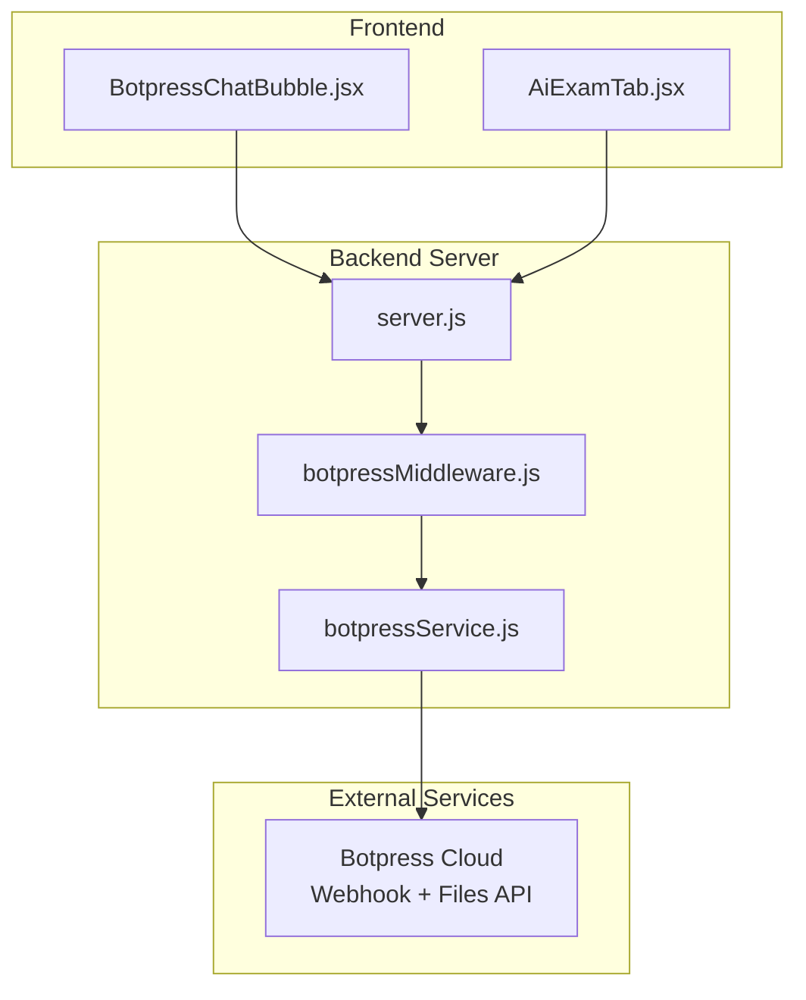
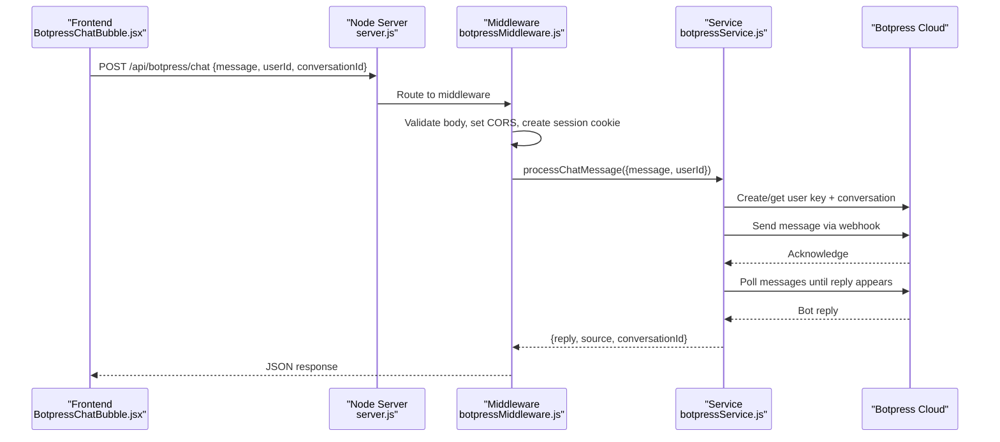
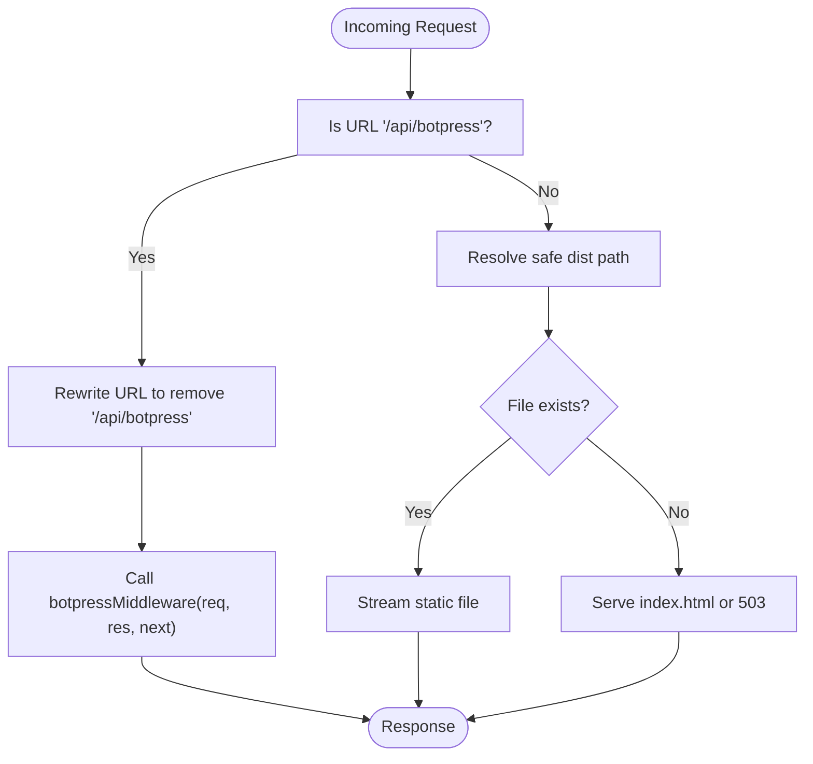
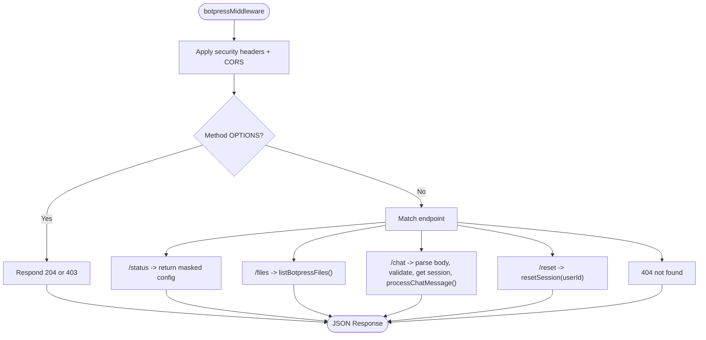
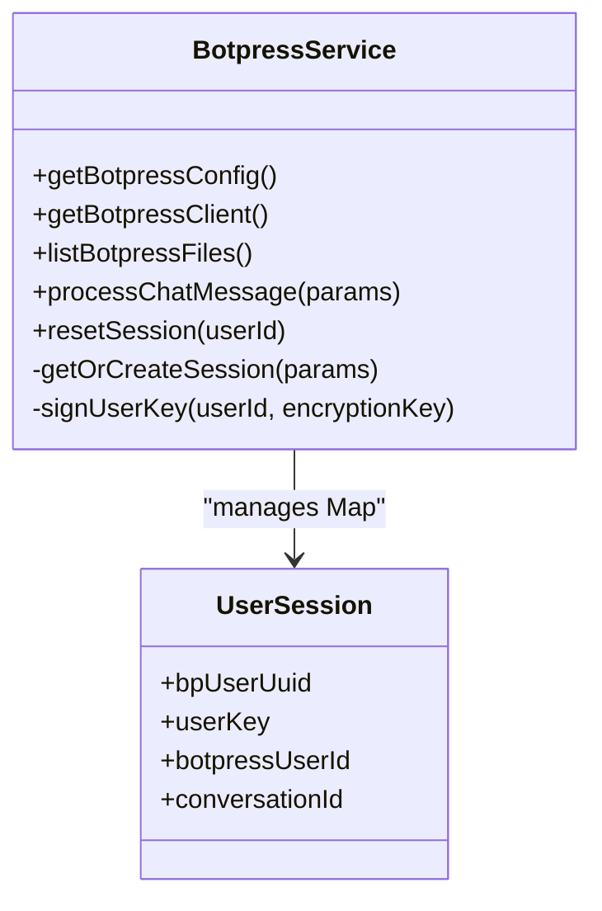
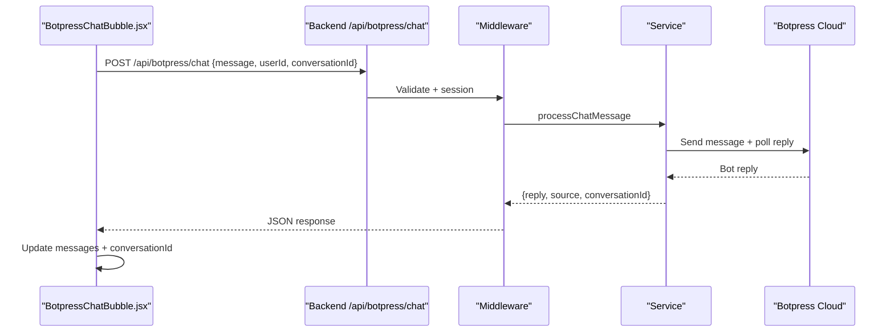
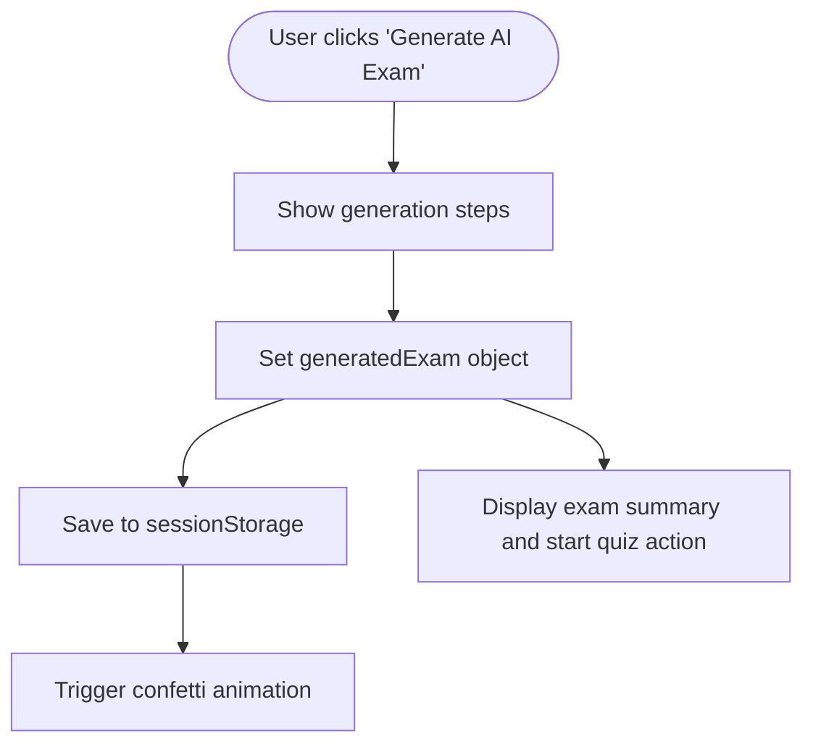
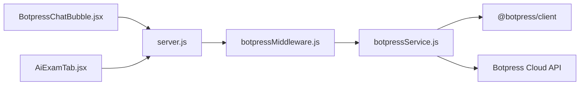

# AI Integration & Botpress

<cite>
**Referenced Files in This Document**
- [server.js](file://server/server.js)
- [botpressMiddleware.js](file://server/botpressMiddleware.js)
- [botpressService.js](file://server/botpressService.js)
- [BotpressChatBubble.jsx](file://src/components/BotpressChatBubble.jsx)
- [AiExamTab.jsx](file://src/components/AiExamTab.jsx)
</cite>

## Table of Contents
1. [Introduction](#introduction)
2. [Project Structure](#project-structure)
3. [Core Components](#core-components)
4. [Architecture Overview](#architecture-overview)
5. [Detailed Component Analysis](#detailed-component-analysis)
6. [Dependency Analysis](#dependency-analysis)
7. [Performance Considerations](#performance-considerations)
8. [Troubleshooting Guide](#troubleshooting-guide)
9. [Conclusion](#conclusion)
10. [Appendices](#appendices)

## Introduction
This document explains how the application integrates AI through a secure Botpress backend, a frontend chat widget, and an AI-powered exam generation experience. It covers:
- Botpress middleware setup and API proxy configuration
- Message routing between the React frontend and the Node.js backend
- Conversation state management with Botpress Cloud
- Security headers, CORS, session cookies, and secret handling
- Custom bot responses and fallback logic
- Rate limiting considerations, debugging strategies, and extension patterns for AI capabilities

The goal is to make the integration understandable for both developers and non-technical users while providing precise references to the source files.

## Project Structure
The AI integration spans three main layers:
- Frontend React components that render the chat UI and AI exam tools
- A lightweight Node.js HTTP server that proxies Botpress API calls
- Backend services that manage configuration, sessions, and Botpress interactions

**Diagram sources**
- [server.js:40-50](file://server/server.js#L40-L50)
- [botpressMiddleware.js:65-132](file://server/botpressMiddleware.js#L65-L132)
- [botpressService.js:89-133](file://server/botpressService.js#L89-L133)
- [BotpressChatBubble.jsx:160-175](file://src/components/BotpressChatBubble.jsx#L160-L175)
- [AiExamTab.jsx:57-86](file://src/components/AiExamTab.jsx#L57-L86)

**Section sources**
- [server.js:1-80](file://server/server.js#L1-L80)
- [botpressMiddleware.js:1-133](file://server/botpressMiddleware.js#L1-L133)
- [botpressService.js:1-333](file://server/botpressService.js#L1-L333)
- [BotpressChatBubble.jsx:1-617](file://src/components/BotpressChatBubble.jsx#L1-L617)
- [AiExamTab.jsx:1-322](file://src/components/AiExamTab.jsx#L1-L322)

## Core Components
- Backend HTTP server: routes `/api/botpress/*` to the Botpress middleware and serves static frontend assets otherwise.
- Botpress middleware: enforces security headers, CORS, input validation, session cookie handling, and endpoint routing for status, files, chat, and reset.
- Botpress service: loads backend-only environment variables, signs user keys, manages conversation sessions, and calls Botpress Cloud APIs or returns fallback responses.
- Frontend chat component: renders a floating mascot, handles message sending, displays formatted bot replies, and exposes admin-only backend diagnostics.
- AI exam tab: provides a simulated AI exam generator and a local AI mentor chat for learning support.

Key responsibilities:
- Security: secrets never reach the browser; only masked values are exposed.
- Sessioning: per-user conversation context is maintained via cookies and Botpress conversation IDs.
- Fallbacks: if Botpress Cloud is unavailable, the backend returns curated educational replies.

**Section sources**
- [server.js:40-50](file://server/server.js#L40-L50)
- [botpressMiddleware.js:65-132](file://server/botpressMiddleware.js#L65-L132)
- [botpressService.js:43-78](file://server/botpressService.js#L43-L78)
- [BotpressChatBubble.jsx:128-175](file://src/components/BotpressChatBubble.jsx#L128-L175)
- [AiExamTab.jsx:16-86](file://src/components/AiExamTab.jsx#L16-L86)

## Architecture Overview
The system uses a secure proxy pattern:
- The React app calls `/api/botpress/chat`, `/api/botpress/files`, `/api/botpress/status`, and `/api/botpress/reset`.
- The Node.js server strips the `/api/botpress` prefix and forwards requests to the middleware.
- The middleware validates inputs, applies security headers, manages sessions, and delegates to the service layer.
- The service layer interacts with Botpress Cloud using signed user keys and webhook endpoints, maintaining conversation context.

**Diagram sources**
- [server.js:40-50](file://server/server.js#L40-L50)
- [botpressMiddleware.js:106-114](file://server/botpressMiddleware.js#L106-L114)
- [botpressService.js:220-332](file://server/botpressService.js#L220-L332)
- [BotpressChatBubble.jsx:314-373](file://src/components/BotpressChatBubble.jsx#L314-L373)

## Detailed Component Analysis

### Backend HTTP Server
Responsibilities:
- Apply global security headers
- Intercept `/api/botpress` paths and forward them to the middleware
- Serve static build assets from `dist`
- Return safe error responses when static assets are missing

Security and routing highlights:
- All requests receive security headers before processing
- `/api/botpress` URLs are rewritten by removing the prefix so the middleware sees clean paths
- Static file serving includes path traversal protection

**Diagram sources**
- [server.js:40-75](file://server/server.js#L40-L75)

**Section sources**
- [server.js:1-80](file://server/server.js#L1-L80)

### Botpress Middleware
Responsibilities:
- Enforce CORS based on allowed origin
- Parse and validate JSON payloads with size limits
- Manage chat session cookies
- Provide endpoints:
  - `/status` or `/api/botpress/status`: return masked configuration
  - `/files` or `/api/botpress/files`: list Botpress files (requires token)
  - `/chat` or `/api/botpress/chat`: send chat messages and get replies
  - `/reset` or `/api/botpress/reset`: reset conversation context

Error handling:
- Returns structured JSON errors with appropriate status codes
- Logs server-side errors above 500

**Diagram sources**
- [botpressMiddleware.js:65-132](file://server/botpressMiddleware.js#L65-L132)

**Section sources**
- [botpressMiddleware.js:1-133](file://server/botpressMiddleware.js#L1-L133)

### Botpress Service
Responsibilities:
- Load backend-only environment variables from `.env.local` and `.env`
- Provide masked configuration for frontend diagnostics
- Sign JWT-like user keys using HMAC-SHA256 with the encryption key
- Manage in-memory user sessions keyed by `userId`
- Interact with Botpress Cloud:
  - Get or create user
  - Create conversation
  - Send message and poll for bot reply
- Provide fallback educational responses when Botpress Cloud is unavailable

Session model:
- Each user has a session containing:
  - Stable Botpress user UUID
  - Signed user key
  - Botpress user ID
  - Active conversation ID

**Diagram sources**
- [botpressService.js:43-78](file://server/botpressService.js#L43-L78)
- [botpressService.js:135-217](file://server/botpressService.js#L135-L217)
- [botpressService.js:220-332](file://server/botpressService.js#L220-L332)

**Section sources**
- [botpressService.js:1-333](file://server/botpressService.js#L1-L333)

### Frontend Chat Component
Responsibilities:
- Render a floating mascot button and chat window
- Display formatted bot messages with inline markdown and lists
- Call backend endpoints securely via `/api/botpress`
- Maintain conversation state locally and persist `conversationId`
- Provide admin-only backend diagnostics and test utilities

Message flow:
- On send, the component posts `{message, userId, conversationId}` to `/api/botpress/chat`
- It updates local state with user and bot messages
- It persists the returned `conversationId` to maintain context across messages

**Diagram sources**
- [BotpressChatBubble.jsx:314-373](file://src/components/BotpressChatBubble.jsx#L314-L373)
- [botpressMiddleware.js:106-114](file://server/botpressMiddleware.js#L106-L114)
- [botpressService.js:220-332](file://server/botpressService.js#L220-L332)

**Section sources**
- [BotpressChatBubble.jsx:1-617](file://src/components/BotpressChatBubble.jsx#L1-L617)

### AI Exam Tab
Responsibilities:
- Simulate AI-driven exam generation with step-by-step progress feedback
- Persist generated exam data in session storage
- Provide a local AI mentor chat with keyword-based educational responses

Note:
- The exam generation here is a frontend simulation; it does not call Botpress or external AI services directly.

**Diagram sources**
- [AiExamTab.jsx:57-86](file://src/components/AiExamTab.jsx#L57-L86)
- [AiExamTab.jsx:25-38](file://src/components/AiExamTab.jsx#L25-L38)

**Section sources**
- [AiExamTab.jsx:1-322](file://src/components/AiExamTab.jsx#L1-L322)

## Dependency Analysis
High-level dependencies:
- `server.js` depends on `botpressMiddleware.js` and `securityHeaders.js`
- `botpressMiddleware.js` depends on `botpressService.js` and `securityHeaders.js`
- `botpressService.js` depends on `@botpress/client` and makes direct HTTP calls to Botpress Cloud
- Frontend components depend on the backend endpoints under `/api/botpress`

**Diagram sources**
- [server.js:1-80](file://server/server.js#L1-L80)
- [botpressMiddleware.js:1-133](file://server/botpressMiddleware.js#L1-L133)
- [botpressService.js:1-333](file://server/botpressService.js#L1-L333)
- [BotpressChatBubble.jsx:160-175](file://src/components/BotpressChatBubble.jsx#L160-L175)
- [AiExamTab.jsx:1-322](file://src/components/AiExamTab.jsx#L1-L322)

**Section sources**
- [server.js:1-80](file://server/server.js#L1-L80)
- [botpressMiddleware.js:1-133](file://server/botpressMiddleware.js#L1-L133)
- [botpressService.js:1-333](file://server/botpressService.js#L1-L333)

## Performance Considerations
- Input size limits:
  - Maximum request body size is enforced to prevent large payloads.
  - Message text is trimmed and truncated to a maximum length.
- Polling strategy:
  - After sending a message, the backend polls Botpress Cloud up to ~26 seconds to retrieve the bot’s reply.
  - This polling loop introduces latency; consider optimizing retry intervals or switching to webhooks if available.
- In-memory session store:
  - Conversations are stored in a Node.js `Map`; this is fast but not persistent across server restarts.
  - For production, consider a persistent store like Redis or a database.
- File listing:
  - The files endpoint may be slow depending on Botpress Cloud; caching results at the backend can reduce repeated calls.
- Frontend rendering:
  - Message formatting parses markdown-like syntax; keep message sizes reasonable to avoid heavy DOM updates.

[No sources needed since this section provides general guidance]

## Troubleshooting Guide
Common issues and resolutions:
- Botpress tokens not configured:
  - The frontend shows masked configuration values indicating whether the backend is configured.
  - Ensure `.env.local` contains valid `BOTPRESS_TOKEN`, `BOTPRESS_BOT_ID`, `BOTPRESS_WEBHOOK_ID`, and `BOTPRESS_ENCRYPTION_KEY`.
- CORS errors:
  - Set `BOTPRESS_ALLOWED_ORIGIN` to match your frontend origin.
  - The middleware sets CORS headers conditionally based on the allowed origin.
- Empty or invalid messages:
  - The middleware rejects empty messages and invalid JSON bodies with clear error responses.
- Botpress Cloud unavailability:
  - The service falls back to curated educational replies; check logs for warnings about API failures.
- Session not resetting:
  - Use the reset endpoint to clear conversation context; ensure the frontend sends the correct `userId`.

Debugging tips:
- Use the admin-only backend diagnostics tab to test the Botpress Files API via the backend.
- Inspect masked configuration values to verify tokens are loaded without exposing secrets.
- Monitor console warnings from the service layer for Botpress API issues.

**Section sources**
- [botpressMiddleware.js:9-36](file://server/botpressMiddleware.js#L9-L36)
- [botpressMiddleware.js:65-132](file://server/botpressMiddleware.js#L65-L132)
- [botpressService.js:43-78](file://server/botpressService.js#L43-L78)
- [botpressService.js:299-332](file://server/botpressService.js#L299-L332)
- [BotpressChatBubble.jsx:178-192](file://src/components/BotpressChatBubble.jsx#L178-L192)
- [BotpressChatBubble.jsx:229-266](file://src/components/BotpressChatBubble.jsx#L229-L266)

## Conclusion
The AI integration combines a secure backend proxy, robust session management, and a friendly frontend chat interface. The system protects secrets, maintains conversation context, and gracefully degrades to educational fallbacks when external services are unavailable. For production hardening, consider adding rate limiting, persistent session storage, webhook-based real-time replies, and comprehensive audit logging.

[No sources needed since this section summarizes without analyzing specific files]

## Appendices

### Configuration Examples
- Backend environment variables:
  - `BOTPRESS_TOKEN`: Botpress API token
  - `BOTPRESS_BOT_ID`: Bot identifier
  - `BOTPRESS_WEBHOOK_ID`: Webhook endpoint base
  - `BOTPRESS_ENCRYPTION_KEY`: Key for signing user keys
  - `BOTPRESS_ALLOWED_ORIGIN`: Allowed frontend origin for CORS
- Frontend usage:
  - Calls `/api/botpress/chat`, `/api/botpress/files`, `/api/botpress/status`, `/api/botpress/reset`
  - Displays masked configuration values for diagnostics

**Section sources**
- [botpressService.js:43-78](file://server/botpressService.js#L43-L78)
- [BotpressChatBubble.jsx:178-192](file://src/components/BotpressChatBubble.jsx#L178-L192)

### Custom Bot Responses and Extension Patterns
- Fallback responses:
  - Keyword-based replies for Python, SQL, network topics, and exam structure.
- Extending AI capabilities:
  - Add new keyword branches in the fallback logic for additional subjects.
  - Integrate additional LLM providers behind the service layer while keeping secrets server-side.
  - Implement caching for frequent queries and add analytics for message volume.

**Section sources**
- [botpressService.js:299-332](file://server/botpressService.js#L299-L332)

### Rate Limiting Recommendations
- Enforce per-IP or per-session request limits at the middleware level.
- Add exponential backoff for retries when calling Botpress Cloud.
- Cache frequent read operations (e.g., files list) with TTL.
- Monitor and alert on high error rates or slow responses.

[No sources needed since this section provides general guidance]

### Conversation State Management
- Cookie-based session ID:
  - A secure, HttpOnly cookie stores a unique session identifier.
- Botpress conversation ID:
  - Maintained per user to preserve context across messages.
- Reset behavior:
  - Closing the chat or explicitly resetting clears the conversation context.

**Section sources**
- [botpressMiddleware.js:38-52](file://server/botpressMiddleware.js#L38-L52)
- [botpressService.js:135-217](file://server/botpressService.js#L135-L217)
- [BotpressChatBubble.jsx:268-311](file://src/components/BotpressChatBubble.jsx#L268-L311)

### Security Considerations for AI Interactions
- Secrets handling:
  - Tokens and keys are loaded only on the backend; frontend receives masked values.
- CORS policy:
  - Only allow specified origins; reject unauthorized preflight requests.
- Input validation:
  - Enforce payload size and content type; sanitize message text.
- Session security:
  - Use HttpOnly, SameSite, and Secure flags for cookies in production.
- Error exposure:
  - Avoid leaking stack traces or internal details to clients.

**Section sources**
- [botpressService.js:11-40](file://server/botpressService.js#L11-L40)
- [botpressMiddleware.js:65-87](file://server/botpressMiddleware.js#L65-L87)
- [botpressMiddleware.js:38-52](file://server/botpressMiddleware.js#L38-L52)
- [botpressMiddleware.js:125-131](file://server/botpressMiddleware.js#L125-L131)