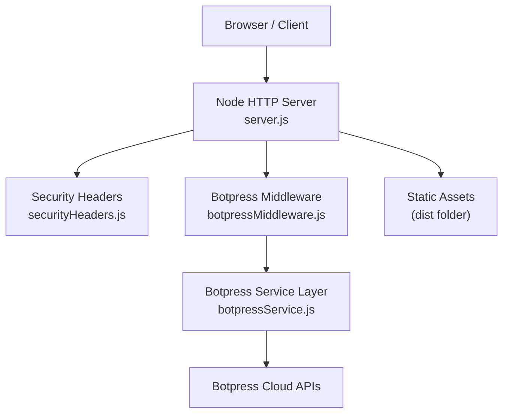
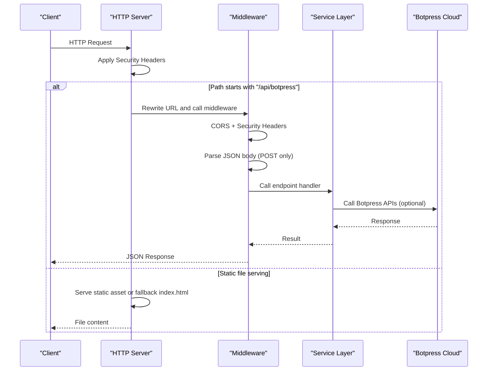
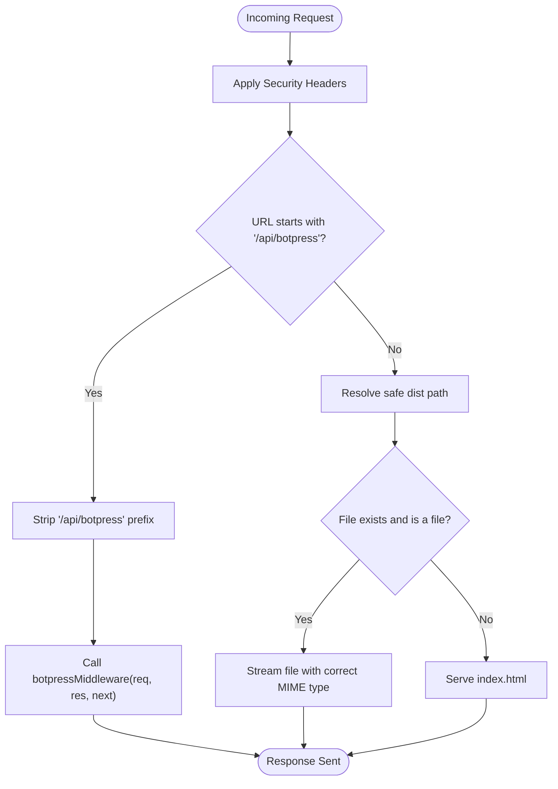
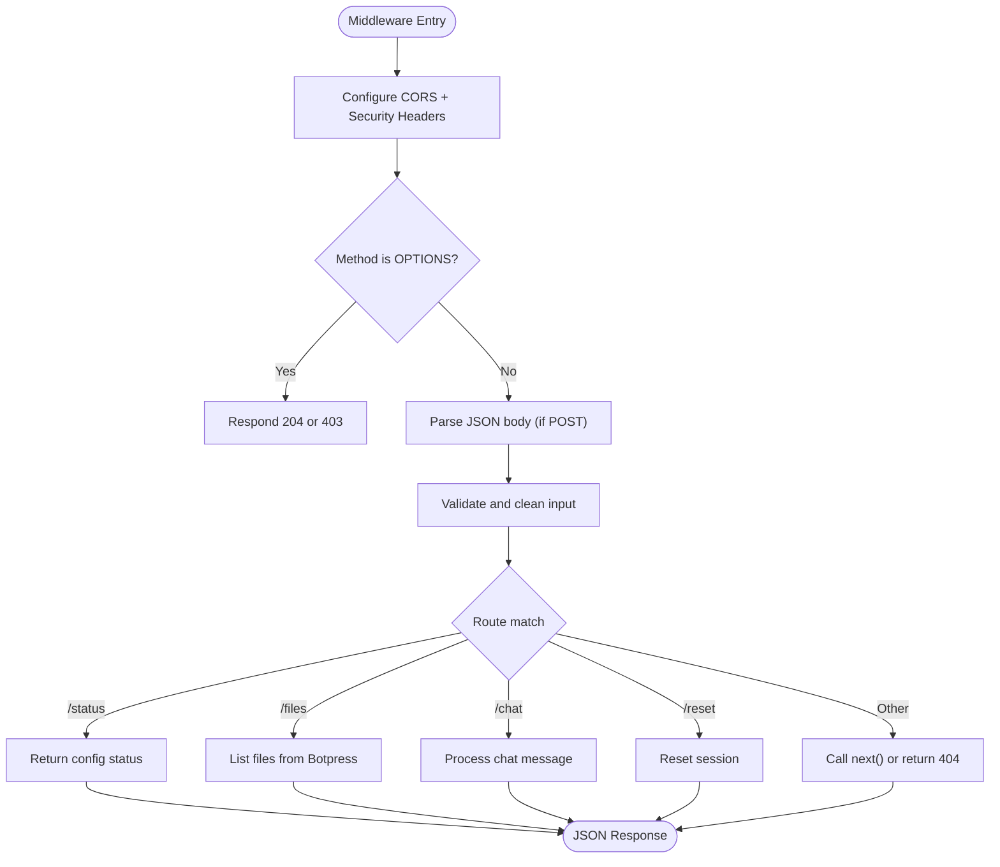
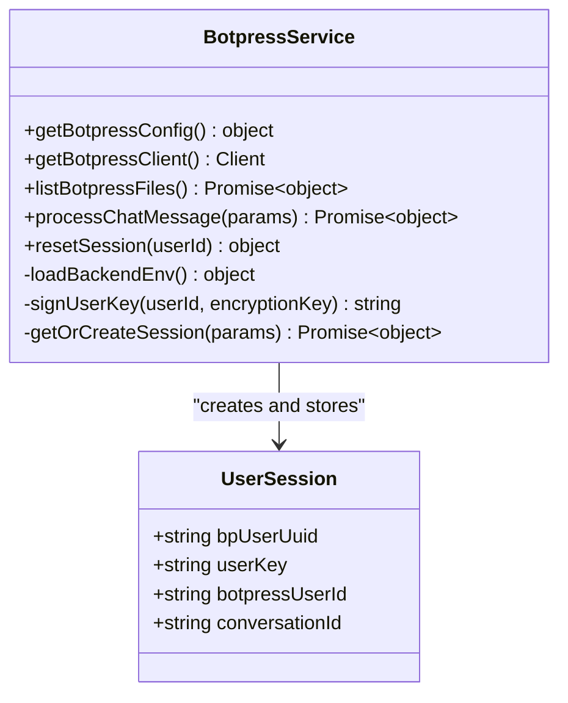
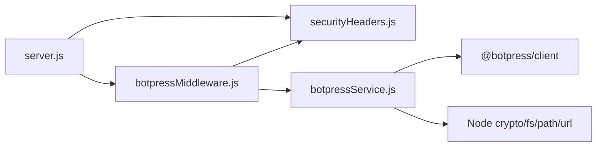

# Botpress Middleware & API Proxy

<cite>
**Referenced Files in This Document**
- [server.js](file://server/server.js)
- [botpressMiddleware.js](file://server/botpressMiddleware.js)
- [botpressService.js](file://server/botpressService.js)
- [securityHeaders.js](file://server/securityHeaders.js)
</cite>

## Table of Contents
1. [Introduction](#introduction)
2. [Project Structure](#project-structure)
3. [Core Components](#core-components)
4. [Architecture Overview](#architecture-overview)
5. [Detailed Component Analysis](#detailed-component-analysis)
6. [Dependency Analysis](#dependency-analysis)
7. [Performance Considerations](#performance-considerations)
8. [Troubleshooting Guide](#troubleshooting-guide)
9. [Conclusion](#conclusion)

## Introduction
This document explains the Node.js backend that proxies requests to Botpress Cloud, manages chat sessions via cookies, and serves static frontend assets. It covers:
- Middleware architecture for routing `/status`, `/files`, `/chat`, and `/reset`
- Request body parsing with strict size limits and JSON validation
- Session cookie management for per-user chat context
- CORS configuration and security headers
- Error handling patterns and response formatting
- Production deployment considerations

## Project Structure
The backend is a small HTTP server built on Node’s `http` module. It delegates API logic to a middleware layer and uses a service layer to interact with Botpress Cloud. Security headers are applied globally.

**Diagram sources**
- [server.js:40-75](file://server/server.js#L40-L75)
- [botpressMiddleware.js:65-132](file://server/botpressMiddleware.js#L65-L132)
- [botpressService.js:88-133](file://server/botpressService.js#L88-L133)
- [securityHeaders.js:14-29](file://server/securityHeaders.js#L14-L29)

**Section sources**
- [server.js:1-80](file://server/server.js#L1-L80)
- [botpressMiddleware.js:1-133](file://server/botpressMiddleware.js#L1-L133)
- [botpressService.js:1-333](file://server/botpressService.js#L1-L333)
- [securityHeaders.js:1-30](file://server/securityHeaders.js#L1-L30)

## Core Components
- HTTP server entrypoint: routes `/api/botpress/*` to the middleware and serves static files otherwise.
- Middleware: parses JSON bodies, validates inputs, sets CORS, applies security headers, and dispatches endpoints.
- Service layer: loads environment variables, signs user keys, interacts with Botpress Cloud, and maintains in-memory session state.
- Security headers: enforces CSP, HSTS, frame options, referrer policy, and permissions policy.

Key responsibilities:
- Body parsing with size limit and JSON validation
- Cookie-based session ID generation and validation
- Endpoint handlers for status, files, chat, reset
- CORS preflight handling and origin allowlist
- Consistent JSON responses and error mapping

**Section sources**
- [server.js:40-75](file://server/server.js#L40-L75)
- [botpressMiddleware.js:9-63](file://server/botpressMiddleware.js#L9-L63)
- [botpressService.js:12-78](file://server/botpressService.js#L12-L78)
- [securityHeaders.js:14-29](file://server/securityHeaders.js#L14-L29)

## Architecture Overview
The request flow is:
1. The HTTP server applies security headers to every response.
2. Requests starting with `/api/botpress` are rewritten and passed to the middleware.
3. The middleware handles CORS, parses the body (for POST), validates input, and routes to endpoint handlers.
4. For `/chat`, the service layer creates or reuses a session, signs a user key, and calls Botpress Cloud APIs.
5. Responses are returned as JSON with consistent headers.

**Diagram sources**
- [server.js:40-75](file://server/server.js#L40-L75)
- [botpressMiddleware.js:65-132](file://server/botpressMiddleware.js#L65-L132)
- [botpressService.js:219-332](file://server/botpressService.js#L219-L332)

## Detailed Component Analysis

### HTTP Server and Routing
- Applies security headers to all responses.
- Rewrites `/api/botpress*` paths by stripping the prefix before invoking the middleware.
- Serves static assets from the `dist` directory with safe path resolution to prevent directory traversal.
- Falls back to `index.html` for SPA routing and returns a 503 when the build is not ready.

**Diagram sources**
- [server.js:40-75](file://server/server.js#L40-L75)

**Section sources**
- [server.js:10-38](file://server/server.js#L10-L38)
- [server.js:40-75](file://server/server.js#L40-L75)

### Middleware: Request Processing and Routing
Responsibilities:
- Enforce CORS based on `BOTPRESS_ALLOWED_ORIGIN`.
- Handle OPTIONS preflight requests.
- Parse JSON bodies with a maximum size limit and validate JSON syntax.
- Validate and sanitize message input.
- Manage session cookies for chat context.
- Route to endpoint handlers: `/status`, `/files`, `/chat`, `/reset`.
- Normalize errors into JSON responses with appropriate status codes.

Body parsing:
- Accumulates chunks up to a maximum byte limit; rejects oversized payloads with a 413 status.
- Parses accumulated data as JSON; invalid JSON results in a 400 status.

Session cookie:
- Reads an existing valid UUID cookie; if missing or invalid, generates a new one.
- Sets `Set-Cookie` with `HttpOnly`, `SameSite=Lax`, `Path=/`, and `Max-Age=86400`.
- Adds `Secure` flag in production environments.

CORS:
- Allows GET, POST, OPTIONS methods.
- Allows `Content-Type` header.
- Reflects allowed origin only when it matches the configured value.

Endpoints:
- `/status`: Returns configuration metadata with masked secrets.
- `/files`: Lists files from Botpress Cloud (requires token and botId).
- `/chat`: Accepts a message, persists session, and forwards to Botpress Cloud.
- `/reset`: Resets the current chat session.

Error handling:
- Centralized try/catch maps internal errors to JSON responses.
- Logs server errors while returning sanitized messages to clients.

**Diagram sources**
- [botpressMiddleware.js:9-63](file://server/botpressMiddleware.js#L9-L63)
- [botpressMiddleware.js:65-132](file://server/botpressMiddleware.js#L65-L132)

**Section sources**
- [botpressMiddleware.js:5-63](file://server/botpressMiddleware.js#L5-L63)
- [botpressMiddleware.js:65-132](file://server/botpressMiddleware.js#L65-L132)

### Service Layer: Botpress Integration and Sessions
Responsibilities:
- Load environment variables from `.env.local`, `.evn.local`, and `.env`.
- Provide configuration values and mask sensitive parts for diagnostics.
- Create a Botpress client when tokens are available.
- Sign a JWT-like user key using HMAC-SHA256 with the encryption key.
- Manage in-memory user sessions keyed by userId.
- Interact with Botpress Cloud endpoints for users, conversations, and messages.
- Provide fallback responses when Botpress Cloud is unavailable.

Session management:
- Maintains a Map of userId to session objects containing Botpress identifiers and conversationId.
- Ensures stable user UUIDs and preserves conversationId across messages within a session.
- Supports forced session reset.

Chat processing:
- Creates or retrieves a session, sends a message to Botpress Cloud, and polls for the bot’s reply.
- If polling does not yield a reply within a timeout window, returns a fallback response.

Files listing:
- Uses the Botpress client if available; otherwise falls back to direct HTTP calls.
- Normalizes responses and wraps errors with a structured status.

**Diagram sources**
- [botpressService.js:12-78](file://server/botpressService.js#L12-L78)
- [botpressService.js:135-217](file://server/botpressService.js#L135-L217)
- [botpressService.js:219-332](file://server/botpressService.js#L219-L332)

**Section sources**
- [botpressService.js:12-78](file://server/botpressService.js#L12-L78)
- [botpressService.js:88-133](file://server/botpressService.js#L88-L133)
- [botpressService.js:135-217](file://server/botpressService.js#L135-L217)
- [botpressService.js:219-332](file://server/botpressService.js#L219-L332)

### Security Headers
Global headers include:
- Content Security Policy with controlled script, style, image, connect, and frame sources.
- X-Content-Type-Options set to nosniff.
- X-Frame-Options set to SAMEORIGIN.
- Referrer-Policy set to strict-origin-when-cross-origin.
- Permissions-Policy disabling potentially risky features.
- Strict-Transport-Security enabled when HTTPS is detected or running in production.

These headers are applied to every response, including API responses and error pages.

**Section sources**
- [securityHeaders.js:1-30](file://server/securityHeaders.js#L1-L30)

## Dependency Analysis
High-level dependencies:
- server.js depends on botpressMiddleware.js and securityHeaders.js.
- botpressMiddleware.js depends on botpressService.js and securityHeaders.js.
- botpressService.js depends on @botpress/client and Node’s crypto, fs, path, and url modules.
- All components rely on environment variables for configuration.

**Diagram sources**
- [server.js:1-6](file://server/server.js#L1-L6)
- [botpressMiddleware.js:1-3](file://server/botpressMiddleware.js#L1-L3)
- [botpressService.js:1-5](file://server/botpressService.js#L1-L5)

**Section sources**
- [server.js:1-6](file://server/server.js#L1-L6)
- [botpressMiddleware.js:1-3](file://server/botpressMiddleware.js#L1-L3)
- [botpressService.js:1-5](file://server/botpressService.js#L1-L5)

## Performance Considerations
- Body parsing accumulates raw bytes; keep MAX_BODY_BYTES conservative to avoid memory spikes.
- Message length is trimmed to MAX_MESSAGE_CHARS to reduce payload size and downstream processing.
- In-memory session map provides fast lookups but does not persist across process restarts.
- Polling for Botpress replies introduces latency; consider optimizing poll intervals or using webhooks if supported.
- Static file streaming avoids loading entire files into memory.

[No sources needed since this section provides general guidance]

## Troubleshooting Guide
Common issues and resolutions:
- Oversized payloads: Ensure client requests stay under the configured body size limit.
- Invalid JSON: Verify Content-Type and payload structure before sending.
- Missing Botpress configuration: Set BOTPRESS_TOKEN, BOTPRESS_BOT_ID, BOTPRESS_WEBHOOK_ID, and BOTPRESS_ENCRYPTION_KEY in environment files.
- CORS failures: Configure BOTPRESS_ALLOWED_ORIGIN to match the browser origin.
- Session not resetting: Use the `/reset` endpoint to clear the in-memory session for the current userId.
- Build not ready: Ensure the static build exists in the dist directory; otherwise, the server returns a 503.

**Section sources**
- [botpressMiddleware.js:9-36](file://server/botpressMiddleware.js#L9-L36)
- [botpressMiddleware.js:44-52](file://server/botpressMiddleware.js#L44-L52)
- [botpressMiddleware.js:65-132](file://server/botpressMiddleware.js#L65-L132)
- [botpressService.js:12-40](file://server/botpressService.js#L12-L40)
- [server.js:52-75](file://server/server.js#L52-L75)

## Conclusion
The backend provides a secure, minimal proxy for Botpress Cloud with robust middleware for request handling, session management, and security headers. It supports essential endpoints for status checks, file listings, chat interactions, and session resets. For production, ensure proper environment configuration, restrict CORS origins, enable HTTPS, and monitor logs for errors.

[No sources needed since this section summarizes without analyzing specific files]