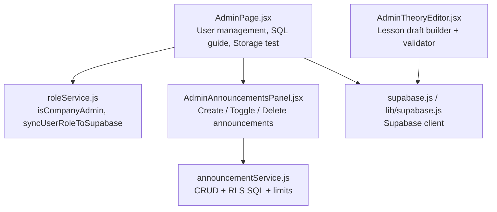
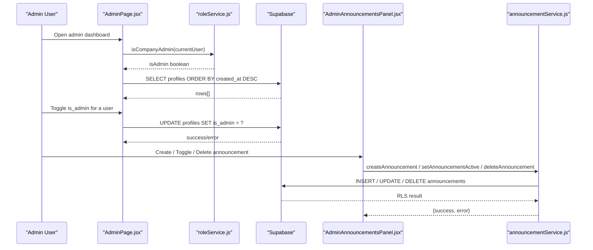
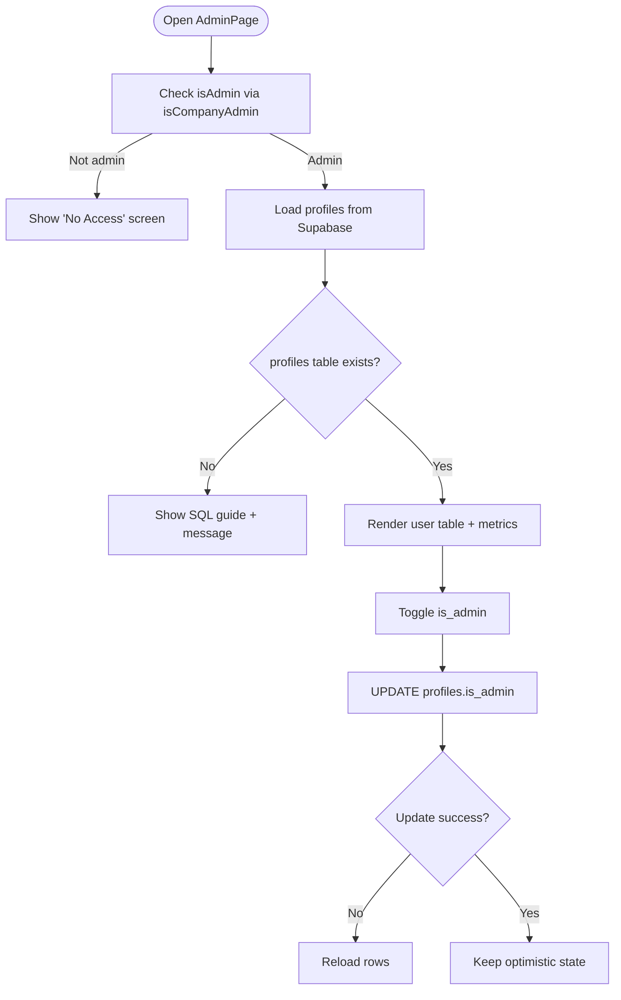
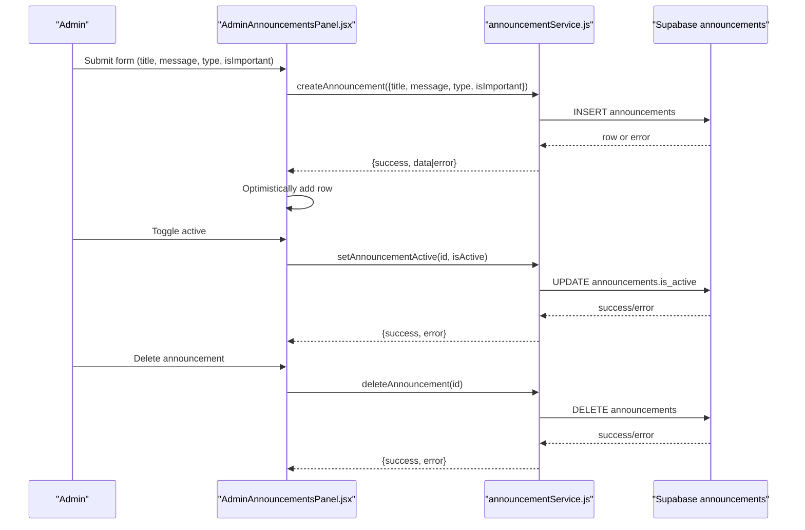
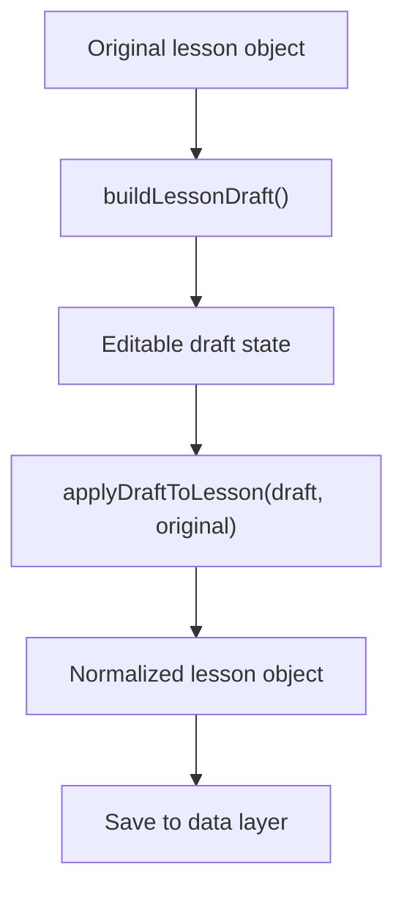
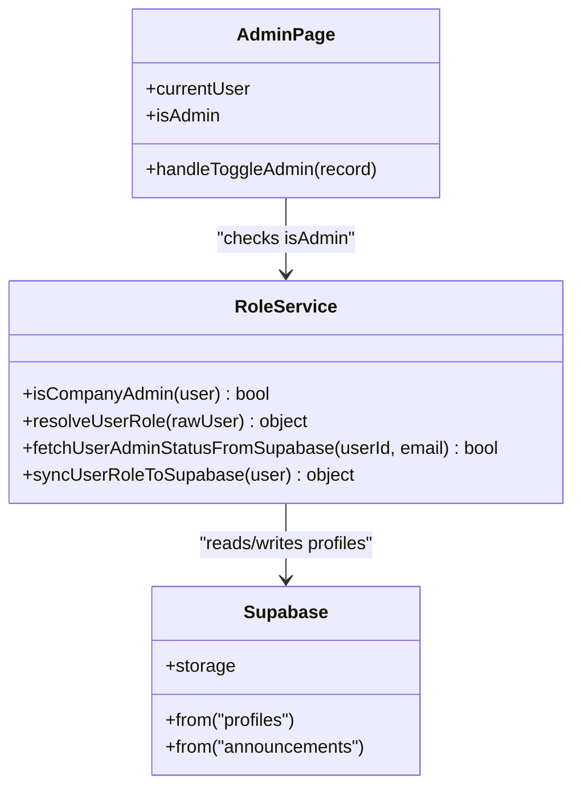
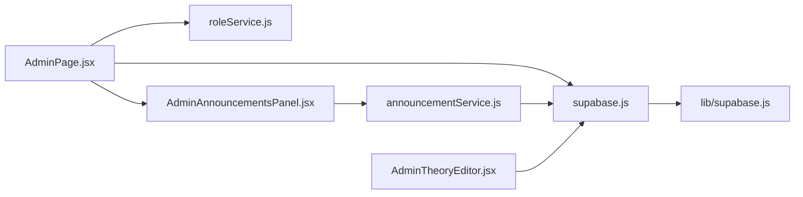

# Admin Panel & Content Management

<cite>
**Referenced Files in This Document**
- [AdminPage.jsx](file://src/components/AdminPage.jsx)
- [AdminAnnouncementsPanel.jsx](file://src/components/AdminAnnouncementsPanel.jsx)
- [AdminTheoryEditor.jsx](file://src/components/AdminTheoryEditor.jsx)
- [roleService.js](file://src/lib/roleService.js)
- [announcementService.js](file://src/lib/announcementService.js)
- [supabase.js](file://src/supabase.js)
- [lib/supabase.js](file://lib/supabase.js)
</cite>

## Table of Contents
1. [Introduction](#introduction)
2. [Project Structure](#project-structure)
3. [Core Components](#core-components)
4. [Architecture Overview](#architecture-overview)
5. [Detailed Component Analysis](#detailed-component-analysis)
6. [Dependency Analysis](#dependency-analysis)
7. [Performance Considerations](#performance-considerations)
8. [Security and Audit Considerations](#security-and-audit-considerations)
9. [Troubleshooting Guide](#troubleshooting-guide)
10. [Conclusion](#conclusion)

## Introduction
This document explains the admin panel and content management system for the application. It covers:
- Administrative interfaces for user management, announcement publishing, theory content editing, and basic system monitoring.
- Role-based access control using Supabase profiles and Row Level Security.
- Announcement lifecycle, including creation, activation, dismissal by learners, and deletion.
- Theory editor structure, validation rules, and how drafts are converted into lesson data.
- Integration with the main application’s data layer through Supabase.
- Security considerations, error handling, and operational guidance for administrators.

The system is primarily frontend-driven: React components call Supabase directly from the browser. Authorization is enforced both on the client (UI gating) and on the database (RLS policies).

## Project Structure
The admin and content management features live under `src/components` and `src/lib`:
- `src/components/AdminPage.jsx` is the central admin dashboard for user profiles, role toggling, SQL setup guidance, storage policy testing, and embedding the announcements panel.
- `src/components/AdminAnnouncementsPanel.jsx` provides the announcement authoring and management UI.
- `src/components/AdminTheoryEditor.jsx` provides a structured editor for theory lessons, objectives, content sections, exam tips, code snippets, and quiz questions.
- `src/lib/roleService.js` contains role helpers and Supabase profile synchronization logic.
- `src/lib/announcementService.js` defines announcement schema SQL, limits, types, and CRUD operations.
- `src/supabase.js` re-exports the Supabase client configured in `lib/supabase.js`.

**Diagram sources**
- [AdminPage.jsx:24-97](file://src/components/AdminPage.jsx#L24-L97)
- [AdminAnnouncementsPanel.jsx:49-116](file://src/components/AdminAnnouncementsPanel.jsx#L49-L116)
- [AdminTheoryEditor.jsx:30-111](file://src/components/AdminTheoryEditor.jsx#L30-L111)
- [roleService.js:8-28](file://src/lib/roleService.js#L8-L28)
- [announcementService.js:9-63](file://src/lib/announcementService.js#L9-L63)
- [supabase.js:1-2](file://src/supabase.js#L1-L2)
- [lib/supabase.js:1-14](file://lib/supabase.js#L1-L14)

**Section sources**
- [AdminPage.jsx:24-97](file://src/components/AdminPage.jsx#L24-L97)
- [AdminAnnouncementsPanel.jsx:49-116](file://src/components/AdminAnnouncementsPanel.jsx#L49-L116)
- [AdminTheoryEditor.jsx:30-111](file://src/components/AdminTheoryEditor.jsx#L30-L111)
- [roleService.js:8-28](file://src/lib/roleService.js#L8-L28)
- [announcementService.js:9-63](file://src/lib/announcementService.js#L9-L63)
- [supabase.js:1-2](file://src/supabase.js#L1-L2)
- [lib/supabase.js:1-14](file://lib/supabase.js#L1-L14)

## Core Components
- Admin dashboard (`AdminPage.jsx`)
  - Loads user profiles from Supabase `profiles`.
  - Shows total profiles, admin count, and standard learner count.
  - Allows toggling `is_admin` per user.
  - Provides SQL to create `profiles`, sync users, enable RLS, and grant storage write permissions.
  - Includes a storage write diagnostic button that calls `testRoadmapStorageWrite`.
  - Embeds the announcements panel for system-wide messaging.
- Announcements panel (`AdminAnnouncementsPanel.jsx`)
  - Lists all announcements, supports creating new ones, toggling active state, and deleting.
  - Uses `ANNOUNCEMENT_TYPES`, `ANNOUNCEMENT_LIMITS`, and `ANNOUNCEMENTS_SQL`.
  - Detects missing schema and shows SQL to create the `announcements` table.
- Theory editor (`AdminTheoryEditor.jsx`)
  - Builds a draft from an existing lesson object.
  - Validates and normalizes objectives, content sections, exam tips, code snippets, and quiz options.
  - Emits a normalized lesson object suitable for saving back to the data layer.
- Role service (`roleService.js`)
  - Determines whether a user is admin based on `isAdmin` or `is_admin`.
  - Resolves user roles and synchronizes new users into `profiles` with default non-admin status.
- Announcement service (`announcementService.js`)
  - Defines allowed announcement types and length limits.
  - Exposes functions to fetch active announcements, list all announcements, create, toggle, and delete announcements.
  - Encapsulates RLS-related SQL and error descriptions.
- Supabase client (`src/supabase.js`, `lib/supabase.js`)
  - Creates the Supabase client using environment variables or fallback values.

**Section sources**
- [AdminPage.jsx:24-97](file://src/components/AdminPage.jsx#L24-L97)
- [AdminAnnouncementsPanel.jsx:49-116](file://src/components/AdminAnnouncementsPanel.jsx#L49-L116)
- [AdminTheoryEditor.jsx:30-111](file://src/components/AdminTheoryEditor.jsx#L30-L111)
- [roleService.js:8-28](file://src/lib/roleService.js#L8-L28)
- [announcementService.js:9-63](file://src/lib/announcementService.js#L9-L63)
- [supabase.js:1-2](file://src/supabase.js#L1-L2)
- [lib/supabase.js:1-14](file://lib/supabase.js#L1-L14)

## Architecture Overview
The admin panel is a React-based interface that interacts directly with Supabase. The flow generally follows:
1. Client loads admin page and checks admin status via `isCompanyAdmin`.
2. Admin actions update local state immediately, then persist changes to Supabase.
3. Database-level RLS policies enforce who can read/write each table.
4. Announcements are visible to all learners when active; learners can dismiss them locally.
5. Theory editor transforms rich lesson drafts into normalized structures before saving.

**Diagram sources**
- [AdminPage.jsx:48-128](file://src/components/AdminPage.jsx#L48-L128)
- [roleService.js:8-11](file://src/lib/roleService.js#L8-L11)
- [AdminAnnouncementsPanel.jsx:74-110](file://src/components/AdminAnnouncementsPanel.jsx#L74-L110)
- [announcementService.js:118-147](file://src/lib/announcementService.js#L118-L147)

## Detailed Component Analysis

### Admin Dashboard: User Management and System Monitoring
Responsibilities:
- Load and display profiles from Supabase.
- Filter and search by userid, username, email.
- Show metrics: total profiles, admins, standard learners.
- Toggle admin rights per user.
- Provide SQL for schema setup, user sync, RLS, and storage policy.
- Test storage write permissions.
- Embed announcements panel.

Key behaviors:
- Early guard: if not admin, show “No Access” screen.
- Error handling for missing `profiles` table returns a helpful message and SQL guide.
- Immediate optimistic UI update for `is_admin`, followed by Supabase update; on failure, reload rows.
- Storage test uses `testRoadmapStorageWrite` to validate bucket write policy.

**Diagram sources**
- [AdminPage.jsx:48-128](file://src/components/AdminPage.jsx#L48-L128)
- [AdminPage.jsx:130-261](file://src/components/AdminPage.jsx#L130-L261)
- [AdminPage.jsx:269-276](file://src/components/AdminPage.jsx#L269-L276)

**Section sources**
- [AdminPage.jsx:24-128](file://src/components/AdminPage.jsx#L24-L128)
- [AdminPage.jsx:130-261](file://src/components/AdminPage.jsx#L130-L261)
- [AdminPage.jsx:269-276](file://src/components/AdminPage.jsx#L269-L276)
- [AdminPage.jsx:801-911](file://src/components/AdminPage.jsx#L801-L911)

### Announcements Panel: Publishing and Lifecycle
Responsibilities:
- List all announcements.
- Create new announcements with title, message, type, and important flag.
- Toggle active/inactive.
- Delete announcements.
- Detect missing schema and provide SQL to create `announcements`.
- Respect announcement type enum and length limits.

Data model and constraints:
- Types: info, success, important, event.
- Title length limit: 80 characters.
- Message length limit: 400 characters.
- `is_important` enables prominent display.
- `is_active` controls visibility to learners.

**Diagram sources**
- [AdminAnnouncementsPanel.jsx:74-110](file://src/components/AdminAnnouncementsPanel.jsx#L74-L110)
- [announcementService.js:118-147](file://src/lib/announcementService.js#L118-L147)

Validation and error handling:
- Missing schema errors map to a friendly message prompting SQL execution.
- RLS permission errors are described as needing admin login.
- Local dismissal of announcements is stored in `localStorage` under a dedicated key.

**Section sources**
- [AdminAnnouncementsPanel.jsx:49-116](file://src/components/AdminAnnouncementsPanel.jsx#L49-L116)
- [announcementService.js:9-63](file://src/lib/announcementService.js#L9-L63)
- [announcementService.js:65-75](file://src/lib/announcementService.js#L65-L75)
- [announcementService.js:118-147](file://src/lib/announcementService.js#L118-L147)
- [announcementService.js:151-168](file://src/lib/announcementService.js#L151-L168)

### Theory Editor: Lesson Draft Builder and Validator
Responsibilities:
- Convert an existing lesson into a draft structure.
- Allow editing:
  - General info: title, book reference, exam format, summary.
  - Objectives: newline-separated lines.
  - Content sections: heading, text, bullet points.
  - Exam tips.
  - Code snippet: optional title and code block.
  - Quiz: question, multiple-choice options, correct answer index, explanation.
- Normalize and validate draft before saving.

Draft transformation:
- `buildLessonDraft` flattens nested theory and quiz fields into editable arrays and primitives.
- `applyDraftToLesson` trims strings, filters empty items, clamps quiz answer index, and conditionally includes optional fields only when provided.

**Diagram sources**
- [AdminTheoryEditor.jsx:30-62](file://src/components/AdminTheoryEditor.jsx#L30-L62)
- [AdminTheoryEditor.jsx:64-111](file://src/components/AdminTheoryEditor.jsx#L64-L111)

Validation rules:
- Objectives: array of non-empty trimmed lines.
- Content sections: at least one of heading, text, or bullet points must exist; empty sections are filtered out.
- Code snippet: included only if title or code is present.
- Quiz: question and options are trimmed; options are filtered to non-empty; answer index is clamped to valid range.

**Section sources**
- [AdminTheoryEditor.jsx:30-111](file://src/components/AdminTheoryEditor.jsx#L30-L111)
- [AdminTheoryEditor.jsx:174-200](file://src/components/AdminTheoryEditor.jsx#L174-L200)

### Role-Based Access Control
Access decisions:
- Client-side: `isCompanyAdmin` checks `isAdmin` or `is_admin` on the current user object.
- Server-side: Supabase RLS policies restrict reads/writes to `profiles`, `announcements`, and storage buckets.

Profile synchronization:
- On login, `syncUserRoleToSupabase` ensures the user exists in `profiles`; new users get `is_admin = false`.
- Existing users retain their current `is_admin` value.

**Diagram sources**
- [roleService.js:8-28](file://src/lib/roleService.js#L8-L28)
- [roleService.js:33-52](file://src/lib/roleService.js#L33-L52)
- [roleService.js:59-100](file://src/lib/roleService.js#L59-L100)
- [AdminPage.jsx:48-128](file://src/components/AdminPage.jsx#L48-L128)

**Section sources**
- [roleService.js:8-28](file://src/lib/roleService.js#L8-L28)
- [roleService.js:33-52](file://src/lib/roleService.js#L33-L52)
- [roleService.js:59-100](file://src/lib/roleService.js#L59-L100)
- [AdminPage.jsx:48-128](file://src/components/AdminPage.jsx#L48-L128)

## Dependency Analysis
High-level dependencies:
- `AdminPage.jsx` depends on:
  - `roleService.js` for admin check.
  - `supabase.js` for database queries.
  - `AdminAnnouncementsPanel.jsx` for announcements UI.
- `AdminAnnouncementsPanel.jsx` depends on:
  - `announcementService.js` for CRUD and constants.
  - `supabase.js` indirectly via the service.
- `AdminTheoryEditor.jsx` is self-contained for drafting/validation but integrates with the parent component’s save handler and ultimately the data layer.
- `announcementService.js` depends on `supabase.js` for all database operations.
- `lib/supabase.js` configures the Supabase client used throughout.

**Diagram sources**
- [AdminPage.jsx:1-23](file://src/components/AdminPage.jsx#L1-L23)
- [AdminAnnouncementsPanel.jsx:1-11](file://src/components/AdminAnnouncementsPanel.jsx#L1-L11)
- [AdminTheoryEditor.jsx:1-14](file://src/components/AdminTheoryEditor.jsx#L1-L14)
- [announcementService.js:1](file://src/lib/announcementService.js#L1)
- [supabase.js:1-2](file://src/supabase.js#L1-L2)
- [lib/supabase.js:1-14](file://lib/supabase.js#L1-L14)

**Section sources**
- [AdminPage.jsx:1-23](file://src/components/AdminPage.jsx#L1-L23)
- [AdminAnnouncementsPanel.jsx:1-11](file://src/components/AdminAnnouncementsPanel.jsx#L1-L11)
- [AdminTheoryEditor.jsx:1-14](file://src/components/AdminTheoryEditor.jsx#L1-L14)
- [announcementService.js:1](file://src/lib/announcementService.js#L1)
- [supabase.js:1-2](file://src/supabase.js#L1-L2)
- [lib/supabase.js:1-14](file://lib/supabase.js#L1-L14)

## Performance Considerations
- Profile loading: The admin dashboard loads all profiles and performs client-side filtering. For large user bases, consider server-side pagination and search to reduce payload size.
- Announcements listing: The service fetches all announcements for admin view; caching or incremental refresh may be beneficial.
- Optimistic UI: Both admin role toggling and announcement updates use optimistic state changes to improve perceived performance, with rollback on failure.
- Storage diagnostics: The storage write test triggers a real write operation; avoid frequent polling.

[No sources needed since this section provides general guidance]

## Security and Audit Considerations
Client-side authorization:
- Admin-only screens gate access early using `isCompanyAdmin`.
- Non-admin users see a locked-out screen instead of partial functionality.

Database-level security:
- `profiles` table uses RLS policies:
  - Users can select their own profile; admins can select all.
  - Insert allows creating only self-profiles and prevents self-promotion.
  - Update requires admin status.
- `announcements` table uses RLS policies:
  - Everyone can select active announcements; admins can select all.
  - Insert/update/delete require admin status.
- Storage policies:
  - Admins can insert/update/delete/read objects in the specified bucket.
  - Public read policy allows learners to access materials when needed.

Content validation:
- Announcement title and message lengths are enforced.
- Announcement type is restricted to a known enum.
- Theory editor trims and filters empty content, clamps quiz answer indices, and avoids writing empty optional fields.

Audit logging:
- No explicit audit log table or middleware is present in the analyzed files.
- Recommended enhancements:
  - Add an audit log table recording actor, action, target record, timestamp, and IP/session context where available.
  - Log failed admin operations and RLS denials at the application level.
  - Retain logs securely and restrict access.

Operational notes:
- SQL scripts embedded in the UI should be reviewed before running in production.
- Avoid hardcoding admin emails in long-term deployments; prefer configuration or secure provisioning.
- Ensure Supabase project settings and RLS policies match the intended security model.

**Section sources**
- [AdminPage.jsx:48-128](file://src/components/AdminPage.jsx#L48-L128)
- [AdminPage.jsx:130-261](file://src/components/AdminPage.jsx#L130-L261)
- [announcementService.js:24-63](file://src/lib/announcementService.js#L24-L63)
- [announcementService.js:118-147](file://src/lib/announcementService.js#L118-L147)
- [AdminTheoryEditor.jsx:64-111](file://src/components/AdminTheoryEditor.jsx#L64-L111)

## Troubleshooting Guide
Common issues and resolutions:
- Missing `profiles` table:
  - Symptom: Admin dashboard shows a message indicating the table does not exist and displays SQL to create it.
  - Resolution: Run the provided SQL in Supabase SQL Editor to create the table, sync users, enable RLS, and assign admin rights.
- Missing `announcements` table or column:
  - Symptom: Announcements panel reports missing schema and provides SQL to create the table and add `is_important`.
  - Resolution: Execute the displayed SQL in Supabase SQL Editor, then reload the panel.
- Storage write blocked:
  - Symptom: Storage test fails with a permission error.
  - Resolution: Use the SQL guide to open storage policies allowing admin writes to the required bucket.
- RLS permission denied:
  - Symptom: Errors mention JWT, permission denied, or RLS violations.
  - Resolution: Ensure the logged-in user has admin privileges and that RLS policies are correctly applied.

Diagnostic tools:
- Admin dashboard includes a “Test storage write” button that attempts a controlled write to verify bucket permissions.
- Announcements panel detects schema mismatches and guides SQL execution.

**Section sources**
- [AdminPage.jsx:50-93](file://src/components/AdminPage.jsx#L50-L93)
- [AdminPage.jsx:130-261](file://src/components/AdminPage.jsx#L130-L261)
- [AdminPage.jsx:269-276](file://src/components/AdminPage.jsx#L269-L276)
- [AdminAnnouncementsPanel.jsx:161-179](file://src/components/AdminAnnouncementsPanel.jsx#L161-L179)
- [announcementService.js:65-75](file://src/lib/announcementService.js#L65-L75)

## Conclusion
The admin panel and content management system provide:
- A centralized dashboard for managing user roles and verifying system readiness.
- A robust announcements workflow with clear validation, RLS protection, and learner-facing dismissal behavior.
- A structured theory editor that enforces data integrity while remaining flexible for content authors.
- Clear integration points with Supabase for authentication, database, and storage.

For production hardening, prioritize:
- Comprehensive audit logging for administrative actions.
- Centralized configuration for admin accounts and feature flags.
- Pagination and server-side filtering for large datasets.
- Regular review of RLS policies and storage permissions.

[No sources needed since this section summarizes without analyzing specific files]