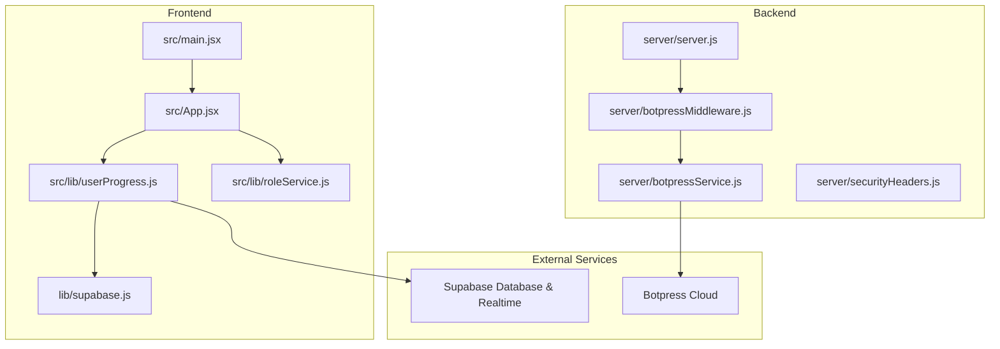
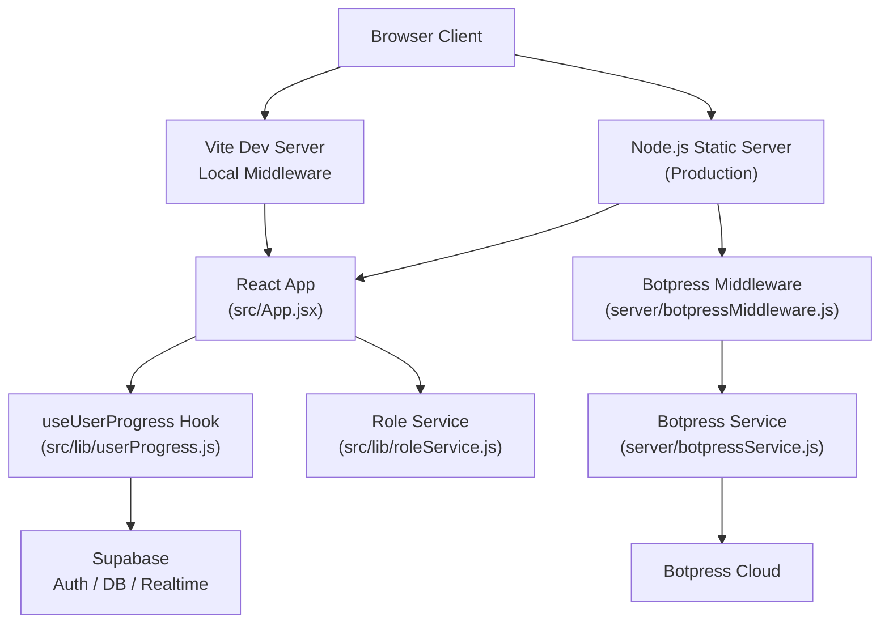
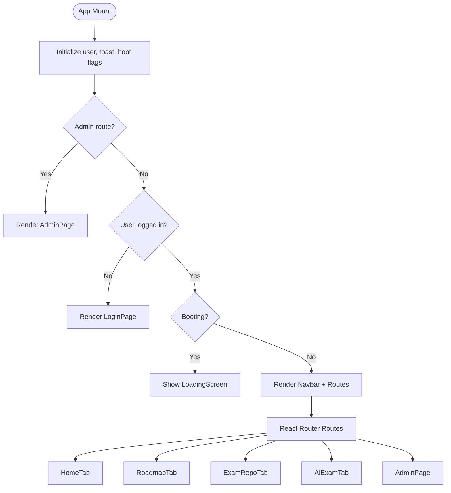
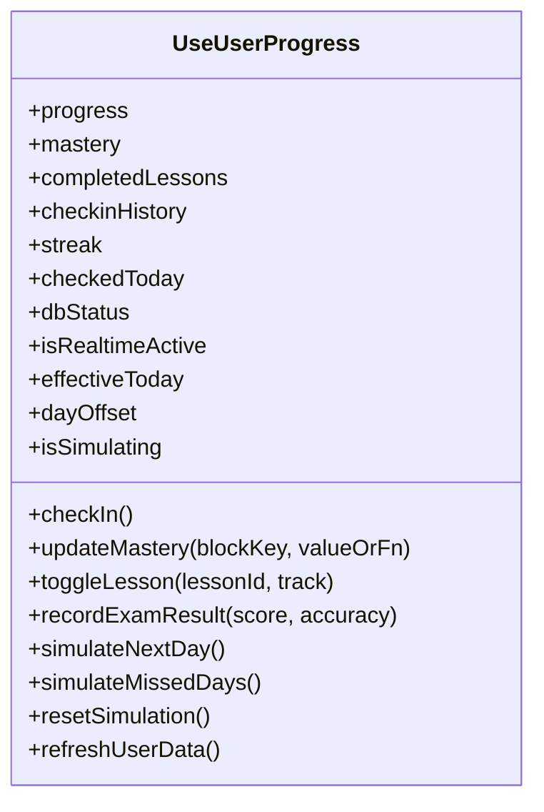
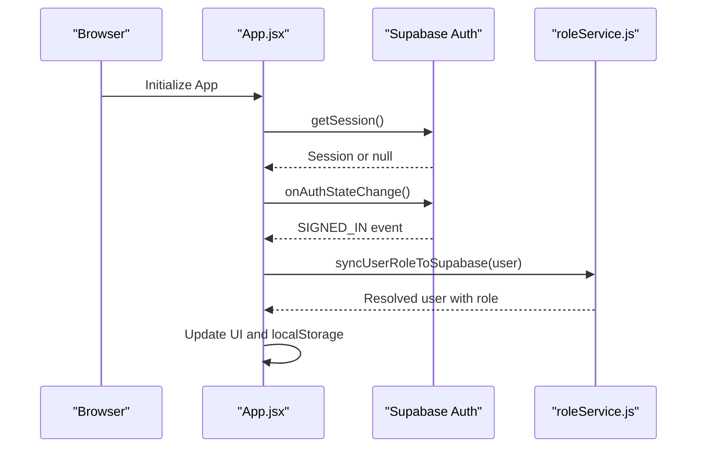
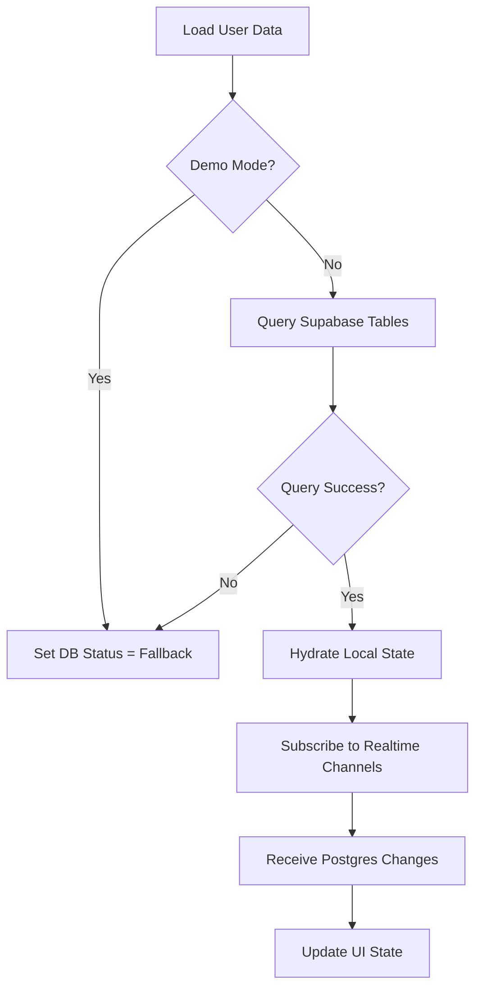
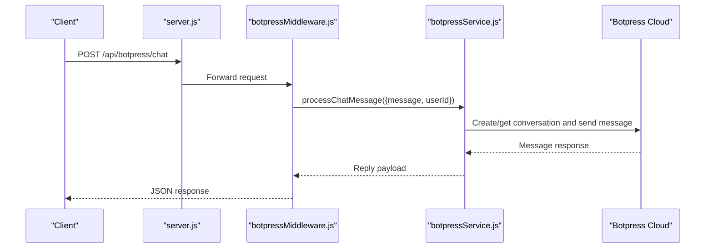
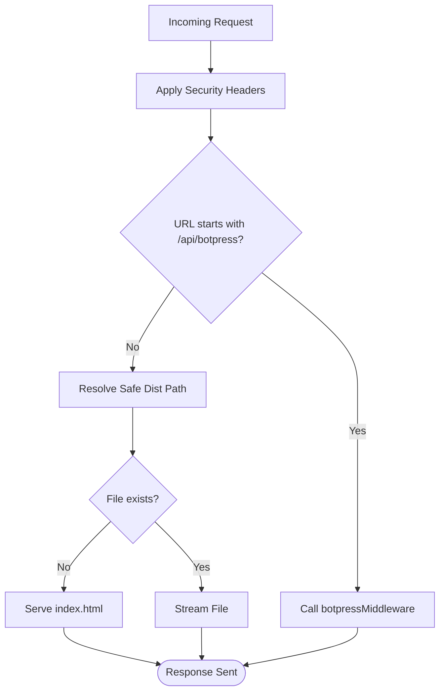
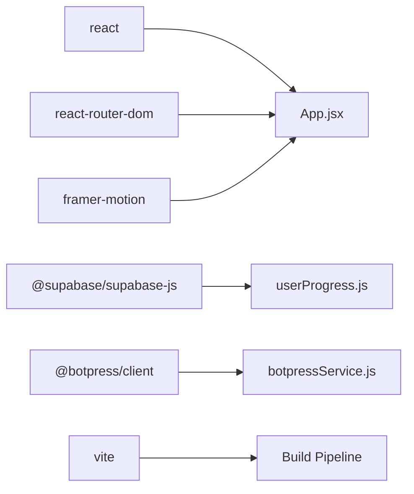

# Architecture Overview

<cite>
**Referenced Files in This Document**
- [README.md](file://README.md)
- [package.json](file://package.json)
- [vite.config.js](file://vite.config.js)
- [src/main.jsx](file://src/main.jsx)
- [src/App.jsx](file://src/App.jsx)
- [lib/supabase.js](file://lib/supabase.js)
- [src/supabase.js](file://src/supabase.js)
- [src/lib/userProgress.js](file://src/lib/userProgress.js)
- [src/lib/roleService.js](file://src/lib/roleService.js)
- [server/server.js](file://server/server.js)
- [server/botpressMiddleware.js](file://server/botpressMiddleware.js)
- [server/botpressService.js](file://server/botpressService.js)
- [server/securityHeaders.js](file://server/securityHeaders.js)
- [.github/workflows/deploy.yml](file://.github/workflows/deploy.yml)
- [.github/workflows/deploy-vps.yml](file://.github/workflows/deploy-vps.yml)
</cite>

## Table of Contents
1. Introduction
2. Project Structure
3. Core Components
4. Architecture Overview
5. Detailed Component Analysis
6. Dependency Analysis
7. Performance Considerations
8. Troubleshooting Guide
9. Conclusion

## Introduction
MewTinHoc is a React-based learning platform for Vietnamese high school computer science exam preparation. It provides:
- A client-side React application with routing, animations, and state management via hooks.
- Real-time progress tracking using Supabase Database and Realtime subscriptions.
- An AI chatbot integration through Botpress Cloud, proxied by a minimal Node.js server.
- Two deployment targets: GitHub Pages for static hosting and a VPS running the Node.js server for production API proxying.

The system emphasizes a clean separation between frontend UI logic, persistent user progress, and external services (Supabase and Botpress).

**Section sources**
- [README.md:1-4](file://README.md#L1-L4)

## Project Structure
The repository follows a standard Vite + React layout:
- `src/` contains the React application, components, hooks, and Supabase client configuration.
- `server/` contains a lightweight Node.js HTTP server, Botpress middleware, service layer, and security headers.
- `lib/` holds shared Supabase client initialization used by both frontend and backend.
- `.github/workflows/` defines CI/CD pipelines for GitHub Pages and VPS deployment.
- `public/`, `scripts/`, and root configuration files (`index.html`, `vite.config.js`, `package.json`) complete the build and runtime setup.

**Diagram sources**
- [src/main.jsx:1-18](file://src/main.jsx#L1-L18)
- [src/App.jsx:1-406](file://src/App.jsx#L1-L406)
- [src/lib/userProgress.js:1-717](file://src/lib/userProgress.js#L1-L717)
- [src/lib/roleService.js:1-101](file://src/lib/roleService.js#L1-L101)
- [lib/supabase.js:1-14](file://lib/supabase.js#L1-L14)
- [server/server.js:1-80](file://server/server.js#L1-L80)
- [server/botpressMiddleware.js:1-133](file://server/botpressMiddleware.js#L1-L133)
- [server/botpressService.js:1-333](file://server/botpressService.js#L1-L333)
- [server/securityHeaders.js:1-30](file://server/securityHeaders.js#L1-L30)

**Section sources**
- [package.json:1-34](file://package.json#L1-L34)
- [vite.config.js:1-22](file://vite.config.js#L1-L22)

## Core Components
- React Application Entry and Routing
  - The app initializes with React Router’s `BrowserRouter`, sets a base path from environment variables, and renders the root `App`.
  - `App` manages authentication state, tab navigation, route mapping, and global UI elements like toasts and chat bubble.

- State Management and Data Flow
  - User progress, streaks, mastery levels, lesson completion, and check-in history are managed by the `useUserProgress` hook.
  - The hook uses optimistic UI updates, local storage fallbacks, and Supabase Realtime subscriptions for live synchronization.

- Authentication and Roles
  - Google OAuth via Supabase Auth is integrated into `App` for login/logout flows.
  - Role resolution and profile synchronization are handled by `roleService`, ensuring admin rights come from Supabase profiles.

- Backend Proxy and Security
  - The Node.js server serves static assets from the Vite build directory and proxies `/api/botpress` requests to Botpress Cloud.
  - Security headers are applied globally to protect against common web vulnerabilities.

**Section sources**
- [src/main.jsx:1-18](file://src/main.jsx#L1-L18)
- [src/App.jsx:1-406](file://src/App.jsx#L1-L406)
- [src/lib/userProgress.js:1-717](file://src/lib/userProgress.js#L1-L717)
- [src/lib/roleService.js:1-101](file://src/lib/roleService.js#L1-L101)
- [server/server.js:1-80](file://server/server.js#L1-L80)
- [server/securityHeaders.js:1-30](file://server/securityHeaders.js#L1-L30)

## Architecture Overview
The system architecture consists of:
- Frontend: React SPA built with Vite, routed via React Router, animated with Framer Motion.
- Backend: Minimal Node.js HTTP server for production, serving static files and proxying Botpress API calls.
- External Integrations:
  - Supabase for authentication, database persistence, and real-time updates.
  - Botpress Cloud for AI chatbot responses and conversation context.

**Diagram sources**
- [vite.config.js:1-22](file://vite.config.js#L1-L22)
- [src/main.jsx:1-18](file://src/main.jsx#L1-L18)
- [src/App.jsx:1-406](file://src/App.jsx#L1-L406)
- [src/lib/userProgress.js:1-717](file://src/lib/userProgress.js#L1-L717)
- [src/lib/roleService.js:1-101](file://src/lib/roleService.js#L1-L101)
- [server/server.js:1-80](file://server/server.js#L1-L80)
- [server/botpressMiddleware.js:1-133](file://server/botpressMiddleware.js#L1-L133)
- [server/botpressService.js:1-333](file://server/botpressService.js#L1-L333)

## Detailed Component Analysis

### React Application and Routing
- Entry point wraps the app in `StrictMode` and `BrowserRouter`, setting the base URL from environment variables.
- `App` coordinates:
  - Tab state and navigation.
  - Authentication lifecycle with Supabase Auth.
  - Route definitions for Home, Roadmap, Exams, AI Exam, and Admin pages.
  - Global UI elements such as Navbar, Footer, Toast notifications, Announcement banner, and Botpress chat bubble.

**Diagram sources**
- [src/main.jsx:1-18](file://src/main.jsx#L1-L18)
- [src/App.jsx:1-406](file://src/App.jsx#L1-L406)

**Section sources**
- [src/main.jsx:1-18](file://src/main.jsx#L1-L18)
- [src/App.jsx:1-406](file://src/App.jsx#L1-L406)

### State Management with Hooks and Context Providers
- `useUserProgress` centralizes:
  - Local storage hydration and persistence.
  - Optimistic UI updates for streaks, mastery, lessons, and exams.
  - Supabase Realtime subscriptions for live data sync.
  - Simulation helpers for testing streak expiration and day progression.

**Diagram sources**
- [src/lib/userProgress.js:1-717](file://src/lib/userProgress.js#L1-L717)

**Section sources**
- [src/lib/userProgress.js:1-717](file://src/lib/userProgress.js#L1-L717)

### Authentication and Role Resolution
- Supabase Auth integration handles:
  - Initial session retrieval.
  - Listening to auth state changes.
  - Syncing user metadata and roles into app state.
- Role service ensures:
  - Admin status is derived from Supabase profiles.
  - New users default to non-admin roles.
  - Profile creation or update on first login.

**Diagram sources**
- [src/App.jsx:93-150](file://src/App.jsx#L93-L150)
- [src/lib/roleService.js:59-101](file://src/lib/roleService.js#L59-L101)

**Section sources**
- [src/App.jsx:93-150](file://src/App.jsx#L93-L150)
- [src/lib/roleService.js:1-101](file://src/lib/roleService.js#L1-L101)

### Supabase Integration and Realtime Data Flow
- Initialization:
  - Supabase client is configured with environment variables or defaults.
- Data operations:
  - Fetches user progress, mastery, roadmap lessons, and check-in history.
  - Subscribes to realtime changes across relevant tables.
  - Falls back to local storage when Supabase is unavailable or in demo mode.

**Diagram sources**
- [lib/supabase.js:1-14](file://lib/supabase.js#L1-L14)
- [src/lib/userProgress.js:274-475](file://src/lib/userProgress.js#L274-L475)

**Section sources**
- [lib/supabase.js:1-14](file://lib/supabase.js#L1-L14)
- [src/supabase.js:1-2](file://src/supabase.js#L1-L2)
- [src/lib/userProgress.js:274-475](file://src/lib/userProgress.js#L274-L475)

### Botpress Middleware and AI Chatbot Services
- Middleware:
  - Parses JSON payloads securely.
  - Manages chat sessions via cookies.
  - Handles CORS and security headers.
  - Routes endpoints for status, files, chat, and reset.
- Service:
  - Loads backend-only environment variables.
  - Creates Botpress clients or direct fetch calls.
  - Maintains conversation context per user session.
  - Implements fallback logic if Botpress Cloud is unreachable.

**Diagram sources**
- [server/server.js:40-50](file://server/server.js#L40-L50)
- [server/botpressMiddleware.js:65-133](file://server/botpressMiddleware.js#L65-L133)
- [server/botpressService.js:220-333](file://server/botpressService.js#L220-L333)

**Section sources**
- [server/server.js:40-50](file://server/server.js#L40-L50)
- [server/botpressMiddleware.js:1-133](file://server/botpressMiddleware.js#L1-L133)
- [server/botpressService.js:1-333](file://server/botpressService.js#L1-L333)

### Production Server and Static File Serving
- The Node.js server:
  - Applies security headers to all responses.
  - Proxies `/api/botpress` to Botpress middleware.
  - Serves static files from the Vite build directory.
  - Returns appropriate error codes for missing or invalid paths.

**Diagram sources**
- [server/server.js:1-80](file://server/server.js#L1-L80)
- [server/securityHeaders.js:1-30](file://server/securityHeaders.js#L1-L30)

**Section sources**
- [server/server.js:1-80](file://server/server.js#L1-L80)
- [server/securityHeaders.js:1-30](file://server/securityHeaders.js#L1-L30)

## Dependency Analysis
- Frontend Dependencies:
  - React, React DOM, React Router, Framer Motion, PDF rendering libraries, Lucide icons, Canvas confetti.
  - Supabase JS client for authentication, database, and realtime features.
- Backend Dependencies:
  - Node.js built-in modules for HTTP, filesystem, path, and crypto.
  - Botpress client SDK for cloud interactions.
- Build and Deployment:
  - Vite for development and production builds.
  - GitHub Actions for GitHub Pages and VPS deployments.

**Diagram sources**
- [package.json:14-31](file://package.json#L14-L31)
- [src/App.jsx:1-20](file://src/App.jsx#L1-L20)
- [src/lib/userProgress.js:1-3](file://src/lib/userProgress.js#L1-L3)
- [server/botpressService.js:1-6](file://server/botpressService.js#L1-L6)

**Section sources**
- [package.json:14-31](file://package.json#L14-L31)

## Performance Considerations
- Optimize bundle size by leveraging Vite’s tree-shaking and code splitting where possible.
- Minimize unnecessary re-renders by memoizing expensive computations within hooks and components.
- Use Supabase Realtime judiciously; ensure channels are unsubscribed on component unmount to avoid memory leaks.
- Cache static assets appropriately and leverage browser caching for improved load times.
- Implement pagination or lazy loading for large datasets such as exam repositories or roadmap items.

[No sources needed since this section provides general guidance]

## Troubleshooting Guide
- Supabase Connectivity Issues:
  - Verify environment variables for Supabase URL and publishable key.
  - Check network permissions and CORS settings in Supabase project configuration.
  - Inspect console warnings for table schema mismatches or permission errors.

- Botpress Chat Failures:
  - Ensure backend environment variables for Botpress token, bot ID, webhook ID, and encryption key are correctly set.
  - Validate CORS policies if the frontend origin differs from the allowed origin.
  - Review middleware logs for payload parsing errors or rate limiting responses.

- Authentication Problems:
  - Confirm Google OAuth provider is enabled in Supabase Auth settings.
  - Check redirect URIs and domain configurations match the deployed environment.
  - Validate that profile records exist and admin flags are correctly synchronized.

**Section sources**
- [lib/supabase.js:1-14](file://lib/supabase.js#L1-L14)
- [server/botpressMiddleware.js:65-133](file://server/botpressMiddleware.js#L65-L133)
- [server/botpressService.js:43-78](file://server/botpressService.js#L43-L78)
- [src/App.jsx:126-150](file://src/App.jsx#L126-L150)

## Conclusion
MewTinHoc combines a modern React frontend with a minimal Node.js backend to deliver a responsive, real-time learning experience. The architecture cleanly separates concerns:
- Frontend focuses on user interaction, state management, and visual feedback.
- Backend provides secure static file serving and API proxying for Botpress.
- External services handle authentication, persistence, and AI-driven chat capabilities.

This design supports scalable growth, clear maintenance boundaries, and flexible deployment options across GitHub Pages and VPS environments.

[No sources needed since this section summarizes without analyzing specific files]