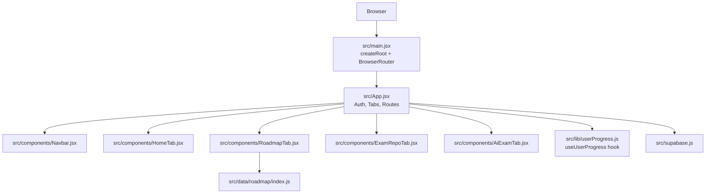
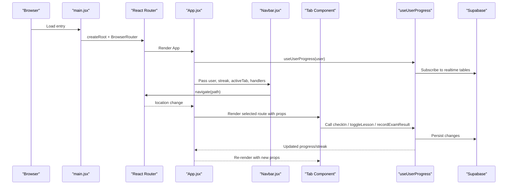
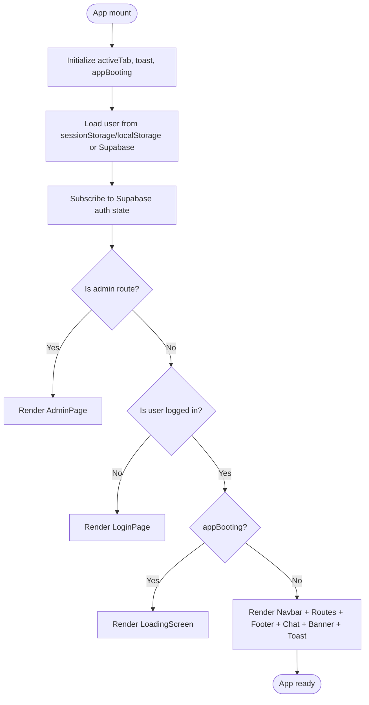
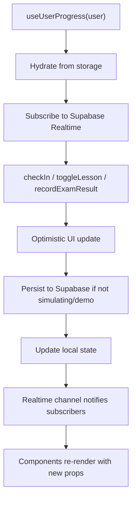
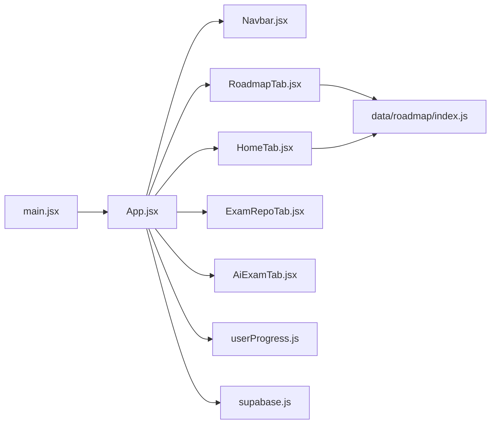

# Frontend Architecture

<cite>
**Referenced Files in This Document**
- [main.jsx](file://src/main.jsx)
- [App.jsx](file://src/App.jsx)
- [Navbar.jsx](file://src/components/Navbar.jsx)
- [HomeTab.jsx](file://src/components/HomeTab.jsx)
- [RoadmapTab.jsx](file://src/components/RoadmapTab.jsx)
- [ExamRepoTab.jsx](file://src/components/ExamRepoTab.jsx)
- [AiExamTab.jsx](file://src/components/AiExamTab.jsx)
- [userProgress.js](file://src/lib/userProgress.js)
- [supabase.js](file://src/supabase.js)
- [index.js](file://src/data/roadmap/index.js)
</cite>

## Table of Contents
1. [Introduction](#introduction)
2. [Project Structure](#project-structure)
3. [Core Components](#core-components)
4. [Architecture Overview](#architecture-overview)
5. [Detailed Component Analysis](#detailed-component-analysis)
6. [Dependency Analysis](#dependency-analysis)
7. [Performance Considerations](#performance-considerations)
8. [Troubleshooting Guide](#troubleshooting-guide)
9. [Conclusion](#conclusion)

## Introduction
This document explains the React frontend architecture for MewTinHoc. The application is a single-page learning platform that uses functional components, React hooks, React Router for client-side navigation, and a custom `useUserProgress` hook to manage user progress, streaks, mastery, and lesson completion. Data flows from parent components down through props, while shared state such as authentication, user progress, and tab routing is coordinated at the top-level `App` component. There is no global React Context provider in the analyzed code; instead, the app relies on prop drilling, URL-driven routing, and a centralized hook-based state layer.

## Project Structure
The frontend entry point initializes React with strict mode, sets up browser routing, and mounts the root `App`. The main application component owns authentication, active tabs, toast notifications, and route rendering. Feature pages are implemented as separate tab components under `src/components`, while reusable motion and UI helpers live under `src/components/motion`. Shared data models for tracks and roadmaps are exported from `src/data/roadmap`.

**Diagram sources**
- [main.jsx:1-18](file://src/main.jsx#L1-L18)
- [App.jsx:1-406](file://src/App.jsx#L1-L406)
- [Navbar.jsx:1-289](file://src/components/Navbar.jsx#L1-L289)
- [HomeTab.jsx:1-773](file://src/components/HomeTab.jsx#L1-L773)
- [RoadmapTab.jsx:1-800](file://src/components/RoadmapTab.jsx#L1-L800)
- [ExamRepoTab.jsx:1-800](file://src/components/ExamRepoTab.jsx#L1-L800)
- [AiExamTab.jsx:1-322](file://src/components/AiExamTab.jsx#L1-L322)
- [userProgress.js:1-717](file://src/lib/userProgress.js#L1-L717)
- [supabase.js:1-2](file://src/supabase.js#L1-L2)
- [index.js:1-43](file://src/data/roadmap/index.js#L1-L43)

**Section sources**
- [main.jsx:1-18](file://src/main.jsx#L1-L18)
- [App.jsx:1-406](file://src/App.jsx#L1-L406)

## Core Components
- **Application shell**: `App` manages authentication, active tab selection, toast messages, loading screen, and route rendering. It composes the horizontal navbar, page content, footer, chat bubble, announcements, and toast notifications.
- **Navigation**: `Navbar` exposes tab constants and renders the brand, student info, streak pill, admin button (for company admins), logout, and four learning tabs. It uses React Router’s `useNavigate` and `useLocation` to keep UI state synchronized with the URL.
- **Feature tabs**:
  - `HomeTab`: Dashboard showing streak, weekly calendar, knowledge matrix, mastery bars, evolution collection, and simulation controls for admins.
  - `RoadmapTab`: Visual chained roadmap with track switching, station modal, theory PDF viewer, quiz integration, progress tracking, and admin theory editor.
  - `ExamRepoTab`: Document repository for exam materials with type filtering, search, preview, download, drag-and-drop upload, rename, delete, and admin-only operations.
  - `AiExamTab`: AI-powered exam generator UI with configuration, step-by-step generation animation, generated exam summary, performance metrics, and an interactive AI mentor chat.
- **State and persistence**: `useUserProgress` centralizes streak logic, mastery blocks, completed lessons, check-in history, optimistic updates, Supabase Realtime subscriptions, and local storage fallbacks.

**Section sources**
- [App.jsx:22-406](file://src/App.jsx#L22-L406)
- [Navbar.jsx:17-289](file://src/components/Navbar.jsx#L17-L289)
- [HomeTab.jsx:66-773](file://src/components/HomeTab.jsx#L66-L773)
- [RoadmapTab.jsx:51-800](file://src/components/RoadmapTab.jsx#L51-L800)
- [ExamRepoTab.jsx:96-800](file://src/components/ExamRepoTab.jsx#L96-L800)
- [AiExamTab.jsx:16-322](file://src/components/AiExamTab.jsx#L16-L322)
- [userProgress.js:88-717](file://src/lib/userProgress.js#L88-L717)

## Architecture Overview
MewTinHoc follows a layered, component-centric architecture:

- **Entry layer**: `main.jsx` bootstraps React, installs viewport height utilities, wraps the app in `BrowserRouter`, and renders `App`.
- **Routing layer**: `App` defines routes for home, roadmap, exams, AI exam, and admin. It synchronizes the active tab with the current URL path and uses `AnimatePresence` plus `PageTransition` for smooth transitions.
- **Presentation layer**: Tab components render feature-specific UIs. They receive data via props and call callbacks to mutate shared state or navigate.
- **State layer**: `App` holds authentication and tab state. `useUserProgress` provides progress, streak, mastery, and lesson completion state, along with actions like check-in, toggle lesson, record exam result, and simulation helpers.
- **Data layer**: Supabase is used for authentication, database reads/writes, and realtime subscriptions. LocalStorage/sessionStorage provide offline fallbacks and demo-mode isolation.

**Diagram sources**
- [main.jsx:1-18](file://src/main.jsx#L1-L18)
- [App.jsx:22-406](file://src/App.jsx#L22-L406)
- [Navbar.jsx:1-289](file://src/components/Navbar.jsx#L1-L289)
- [userProgress.js:88-717](file://src/lib/userProgress.js#L88-L717)
- [supabase.js:1-2](file://src/supabase.js#L1-L2)

## Detailed Component Analysis

### Application Shell: App.jsx
`App` is the orchestrator:
- Initializes active tab, toast message, and booting screen.
- Manages user state from demo session storage, local storage, or Supabase Auth.
- Syncs Supabase auth events into app user state and clears OAuth artifacts from the URL.
- Provides login/logout handlers and integrates streak simulation helpers.
- Synchronizes active tab with URL paths and renders protected routes.
- Composes `Navbar`, `Routes`, `AnimatePresence`, `PageTransition`, footer, chat bubble, announcement banner, and toast.

Key responsibilities:
- Authentication flow with Google OAuth via Supabase.
- Route-to-tab synchronization.
- Admin route bypass (`/admin`).
- Passing user, streak, progress, and callbacks to child components.

**Diagram sources**
- [App.jsx:22-406](file://src/App.jsx#L22-L406)

**Section sources**
- [App.jsx:22-406](file://src/App.jsx#L22-L406)

### Navigation: Navbar.jsx
`Navbar` is a presentational component that:
- Exposes `TABS` constants for consistent tab keys across the app.
- Uses `useLocation` to determine active tab based on URL prefixes.
- Calls `setActiveTab` and `navigate` together to keep UI and URL in sync.
- Renders brand logo, streak pill, student profile chip, admin button (conditional on `isAdmin`), logout button, and four learning tabs with animated active indicators.

Design patterns:
- Prop-driven behavior: receives `activeTab`, `setActiveTab`, `user`, `streak`, `onLogout`, `onOpenStreakDetails`.
- Accessibility: uses `role="tablist"` and `aria-selected`.
- Motion: leverages Framer Motion variants and reduced-motion preferences.

**Section sources**
- [Navbar.jsx:17-289](file://src/components/Navbar.jsx#L17-L289)

### Home Dashboard: HomeTab.jsx
`HomeTab` presents:
- Welcome banner with mascot and hero background.
- Quick metrics: streak count, exams taken, average score, accuracy.
- Knowledge matrix with mastery bars per block.
- Streak card with evolution art, weekly calendar, check-in button, grace rule warning, evolution collection panel, and admin simulation tools.

State and composition:
- Owns local UI state for help popovers, evolution expansion, admin preview mode, and flaring animation.
- Reads track selection from URL params and localStorage.
- Computes mastery by mapping stations to knowledge blocks and scoring thresholds.
- Composes motion components: `CountUpNumber`, `MasteryBar`, `MascotHeroCat`, `HeroBannerBackground`, `StreakFlameStage`, and `StreakEvolutionArt`.

Data flow:
- Receives `user`, `streak`, `progress`, `completedLessons`, `userId`, and callbacks for check-in and simulations.
- Delegates streak mutations to parent-provided `onCheckIn` and simulation handlers.

**Section sources**
- [HomeTab.jsx:66-773](file://src/components/HomeTab.jsx#L66-L773)

### Roadmap: RoadmapTab.jsx
`RoadmapTab` implements:
- Track switching between ICT and CS, persisted to localStorage and reflected in URL.
- Remote roadmap data loading from Supabase Storage with fallback to local defaults.
- Station modal supporting PDF streaming, theory lessons, quizzes, and admin theory editing.
- Progress calculation per station based on quiz scores or lesson completion.
- Admin features: refresh roadmap, download JSON, edit and save raw roadmap back to Supabase.

State management:
- Local state for selected station, lesson index, modal tab, study focus mode, fullscreen, zoom, blueprint toggles, sync status, editing mode, and quiz scores.
- Uses `useParams` and `useNavigate` for route-aware behavior.
- Persists completed lessons and quiz scores to localStorage when not using Supabase Realtime.

Composition:
- Integrates `PdfDocumentViewer`, `StationQuizView`, and `AdminTheoryEditor`.
- Uses scroll lock utility to prevent background scrolling during modal.

**Section sources**
- [RoadmapTab.jsx:51-800](file://src/components/RoadmapTab.jsx#L51-L800)

### Exam Repository: ExamRepoTab.jsx
`ExamRepoTab` provides:
- Type-based document listing with dynamic folder detection from Supabase Storage.
- Search, pagination on mobile, and file metadata display.
- Previewable documents via Office Online embed for DOC/DOCX and direct URLs for other types.
- Admin-only operations: drag-and-drop upload, rename, delete, and folder creation.
- Error handling and notices for bucket issues, upload failures, and deletion confirmations.

State and UX:
- Tracks loading, error, active type, search query, mobile viewport, visible document count, editing/rename state, busy operation, upload progress, drag-over state, notice, confirmation, and preview document.
- Uses `useCallback` and `useMemo` for performance-sensitive functions and derived values.
- Leverages Framer Motion for active tab background animation and respects reduced motion preferences.

**Section sources**
- [ExamRepoTab.jsx:96-800](file://src/components/ExamRepoTab.jsx#L96-L800)

### AI Exam Generator: AiExamTab.jsx
`AiExamTab` offers:
- Direction selection (CS or ICT) persisted to localStorage.
- Simulated AI exam generation with step-by-step progress and confetti celebration.
- Generated exam summary with structure details and a placeholder action to start solving.
- Learner performance metrics read from `progress` and `user`.
- Interactive AI mentor chat with keyword-triggered explanations.

State and composition:
- Local state for direction, generation flags, steps, generated exam, chat messages, and input text.
- Persists generated exam in sessionStorage.
- Uses `TRACK_TYPES` from roadmap data for consistency.

**Section sources**
- [AiExamTab.jsx:16-322](file://src/components/AiExamTab.jsx#L16-L322)

### State Management: useUserProgress Hook
`useUserProgress` is the core state manager:
- Initializes progress, mastery, completed lessons, and check-in history from storage.
- Hydrates state when user changes and isolates demo vs real sessions.
- Implements streak grace rules and automatic expiration when days exceed the allowed gap.
- Subscribes to Supabase Realtime channels for `user_progress`, `mastery_progress`, `roadmap_lessons`, and `daily_checkins`.
- Provides optimistic UI updates for check-in, lesson toggle, and exam result recording.
- Exposes simulation helpers for testing streak mechanics without persisting fake dates.

Key behaviors:
- LocalStorage/sessionStorage fallback when Supabase is unavailable or in demo mode.
- Realtime updates reflect immediately in UI without full reloads.
- Returns a rich object containing state, computed streak compatibility, and mutation functions.

**Diagram sources**
- [userProgress.js:88-717](file://src/lib/userProgress.js#L88-L717)

**Section sources**
- [userProgress.js:88-717](file://src/lib/userProgress.js#L88-L717)

## Dependency Analysis
The frontend dependencies form a clear hierarchy:

- `main.jsx` depends on React DOM, React Router, and the root `App`.
- `App.jsx` depends on React Router, Framer Motion, multiple tab components, mock data, Supabase, role service, and the `useUserProgress` hook.
- `Navbar.jsx` depends on React Router, Framer Motion, Lucide icons, and shared motion variants.
- `HomeTab.jsx` depends on React Router, Lucide icons, canvas-confetti, motion components, roadmap data, and question data.
- `RoadmapTab.jsx` depends on React Router, roadmap data, Supabase storage utilities, admin editor, quiz view, and scroll lock utility.
- `ExamRepoTab.jsx` depends on Supabase storage utilities, motion components, and loading screen.
- `AiExamTab.jsx` depends on roadmap track types and canvas-confetti.
- `userProgress.js` depends on Supabase and streak evolution utilities.

**Diagram sources**
- [main.jsx:1-18](file://src/main.jsx#L1-L18)
- [App.jsx:1-406](file://src/App.jsx#L1-L406)
- [Navbar.jsx:1-289](file://src/components/Navbar.jsx#L1-L289)
- [HomeTab.jsx:1-773](file://src/components/HomeTab.jsx#L1-L773)
- [RoadmapTab.jsx:1-800](file://src/components/RoadmapTab.jsx#L1-L800)
- [ExamRepoTab.jsx:1-800](file://src/components/ExamRepoTab.jsx#L1-L800)
- [AiExamTab.jsx:1-322](file://src/components/AiExamTab.jsx#L1-L322)
- [userProgress.js:1-717](file://src/lib/userProgress.js#L1-L717)
- [supabase.js:1-2](file://src/supabase.js#L1-L2)
- [index.js:1-43](file://src/data/roadmap/index.js#L1-L43)

**Section sources**
- [App.jsx:1-406](file://src/App.jsx#L1-L406)
- [userProgress.js:1-717](file://src/lib/userProgress.js#L1-L717)
- [index.js:1-43](file://src/data/roadmap/index.js#L1-L43)

## Performance Considerations
- **Reduced motion support**: Components respect `useReducedMotion` to disable animations for users who prefer reduced motion.
- **Memoization**: `ExamRepoTab` uses `useCallback` and `useMemo` to avoid unnecessary recalculations and re-renders.
- **Optimistic UI**: `useUserProgress` updates local state immediately before network persistence, improving perceived responsiveness.
- **Realtime subscriptions**: Centralized in `useUserProgress` to minimize duplicate listeners and ensure proper cleanup.
- **Local storage fallback**: Reduces network dependency and improves availability when Supabase is unreachable.
- **Component composition**: Heavy UI sections are split into smaller components (e.g., motion helpers) to improve readability and potential reuse.

[No sources needed since this section provides general guidance]

## Troubleshooting Guide
Common issues and their likely causes:

- **Supabase connection errors**:
  - Bucket not found or misconfigured name casing.
  - Missing tables or realtime permissions.
  - Fallback to local storage occurs automatically; verify Supabase configuration and RLS policies.

- **Streak not increasing**:
  - Already checked in today.
  - Grace period exceeded; streak resets to zero automatically.
  - Simulation mode may be active; reset simulation to return to real date.

- **Roadmap data not updating**:
  - Remote roadmap not uploaded to Supabase Storage.
  - Use admin refresh or download JSON to inspect local default data.
  - Ensure correct track key (`ict` or `cs`) in URL and localStorage.

- **Exam repository upload failures**:
  - File size exceeds limit or unsupported extension.
  - Folder creation failed; ensure admin has write access to the bucket.
  - Check notices for specific error messages.

- **AI exam generation stuck**:
  - Generation is simulated; ensure UI is responsive and no blocking alerts are present.
  - Clear sessionStorage if generated exam state becomes corrupted.

**Section sources**
- [ExamRepoTab.jsx:398-404](file://src/components/ExamRepoTab.jsx#L398-L404)
- [userProgress.js:210-240](file://src/lib/userProgress.js#L210-L240)
- [userProgress.js:477-536](file://src/lib/userProgress.js#L477-L536)
- [RoadmapTab.jsx:154-179](file://src/components/RoadmapTab.jsx#L154-L179)

## Conclusion
MewTinHoc’s frontend architecture centers on functional components, hooks, and a centralized state layer provided by `useUserProgress`. Routing is handled by React Router, with `App` coordinating authentication, tab state, and route rendering. Data flows primarily through props, while shared concerns like progress, streaks, and realtime updates are encapsulated in the hook. The design favors composability, accessibility, and performance optimizations such as reduced motion support and optimistic UI. For future enhancements, consider introducing React Context for deeply nested shared state if prop drilling becomes unwieldy, but the current approach keeps coupling low and clarity high.

[No sources needed since this section summarizes without analyzing specific files]