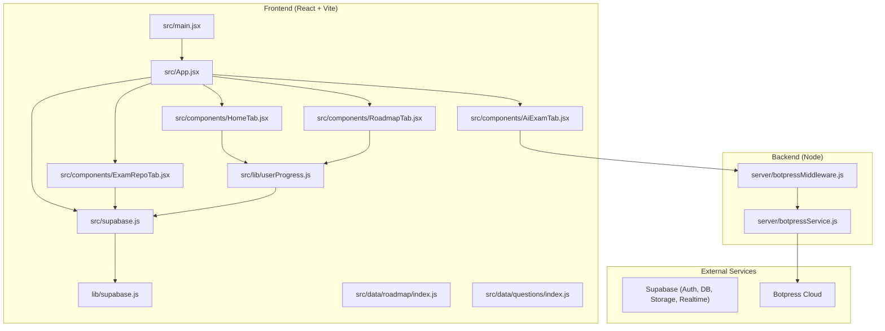
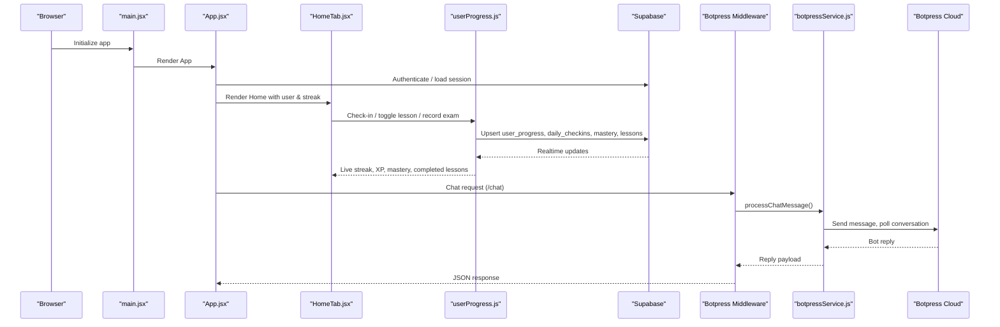
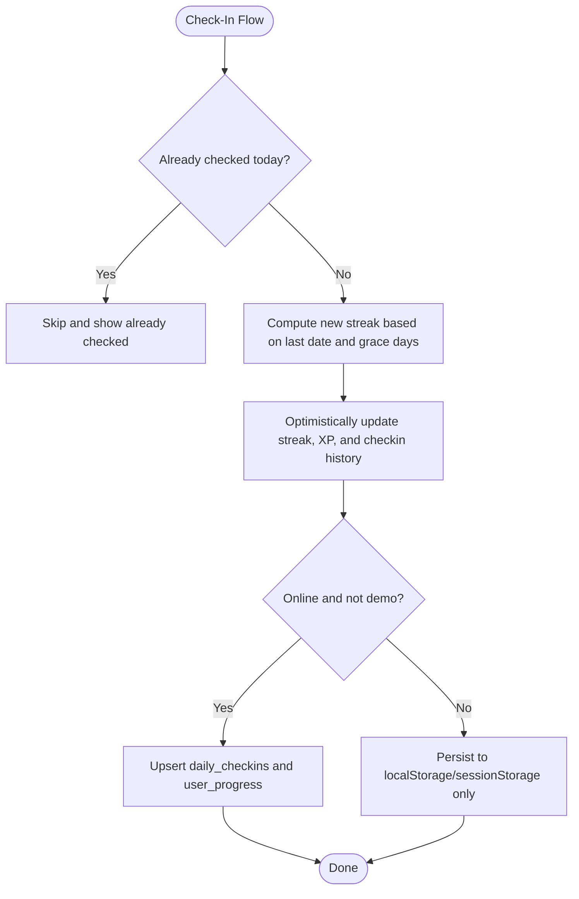
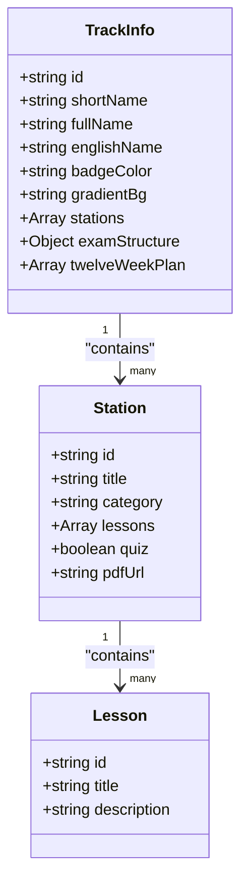
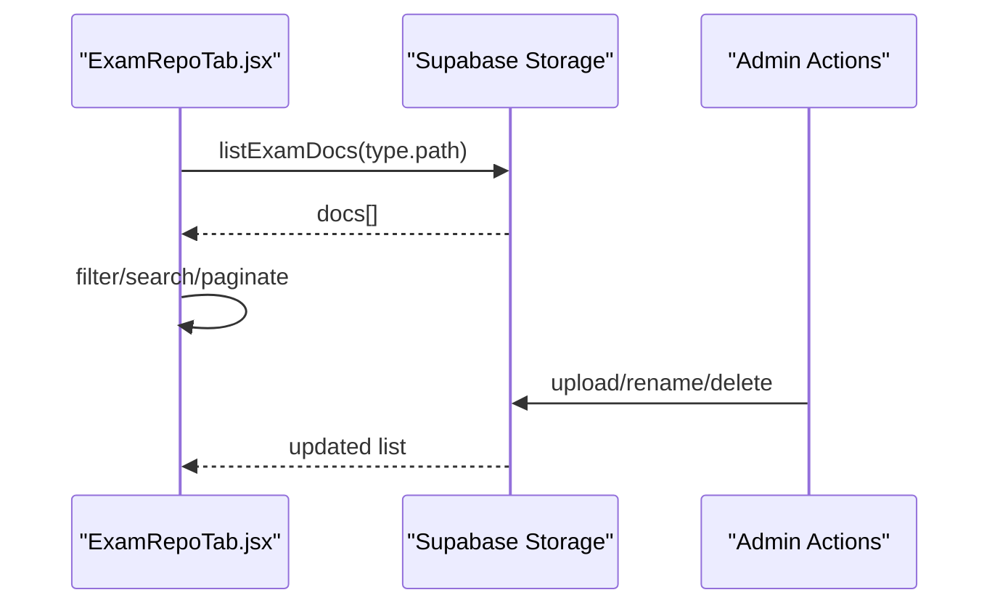
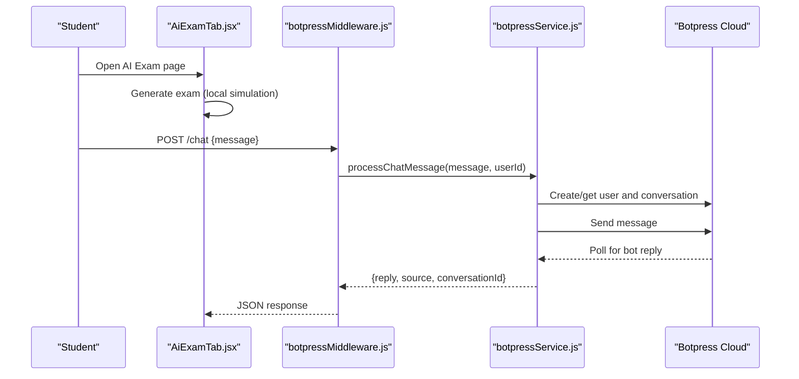
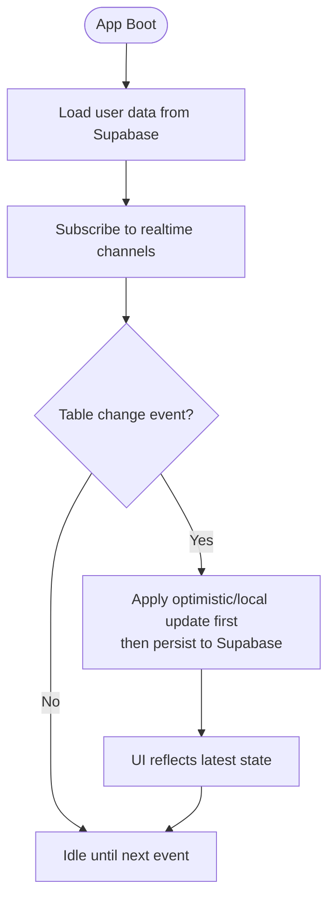
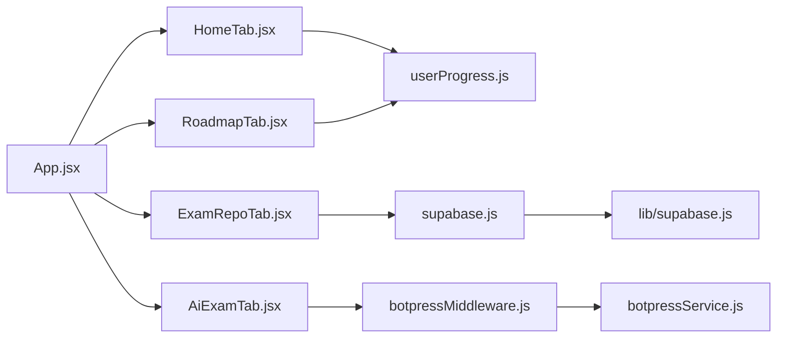

# Core Features

<cite>
**Referenced Files in This Document**
- [README.md](file://README.md)
- [package.json](file://package.json)
- [src/main.jsx](file://src/main.jsx)
- [src/App.jsx](file://src/App.jsx)
- [src/supabase.js](file://src/supabase.js)
- [lib/supabase.js](file://lib/supabase.js)
- [src/lib/userProgress.js](file://src/lib/userProgress.js)
- [src/components/HomeTab.jsx](file://src/components/HomeTab.jsx)
- [src/components/RoadmapTab.jsx](file://src/components/RoadmapTab.jsx)
- [src/data/roadmap/index.js](file://src/data/roadmap/index.js)
- [src/data/questions/index.js](file://src/data/questions/index.js)
- [src/components/ExamRepoTab.jsx](file://src/components/ExamRepoTab.jsx)
- [src/components/AiExamTab.jsx](file://src/components/AiExamTab.jsx)
- [server/botpressService.js](file://server/botpressService.js)
- [server/botpressMiddleware.js](file://server/botpressMiddleware.js)
</cite>

## Table of Contents
1. Introduction
2. Project Structure
3. Core Components
4. Architecture Overview
5. Detailed Component Analysis
6. Dependency Analysis
7. Performance Considerations
8. Troubleshooting Guide
9. Conclusion

## Introduction
MewTinHoc is a gamified, exam-aligned learning platform for the Vietnamese high school computer science graduation exam. It combines streak-based motivation, structured study tracks (ICT and CS), a practice exam repository, AI-powered assessment flows, and real-time progress synchronization via Supabase. The application is built with React and Vite, integrates Botpress for an AI chat assistant, and uses Supabase for authentication, database, storage, and realtime updates.

Key goals:
- Keep learners engaged through streaks, XP, mastery tracking, and visual evolution rewards.
- Provide clear, official-exam-aligned curricula for ICT and CS tracks.
- Offer a rich question bank and exam repository for targeted practice.
- Deliver AI-assisted assessments and tutoring through Botpress.
- Synchronize user state across devices and sessions using Supabase Realtime.

**Section sources**
- [README.md:1-4](file://README.md#L1-L4)
- [package.json:1-34](file://package.json#L1-L34)

## Project Structure
The project follows a feature-oriented structure under src/components and src/data, with shared libraries for Supabase integration and user progress logic. A small Node server provides Botpress middleware and service utilities.

**Diagram sources**
- [src/main.jsx:1-18](file://src/main.jsx#L1-L18)
- [src/App.jsx:1-406](file://src/App.jsx#L1-L406)
- [src/supabase.js:1-2](file://src/supabase.js#L1-L2)
- [lib/supabase.js:1-14](file://lib/supabase.js#L1-L14)
- [src/lib/userProgress.js:1-717](file://src/lib/userProgress.js#L1-L717)
- [src/components/HomeTab.jsx:1-773](file://src/components/HomeTab.jsx#L1-L773)
- [src/components/RoadmapTab.jsx:1-800](file://src/components/RoadmapTab.jsx#L1-L800)
- [src/components/ExamRepoTab.jsx:1-800](file://src/components/ExamRepoTab.jsx#L1-L800)
- [src/components/AiExamTab.jsx:1-322](file://src/components/AiExamTab.jsx#L1-L322)
- [server/botpressService.js:1-333](file://server/botpressService.js#L1-L333)
- [server/botpressMiddleware.js:1-133](file://server/botpressMiddleware.js#L1-L133)

**Section sources**
- [src/main.jsx:1-18](file://src/main.jsx#L1-L18)
- [package.json:1-34](file://package.json#L1-L34)

## Core Components
- Gamification engine: Streaks, XP, mastery blocks, and evolution visuals are managed by the user progress hook and surfaced in the Home dashboard.
- Structured curriculum: ICT and CS tracks with stations, lessons, quizzes, and exam blueprints.
- Practice exam repository: Browse, preview, download, and admin-manage exam documents stored in Supabase Storage.
- AI assessment and tutoring: AI exam generator UI and Botpress-backed chat assistant.
- Realtime data sync: Supabase Realtime subscriptions keep streaks, mastery, lesson completion, and check-in history consistent across tabs and devices.

**Section sources**
- [src/lib/userProgress.js:1-717](file://src/lib/userProgress.js#L1-L717)
- [src/components/HomeTab.jsx:1-773](file://src/components/HomeTab.jsx#L1-L773)
- [src/data/roadmap/index.js:1-44](file://src/data/roadmap/index.js#L1-L44)
- [src/data/questions/index.js:1-40](file://src/data/questions/index.js#L1-L40)
- [src/components/ExamRepoTab.jsx:1-800](file://src/components/ExamRepoTab.jsx#L1-L800)
- [src/components/AiExamTab.jsx:1-322](file://src/components/AiExamTab.jsx#L1-L322)

## Architecture Overview
The app initializes routing and viewport helpers, then mounts App. App manages authentication (Supabase Auth), tab navigation, and delegates to feature tabs. User progress is centralized in a hook that reads/writes to Supabase and falls back to local storage when offline or in demo mode. Roadmap and Exam Repo interact with Supabase Storage and Database. AI features use a Node middleware to proxy requests to Botpress Cloud.

**Diagram sources**
- [src/main.jsx:1-18](file://src/main.jsx#L1-L18)
- [src/App.jsx:1-406](file://src/App.jsx#L1-L406)
- [src/components/HomeTab.jsx:1-773](file://src/components/HomeTab.jsx#L1-L773)
- [src/lib/userProgress.js:1-717](file://src/lib/userProgress.js#L1-L717)
- [server/botpressMiddleware.js:1-133](file://server/botpressMiddleware.js#L1-L133)
- [server/botpressService.js:1-333](file://server/botpressService.js#L1-L333)

## Detailed Component Analysis

### Gamified Learning System: Streaks, XP, Mastery, and Evolution
- Streak rules: Grace period allows up to 3 days between check-ins; missing 3 consecutive days resets streak to zero.
- XP rewards: +50 XP per check-in, +30 XP per completed lesson, +100 XP per recorded exam result.
- Mastery blocks: Python, SQL, Network, Safety; progress computed from quiz accuracy thresholds and lesson completion.
- Visual evolution: Streak milestones unlock flame evolutions with animated stages and collection view.

**Diagram sources**
- [src/lib/userProgress.js:477-536](file://src/lib/userProgress.js#L477-L536)
- [src/lib/userProgress.js:210-240](file://src/lib/userProgress.js#L210-L240)
- [src/components/HomeTab.jsx:98-107](file://src/components/HomeTab.jsx#L98-L107)

**Section sources**
- [src/lib/userProgress.js:1-717](file://src/lib/userProgress.js#L1-L717)
- [src/components/HomeTab.jsx:1-773](file://src/components/HomeTab.jsx#L1-L773)

### Structured Curriculum: ICT and CS Tracks
- Two tracks: ICT (Information & Communications Technology) and CS (Computer Science).
- Each track defines stations, lessons, quizzes, exam structure, and a 12-week plan aligned with official requirements.
- Admins can edit theory content and publish updates to Supabase Storage; students see live changes.

**Diagram sources**
- [src/data/roadmap/index.js:1-44](file://src/data/roadmap/index.js#L1-L44)
- [src/components/RoadmapTab.jsx:154-196](file://src/components/RoadmapTab.jsx#L154-L196)

**Section sources**
- [src/data/roadmap/index.js:1-44](file://src/data/roadmap/index.js#L1-L44)
- [src/components/RoadmapTab.jsx:1-800](file://src/components/RoadmapTab.jsx#L1-L800)

### Practice Exam Repository
- Lists and filters exam documents by type (e.g., general vs numerical).
- Supports previewing supported formats and downloading files.
- Admin operations: upload, rename, delete, and ensure folder structure in Supabase Storage.

**Diagram sources**
- [src/components/ExamRepoTab.jsx:162-179](file://src/components/ExamRepoTab.jsx#L162-L179)
- [src/components/ExamRepoTab.jsx:239-281](file://src/components/ExamRepoTab.jsx#L239-L281)
- [src/components/ExamRepoTab.jsx:310-367](file://src/components/ExamRepoTab.jsx#L310-L367)

**Section sources**
- [src/components/ExamRepoTab.jsx:1-800](file://src/components/ExamRepoTab.jsx#L1-L800)

### AI-Powered Assessment Tools and Tutoring
- AI exam generator UI simulates a multi-step generation flow and displays a summary card.
- AI Mentor chat provides topic-aware explanations and references to the exam matrix.
- Backend Botpress middleware proxies messages to Botpress Cloud, maintains conversation context, and falls back to rule-based replies if needed.

**Diagram sources**
- [src/components/AiExamTab.jsx:57-86](file://src/components/AiExamTab.jsx#L57-L86)
- [server/botpressMiddleware.js:106-114](file://server/botpressMiddleware.js#L106-L114)
- [server/botpressService.js:220-297](file://server/botpressService.js#L220-L297)

**Section sources**
- [src/components/AiExamTab.jsx:1-322](file://src/components/AiExamTab.jsx#L1-L322)
- [server/botpressMiddleware.js:1-133](file://server/botpressMiddleware.js#L1-L133)
- [server/botpressService.js:1-333](file://server/botpressService.js#L1-L333)

### Real-Time Progress Tracking via Supabase
- Initial load fetches user_progress, mastery_progress, roadmap_lessons, and daily_checkins.
- Realtime subscriptions update UI instantly when any table row changes for the current user.
- Fallback to local storage ensures continuity when offline or in demo mode.

**Diagram sources**
- [src/lib/userProgress.js:273-382](file://src/lib/userProgress.js#L273-L382)
- [src/lib/userProgress.js:384-475](file://src/lib/userProgress.js#L384-L475)

**Section sources**
- [src/lib/userProgress.js:1-717](file://src/lib/userProgress.js#L1-L717)
- [src/supabase.js:1-2](file://src/supabase.js#L1-L2)
- [lib/supabase.js:1-14](file://lib/supabase.js#L1-L14)

## Dependency Analysis
- Frontend dependencies include React, framer-motion, lucide-react, pdfjs-dist, react-pdf, react-router-dom, canvas-confetti, and Supabase/Botpress clients.
- App orchestrates routing, auth, and feature tabs; userProgress centralizes persistence and realtime sync.
- Roadmap and Exam Repo depend on Supabase Storage and Database; Botpress features depend on the Node middleware and service layer.

**Diagram sources**
- [src/App.jsx:1-406](file://src/App.jsx#L1-L406)
- [src/components/HomeTab.jsx:1-773](file://src/components/HomeTab.jsx#L1-L773)
- [src/components/RoadmapTab.jsx:1-800](file://src/components/RoadmapTab.jsx#L1-L800)
- [src/components/ExamRepoTab.jsx:1-800](file://src/components/ExamRepoTab.jsx#L1-L800)
- [src/components/AiExamTab.jsx:1-322](file://src/components/AiExamTab.jsx#L1-L322)
- [src/lib/userProgress.js:1-717](file://src/lib/userProgress.js#L1-L717)
- [src/supabase.js:1-2](file://src/supabase.js#L1-L2)
- [lib/supabase.js:1-14](file://lib/supabase.js#L1-L14)
- [server/botpressMiddleware.js:1-133](file://server/botpressMiddleware.js#L1-L133)
- [server/botpressService.js:1-333](file://server/botpressService.js#L1-L333)

**Section sources**
- [package.json:1-34](file://package.json#L1-L34)
- [src/App.jsx:1-406](file://src/App.jsx#L1-L406)

## Performance Considerations
- Use optimistic UI updates for streaks, lesson toggles, and exam results to improve perceived responsiveness.
- Debounce or throttle frequent realtime events if multiple tables update simultaneously.
- Limit realtime subscription scopes to the current user’s rows to reduce bandwidth.
- Cache roadmap JSON locally during editing sessions and batch uploads to minimize network churn.
- Respect reduced motion preferences for animations to improve performance on low-end devices.

[No sources needed since this section provides general guidance]

## Troubleshooting Guide
- Supabase connectivity issues:
  - If tables are missing or queries fail, the system falls back to local storage and marks dbStatus as fallback. Verify environment variables and RLS policies.
  - Realtime channel errors disable realtime updates; UI remains functional with cached data.
- Botpress integration:
  - Ensure BOTPRESS_TOKEN, BOTPRESS_BOT_ID, WEBHOOK_ID, and encryption key are configured. Status endpoint exposes masked configuration values.
  - If Botpress Cloud is unreachable, the backend returns rule-based fallback replies.
- Streak anomalies:
  - Grace period is 3 days; exceeding it resets streak to zero. Simulation tools allow testing next-day transitions and missed-day scenarios without writing fake dates to the database.

**Section sources**
- [src/lib/userProgress.js:273-382](file://src/lib/userProgress.js#L273-L382)
- [src/lib/userProgress.js:384-475](file://src/lib/userProgress.js#L384-L475)
- [server/botpressMiddleware.js:90-124](file://server/botpressMiddleware.js#L90-L124)
- [server/botpressService.js:43-69](file://server/botpressService.js#L43-L69)

## Conclusion
MewTinHoc unites gamification, structured curricula, exam repositories, AI assessment, and realtime synchronization into a cohesive learning experience aligned with official exam requirements. Students stay motivated through streaks and XP, follow clear ICT/CS pathways, practice with curated question banks, and receive AI-driven feedback. Administrators can manage content and monitor progress, while Supabase ensures reliable, real-time data consistency across devices.

[No sources needed since this section summarizes without analyzing specific files]