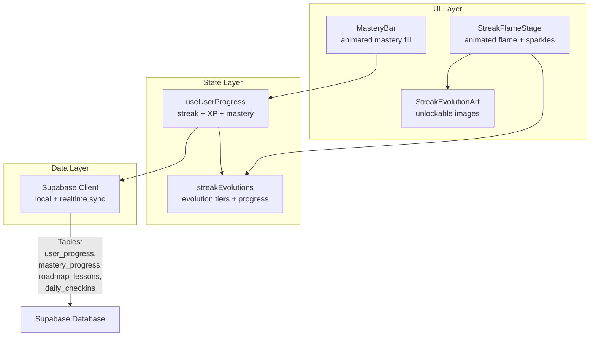
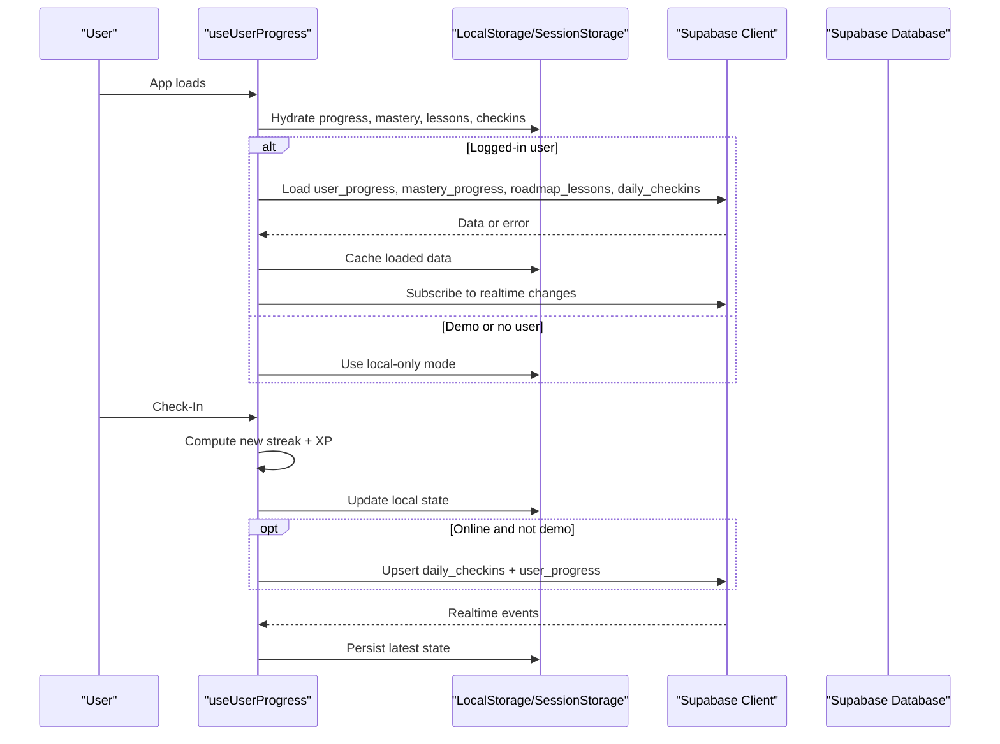
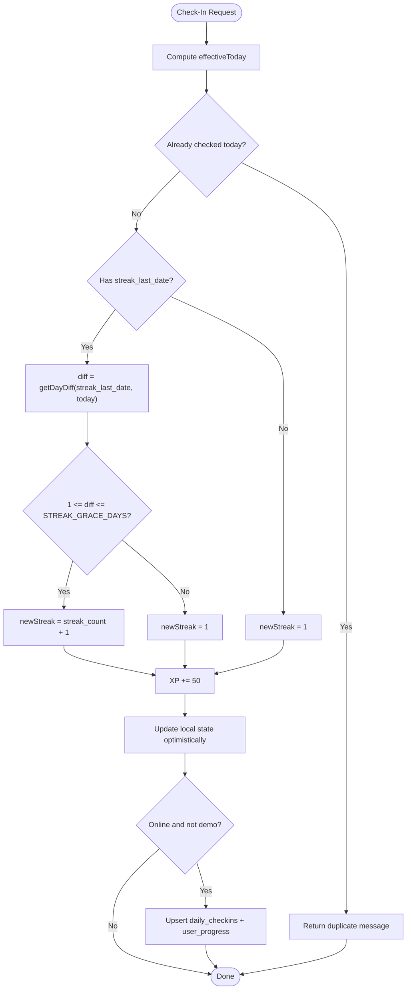
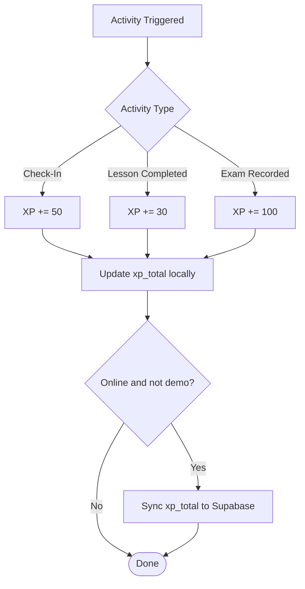
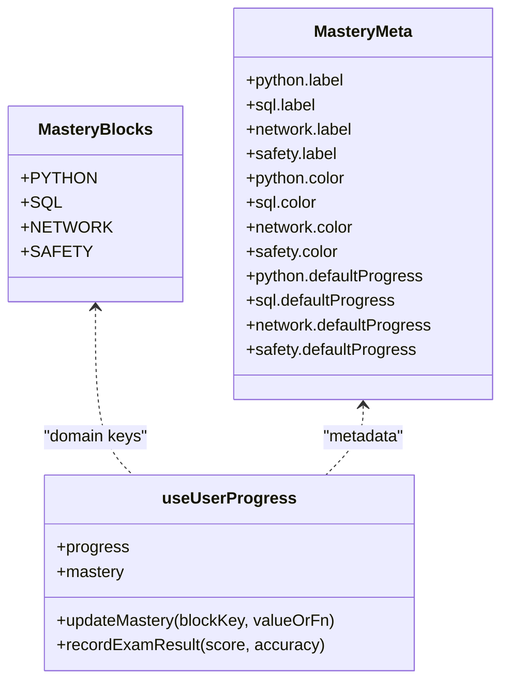
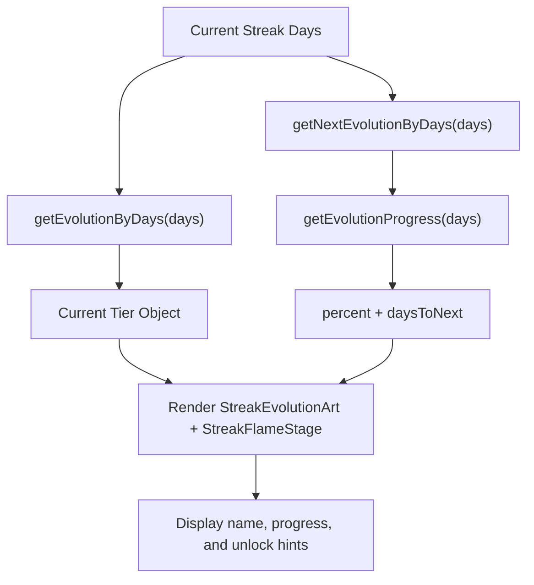
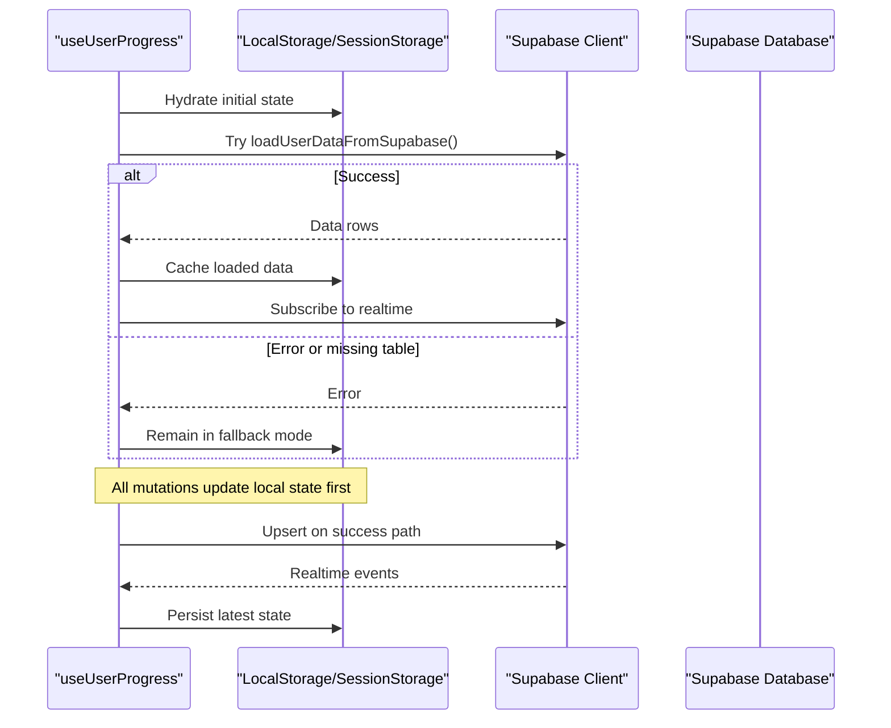
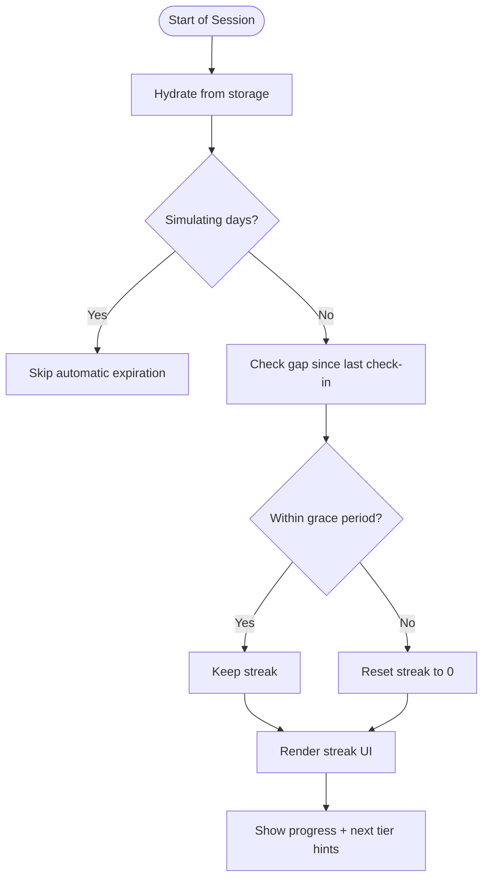
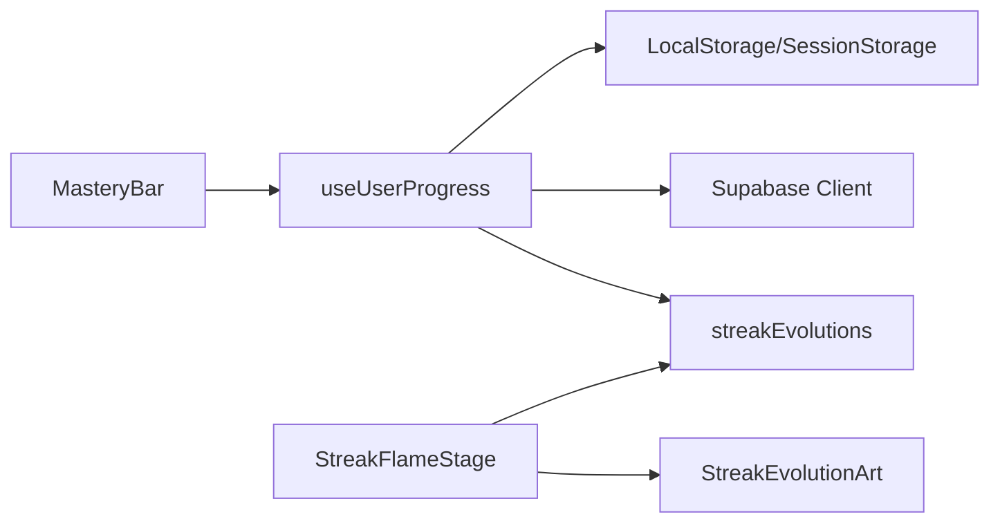

# Gamification System

<cite>
**Referenced Files in This Document**
- [userProgress.js](file://src/lib/userProgress.js)
- [streakEvolutions.js](file://src/lib/streakEvolutions.js)
- [StreakEvolutionArt.jsx](file://src/components/StreakEvolutionArt.jsx)
- [MasteryBar.jsx](file://src/components/motion/MasteryBar.jsx)
- [StreakFlameStage.jsx](file://src/components/motion/StreakFlameStage.jsx)
- [supabase.js](file://lib/supabase.js)
</cite>

## Table of Contents
1. [Introduction](#introduction)
2. [Project Structure](#project-structure)
3. [Core Components](#core-components)
4. [Architecture Overview](#architecture-overview)
5. [Detailed Component Analysis](#detailed-component-analysis)
6. [Dependency Analysis](#dependency-analysis)
7. [Performance Considerations](#performance-considerations)
8. [Troubleshooting Guide](#troubleshooting-guide)
9. [Conclusion](#conclusion)

## Introduction
This document explains MewTinHoc’s gamification system: how it tracks daily streaks with a grace period, calculates and accumulates XP points, progresses mastery across Python, SQL, Network, and Safety domains, and renders visual evolution animations that respond to user progress. It also documents the local storage fallback mechanism synchronized with Supabase, the streak validation logic, and how these systems motivate consistent learning habits.

The system is built around a single React hook that owns all gamification state, persists data locally, optionally syncs with Supabase, and exposes actions for check-in, lesson completion, exam recording, and mastery updates. Visual components render streak evolutions, mastery bars, and animated feedback.

## Project Structure
The gamification feature spans three main layers:

- State and persistence layer: `src/lib/userProgress.js`
- Streak evolution definitions and helpers: `src/lib/streakEvolutions.js`
- UI components: `src/components/StreakEvolutionArt.jsx`, `src/components/motion/StreakFlameStage.jsx`, `src/components/motion/MasteryBar.jsx`
- Supabase client configuration: `lib/supabase.js`

**Diagram sources**
- [userProgress.js:86-716](file://src/lib/userProgress.js#L86-L716)
- [streakEvolutions.js:20-167](file://src/lib/streakEvolutions.js#L20-L167)
- [StreakEvolutionArt.jsx:15-75](file://src/components/StreakEvolutionArt.jsx#L15-L75)
- [StreakFlameStage.jsx:13-191](file://src/components/motion/StreakFlameStage.jsx#L13-L191)
- [MasteryBar.jsx:16-41](file://src/components/motion/MasteryBar.jsx#L16-L41)
- [supabase.js:1-14](file://lib/supabase.js#L1-L14)

**Section sources**
- [userProgress.js:1-717](file://src/lib/userProgress.js#L1-L717)
- [streakEvolutions.js:1-168](file://src/lib/streakEvolutions.js#L1-L168)
- [StreakEvolutionArt.jsx:1-76](file://src/components/StreakEvolutionArt.jsx#L1-L76)
- [StreakFlameStage.jsx:1-192](file://src/components/motion/StreakFlameStage.jsx#L1-L192)
- [MasteryBar.jsx:1-42](file://src/components/motion/MasteryBar.jsx#L1-L42)
- [supabase.js:1-14](file://lib/supabase.js#L1-L14)

## Core Components
- **Gamification state hook**: `useUserProgress` manages streak count, last check-in date, total XP, mastery per domain, completed lessons, check-in history, database status, and simulation tools.
- **Streak evolution system**: Defines unlockable tiers based on streak days, computes current tier, next tier, and progress percentage.
- **Visual feedback components**: Render streak artwork, animated flame stages, and mastery progress bars.
- **Persistence and sync**: LocalStorage/sessionStorage fallback with optional Supabase synchronization and real-time updates.

Key responsibilities:
- Streak calculation with grace period handling
- XP accumulation for check-ins, lesson completion, and exams
- Mastery progression across Python, SQL, Network, and Safety
- Visual evolution animations responding to streak milestones
- Offline-first UX with Supabase as authoritative source when available

**Section sources**
- [userProgress.js:6-18](file://src/lib/userProgress.js#L6-L18)
- [userProgress.js:20-34](file://src/lib/userProgress.js#L20-L34)
- [userProgress.js:36-42](file://src/lib/userProgress.js#L36-L42)
- [userProgress.js:86-716](file://src/lib/userProgress.js#L86-L716)
- [streakEvolutions.js:20-167](file://src/lib/streakEvolutions.js#L20-L167)
- [StreakEvolutionArt.jsx:15-75](file://src/components/StreakEvolutionArt.jsx#L15-L75)
- [StreakFlameStage.jsx:13-191](file://src/components/motion/StreakFlameStage.jsx#L13-L191)
- [MasteryBar.jsx:16-41](file://src/components/motion/MasteryBar.jsx#L16-L41)

## Architecture Overview
The gamification architecture follows an offline-first pattern:

- On app load, the hook hydrates state from local storage or session storage (demo mode).
- If a logged-in user exists, it attempts to load data from Supabase tables: `user_progress`, `mastery_progress`, `roadmap_lessons`, and `daily_checkins`.
- Realtime subscriptions keep the UI in sync with server changes.
- All mutations are optimistic: they update local state immediately, then persist to Supabase if available.
- If Supabase is unavailable or errors occur, the system falls back to local storage and continues functioning.

**Diagram sources**
- [userProgress.js:86-716](file://src/lib/userProgress.js#L86-L716)
- [supabase.js:1-14](file://lib/supabase.js#L1-L14)

**Section sources**
- [userProgress.js:86-716](file://src/lib/userProgress.js#L86-L716)
- [supabase.js:1-14](file://lib/supabase.js#L1-L14)

## Detailed Component Analysis

### Streak Tracking Algorithm with Grace Period Handling
The streak algorithm enforces a maximum gap between two check-ins. The rule is:

- A streak remains active if the difference between the last check-in date and today is within the grace period.
- If the gap exceeds the grace period, the streak resets to zero.
- The grace period is defined as a constant and used consistently across calculations.

Key behaviors:
- Date formatting uses local time to avoid UTC drift.
- Day difference is computed using absolute day numbers derived from local dates.
- Automatic expiration runs only on real days (not simulated days), preventing fake data from being written to Supabase.
- Check-in action computes the new streak based on the last check-in date and the grace period.

**Diagram sources**
- [userProgress.js:44-83](file://src/lib/userProgress.js#L44-L83)
- [userProgress.js:210-240](file://src/lib/userProgress.js#L210-L240)
- [userProgress.js:477-536](file://src/lib/userProgress.js#L477-L536)

**Section sources**
- [userProgress.js:36-42](file://src/lib/userProgress.js#L36-L42)
- [userProgress.js:44-83](file://src/lib/userProgress.js#L44-L83)
- [userProgress.js:210-240](file://src/lib/userProgress.js#L210-L240)
- [userProgress.js:477-536](file://src/lib/userProgress.js#L477-L536)

### XP Points Calculation and Accumulation
XP is accumulated through three primary activities:

- Check-In: Adds a fixed amount of XP each successful daily check-in.
- Lesson Completion: Adds a fixed amount of XP when marking a lesson as completed.
- Exam Result Recording: Adds a fixed amount of XP when recording an exam result.

These increments are applied optimistically to local state and then persisted to Supabase when available. The hook maintains `xp_total` alongside other metrics such as streak count, average score, accuracy, and total exams.

Examples:
- Check-In: +50 XP
- Lesson Completion: +30 XP
- Exam Result Recording: +100 XP

**Diagram sources**
- [userProgress.js:477-536](file://src/lib/userProgress.js#L477-L536)
- [userProgress.js:566-606](file://src/lib/userProgress.js#L566-L606)
- [userProgress.js:608-644](file://src/lib/userProgress.js#L608-L644)

**Section sources**
- [userProgress.js:477-536](file://src/lib/userProgress.js#L477-L536)
- [userProgress.js:566-606](file://src/lib/userProgress.js#L566-L606)
- [userProgress.js:608-644](file://src/lib/userProgress.js#L608-L644)

### Mastery Level Progression Across Knowledge Domains
The system defines four knowledge domains:

- Python: Programming & Algorithms
- SQL: Databases & SQL
- Network: Computer Networks & Internet
- Safety: Digital Safety & ICT Ethics

Each domain has metadata including label, color, and default progress. Mastery values are clamped between 0 and 100 and updated via an optimistic setter function. When online and not in demo mode, updates are persisted to Supabase.

**Diagram sources**
- [userProgress.js:6-18](file://src/lib/userProgress.js#L6-L18)
- [userProgress.js:538-563](file://src/lib/userProgress.js#L538-L563)

**Section sources**
- [userProgress.js:6-18](file://src/lib/userProgress.js#L6-L18)
- [userProgress.js:538-563](file://src/lib/userProgress.js#L538-L563)

### Visual Evolution Animations Responding to User Progress
Streak evolution is represented by six tiers unlocked at specific streak thresholds. Each tier includes visual assets, colors, descriptions, and badge labels. The UI renders:

- Unlockable artwork images that appear monochrome until unlocked.
- Animated flame stage with subtle breathing and sparkle effects.
- Progress bar showing how close the user is to the next tier.
- Textual feedback indicating current evolution name and days remaining to unlock the next tier.

**Diagram sources**
- [streakEvolutions.js:20-167](file://src/lib/streakEvolutions.js#L20-L167)
- [StreakEvolutionArt.jsx:15-75](file://src/components/StreakEvolutionArt.jsx#L15-L75)
- [StreakFlameStage.jsx:13-191](file://src/components/motion/StreakFlameStage.jsx#L13-L191)

**Section sources**
- [streakEvolutions.js:20-167](file://src/lib/streakEvolutions.js#L20-L167)
- [StreakEvolutionArt.jsx:15-75](file://src/components/StreakEvolutionArt.jsx#L15-L75)
- [StreakFlameStage.jsx:13-191](file://src/components/motion/StreakFlameStage.jsx#L13-L191)

### Local Storage Fallback Mechanism with Supabase Synchronization
The system prioritizes local storage for immediate responsiveness and falls back gracefully when Supabase is unavailable:

- On initialization, state is hydrated from local storage or session storage.
- If a user is logged in, the hook attempts to load data from Supabase tables.
- Realtime subscriptions keep the UI synchronized with server changes.
- Mutations are optimistic: local state updates first, then Supabase writes follow.
- If Supabase fails, the system logs warnings and continues operating with local data.

**Diagram sources**
- [userProgress.js:86-716](file://src/lib/userProgress.js#L86-L716)
- [supabase.js:1-14](file://lib/supabase.js#L1-L14)

**Section sources**
- [userProgress.js:86-716](file://src/lib/userProgress.js#L86-L716)
- [supabase.js:1-14](file://lib/supabase.js#L1-L14)

### Streak Validation Logic and Motivation Design
The streak validation logic ensures consistency between local state and server data while providing forgiving grace periods to encourage habit formation:

- Grace period allows users to maintain streaks even if they miss a few days.
- Automatic expiration resets streaks when the gap exceeds the grace period.
- Simulation tools allow administrators to test streak behavior without affecting production data.
- Visual feedback reinforces motivation by displaying streak levels, progress toward next tiers, and animated rewards.

**Diagram sources**
- [userProgress.js:210-240](file://src/lib/userProgress.js#L210-L240)
- [userProgress.js:646-681](file://src/lib/userProgress.js#L646-L681)
- [StreakFlameStage.jsx:159-175](file://src/components/motion/StreakFlameStage.jsx#L159-L175)

**Section sources**
- [userProgress.js:210-240](file://src/lib/userProgress.js#L210-L240)
- [userProgress.js:646-681](file://src/lib/userProgress.js#L646-L681)
- [StreakFlameStage.jsx:159-175](file://src/components/motion/StreakFlameStage.jsx#L159-L175)

## Dependency Analysis
The gamification system has clear dependencies:

- `useUserProgress` depends on:
  - `streakEvolutions` for tier lookup and progress calculation
  - Supabase client for data loading, persistence, and realtime updates
  - Local storage/session storage for offline-first state hydration
- UI components depend on:
  - `StreakEvolutionArt` for rendering unlockable images
  - `StreakFlameStage` for animated flame and sparkle effects
  - `MasteryBar` for animated mastery progress visualization

**Diagram sources**
- [userProgress.js:86-716](file://src/lib/userProgress.js#L86-L716)
- [streakEvolutions.js:20-167](file://src/lib/streakEvolutions.js#L20-L167)
- [StreakEvolutionArt.jsx:15-75](file://src/components/StreakEvolutionArt.jsx#L15-L75)
- [StreakFlameStage.jsx:13-191](file://src/components/motion/StreakFlameStage.jsx#L13-L191)
- [MasteryBar.jsx:16-41](file://src/components/motion/MasteryBar.jsx#L16-L41)

**Section sources**
- [userProgress.js:86-716](file://src/lib/userProgress.js#L86-L716)
- [streakEvolutions.js:20-167](file://src/lib/streakEvolutions.js#L20-L167)
- [StreakEvolutionArt.jsx:15-75](file://src/components/StreakEvolutionArt.jsx#L15-L75)
- [StreakFlameStage.jsx:13-191](file://src/components/motion/StreakFlameStage.jsx#L13-L191)
- [MasteryBar.jsx:16-41](file://src/components/motion/MasteryBar.jsx#L16-L41)

## Performance Considerations
- Optimistic UI updates ensure responsive interactions without waiting for network responses.
- Local storage writes are throttled by React state changes and conditional checks to avoid unnecessary I/O.
- Realtime subscriptions are cleaned up on unmount to prevent memory leaks.
- Animation components respect reduced motion preferences for accessibility.
- Image assets for streak evolutions are static and cached by the browser, minimizing runtime overhead.

[No sources needed since this section provides general guidance]

## Troubleshooting Guide
Common issues and resolutions:

- **Supabase connection errors**: The system logs warnings and falls back to local storage. Verify environment variables and network connectivity.
- **Realtime subscription failures**: The system disables realtime updates but continues functioning with local state. Check channel status and permissions.
- **Streak not resetting**: Ensure automatic expiration logic runs on real days and not simulated days. Use simulation tools carefully.
- **XP not syncing**: Confirm that mutations are performed outside demo mode and that Supabase writes succeed.

**Section sources**
- [userProgress.js:273-382](file://src/lib/userProgress.js#L273-L382)
- [userProgress.js:384-475](file://src/lib/userProgress.js#L384-L475)
- [userProgress.js:510-529](file://src/lib/userProgress.js#L510-L529)
- [userProgress.js:551-562](file://src/lib/userProgress.js#L551-L562)
- [userProgress.js:583-603](file://src/lib/userProgress.js#L583-L603)
- [userProgress.js:625-639](file://src/lib/userProgress.js#L625-L639)

## Conclusion
MewTinHoc’s gamification system combines robust streak tracking, XP accumulation, mastery progression, and engaging visual feedback to motivate consistent learning. Its offline-first design ensures reliability, while Supabase synchronization provides cross-device persistence and real-time collaboration. The grace period handling makes streaks forgiving yet meaningful, encouraging users to build lasting study habits. By aligning mechanics with clear visual rewards, the system creates a compelling loop that celebrates progress and sustains engagement.

[No sources needed since this section summarizes without analyzing specific files]