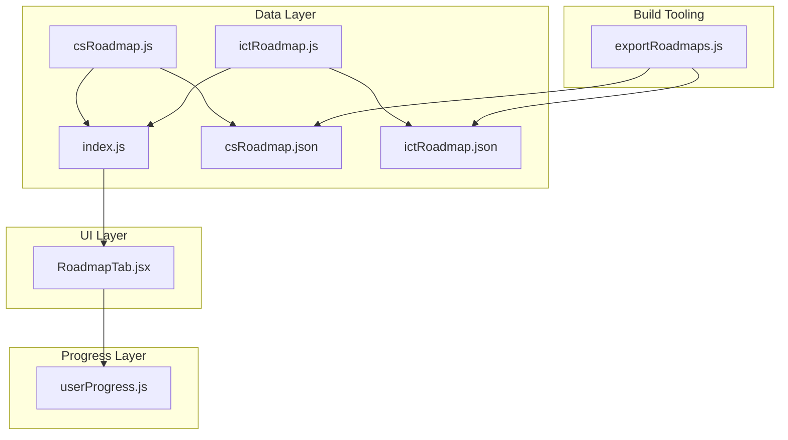
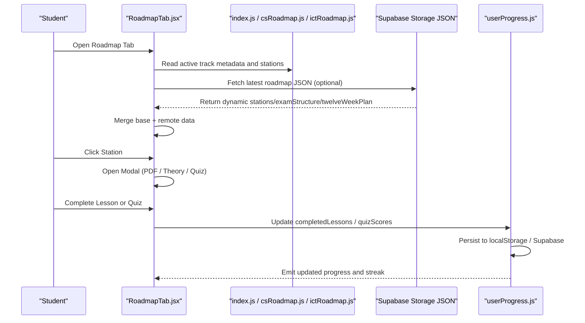
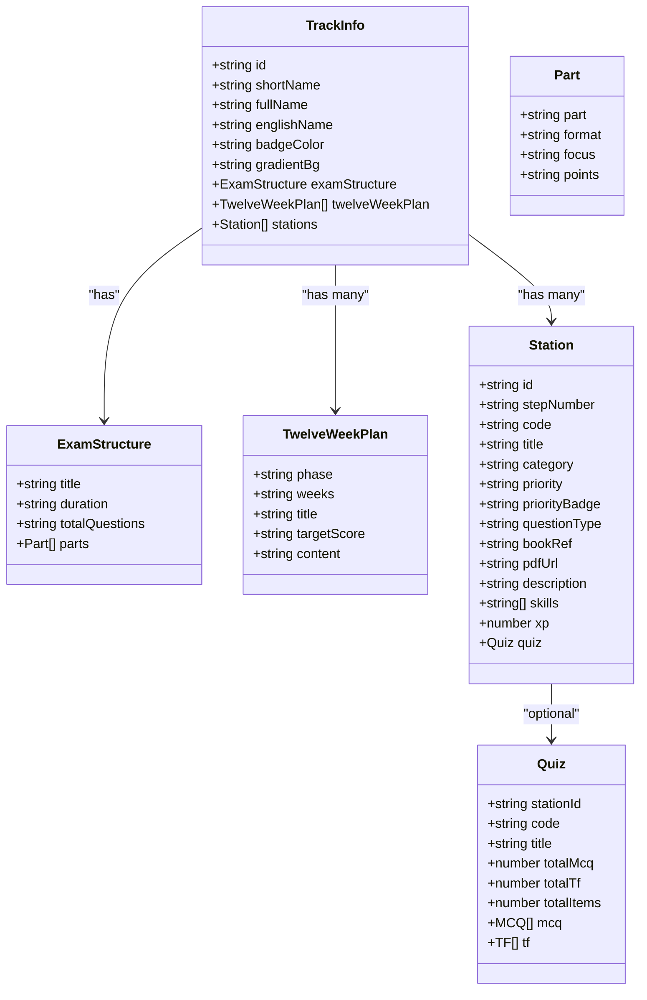
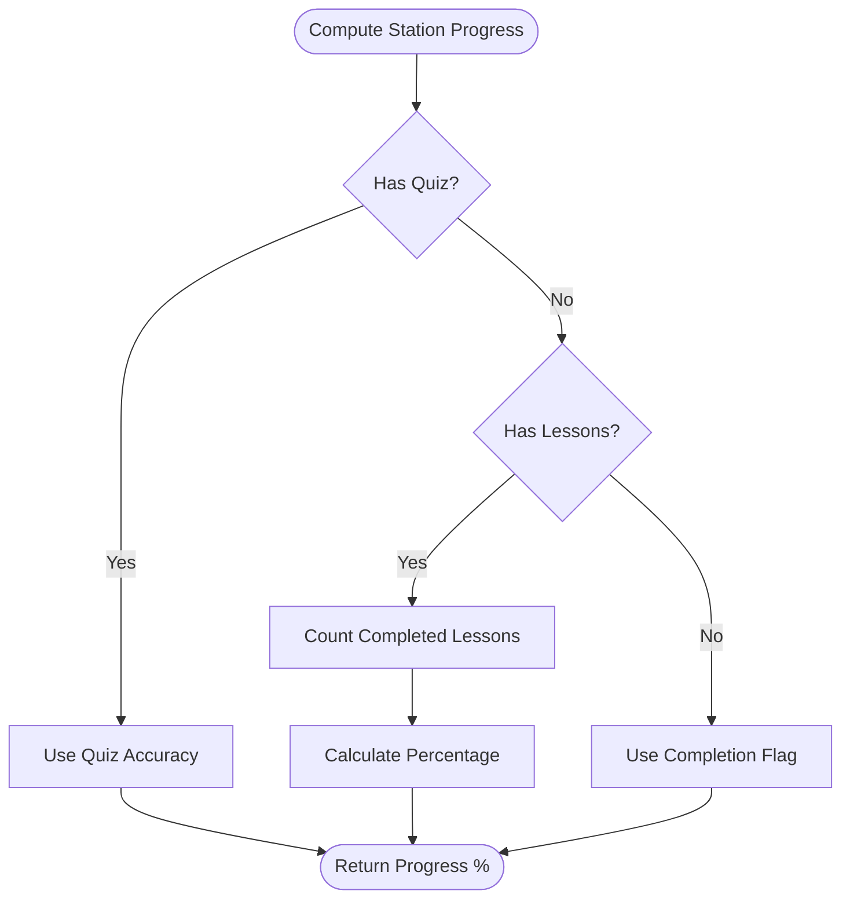
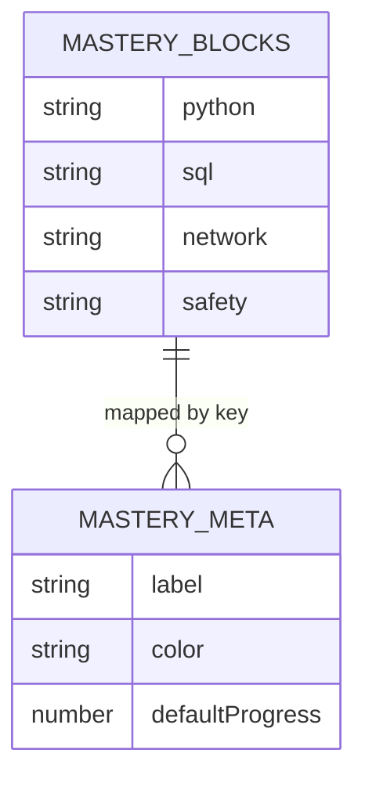
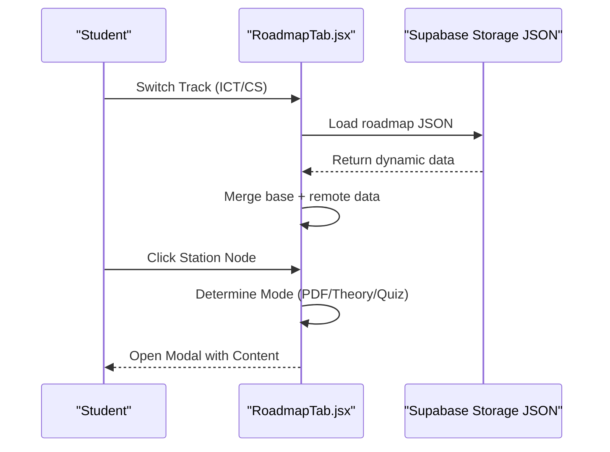
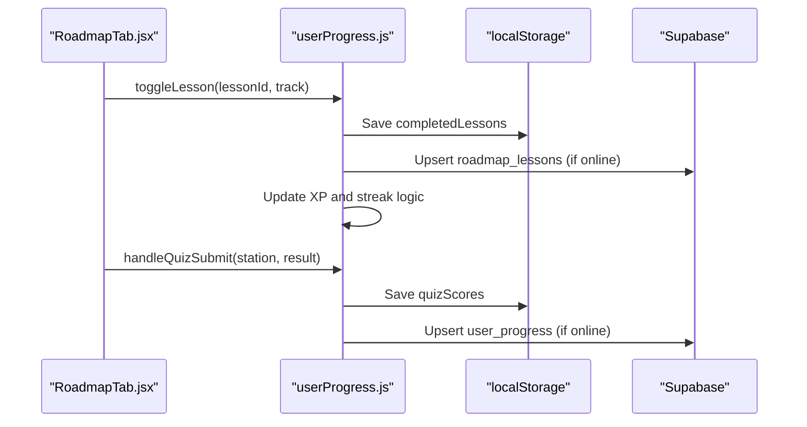

# Curriculum & Roadmap System

<cite>
**Referenced Files in This Document**   
- [csRoadmap.json](file://LoTrinhDayXich/csRoadmap.json)
- [ictRoadmap.json](file://LoTrinhDayXich/ictRoadmap.json)
- [csRoadmap.js](file://src/data/roadmap/csRoadmap.js)
- [ictRoadmap.js](file://src/data/roadmap/ictRoadmap.js)
- [index.js](file://src/data/roadmap/index.js)
- [RoadmapTab.jsx](file://src/components/RoadmapTab.jsx)
- [userProgress.js](file://src/lib/userProgress.js)
- [exportRoadmaps.js](file://scripts/exportRoadmaps.js)
</cite>

## Table of Contents
1. [Introduction](#introduction)
2. [Project Structure](#project-structure)
3. [Core Components](#core-components)
4. [Architecture Overview](#architecture-overview)
5. [Detailed Component Analysis](#detailed-component-analysis)
6. [Dependency Analysis](#dependency-analysis)
7. [Performance Considerations](#performance-considerations)
8. [Troubleshooting Guide](#troubleshooting-guide)
9. [Conclusion](#conclusion)

## Introduction
This document explains the curriculum and roadmap system that structures learning paths for two official tracks: Computer Science (CS) and Information Technology (ICT). It covers how lesson progression is tracked, how knowledge blocks are organized, how mastery levels are indicated, and how students navigate structured content aligned with national exam requirements. It also documents the roadmap data structure, JSON examples, and integration with progress tracking.

## Project Structure
The roadmap system is composed of:
- Static roadmap definitions in JavaScript modules.
- Exported JSON files used by Supabase Storage and the frontend.
- A React component that renders the visual roadmap, manages state, and integrates with progress tracking.
- A user progress hook that persists streaks, mastery blocks, completed lessons, and quiz scores.

**Diagram sources**
- [csRoadmap.js:1-236](file://src/data/roadmap/csRoadmap.js#L1-L236)
- [ictRoadmap.js:1-236](file://src/data/roadmap/ictRoadmap.js#L1-L236)
- [index.js:1-44](file://src/data/roadmap/index.js#L1-L44)
- [RoadmapTab.jsx:1-800](file://src/components/RoadmapTab.jsx#L1-L800)
- [userProgress.js:1-717](file://src/lib/userProgress.js#L1-L717)
- [exportRoadmaps.js:1-52](file://scripts/exportRoadmaps.js#L1-L52)

**Section sources**
- [csRoadmap.js:1-236](file://src/data/roadmap/csRoadmap.js#L1-L236)
- [ictRoadmap.js:1-236](file://src/data/roadmap/ictRoadmap.js#L1-L236)
- [index.js:1-44](file://src/data/roadmap/index.js#L1-L44)
- [RoadmapTab.jsx:1-800](file://src/components/RoadmapTab.jsx#L1-L800)
- [userProgress.js:1-717](file://src/lib/userProgress.js#L1-L717)
- [exportRoadmaps.js:1-52](file://scripts/exportRoadmaps.js#L1-L52)

## Core Components
- Track metadata and routing: defines ICT and CS track identifiers, colors, and default data references.
- Roadmap stations: ordered learning nodes with metadata such as priority, question type, skills, XP, optional PDF links, and optional quizzes.
- Exam structure and 12-week plan: aligns curriculum to the national exam format and provides a phased study strategy.
- UI controller: renders the chain-style roadmap, opens modal learning modes (PDF, theory, quiz), computes station progress, and handles sync with remote JSON.
- Progress tracking: maintains streaks, mastery blocks, completed lessons, and quiz scores; persists to localStorage and optionally Supabase.

Key responsibilities:
- Data definition: csRoadmap.js, ictRoadmap.js, index.js.
- User experience: RoadmapTab.jsx.
- Persistence and gamification: userProgress.js.
- Build-time export: exportRoadmaps.js.

**Section sources**
- [index.js:1-44](file://src/data/roadmap/index.js#L1-L44)
- [csRoadmap.js:1-236](file://src/data/roadmap/csRoadmap.js#L1-L236)
- [ictRoadmap.js:1-236](file://src/data/roadmap/ictRoadmap.js#L1-L236)
- [RoadmapTab.jsx:1-800](file://src/components/RoadmapTab.jsx#L1-L800)
- [userProgress.js:1-717](file://src/lib/userProgress.js#L1-L717)

## Architecture Overview
The system follows a layered architecture:
- Data layer: static JS modules define the canonical roadmap; build scripts export them to JSON for storage and CDN distribution.
- UI layer: a single tab component orchestrates navigation, modal learning modes, and progress visualization.
- Progress layer: a hook centralizes streaks, mastery, completed lessons, and quiz results, syncing with Supabase when available.

**Diagram sources**
- [RoadmapTab.jsx:154-196](file://src/components/RoadmapTab.jsx#L154-L196)
- [RoadmapTab.jsx:220-240](file://src/components/RoadmapTab.jsx#L220-L240)
- [userProgress.js:566-606](file://src/lib/userProgress.js#L566-L606)

## Detailed Component Analysis

### Roadmap Data Model
Each track defines:
- examStructure: title, duration, totalQuestions, parts with focus and points.
- twelveWeekPlan: phased schedule with target scores and content guidance.
- stations: ordered array of learning nodes.

Station fields include:
- id, stepNumber, code, title, category, priority, priorityBadge.
- questionType, bookRef, pdfUrl, description, skills, xp.
- Optional quiz object with mcq and tf arrays.

**Diagram sources**
- [index.js:9-34](file://src/data/roadmap/index.js#L9-L34)
- [csRoadmap.js:9-51](file://src/data/roadmap/csRoadmap.js#L9-L51)
- [csRoadmap.js:53-235](file://src/data/roadmap/csRoadmap.js#L53-L235)
- [ictRoadmap.js:9-51](file://src/data/roadmap/ictRoadmap.js#L9-L51)
- [ictRoadmap.js:53-235](file://src/data/roadmap/ictRoadmap.js#L53-L235)

**Section sources**
- [csRoadmap.js:9-235](file://src/data/roadmap/csRoadmap.js#L9-L235)
- [ictRoadmap.js:9-235](file://src/data/roadmap/ictRoadmap.js#L9-L235)
- [index.js:1-44](file://src/data/roadmap/index.js#L1-L44)

### National Exam Alignment
Both tracks align to the same national exam pattern:
- Total: 22 questions in 50 minutes.
- Part I: 18 multiple-choice questions covering foundational topics.
- Part II: 4 True/False questions with progressive scoring, specialized per track.

Track-specific focuses:
- CS: Python programming techniques, sorting/searching algorithms, SQL, AI/Machine Learning concepts.
- ICT: Advanced Excel functions, HTML/CSS web design, graphic/video editing tools.

These alignments are defined in each track’s examStructure and reflected in the 12-week plan phases.

**Section sources**
- [csRoadmap.js:9-27](file://src/data/roadmap/csRoadmap.js#L9-L27)
- [ictRoadmap.js:9-27](file://src/data/roadmap/ictRoadmap.js#L9-L27)
- [csRoadmap.js:29-51](file://src/data/roadmap/csRoadmap.js#L29-L51)
- [ictRoadmap.js:29-51](file://src/data/roadmap/ictRoadmap.js#L29-L51)

### Lesson Progression Tracking
Progress is computed per station using:
- Quiz accuracy if a quiz exists.
- Completed lessons within the station.
- Fallback to binary completion flag if no lessons exist.

Completion thresholds:
- Station considered complete at 80% or above.
- Individual lessons toggled via a global toggle function that updates local state and optionally Supabase.

**Diagram sources**
- [RoadmapTab.jsx:220-231](file://src/components/RoadmapTab.jsx#L220-L231)

**Section sources**
- [RoadmapTab.jsx:220-231](file://src/components/RoadmapTab.jsx#L220-L231)
- [RoadmapTab.jsx:301-313](file://src/components/RoadmapTab.jsx#L301-L313)
- [userProgress.js:566-606](file://src/lib/userProgress.js#L566-L606)

### Knowledge Block Organization and Mastery Indicators
Mastery is organized into four standardized blocks:
- Python: Programming and algorithms.
- SQL: Databases and queries.
- Network: Networking and Internet.
- Safety: Digital safety and ethics.

Each block has:
- Label and color.
- Default progress value.
- Persistent percentage stored locally and optionally on Supabase.

Mastery values influence dashboards and can be updated programmatically.

**Diagram sources**
- [userProgress.js:6-18](file://src/lib/userProgress.js#L6-L18)

**Section sources**
- [userProgress.js:6-18](file://src/lib/userProgress.js#L6-L18)
- [userProgress.js:538-563](file://src/lib/userProgress.js#L538-L563)

### Navigation Through Structured Content
Students navigate via:
- Track switcher buttons to select ICT or CS.
- Chain-style station nodes representing ordered steps.
- Modal learning modes:
  - PDF stream if a station includes a pdfUrl.
  - Theory mode for step-by-step lessons.
  - Quiz mode when a station includes a quiz.

The UI merges remote JSON overrides with local defaults, enabling live content updates without redeployments.

**Diagram sources**
- [RoadmapTab.jsx:154-196](file://src/components/RoadmapTab.jsx#L154-L196)
- [RoadmapTab.jsx:260-287](file://src/components/RoadmapTab.jsx#L260-L287)

**Section sources**
- [RoadmapTab.jsx:154-196](file://src/components/RoadmapTab.jsx#L154-L196)
- [RoadmapTab.jsx:260-287](file://src/components/RoadmapTab.jsx#L260-L287)

### Roadmap JSON Structures
Two parallel JSON schemas exist for both tracks:
- examStructure: describes the national exam format.
- twelveWeekPlan: outlines phased study goals.
- stations: ordered learning units with metadata and optional quizzes.

Example structure overview:
- Top-level keys: examStructure, twelveWeekPlan, stations.
- Each station includes: id, stepNumber, code, title, category, priority, priorityBadge, questionType, bookRef, pdfUrl, description, skills, xp, and optional quiz.

These JSON files are generated from the JS modules and published to both project directories and public assets.

**Section sources**
- [csRoadmap.json:1-582](file://LoTrinhDayXich/csRoadmap.json#L1-L582)
- [ictRoadmap.json:1-582](file://LoTrinhDayXich/ictRoadmap.json#L1-L582)
- [exportRoadmaps.js:9-46](file://scripts/exportRoadmaps.js#L9-L46)

### Integration with Progress Tracking
Integration points:
- Completed lessons: toggled via a callback that updates local state and optionally Supabase.
- Quiz scores: stored per track+station with accuracy and score10.
- Streaks and XP: maintained by the progress hook; check-ins award XP and update streaks.
- Mastery blocks: persisted percentages per knowledge area.

**Diagram sources**
- [RoadmapTab.jsx:233-240](file://src/components/RoadmapTab.jsx#L233-L240)
- [RoadmapTab.jsx:301-313](file://src/components/RoadmapTab.jsx#L301-L313)
- [userProgress.js:566-606](file://src/lib/userProgress.js#L566-L606)
- [userProgress.js:608-644](file://src/lib/userProgress.js#L608-L644)

**Section sources**
- [RoadmapTab.jsx:233-240](file://src/components/RoadmapTab.jsx#L233-L240)
- [RoadmapTab.jsx:301-313](file://src/components/RoadmapTab.jsx#L301-L313)
- [userProgress.js:566-606](file://src/lib/userProgress.js#L566-L606)
- [userProgress.js:608-644](file://src/lib/userProgress.js#L608-L644)

## Dependency Analysis
- RoadmapTab depends on:
  - TRACK_TYPES and TRACK_INFO from index.js.
  - getStationQuiz from questions module.
  - Remote roadmap utilities for fetching and saving JSON.
  - AdminTheoryEditor and StationQuizView for modal features.
- userProgress.js depends on:
  - Supabase client for persistence.
  - Streak evolution utilities for visual indicators.

Coupling:
- Low coupling between data modules and UI through well-defined exports.
- Clear separation between roadmap data and progress state.

Potential circular dependencies:
- None observed; imports are directional from UI to data and progress layers.

External integrations:
- Supabase Storage for roadmap JSON.
- Supabase Database for user progress and mastery.

**Section sources**
- [RoadmapTab.jsx:1-49](file://src/components/RoadmapTab.jsx#L1-L49)
- [index.js:1-44](file://src/data/roadmap/index.js#L1-L44)
- [userProgress.js:1-18](file://src/lib/userProgress.js#L1-L18)

## Performance Considerations
- Lazy loading of remote roadmap JSON reduces initial bundle size.
- Merging remote data with local defaults avoids unnecessary re-renders.
- LocalStorage caching ensures fast access to progress and quiz scores.
- Supabase Realtime subscriptions are scoped per user to minimize overhead.

Recommendations:
- Cache remote JSON responses where appropriate.
- Debounce frequent progress updates during rapid interactions.
- Preload frequently accessed station content based on user history.

[No sources needed since this section provides general guidance]

## Troubleshooting Guide
Common issues and resolutions:
- Remote roadmap not loading:
  - Check Supabase Storage permissions and file paths.
  - Verify fetchRemoteRoadmap returns success and data.
- Progress not persisting:
  - Ensure Supabase tables exist and user is authenticated.
  - Confirm localStorage fallback is working when offline.
- Streak resets unexpectedly:
  - Validate grace days logic and effective date calculations.
  - Check for day offset simulation interfering with real dates.

Operational tips:
- Use admin controls to refresh roadmap data and download JSON templates.
- Monitor sync status badges indicating cloud vs local data source.

**Section sources**
- [RoadmapTab.jsx:154-196](file://src/components/RoadmapTab.jsx#L154-L196)
- [RoadmapTab.jsx:436-510](file://src/components/RoadmapTab.jsx#L436-L510)
- [userProgress.js:210-240](file://src/lib/userProgress.js#L210-L240)
- [userProgress.js:477-536](file://src/lib/userProgress.js#L477-L536)

## Conclusion
The curriculum and roadmap system provides a structured, track-specific learning path aligned with national exam requirements. It combines clear data models, interactive UI navigation, and robust progress tracking to guide students through foundational topics and specialized content. The modular architecture supports dynamic content updates, persistent progress, and scalable maintenance through exported JSON and Supabase integrations.

[No sources needed since this section summarizes without analyzing specific files]