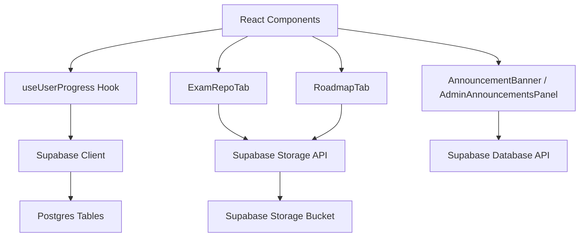
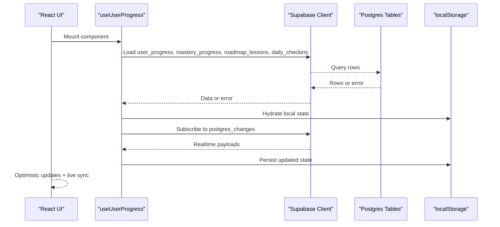
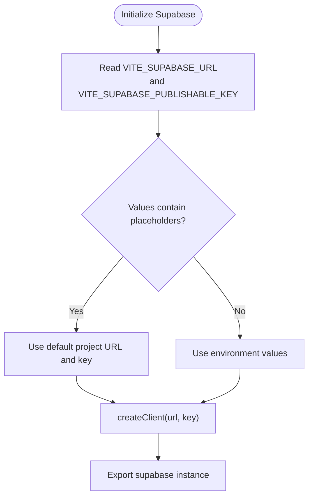
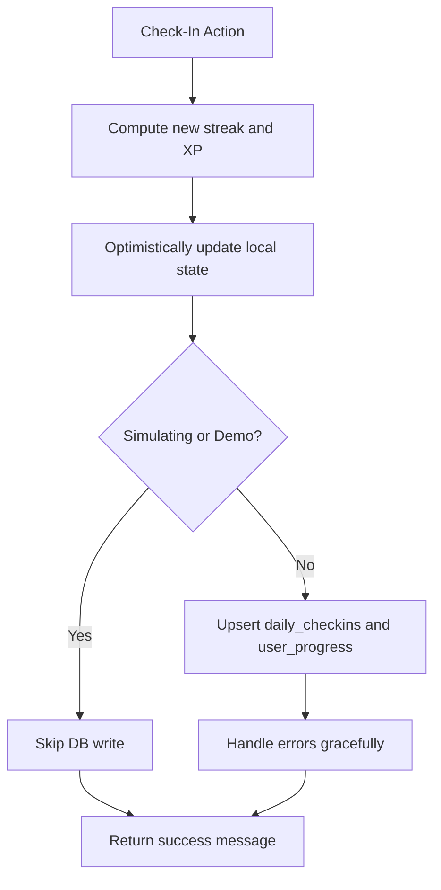
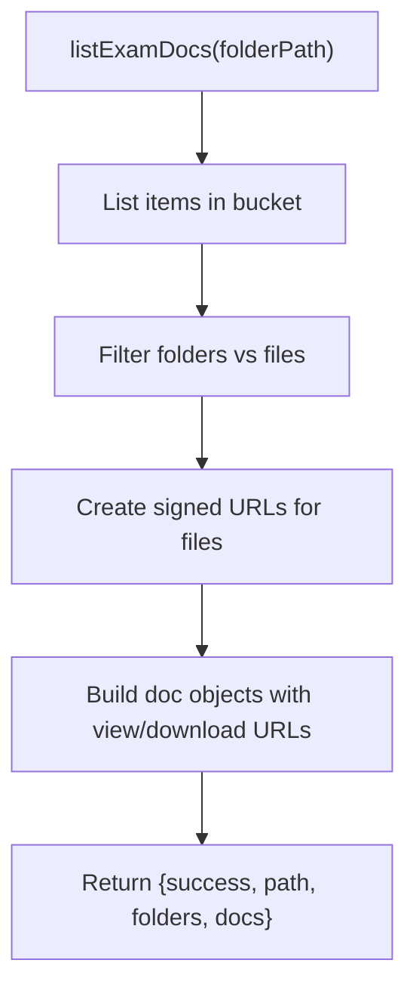
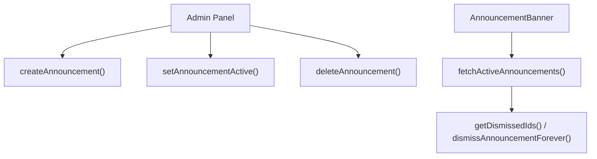
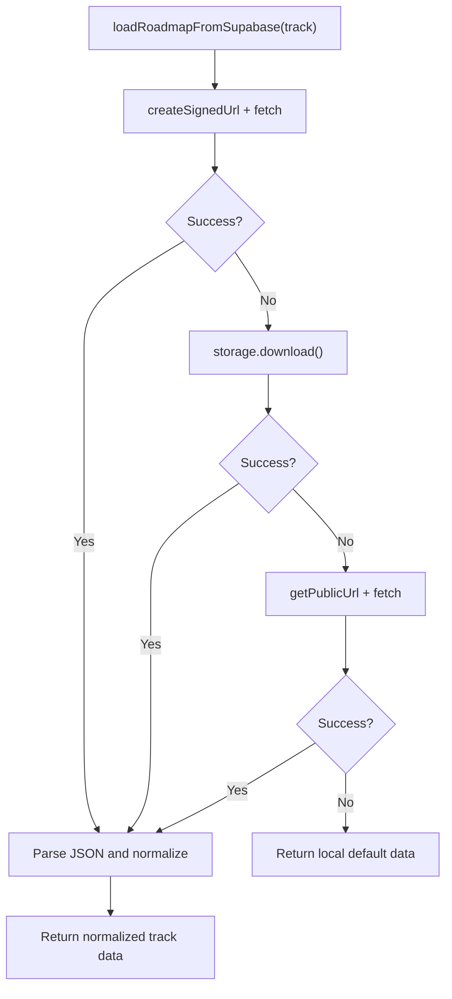
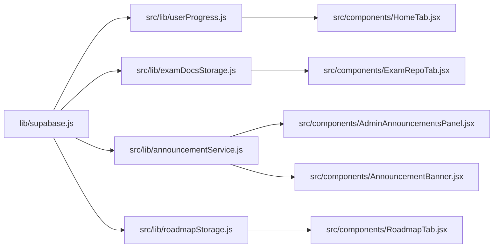

# Data Management & Storage

<cite>
**Referenced Files in This Document**
- [supabase.js](file://lib/supabase.js)
- [userProgress.js](file://src/lib/userProgress.js)
- [examDocsStorage.js](file://src/lib/examDocsStorage.js)
- [announcementService.js](file://src/lib/announcementService.js)
- [roadmapStorage.js](file://src/lib/roadmapStorage.js)
- [HomeTab.jsx](file://src/components/HomeTab.jsx)
- [ExamRepoTab.jsx](file://src/components/ExamRepoTab.jsx)
- [AdminAnnouncementsPanel.jsx](file://src/components/AdminAnnouncementsPanel.jsx)
- [AnnouncementBanner.jsx](file://src/components/AnnouncementBanner.jsx)
- [RoadmapTab.jsx](file://src/components/RoadmapTab.jsx)
</cite>

## Table of Contents
1. [Introduction](#introduction)
2. [Project Structure](#project-structure)
3. [Core Components](#core-components)
4. [Architecture Overview](#architecture-overview)
5. [Detailed Component Analysis](#detailed-component-analysis)
6. [Dependency Analysis](#dependency-analysis)
7. [Performance Considerations](#performance-considerations)
8. [Troubleshooting Guide](#troubleshooting-guide)
9. [Conclusion](#conclusion)

## Introduction
This document explains the data management and storage architecture for the application, focusing on:
- Supabase integration patterns for database, storage, and real-time subscriptions
- Local storage fallback mechanisms for offline-first behavior
- User progress persistence, streak logic, mastery tracking, and exam result recording
- Exam document storage with folder classification, signed URLs, and admin operations
- Announcement data management with RLS policies and per-user dismissal
- Roadmap content loading from Supabase Storage with local fallback and admin editing
- Database schema definitions, query patterns, caching strategies, and performance optimizations
- Data consistency, conflict resolution, and offline-first considerations

## Project Structure
The data layer is organized by feature modules under `src/lib`, with UI components consuming them:
- Supabase client initialization
- User progress hook with realtime sync and localStorage fallback
- Exam documents storage utilities
- Announcements service with SQL schema and RLS policies
- Roadmap storage utilities for JSON content
- UI components that render progress, announcements, roadmap, and exam repository

**Diagram sources**
- [userProgress.js:88-475](file://src/lib/userProgress.js#L88-L475)
- [examDocsStorage.js:160-232](file://src/lib/examDocsStorage.js#L160-L232)
- [announcementService.js:78-147](file://src/lib/announcementService.js#L78-L147)
- [roadmapStorage.js:18-149](file://src/lib/roadmapStorage.js#L18-L149)

**Section sources**
- [supabase.js:1-14](file://lib/supabase.js#L1-L14)
- [userProgress.js:88-475](file://src/lib/userProgress.js#L88-L475)
- [examDocsStorage.js:1-102](file://src/lib/examDocsStorage.js#L1-L102)
- [announcementService.js:1-75](file://src/lib/announcementService.js#L1-L75)
- [roadmapStorage.js:1-11](file://src/lib/roadmapStorage.js#L1-L11)

## Core Components
- Supabase client configuration and environment-aware URL/key handling
- User progress hook with optimistic updates, streak grace period, realtime subscriptions, and localStorage fallback
- Exam documents storage with typed folders, signed URLs, upload/rename/delete helpers
- Announcements service with RLS policies, active listing, admin CRUD, and per-user dismissal
- Roadmap storage with multi-path fetching (signed URL, download, public URL), raw payload handling, and admin save flow

Key responsibilities:
- Data synchronization between Supabase and local cache
- Offline-first resilience via localStorage/sessionStorage
- Realtime updates for user progress and lesson completion
- Secure file access through signed URLs
- Admin-only write paths with clear error messaging

**Section sources**
- [supabase.js:1-14](file://lib/supabase.js#L1-L14)
- [userProgress.js:88-717](file://src/lib/userProgress.js#L88-L717)
- [examDocsStorage.js:1-428](file://src/lib/examDocsStorage.js#L1-L428)
- [announcementService.js:1-169](file://src/lib/announcementService.js#L1-L169)
- [roadmapStorage.js:1-463](file://src/lib/roadmapStorage.js#L1-L463)

## Architecture Overview
The system uses a hybrid approach:
- Primary source: Supabase Postgres for structured data and Supabase Storage for files
- Secondary source: Browser localStorage/sessionStorage for fast, offline-first state
- Realtime channel: Subscriptions to Postgres changes for live UI updates
- Fallback strategy: If Supabase is unavailable or tables are missing, UI continues using local state

**Diagram sources**
- [userProgress.js:274-382](file://src/lib/userProgress.js#L274-L382)
- [userProgress.js:385-475](file://src/lib/userProgress.js#L385-L475)

## Detailed Component Analysis

### Supabase Client Initialization
- Reads environment variables for URL and key; falls back to default values if placeholders are present
- Exports a single Supabase client instance used across modules

**Diagram sources**
- [supabase.js:1-14](file://lib/supabase.js#L1-L14)

**Section sources**
- [supabase.js:1-14](file://lib/supabase.js#L1-L14)

### User Progress Persistence and Realtime Sync
Responsibilities:
- Manage streaks, XP, total exams, average score, accuracy
- Track mastery levels per knowledge block
- Track completed lessons in roadmap
- Maintain check-in history
- Provide optimistic UI updates and realtime sync
- Support simulation mode for admin testing without writing fake dates to DB

Data model (logical):
- user_progress: id, streak_count, streak_last_date, total_exams, avg_score, accuracy, xp_total, updated_at
- mastery_progress: user_id, block_key, progress, updated_at
- roadmap_lessons: user_id, track, lesson_id, completed, completed_at
- daily_checkins: user_id, checkin_date

Query patterns:
- Single-row load by id for user_progress
- Rowset queries filtered by user_id for mastery_progress, roadmap_lessons, daily_checkins
- Upsert operations with conflict keys for id, user_id+block_key, user_id+track+lesson_id, user_id+checkin_date

Realtime subscriptions:
- Listen to postgres_changes on all four tables filtered by user id
- Update local state immediately upon receiving new payloads

Local storage fallback:
- Keys prefixed by userId for isolation
- SessionStorage for demo mode; localStorage otherwise
- Hydration on mount; skip writes during simulation

Conflict resolution:
- Grace period for streak expiration based on effective date difference
- Idempotent upserts with explicit conflict constraints
- Simulation flags prevent writing mock dates to DB

**Diagram sources**
- [userProgress.js:478-536](file://src/lib/userProgress.js#L478-L536)

**Section sources**
- [userProgress.js:6-34](file://src/lib/userProgress.js#L6-L34)
- [userProgress.js:88-192](file://src/lib/userProgress.js#L88-L192)
- [userProgress.js:210-270](file://src/lib/userProgress.js#L210-L270)
- [userProgress.js:274-382](file://src/lib/userProgress.js#L274-L382)
- [userProgress.js:385-475](file://src/lib/userProgress.js#L385-L475)
- [userProgress.js:478-644](file://src/lib/userProgress.js#L478-L644)
- [userProgress.js:646-717](file://src/lib/userProgress.js#L646-L717)

### Exam Document Storage
Responsibilities:
- List folders and files within a bucket path
- Generate signed URLs for private buckets; fallback to public URLs
- Upload, rename, delete documents with validation and conflict checks
- Ensure doc-type folders exist using placeholder files
- Map storage folder names to display types via aliases

Key behaviors:
- Allowed extensions and max size enforced
- Unique filename generation to avoid overwrites
- Error messages translated to user-friendly Vietnamese guidance for RLS issues
- Signed URL batch creation for efficient preview/download links

**Diagram sources**
- [examDocsStorage.js:160-232](file://src/lib/examDocsStorage.js#L160-L232)

**Section sources**
- [examDocsStorage.js:1-102](file://src/lib/examDocsStorage.js#L1-L102)
- [examDocsStorage.js:160-232](file://src/lib/examDocsStorage.js#L160-L232)
- [examDocsStorage.js:242-306](file://src/lib/examDocsStorage.js#L242-L306)
- [examDocsStorage.js:312-378](file://src/lib/examDocsStorage.js#L312-L378)
- [examDocsStorage.js:381-428](file://src/lib/examDocsStorage.js#L381-L428)

### Announcement Data Management
Responsibilities:
- Define table schema and RLS policies for announcements
- Fetch active announcements for users
- Admin CRUD operations with permission checks
- Per-user dismissal stored in localStorage

Schema highlights:
- Table announcements with title, message, type, is_important, is_active, created_by, created_at
- RLS policies allow select for anon/authenticated when active; insert/update/delete only for admins
- Migration-safe ALTER COLUMN for is_important

Client behavior:
- Graceful fallback if column is missing
- Dismissal list persisted locally; UI hides dismissed announcements

**Diagram sources**
- [announcementService.js:24-63](file://src/lib/announcementService.js#L24-L63)
- [announcementService.js:78-147](file://src/lib/announcementService.js#L78-L147)
- [announcementService.js:151-169](file://src/lib/announcementService.js#L151-L169)

**Section sources**
- [announcementService.js:1-75](file://src/lib/announcementService.js#L1-L75)
- [announcementService.js:78-147](file://src/lib/announcementService.js#L78-L147)
- [announcementService.js:151-169](file://src/lib/announcementService.js#L151-L169)

### Roadmap Content Loading and Admin Editing
Responsibilities:
- Load roadmap JSON from Supabase Storage with multiple fallback strategies
- Normalize both array and object formats
- Provide raw payload for admin editor
- Save edited roadmap back to Supabase Storage
- Resolve static URLs to signed URLs for private buckets

Fetch strategy:
- Try createSignedUrl then fetch
- Try storage.download()
- Try getPublicUrl then fetch
- Fallback to local default data if none succeed

Admin flow:
- Load raw JSON
- Edit lesson content
- Build payload and upload with upsert
- Refresh UI cache

**Diagram sources**
- [roadmapStorage.js:18-149](file://src/lib/roadmapStorage.js#L18-L149)

**Section sources**
- [roadmapStorage.js:1-11](file://src/lib/roadmapStorage.js#L1-L11)
- [roadmapStorage.js:18-149](file://src/lib/roadmapStorage.js#L18-L149)
- [roadmapStorage.js:156-256](file://src/lib/roadmapStorage.js#L156-L256)
- [roadmapStorage.js:263-305](file://src/lib/roadmapStorage.js#L263-L305)
- [roadmapStorage.js:311-405](file://src/lib/roadmapStorage.js#L311-L405)
- [roadmapStorage.js:412-463](file://src/lib/roadmapStorage.js#L412-L463)

### UI Integration Points
- HomeTab consumes useUserProgress for streak, mastery, and metrics
- ExamRepoTab uses examDocsStorage for listing, uploading, renaming, deleting
- AdminAnnouncementsPanel uses announcementService for CRUD and SQL migration prompts
- AnnouncementBanner displays active announcements and handles dismissal
- RoadmapTab integrates roadmapStorage for dynamic content and admin editing

**Section sources**
- [HomeTab.jsx:66-196](file://src/components/HomeTab.jsx#L66-L196)
- [ExamRepoTab.jsx:96-234](file://src/components/ExamRepoTab.jsx#L96-L234)
- [AdminAnnouncementsPanel.jsx:49-116](file://src/components/AdminAnnouncementsPanel.jsx#L49-L116)
- [AnnouncementBanner.jsx:30-86](file://src/components/AnnouncementBanner.jsx#L30-L86)
- [RoadmapTab.jsx:154-196](file://src/components/RoadmapTab.jsx#L154-L196)

## Dependency Analysis
High-level dependencies:
- All modules depend on the exported Supabase client
- useUserProgress depends on Supabase DB and Realtime
- examDocsStorage depends on Supabase Storage
- announcementService depends on Supabase DB and RLS policies
- roadmapStorage depends on Supabase Storage and fetch

**Diagram sources**
- [supabase.js:1-14](file://lib/supabase.js#L1-L14)
- [userProgress.js:1-3](file://src/lib/userProgress.js#L1-L3)
- [examDocsStorage.js:1-1](file://src/lib/examDocsStorage.js#L1-L1)
- [announcementService.js:1-1](file://src/lib/announcementService.js#L1-L1)
- [roadmapStorage.js:1-1](file://src/lib/roadmapStorage.js#L1-L1)

**Section sources**
- [supabase.js:1-14](file://lib/supabase.js#L1-L14)
- [userProgress.js:1-3](file://src/lib/userProgress.js#L1-L3)
- [examDocsStorage.js:1-1](file://src/lib/examDocsStorage.js#L1-L1)
- [announcementService.js:1-1](file://src/lib/announcementService.js#L1-L1)
- [roadmapStorage.js:1-1](file://src/lib/roadmapStorage.js#L1-L1)

## Performance Considerations
- Realtime subscriptions are scoped to user id to minimize payload size
- Signed URL batch creation reduces per-file overhead for previews
- LocalStorage hydration avoids unnecessary network calls on reload
- Fallback strategies ensure UI remains responsive even when Supabase is down
- Avoid writing mock dates to DB during simulation to prevent stale data
- Use upsert with conflict constraints to reduce redundant writes and conflicts

[No sources needed since this section provides general guidance]

## Troubleshooting Guide
Common issues and resolutions:
- Missing announcements table or column: Run provided SQL to create table and add is_important column
- Storage RLS errors: Use helper functions to test write permissions and follow error messages to enable policies
- Private bucket NoSuchBucket: Use signed URLs instead of public URLs; resolveStorageUrl helper converts static paths
- Realtime not updating: Verify subscription status and channel cleanup; check user id filters
- Streak not resetting: Ensure effective date calculation and grace period logic are applied; simulation should not persist fake dates

Operational tips:
- For announcements, copy and run the SQL snippet from the admin panel when prompted
- For storage, use the “test write” utility to diagnose policy issues before bulk operations
- For roadmap, refresh after saving to ensure UI reflects cloud changes

**Section sources**
- [announcementService.js:20-75](file://src/lib/announcementService.js#L20-L75)
- [examDocsStorage.js:131-147](file://src/lib/examDocsStorage.js#L131-L147)
- [roadmapStorage.js:412-463](file://src/lib/roadmapStorage.js#L412-L463)

## Conclusion
The application implements a robust, offline-first data layer centered on Supabase:
- Structured data and realtime updates via Postgres
- File assets managed through Storage with secure signed URLs
- Local storage fallback ensuring resilience and speed
- Clear admin workflows for content and announcements
- Careful conflict resolution and graceful error handling

This design balances reliability, performance, and usability while supporting both learners and administrators effectively.