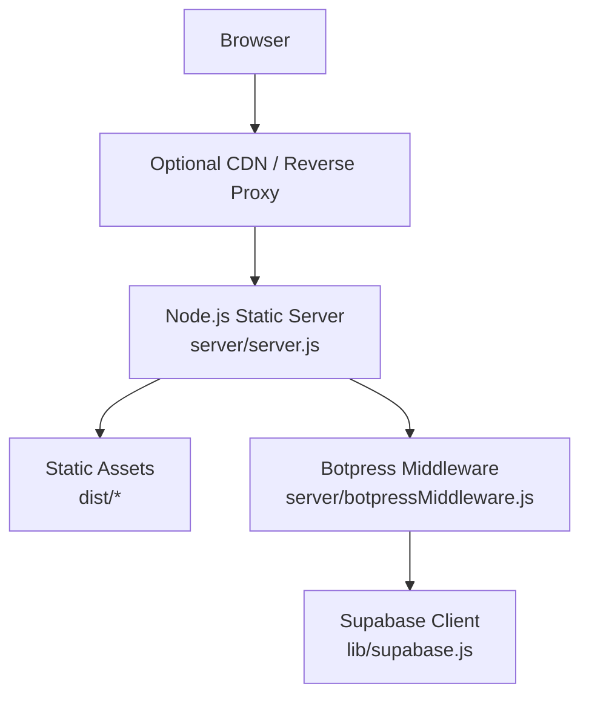
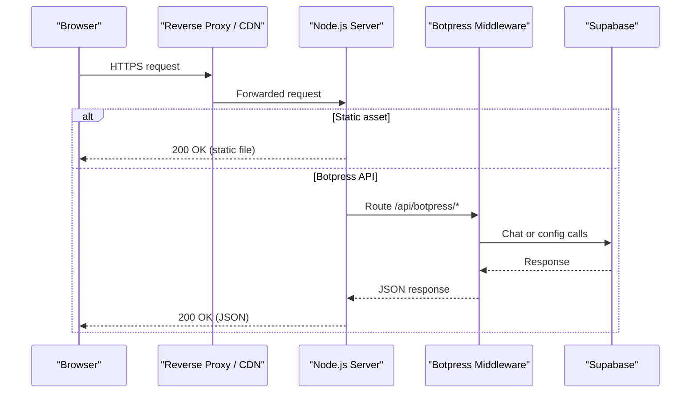
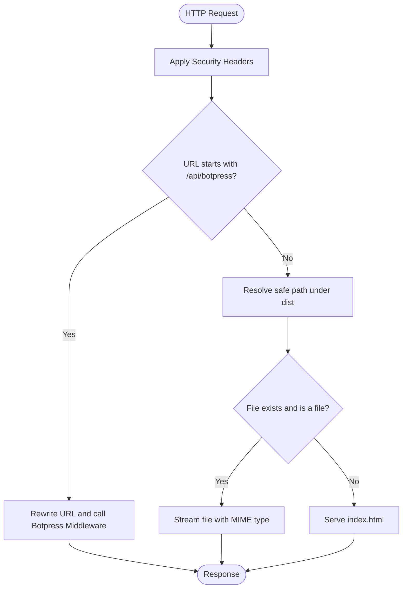
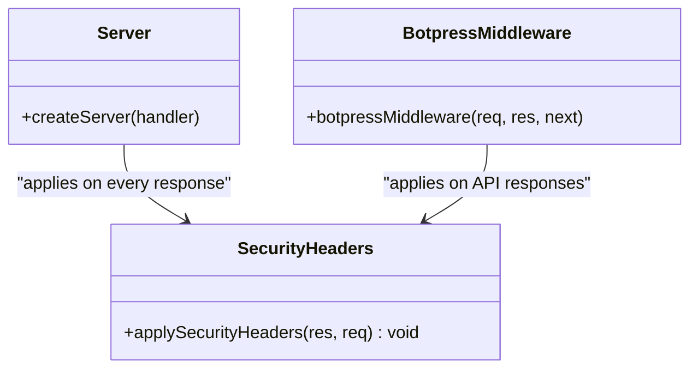
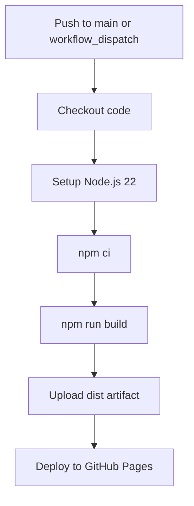
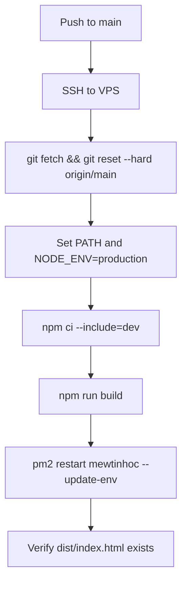
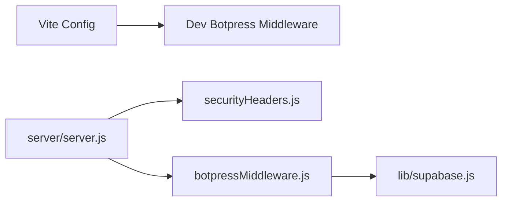

# Deployment & Production Setup

<cite>
**Referenced Files in This Document**
- [package.json](file://package.json)
- [vite.config.js](file://vite.config.js)
- [server/server.js](file://server/server.js)
- [server/securityHeaders.js](file://server/securityHeaders.js)
- [server/botpressMiddleware.js](file://server/botpressMiddleware.js)
- [lib/supabase.js](file://lib/supabase.js)
- [.github/workflows/deploy.yml](file://.github/workflows/deploy.yml)
- [.github/workflows/deploy-vps.yml](file://.github/workflows/deploy-vps.yml)
</cite>

## Table of Contents
1. [Introduction](#introduction)
2. [Project Structure](#project-structure)
3. [Core Components](#core-components)
4. [Architecture Overview](#architecture-overview)
5. [Detailed Component Analysis](#detailed-component-analysis)
6. [Dependency Analysis](#dependency-analysis)
7. [Performance Considerations](#performance-considerations)
8. [Troubleshooting Guide](#troubleshooting-guide)
9. [Conclusion](#conclusion)

## Introduction
This document explains how to deploy and operate the project in production. It covers:
- Production server configuration for static file serving
- Security headers implementation
- Environment variable management
- CI/CD pipelines using GitHub Actions
- Deployment strategies for GitHub Pages and a VPS
- Build optimization, asset bundling, caching, and performance tuning
- SSL configuration, domain setup, and troubleshooting

The application is a React + Vite frontend with a small Node.js HTTP server that serves the built assets and proxies Botpress chat endpoints.

## Project Structure
At deployment time, two main artifacts are relevant:
- Frontend build output under `dist`, produced by Vite
- A lightweight Node.js server that serves `dist` and handles `/api/botpress*` routes

**Diagram sources**
- [server/server.js:10-79](file://server/server.js#L10-L79)
- [server/botpressMiddleware.js:65-132](file://server/botpressMiddleware.js#L65-L132)
- [lib/supabase.js:1-14](file://lib/supabase.js#L1-L14)

**Section sources**
- [package.json:6-12](file://package.json#L6-L12)
- [vite.config.js:6-21](file://vite.config.js#L6-L21)
- [server/server.js:10-79](file://server/server.js#L10-L79)

## Core Components
- **Build tool**: Vite builds the React app into `dist`. The build script is defined in package scripts.
- **Production server**: A minimal Node.js HTTP server serves static files from `dist` and applies security headers.
- **Security headers**: Centralized header policy including CSP, HSTS, frame options, and permissions policy.
- **Botpress middleware**: Handles chat, status, files, and reset endpoints with CORS, body size limits, and session cookies.
- **Environment variables**:
  - Runtime: `PORT`, `NODE_ENV`, `BOTPRESS_ALLOWED_ORIGIN`
  - Build-time (Vite): `VITE_SUPABASE_URL`, `VITE_SUPABASE_PUBLISHABLE_KEY`

**Section sources**
- [package.json:6-12](file://package.json#L6-L12)
- [server/server.js:12-23](file://server/server.js#L12-L23)
- [server/securityHeaders.js:1-29](file://server/securityHeaders.js#L1-L29)
- [server/botpressMiddleware.js:5-52](file://server/botpressMiddleware.js#L5-L52)
- [lib/supabase.js:3-12](file://lib/supabase.js#L3-L12)

## Architecture Overview
The production architecture consists of:
- A reverse proxy or CDN in front of the Node.js server for TLS termination and caching
- The Node.js server serving static assets and API routes
- External services: Botpress Cloud and Supabase

**Diagram sources**
- [server/server.js:40-79](file://server/server.js#L40-L79)
- [server/botpressMiddleware.js:65-132](file://server/botpressMiddleware.js#L65-L132)
- [lib/supabase.js:1-14](file://lib/supabase.js#L1-L14)

## Detailed Component Analysis

### Production Server Configuration
The server:
- Reads `PORT` from environment variables, defaulting to `3001`
- Serves static files from `dist` with correct MIME types
- Falls back to `index.html` for SPA routing
- Applies security headers to every response
- Proxies `/api/botpress*` requests to the Botpress middleware

**Diagram sources**
- [server/server.js:40-79](file://server/server.js#L40-L79)

Key behaviors:
- Path resolution prevents directory traversal outside `dist`
- Missing or invalid paths return a 503 when the static build is not ready
- Content-Type is determined by file extension mapping

**Section sources**
- [server/server.js:12-23](file://server/server.js#L12-L23)
- [server/server.js:25-38](file://server/server.js#L25-L38)
- [server/server.js:52-74](file://server/server.js#L52-L74)

### Security Headers Implementation
All responses include:
- Content-Security-Policy tailored for self-hosted assets, Google accounts, Botpress CDN, and fonts
- X-Content-Type-Options set to nosniff
- X-Frame-Options SAMEORIGIN
- Referrer-Policy strict-origin-when-cross-origin
- Permissions-Policy disabling sensitive browser features
- Strict-Transport-Security when HTTPS is detected or running in production

**Diagram sources**
- [server/securityHeaders.js:14-29](file://server/securityHeaders.js#L14-L29)
- [server/server.js:40-41](file://server/server.js#L40-L41)
- [server/botpressMiddleware.js:65-66](file://server/botpressMiddleware.js#L65-L66)

**Section sources**
- [server/securityHeaders.js:1-29](file://server/securityHeaders.js#L1-L29)

### Environment Variable Management
Runtime variables:
- `PORT`: Server listening port
- `NODE_ENV`: Used to enable secure cookie behavior and HSTS logic
- `BOTPRESS_ALLOWED_ORIGIN`: Controls CORS for Botpress endpoints

Build-time variables (Vite):
- `VITE_SUPABASE_URL`: Supabase project URL
- `VITE_SUPABASE_PUBLISHABLE_KEY`: Supabase anonymous key

Notes:
- Supabase client reads Vite env vars at build time and falls back to defaults if placeholders are present
- Botpress middleware sets Secure cookie flag only when `NODE_ENV=production`

**Section sources**
- [server/server.js:12](file://server/server.js#L12)
- [server/securityHeaders.js:24-28](file://server/securityHeaders.js#L24-L28)
- [server/botpressMiddleware.js:49-50](file://server/botpressMiddleware.js#L49-L50)
- [lib/supabase.js:3-12](file://lib/supabase.js#L3-L12)

### CI/CD Pipeline Setup

#### GitHub Pages Deployment
- Triggers on push to `main` or manual dispatch
- Uses Node.js 22 with npm cache enabled
- Installs dependencies, builds the app, uploads `dist` artifact, and deploys via GitHub Pages

**Diagram sources**
- [.github/workflows/deploy.yml:1-52](file://.github/workflows/deploy.yml#L1-L52)

**Section sources**
- [.github/workflows/deploy.yml:1-52](file://.github/workflows/deploy.yml#L1-L52)

#### VPS Deployment
- Triggers on push to `main`
- Connects to the VPS via SSH using a secret key
- Pulls latest code, installs dependencies including devDependencies for building, runs the build, sets `NODE_ENV=production`, and restarts the process manager (PM2)

**Diagram sources**
- [.github/workflows/deploy-vps.yml:1-37](file://.github/workflows/deploy-vps.yml#L1-L37)

**Section sources**
- [.github/workflows/deploy-vps.yml:1-37](file://.github/workflows/deploy-vps.yml#L1-L37)

### Build Process Optimization and Asset Bundling
- Vite is used for development and production builds
- CSS minification is disabled in the current Vite config; consider enabling it in production for smaller payloads
- The build outputs static assets under `dist`, which the server serves directly

Recommendations:
- Enable CSS minification in production builds
- Use content hashing (default in Vite) for long-term caching
- Avoid unnecessary large dependencies; audit bundle size regularly

**Section sources**
- [vite.config.js:18-20](file://vite.config.js#L18-L20)
- [package.json:6-12](file://package.json#L6-L12)

### Caching Strategies
- Static assets should be served with immutable caching headers via your reverse proxy or CDN
- HTML entry (`index.html`) should be cached with short TTL or no-store to ensure updates propagate
- API responses from Botpress middleware explicitly set `Cache-Control: no-store`

**Section sources**
- [server/botpressMiddleware.js:58-63](file://server/botpressMiddleware.js#L58-L63)

### Performance Tuning for Production
- Enable gzip or Brotli compression at the reverse proxy layer
- Tune TCP keepalive and connection pooling at the proxy level
- Ensure Node.js server runs behind a process manager like PM2 with clustering if needed
- Monitor memory usage and CPU utilization; adjust instance count accordingly

[No sources needed since this section provides general guidance]

### SSL Configuration and Domain Setup
- HSTS is applied automatically when HTTPS is detected or when `NODE_ENV=production`
- For production deployments:
  - Terminate TLS at a reverse proxy (Nginx, Traefik, Cloudflare) or use a managed platform
  - Configure domain DNS records to point to your server or CDN
  - Enforce HTTPS-only redirects at the proxy level
  - Set up automatic certificate renewal (e.g., Let’s Encrypt)

**Section sources**
- [server/securityHeaders.js:24-28](file://server/securityHeaders.js#L24-L28)

## Dependency Analysis
The runtime dependency graph includes:
- Node.js HTTP server depending on security headers and Botpress middleware
- Botpress middleware depending on external services (Supabase)
- Vite build pipeline depending on React plugin and custom middleware during development

**Diagram sources**
- [vite.config.js:1-17](file://vite.config.js#L1-L17)
- [server/server.js:5-6](file://server/server.js#L5-L6)
- [server/botpressMiddleware.js:1-3](file://server/botpressMiddleware.js#L1-L3)
- [lib/supabase.js:1-14](file://lib/supabase.js#L1-L14)

**Section sources**
- [vite.config.js:1-17](file://vite.config.js#L1-L17)
- [server/server.js:5-6](file://server/server.js#L5-L6)
- [server/botpressMiddleware.js:1-3](file://server/botpressMiddleware.js#L1-L3)
- [lib/supabase.js:1-14](file://lib/supabase.js#L1-L14)

## Performance Considerations
- Prefer serving static assets through a CDN or reverse proxy with compression enabled
- Minimize payload sizes by removing unused dependencies and optimizing images
- Use lazy loading for heavy components and PDF rendering where possible
- Cache API responses selectively based on data freshness requirements
- Monitor server metrics and set alerts for error rates and latency spikes

[No sources needed since this section provides general guidance]

## Troubleshooting Guide
Common issues and resolutions:
- **Static build not ready**: If `dist` is missing or incomplete, the server returns a 503. Re-run the build step before starting the server.
- **Bad request errors**: Occur when requested paths resolve outside `dist`. Ensure URLs are valid and do not attempt directory traversal.
- **CORS failures**: Confirm `BOTPRESS_ALLOWED_ORIGIN` matches the browser origin exactly. Preflight OPTIONS requests must succeed.
- **HSTS not applied**: Ensure HTTPS is terminated upstream or `NODE_ENV=production` is set.
- **Supabase connection issues**: Verify `VITE_SUPABASE_URL` and `VITE_SUPABASE_PUBLISHABLE_KEY` are correctly injected at build time.
- **Botpress chat errors**: Check endpoint method restrictions and message validation. Large payloads are rejected with 413.

Operational checks:
- Verify `dist/index.html` exists after deployment
- Confirm PM2 process is running and logs show successful startup
- Test critical endpoints: `/`, `/api/botpress/status`, `/api/botpress/chat`

**Section sources**
- [server/server.js:52-74](file://server/server.js#L52-L74)
- [server/botpressMiddleware.js:18-35](file://server/botpressMiddleware.js#L18-L35)
- [server/botpressMiddleware.js:69-87](file://server/botpressMiddleware.js#L69-L87)
- [lib/supabase.js:3-12](file://lib/supabase.js#L3-L12)

## Conclusion
This project uses a simple but robust production setup:
- Vite builds a static React application
- A Node.js server serves assets and secures responses with comprehensive headers
- CI/CD automates deployments to GitHub Pages and a VPS
- Environment variables control runtime behavior and third-party integrations

For best results in production:
- Run behind a reverse proxy or CDN with TLS and compression
- Pin and review dependencies regularly
- Monitor performance and errors
- Keep environment variables and secrets out of source control

[No sources needed since this section summarizes without analyzing specific files]