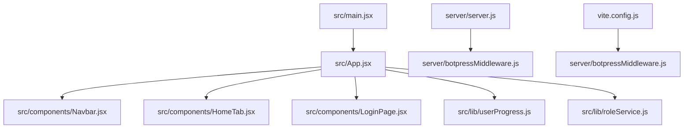
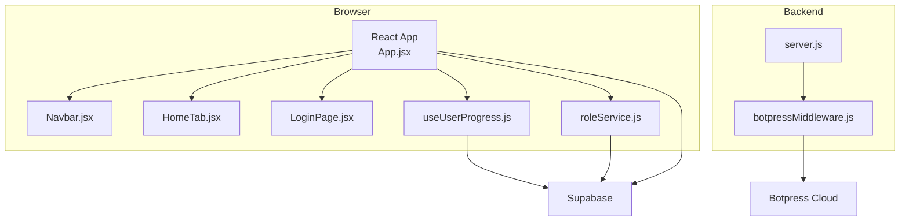
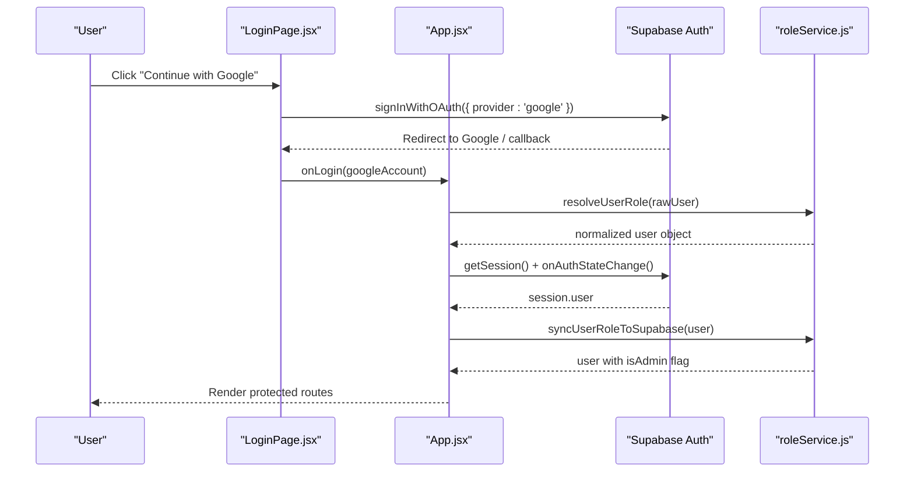
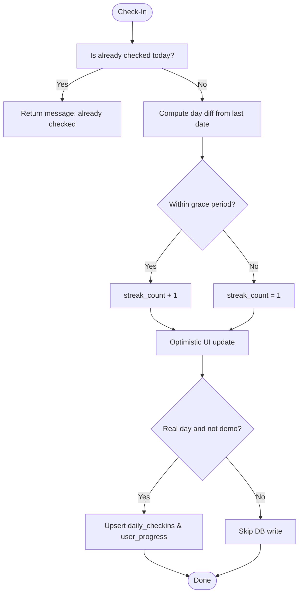
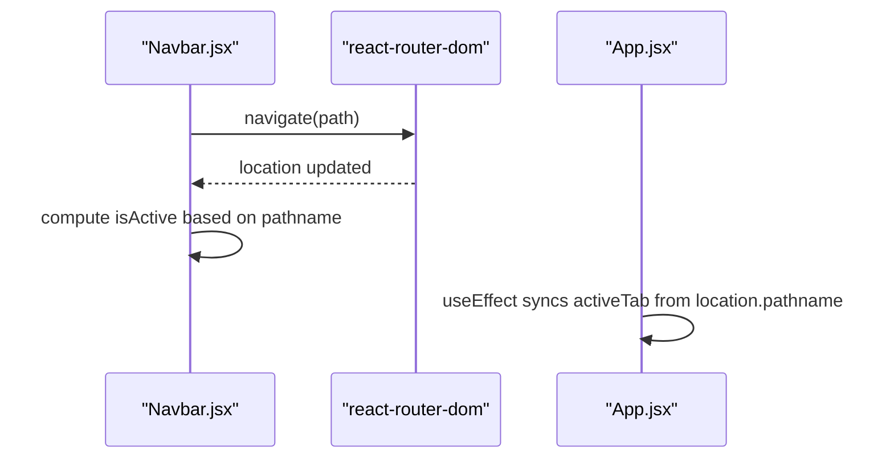
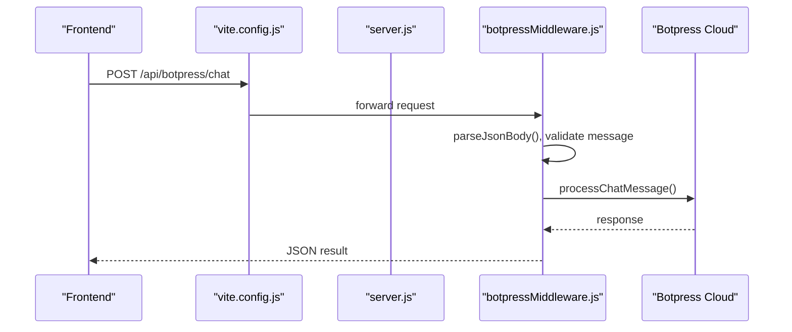
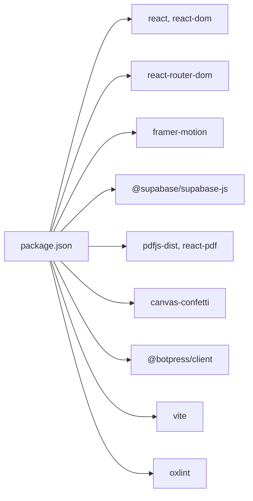

# Development Guide

<cite>
**Referenced Files in This Document**
- [README.md](file://README.md)
- [package.json](file://package.json)
- [vite.config.js](file://vite.config.js)
- [.oxlintrc.json](file://.oxlintrc.json)
- [src/main.jsx](file://src/main.jsx)
- [src/App.jsx](file://src/App.jsx)
- [src/components/Navbar.jsx](file://src/components/Navbar.jsx)
- [src/components/HomeTab.jsx](file://src/components/HomeTab.jsx)
- [src/components/LoginPage.jsx](file://src/components/LoginPage.jsx)
- [src/lib/userProgress.js](file://src/lib/userProgress.js)
- [src/lib/roleService.js](file://src/lib/roleService.js)
- [server/server.js](file://server/server.js)
- [server/botpressMiddleware.js](file://server/botpressMiddleware.js)
</cite>

## Table of Contents
1. Introduction
2. Project Structure
3. Core Components
4. Architecture Overview
5. Detailed Component Analysis
6. Dependency Analysis
7. Performance Considerations
8. Troubleshooting Guide
9. Conclusion
10. Appendices

## Introduction
This guide explains how to contribute to MewTinHoc, a React-based learning platform for Vietnamese high school computer science exam preparation. It covers coding standards, component patterns, testing strategies, debugging techniques, development workflow, code review practices, and quality assurance. It also includes guidance on adding features, maintaining consistency, performance profiling, memory leak detection, and browser compatibility testing.

MewTinHoc is a private Vite + React project with Supabase integration, optional Botpress chat middleware, and an admin area. The repository root contains the frontend source under src/, server-side utilities under server/, and build configuration at the root.

**Section sources**
- [README.md:1-4](file://README.md#L1-L4)

## Project Structure
The project follows a feature-oriented structure:
- Frontend app entry and routing: src/main.jsx, src/App.jsx
- UI components: src/components/*
- Domain logic hooks and services: src/lib/*
- Data models and static content: src/data/*
- Server utilities (Botpress proxy and static hosting): server/*
- Build tooling: vite.config.js, package.json, .oxlintrc.json

**Diagram sources**
- [src/main.jsx:1-18](file://src/main.jsx#L1-L18)
- [src/App.jsx:1-406](file://src/App.jsx#L1-L406)
- [src/components/Navbar.jsx:1-289](file://src/components/Navbar.jsx#L1-L289)
- [src/components/HomeTab.jsx:1-773](file://src/components/HomeTab.jsx#L1-L773)
- [src/components/LoginPage.jsx:1-590](file://src/components/LoginPage.jsx#L1-L590)
- [src/lib/userProgress.js:1-717](file://src/lib/userProgress.js#L1-L717)
- [src/lib/roleService.js:1-101](file://src/lib/roleService.js#L1-L101)
- [server/server.js:1-80](file://server/server.js#L1-L80)
- [server/botpressMiddleware.js:1-133](file://server/botpressMiddleware.js#L1-L133)
- [vite.config.js:1-22](file://vite.config.js#L1-L22)

**Section sources**
- [package.json:1-34](file://package.json#L1-L34)
- [vite.config.js:1-22](file://vite.config.js#L1-L22)

## Core Components
- App shell and routing: manages authentication state, tab navigation, route mapping, and global UI chrome.
- Navbar: top bar with brand, streak pill, user profile, logout, and horizontal tabs for Learning sections.
- HomeTab: dashboard with streak visualization, mastery matrix, quick metrics, and admin-only simulation controls.
- LoginPage: Google OAuth login flow via Supabase, demo mode, and Terms/Privacy modal.
- useUserProgress hook: central state for streak, mastery, completed lessons, check-in history, XP, and Realtime sync with Supabase; includes local fallback and simulation helpers.
- roleService: admin role resolution and Supabase profiles synchronization.
- Botpress middleware: secure proxy endpoints for status, files, chat, and reset with CORS, body size limits, and cookie session handling.

Key responsibilities and interactions are detailed in the next sections.

**Section sources**
- [src/App.jsx:1-406](file://src/App.jsx#L1-L406)
- [src/components/Navbar.jsx:1-289](file://src/components/Navbar.jsx#L1-L289)
- [src/components/HomeTab.jsx:1-773](file://src/components/HomeTab.jsx#L1-L773)
- [src/components/LoginPage.jsx:1-590](file://src/components/LoginPage.jsx#L1-L590)
- [src/lib/userProgress.js:1-717](file://src/lib/userProgress.js#L1-L717)
- [src/lib/roleService.js:1-101](file://src/lib/roleService.js#L1-L101)
- [server/botpressMiddleware.js:1-133](file://server/botpressMiddleware.js#L1-L133)

## Architecture Overview
High-level architecture:
- Browser runs React app (Vite dev/build).
- App uses Supabase for auth and data persistence, with Realtime subscriptions.
- Optional Botpress chat proxy is served by Node server or Vite dev middleware.
- Admin routes and tools are gated by role checks.

**Diagram sources**
- [src/App.jsx:1-406](file://src/App.jsx#L1-L406)
- [src/components/Navbar.jsx:1-289](file://src/components/Navbar.jsx#L1-L289)
- [src/components/HomeTab.jsx:1-773](file://src/components/HomeTab.jsx#L1-L773)
- [src/components/LoginPage.jsx:1-590](file://src/components/LoginPage.jsx#L1-L590)
- [src/lib/userProgress.js:1-717](file://src/lib/userProgress.js#L1-L717)
- [src/lib/roleService.js:1-101](file://src/lib/roleService.js#L1-L101)
- [server/server.js:1-80](file://server/server.js#L1-L80)
- [server/botpressMiddleware.js:1-133](file://server/botpressMiddleware.js#L1-L133)

## Detailed Component Analysis

### Authentication Flow (Google OAuth via Supabase)
Sequence of events from login button to authenticated app state:

**Diagram sources**
- [src/components/LoginPage.jsx:323-355](file://src/components/LoginPage.jsx#L323-L355)
- [src/App.jsx:93-150](file://src/App.jsx#L93-L150)
- [src/lib/roleService.js:59-100](file://src/lib/roleService.js#L59-L100)

**Section sources**
- [src/components/LoginPage.jsx:323-355](file://src/components/LoginPage.jsx#L323-L355)
- [src/App.jsx:93-150](file://src/App.jsx#L93-L150)
- [src/lib/roleService.js:59-100](file://src/lib/roleService.js#L59-L100)

### Streak Logic and Simulation
Streak rules:
- Grace period up to 3 days between check-ins keeps streak alive.
- Missing 3 consecutive full days resets streak to 0.
- Simulation allows advancing day offset without persisting fake dates to Supabase.

**Diagram sources**
- [src/lib/userProgress.js:477-536](file://src/lib/userProgress.js#L477-L536)
- [src/lib/userProgress.js:210-240](file://src/lib/userProgress.js#L210-L240)
- [src/lib/userProgress.js:646-681](file://src/lib/userProgress.js#L646-L681)

**Section sources**
- [src/lib/userProgress.js:477-536](file://src/lib/userProgress.js#L477-L536)
- [src/lib/userProgress.js:210-240](file://src/lib/userProgress.js#L210-L240)
- [src/lib/userProgress.js:646-681](file://src/lib/userProgress.js#L646-L681)

### Navigation and Tab State
- Navbar computes active tab from URL path and updates both internal tab state and router.
- App synchronizes tab state with URL when navigating programmatically.

**Diagram sources**
- [src/components/Navbar.jsx:33-46](file://src/components/Navbar.jsx#L33-L46)
- [src/App.jsx:206-215](file://src/App.jsx#L206-L215)

**Section sources**
- [src/components/Navbar.jsx:33-46](file://src/components/Navbar.jsx#L33-L46)
- [src/App.jsx:206-215](file://src/App.jsx#L206-L215)

### Botpress Chat Proxy
Endpoints:
- GET /status or /api/botpress/status: returns configured flag and masked tokens.
- GET /files or /api/botpress/files: lists available Botpress files.
- POST /chat or /api/botpress/chat: processes chat messages with input validation and cookie-based session.
- POST /reset or /api/botpress/reset: resets conversation context.

Security and constraints:
- Body size limit and message length limit.
- Strict CORS based on BOTPRESS_ALLOWED_ORIGIN.
- Secure cookie flags in production.

**Diagram sources**
- [vite.config.js:10-16](file://vite.config.js#L10-L16)
- [server/server.js:40-50](file://server/server.js#L40-L50)
- [server/botpressMiddleware.js:65-132](file://server/botpressMiddleware.js#L65-L132)

**Section sources**
- [server/botpressMiddleware.js:65-132](file://server/botpressMiddleware.js#L65-L132)
- [server/server.js:40-50](file://server/server.js#L40-L50)
- [vite.config.js:10-16](file://vite.config.js#L10-L16)

## Dependency Analysis
Key runtime dependencies:
- React 19, react-router-dom for routing and navigation.
- framer-motion for animations.
- lucide-react for icons.
- @supabase/supabase-js for auth and database realtime.
- pdfjs-dist and react-pdf for PDF viewing.
- canvas-confetti for celebratory effects.
- botpress client for AI chat integration.

Build and tooling:
- Vite for dev server and bundling.
- Oxlint for linting with React rules enforced.

**Diagram sources**
- [package.json:14-31](file://package.json#L14-L31)

**Section sources**
- [package.json:14-31](file://package.json#L14-L31)

## Performance Considerations
- Prefer memoization for expensive computations in heavy components like HomeTab. Use useMemo/useCallback where appropriate to avoid unnecessary re-renders.
- Avoid heavy animations on low-power devices; respect prefers-reduced-motion.
- Defer non-critical work (e.g., confetti triggers) to user interactions.
- Keep Supabase queries scoped and minimal; leverage Realtime filters to reduce payload.
- For PDF rendering, lazy-load viewers and consider virtualization for large documents.
- Monitor bundle size; tree-shake unused libraries and avoid importing entire packages.

[No sources needed since this section provides general guidance]

## Troubleshooting Guide
Common issues and resolutions:
- Supabase connection errors:
  - Check network connectivity and environment variables.
  - Inspect console warnings about table creation or schema mismatches.
  - Verify Realtime channel subscription status and ensure proper cleanup.
- OAuth redirect issues:
  - Ensure redirect URL matches your deployment base path.
  - Validate Supabase OAuth settings for Google provider.
- Botpress endpoint failures:
  - Confirm BOTPRESS_ALLOWED_ORIGIN is set correctly.
  - Validate request body size and message length limits.
  - Check CORS preflight responses and cookie SameSite/Secure flags.
- Streak anomalies:
  - Verify effective date calculations and timezone handling.
  - Confirm that simulation offsets do not persist to Supabase.

Operational tips:
- Use the admin simulation controls to test streak transitions safely.
- Clear local storage/session storage keys if state becomes inconsistent after user switch.
- Review error boundaries and toast notifications for user feedback.

**Section sources**
- [src/lib/userProgress.js:273-382](file://src/lib/userProgress.js#L273-L382)
- [src/lib/userProgress.js:384-475](file://src/lib/userProgress.js#L384-L475)
- [src/components/LoginPage.jsx:310-355](file://src/components/LoginPage.jsx#L310-L355)
- [server/botpressMiddleware.js:9-36](file://server/botpressMiddleware.js#L9-L36)
- [server/botpressMiddleware.js:65-132](file://server/botpressMiddleware.js#L65-L132)

## Conclusion
MewTinHoc combines a modern React frontend with Supabase-backed state and Realtime sync, plus optional Botpress chat integration. Following the patterns and guidelines in this guide will help you add features safely, maintain consistency, and deliver a performant, accessible experience. Prioritize clear component contracts, robust error handling, and careful state management across local storage and Supabase.

[No sources needed since this section summarizes without analyzing specific files]

## Appendices

### Coding Standards
- Enforce React Hooks rules via Oxlint.
- Prefer functional components and hooks over class components.
- Keep components small and focused; extract reusable logic into hooks or services.
- Use TypeScript types where beneficial; keep props interfaces explicit.
- Maintain consistent naming conventions for files, functions, and variables.
- Limit side effects in render paths; encapsulate in useEffect or event handlers.

**Section sources**
- [.oxlintrc.json:1-9](file://.oxlintrc.json#L1-L9)

### Component Development Patterns
- Container/presentational split:
  - Container components manage state and data fetching (e.g., App, HomeTab).
  - Presentational components focus on UI and receive props (e.g., Navbar buttons, metric cards).
- State management:
  - Local component state for UI-only concerns.
  - useUserProgress for cross-cutting progress, streak, mastery, and lesson completion.
  - Supabase Realtime for live updates; fallback to localStorage/sessionStorage.
- Animations:
  - Use framer-motion with reduced motion support.
  - Animate only meaningful transitions; avoid layout thrashing.

**Section sources**
- [src/App.jsx:1-406](file://src/App.jsx#L1-L406)
- [src/components/HomeTab.jsx:1-773](file://src/components/HomeTab.jsx#L1-L773)
- [src/lib/userProgress.js:1-717](file://src/lib/userProgress.js#L1-L717)

### Testing Strategies
- Unit tests:
  - Test pure utility functions (date formatting, streak math).
  - Mock Supabase calls for service layers.
- Integration tests:
  - Simulate OAuth flows and route guards.
  - Validate Realtime updates and optimistic UI behavior.
- Visual regression:
  - Capture snapshots for key pages (Home, Roadmap, Exams).
- Accessibility:
  - Verify keyboard navigation and ARIA attributes for tabs and modals.

[No sources needed since this section provides general guidance]

### Debugging Techniques
- Use React DevTools to inspect component trees and state changes.
- Log Supabase Realtime events and subscription statuses.
- Validate Botpress payloads and CORS headers in Network tab.
- Use browser Storage panel to inspect local/session storage keys.

**Section sources**
- [src/lib/userProgress.js:384-475](file://src/lib/userProgress.js#L384-L475)
- [server/botpressMiddleware.js:65-132](file://server/botpressMiddleware.js#L65-L132)

### Adding New Features
- Define feature scope and data model changes.
- Extend useUserProgress or create new hooks for domain logic.
- Add components under src/components with clear prop interfaces.
- Wire routes in App.jsx and update Navbar if necessary.
- Add tests and accessibility checks before merging.

[No sources needed since this section provides general guidance]

### Modifying Existing Components
- Identify current state ownership and data flow.
- Preserve backward compatibility for props and URLs.
- Update related hooks/services first, then adjust components.
- Run linter and visual checks; verify Realtime behavior.

**Section sources**
- [src/App.jsx:206-215](file://src/App.jsx#L206-L215)
- [src/components/Navbar.jsx:33-46](file://src/components/Navbar.jsx#L33-L46)

### Maintaining Code Consistency
- Follow Oxlint rules and React best practices.
- Use shared variants and design tokens for consistent styling.
- Centralize constants and enums (e.g., TABS, TRACK_TYPES).
- Document complex logic inline and in this guide.

**Section sources**
- [.oxlintrc.json:1-9](file://.oxlintrc.json#L1-L9)
- [src/components/Navbar.jsx:17-22](file://src/components/Navbar.jsx#L17-L22)

### Performance Profiling
- Use Chrome Performance panel to capture timelines during interactions.
- Profile React renders with Profiler to identify bottlenecks.
- Measure bundle size with Vite analyzer plugins.
- Optimize images and fonts; lazy-load heavy assets.

[No sources needed since this section provides general guidance]

### Memory Leak Detection
- Ensure all timers and intervals are cleared in cleanup functions.
- Unsubscribe from Supabase Realtime channels on unmount.
- Avoid retaining large objects in closures or refs unnecessarily.
- Monitor heap snapshots for unexpected growth.

**Section sources**
- [src/lib/userProgress.js:384-475](file://src/lib/userProgress.js#L384-L475)

### Browser Compatibility Testing
- Test on latest Chrome, Firefox, Safari, and Edge.
- Validate mobile viewport height fixes and sticky headers.
- Check reduced motion preferences and touch interactions.
- Verify OAuth redirects across environments (localhost vs GitHub Pages).

**Section sources**
- [src/main.jsx:6-10](file://src/main.jsx#L6-L10)
- [src/components/LoginPage.jsx:335-347](file://src/components/LoginPage.jsx#L335-L347)

### Development Workflow
- Install dependencies and start dev server: npm run dev
- Preview production build locally: npm run preview
- Lint code: npm run lint
- Build for deployment: npm run build
- Run backend server (if needed): npm run server

**Section sources**
- [package.json:6-12](file://package.json#L6-L12)

### Code Review Process
- Ensure PRs include tests and documentation updates.
- Verify accessibility and responsive behavior.
- Check for security considerations (CORS, cookies, input validation).
- Confirm performance impact and bundle size changes.

[No sources needed since this section provides general guidance]

### Quality Assurance Procedures
- Automated linting via Oxlint.
- Manual QA checklist for critical flows (login, streak, exams).
- Cross-browser and device matrix testing.
- Monitoring and alerting for Supabase and Botpress errors.

**Section sources**
- [.oxlintrc.json:1-9](file://.oxlintrc.json#L1-L9)
- [server/botpressMiddleware.js:65-132](file://server/botpressMiddleware.js#L65-L132)