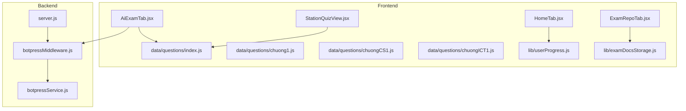
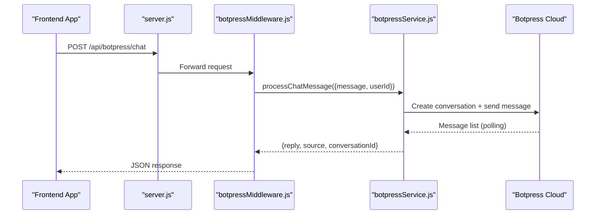
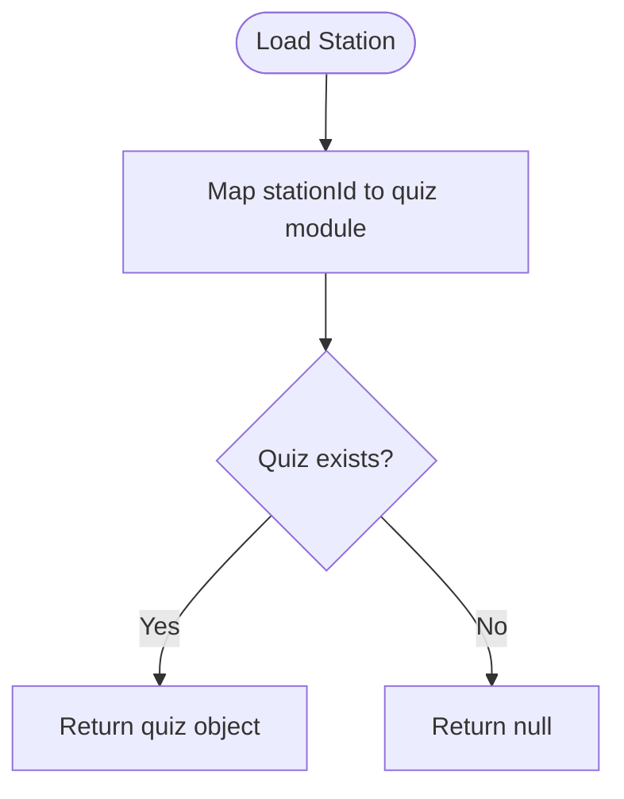
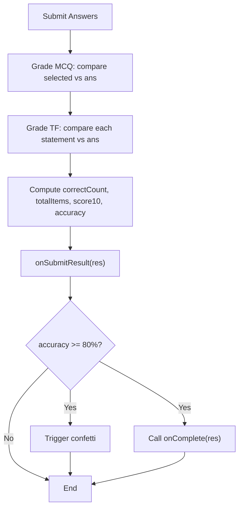
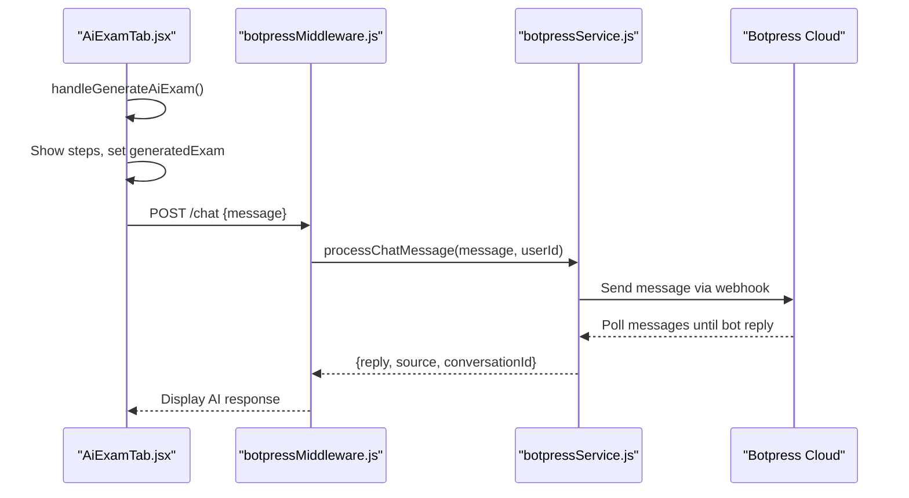
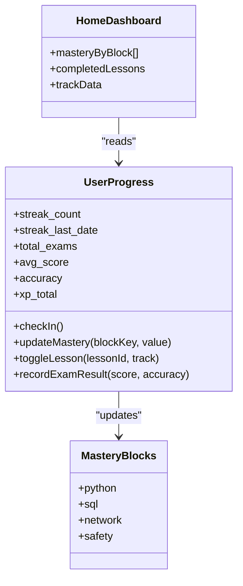
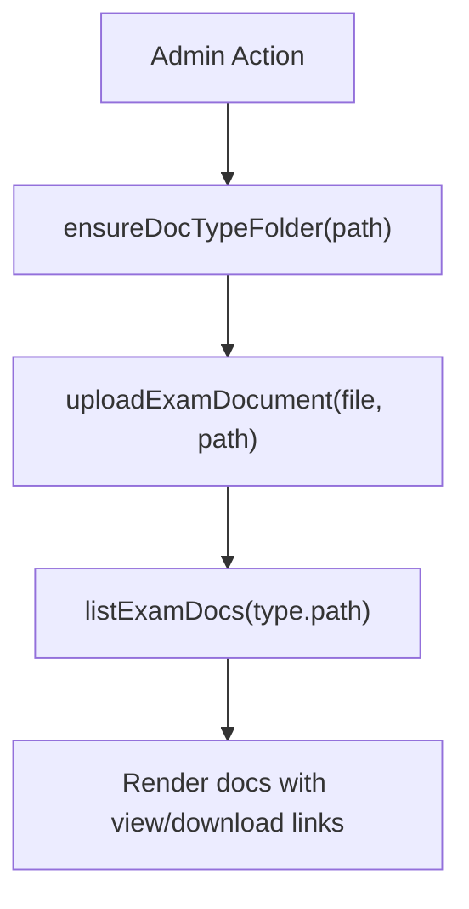
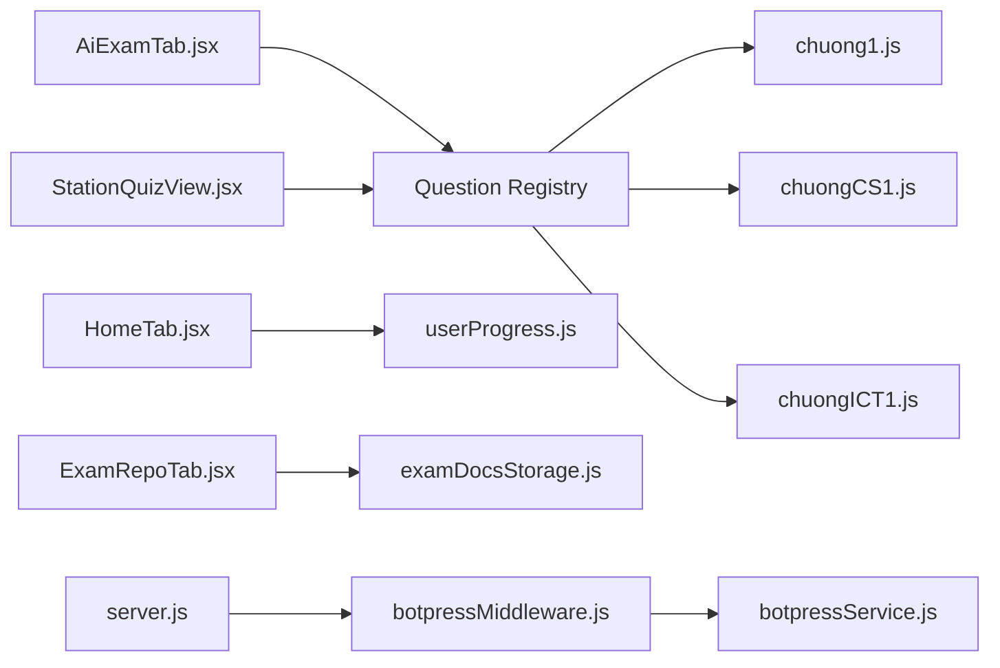

# Exam & Assessment System

<cite>
**Referenced Files in This Document**
- [AiExamTab.jsx](file://src/components/AiExamTab.jsx)
- [StationQuizView.jsx](file://src/components/StationQuizView.jsx)
- [ExamRepoTab.jsx](file://src/components/ExamRepoTab.jsx)
- [botpressService.js](file://server/botpressService.js)
- [botpressMiddleware.js](file://server/botpressMiddleware.js)
- [server.js](file://server/server.js)
- [userProgress.js](file://src/lib/userProgress.js)
- [index.js](file://src/data/questions/index.js)
- [chuong1.js](file://src/data/questions/chuong1.js)
- [chuongCS1.js](file://src/data/questions/chuongCS1.js)
- [chuongICT1.js](file://src/data/questions/chuongICT1.js)
- [examDocsStorage.js](file://src/lib/examDocsStorage.js)
- [HomeTab.jsx](file://src/components/HomeTab.jsx)
</cite>

## Table of Contents
1. [Introduction](#introduction)
2. [Project Structure](#project-structure)
3. [Core Components](#core-components)
4. [Architecture Overview](#architecture-overview)
5. [Detailed Component Analysis](#detailed-component-analysis)
6. [Dependency Analysis](#dependency-analysis)
7. [Performance Considerations](#performance-considerations)
8. [Troubleshooting Guide](#troubleshooting-guide)
9. [Conclusion](#conclusion)

## Introduction
This document explains the exam and assessment system for CS and ICT subjects. It covers:
- Question bank management for CS and ICT stations
- Practice exam interface with station quiz functionality
- AI-powered exam generation through Botpress integration
- Performance analytics and progress tracking
- Question data structures, exam generation algorithms, answer validation, and scoring mechanisms
- Examples of question formats and AI prompt engineering patterns
- Integration with personalized learning recommendations based on mastery blocks

## Project Structure
The system is a React frontend with a small Node backend that proxies Botpress chat and serves static assets.

**Diagram sources**
- [AiExamTab.jsx:1-322](file://src/components/AiExamTab.jsx#L1-L322)
- [StationQuizView.jsx:1-800](file://src/components/StationQuizView.jsx#L1-L800)
- [ExamRepoTab.jsx:1-800](file://src/components/ExamRepoTab.jsx#L1-L800)
- [server.js:1-80](file://server/server.js#L1-L80)
- [botpressMiddleware.js:1-133](file://server/botpressMiddleware.js#L1-L133)
- [botpressService.js:1-333](file://server/botpressService.js#L1-L333)
- [index.js:1-40](file://src/data/questions/index.js#L1-L40)
- [examDocsStorage.js:1-428](file://src/lib/examDocsStorage.js#L1-L428)
- [userProgress.js:1-717](file://src/lib/userProgress.js#L1-L717)
- [HomeTab.jsx:1-773](file://src/components/HomeTab.jsx#L1-L773)

**Section sources**
- [server.js:1-80](file://server/server.js#L1-L80)
- [botpressMiddleware.js:1-133](file://server/botpressMiddleware.js#L1-L133)
- [botpressService.js:1-333](file://server/botpressService.js#L1-L333)
- [index.js:1-40](file://src/data/questions/index.js#L1-L40)
- [examDocsStorage.js:1-428](file://src/lib/examDocsStorage.js#L1-L428)
- [userProgress.js:1-717](file://src/lib/userProgress.js#L1-L717)
- [AiExamTab.jsx:1-322](file://src/components/AiExamTab.jsx#L1-L322)
- [StationQuizView.jsx:1-800](file://src/components/StationQuizView.jsx#L1-L800)
- [ExamRepoTab.jsx:1-800](file://src/components/ExamRepoTab.jsx#L1-L800)
- [HomeTab.jsx:1-773](file://src/components/HomeTab.jsx#L1-L773)

## Core Components
- AI Exam Generator UI: Configures track (CS or ICT), simulates generation steps, shows metrics, and provides an interactive mentor chat panel.
- Station Quiz Interface: Renders MCQ and True/False questions, shuffles items, validates answers, computes score, and triggers confetti on success.
- Exam Repository: Admin-only file management for practice exams and study materials stored in Supabase Storage.
- Progress Analytics: Tracks streaks, XP, average score, accuracy, mastery blocks, and lesson completion; persists to Supabase with Realtime sync and LocalStorage fallback.
- Botpress Integration: Backend middleware routes chat requests, maintains sessions, signs user keys, and polls Botpress for responses with a local fallback.

**Section sources**
- [AiExamTab.jsx:1-322](file://src/components/AiExamTab.jsx#L1-L322)
- [StationQuizView.jsx:1-800](file://src/components/StationQuizView.jsx#L1-L800)
- [ExamRepoTab.jsx:1-800](file://src/components/ExamRepoTab.jsx#L1-L800)
- [userProgress.js:1-717](file://src/lib/userProgress.js#L1-L717)
- [botpressMiddleware.js:1-133](file://server/botpressMiddleware.js#L1-L133)
- [botpressService.js:1-333](file://server/botpressService.js#L1-L333)

## Architecture Overview
The frontend renders exam tabs and quizzes, while the backend handles secure Botpress chat flows and serves static assets.

**Diagram sources**
- [server.js:40-50](file://server/server.js#L40-L50)
- [botpressMiddleware.js:106-114](file://server/botpressMiddleware.js#L106-L114)
- [botpressService.js:220-297](file://server/botpressService.js#L220-L297)

## Detailed Component Analysis

### Question Bank Management (CS and ICT)
- Central registry maps station IDs to quiz modules.
- Each quiz module defines:
  - mcq: array of multiple-choice questions with options, correct index, and explanation
  - tf: array of True/False questions with context and four statements, each having boolean answer and explanation
- The registry supports shared chapters for both tracks and specialized chapters for CS and ICT.

**Diagram sources**
- [index.js:12-37](file://src/data/questions/index.js#L12-L37)

**Section sources**
- [index.js:1-40](file://src/data/questions/index.js#L1-L40)
- [chuong1.js:1-362](file://src/data/questions/chuong1.js#L1-L362)
- [chuongCS1.js:1-63](file://src/data/questions/chuongCS1.js#L1-L63)
- [chuongICT1.js:1-63](file://src/data/questions/chuongICT1.js#L1-L63)

### Practice Exam Interface with Station Quiz Functionality
- Two parts:
  - Part I: 20 MCQ questions
  - Part II: 4 True/False questions, each with 4 statements
- Shuffling:
  - MCQ list shuffled per version
  - TF items shuffled per question per version
- Answer state:
  - mcqAnswers: map from question index to selected option index
  - tfAnswers: nested map from question index to statement index to boolean
- Scoring:
  - Each MCQ worth 1 point
  - Each TF statement worth 1 point
  - Score normalized to 0–10 scale
  - Accuracy percentage computed
- Submission:
  - Computes correct count, wrong lists, score, and accuracy
  - Triggers confetti if accuracy >= 80%
  - Calls onComplete callback when threshold met

**Diagram sources**
- [StationQuizView.jsx:79-144](file://src/components/StationQuizView.jsx#L79-L144)

**Section sources**
- [StationQuizView.jsx:1-800](file://src/components/StationQuizView.jsx#L1-L800)

### AI-Powered Exam Generation Through Botpress Integration
- Frontend generator:
  - Selects track (CS or ICT)
  - Simulates multi-step generation with progress messages
  - Displays generated exam metadata and prompts to start solving
  - Provides an interactive chat panel for AI mentor explanations
- Backend chat flow:
  - Middleware validates origin, parses body, sets cookie session
  - Service manages Botpress sessions, signs user key, creates conversation, sends message, polls for bot reply
  - Fallback logic returns domain-specific knowledge when Botpress is unavailable

**Diagram sources**
- [AiExamTab.jsx:57-86](file://src/components/AiExamTab.jsx#L57-L86)
- [botpressMiddleware.js:106-114](file://server/botpressMiddleware.js#L106-L114)
- [botpressService.js:220-297](file://server/botpressService.js#L220-L297)

**Section sources**
- [AiExamTab.jsx:1-322](file://src/components/AiExamTab.jsx#L1-L322)
- [botpressMiddleware.js:1-133](file://server/botpressMiddleware.js#L1-L133)
- [botpressService.js:1-333](file://server/botpressService.js#L1-L333)

### Performance Analytics and Personalized Learning Recommendations
- Metrics tracked:
  - Streak count and last check-in date
  - Total exams taken, average score, accuracy
  - XP total
  - Mastery blocks: Python, SQL, Network, Safety
  - Completed lessons per roadmap
- Persistence:
  - Supabase tables: user_progress, mastery_progress, roadmap_lessons, daily_checkins
  - Realtime subscriptions update UI instantly
  - LocalStorage fallback for offline/demo mode
- Recommendations:
  - Home dashboard calculates mastery percentages by mapping stations to block keywords
  - Stations with quiz scores >= 80% count as completed for block progress
  - Non-quiz stations require all lessons completed

**Diagram sources**
- [userProgress.js:6-34](file://src/lib/userProgress.js#L6-L34)
- [userProgress.js:477-644](file://src/lib/userProgress.js#L477-L644)
- [HomeTab.jsx:54-64](file://src/components/HomeTab.jsx#L54-L64)
- [HomeTab.jsx:182-196](file://src/components/HomeTab.jsx#L182-L196)

**Section sources**
- [userProgress.js:1-717](file://src/lib/userProgress.js#L1-L717)
- [HomeTab.jsx:1-773](file://src/components/HomeTab.jsx#L1-L773)

### Exam Repository for Study Materials
- Admin-only features:
  - Upload files to Supabase Storage under configured bucket/folder
  - Rename and delete documents
  - Preview supported types inline
  - Search and paginate on mobile
- Storage configuration:
  - Bucket name and folder path defined centrally
  - Doc types mapped to folders with aliases
  - Signed URLs for private buckets
  - Error descriptions translated to Vietnamese for admin guidance

**Diagram sources**
- [ExamRepoTab.jsx:239-281](file://src/components/ExamRepoTab.jsx#L239-L281)
- [examDocsStorage.js:408-427](file://src/lib/examDocsStorage.js#L408-L427)
- [examDocsStorage.js:160-232](file://src/lib/examDocsStorage.js#L160-L232)

**Section sources**
- [ExamRepoTab.jsx:1-800](file://src/components/ExamRepoTab.jsx#L1-L800)
- [examDocsStorage.js:1-428](file://src/lib/examDocsStorage.js#L1-L428)

## Dependency Analysis
- Frontend components depend on:
  - Question registry for station content
  - Progress hook for analytics and streak mechanics
  - Storage library for exam repository operations
- Backend depends on:
  - Botpress client and environment variables
  - Security headers and CORS handling
  - Static asset serving

**Diagram sources**
- [AiExamTab.jsx:1-322](file://src/components/AiExamTab.jsx#L1-L322)
- [StationQuizView.jsx:1-800](file://src/components/StationQuizView.jsx#L1-L800)
- [index.js:1-40](file://src/data/questions/index.js#L1-L40)
- [HomeTab.jsx:1-773](file://src/components/HomeTab.jsx#L1-L773)
- [userProgress.js:1-717](file://src/lib/userProgress.js#L1-L717)
- [ExamRepoTab.jsx:1-800](file://src/components/ExamRepoTab.jsx#L1-L800)
- [examDocsStorage.js:1-428](file://src/lib/examDocsStorage.js#L1-L428)
- [server.js:1-80](file://server/server.js#L1-L80)
- [botpressMiddleware.js:1-133](file://server/botpressMiddleware.js#L1-L133)
- [botpressService.js:1-333](file://server/botpressService.js#L1-L333)

**Section sources**
- [index.js:1-40](file://src/data/questions/index.js#L1-L40)
- [userProgress.js:1-717](file://src/lib/userProgress.js#L1-L717)
- [examDocsStorage.js:1-428](file://src/lib/examDocsStorage.js#L1-L428)
- [server.js:1-80](file://server/server.js#L1-L80)
- [botpressMiddleware.js:1-133](file://server/botpressMiddleware.js#L1-L133)
- [botpressService.js:1-333](file://server/botpressService.js#L1-L333)

## Performance Considerations
- Shuffling and rendering:
  - useMemo used to memoize shuffled lists per quiz version to avoid unnecessary re-renders
  - Pagination and lazy loading for document lists on mobile
- Network calls:
  - Batch signed URL creation for storage listing to reduce latency
  - Polling loop capped at ~26 seconds for Botpress chat replies
- State persistence:
  - Optimistic updates for streak and mastery before DB writes
  - Realtime subscriptions minimize manual refresh overhead

[No sources needed since this section provides general guidance]

## Troubleshooting Guide
- Botpress chat not responding:
  - Verify BOTPRESS_TOKEN, BOTPRESS_BOT_ID, WEBHOOK_ID, ENCRYPTION_KEY are set
  - Check CORS allowed origin configuration
  - Inspect fallback responses in service
- Storage upload errors:
  - Confirm Supabase auth session is active
  - Validate file size and extension limits
  - Review RLS policy errors and follow error hints
- Progress not syncing:
  - Ensure Supabase client initialized and tables exist
  - Check realtime subscription status and network connectivity
  - Use demo mode to verify LocalStorage behavior

**Section sources**
- [botpressService.js:43-78](file://server/botpressService.js#L43-L78)
- [botpressService.js:220-333](file://server/botpressService.js#L220-L333)
- [botpressMiddleware.js:65-133](file://server/botpressMiddleware.js#L65-L133)
- [examDocsStorage.js:242-306](file://src/lib/examDocsStorage.js#L242-L306)
- [userProgress.js:273-382](file://src/lib/userProgress.js#L273-L382)

## Conclusion
The system integrates a structured question bank, a robust station quiz interface, AI-driven exam generation via Botpress, and comprehensive performance analytics. It balances interactivity with reliable persistence and real-time updates, enabling personalized learning pathways and actionable insights for students and administrators alike.