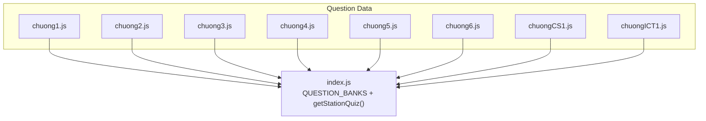
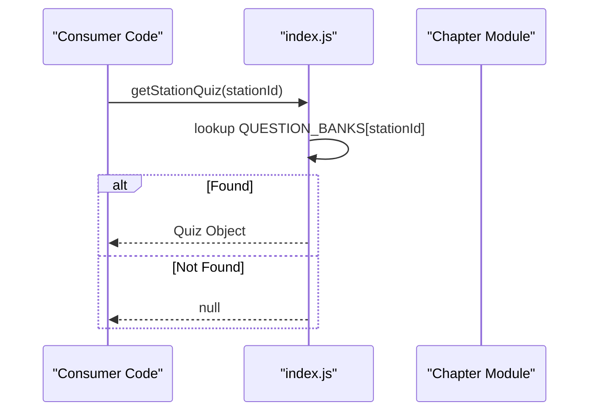
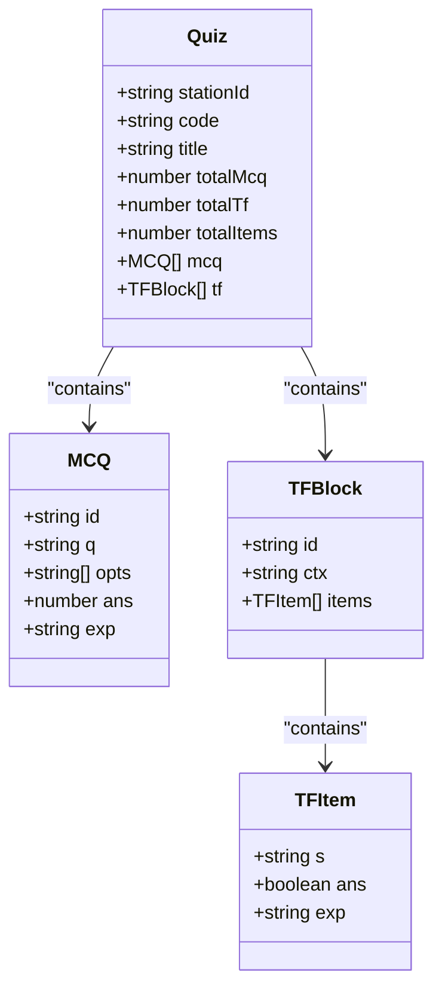
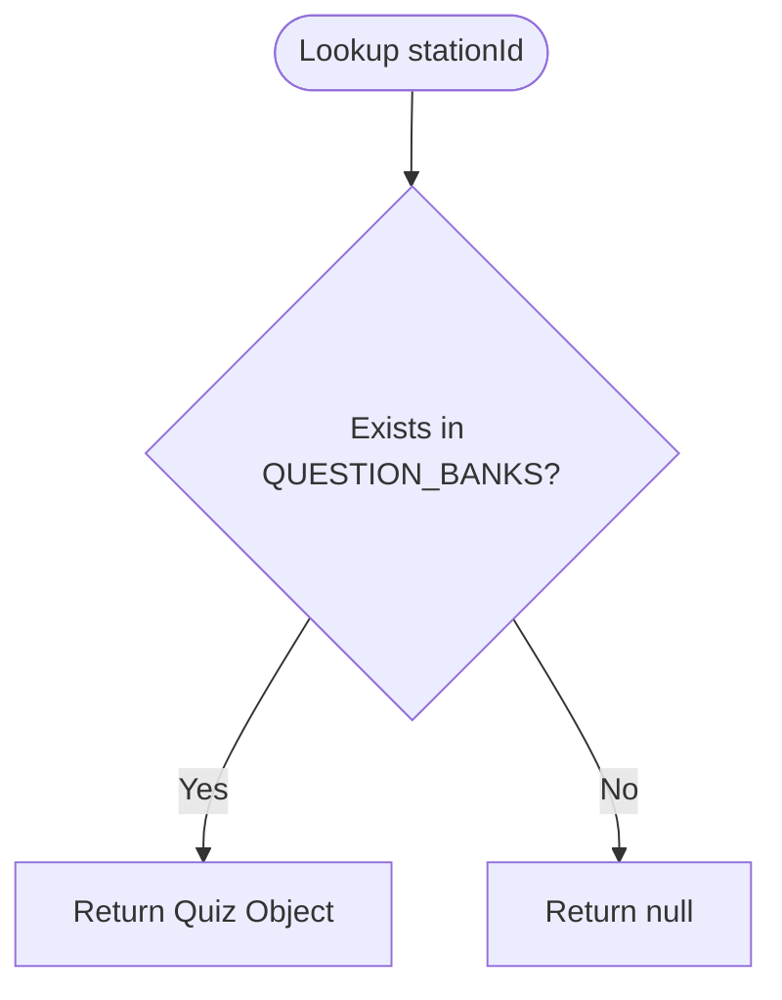
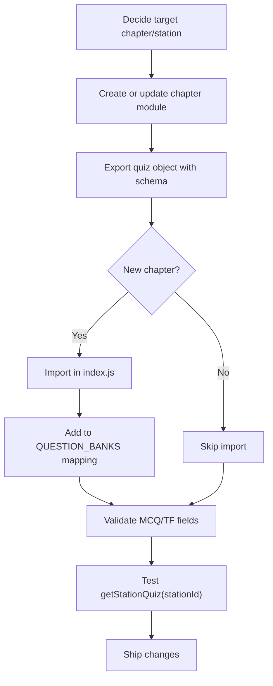
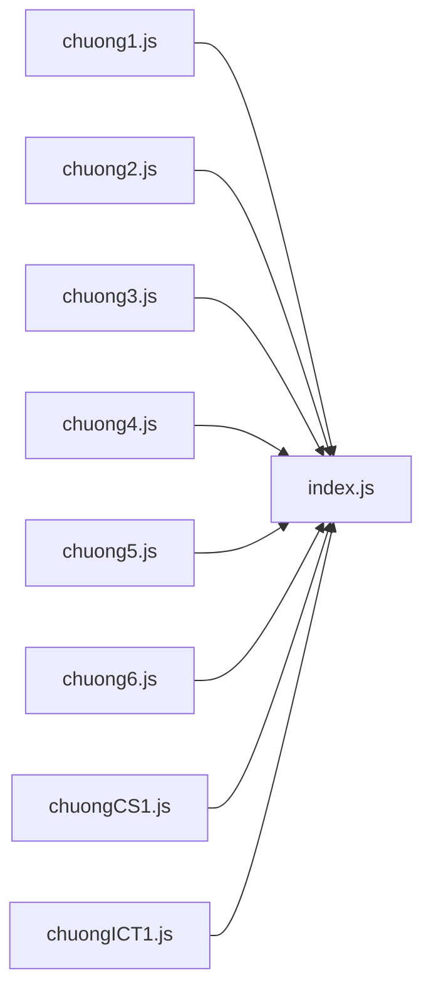

# Question Bank Management

<cite>
**Referenced Files in This Document**
- [index.js](file://src/data/questions/index.js)
- [chuong1.js](file://src/data/questions/chuong1.js)
- [chuong2.js](file://src/data/questions/chuong2.js)
- [chuong3.js](file://src/data/questions/chuong3.js)
- [chuong4.js](file://src/data/questions/chuong4.js)
- [chuong5.js](file://src/data/questions/chuong5.js)
- [chuong6.js](file://src/data/questions/chuong6.js)
- [chuongCS1.js](file://src/data/questions/chuongCS1.js)
- [chuongICT1.js](file://src/data/questions/chuongICT1.js)
</cite>

## Table of Contents
1. [Introduction](#introduction)
2. [Project Structure](#project-structure)
3. [Core Components](#core-components)
4. [Architecture Overview](#architecture-overview)
5. [Detailed Component Analysis](#detailed-component-analysis)
6. [Dependency Analysis](#dependency-analysis)
7. [Performance Considerations](#performance-considerations)
8. [Troubleshooting Guide](#troubleshooting-guide)
9. [Conclusion](#conclusion)
10. [Appendices](#appendices)

## Introduction
This document explains the question bank management system used to organize, index, and serve exam-style questions for both Computer Science (CS) and Information and Communication Technology (ICT) tracks. It covers:
- The data model for questions
- Organization by chapters and subject-specific tracks
- The indexing system that maps station identifiers to question sets
- Multiple-choice question format, True/False multi-statement items, answer validation, and explanations
- Best practices for adding new questions while preserving consistency and usability

The system is implemented as a set of JavaScript modules exporting standardized question objects, with a central registry that maps track stations to chapter-based question banks.

## Project Structure
The question bank lives under `src/data/questions`. Each chapter or track has its own module exporting a single quiz object. A central `index.js` file imports all quiz modules and builds a mapping from station identifiers to quiz content.

**Diagram sources**
- [index.js:1-44](file://src/data/questions/index.js#L1-L44)
- [chuong1.js:6-13](file://src/data/questions/chuong1.js#L6-L13)
- [chuongCS1.js:7-14](file://src/data/questions/chuongCS1.js#L7-L14)
- [chuongICT1.js:7-14](file://src/data/questions/chuongICT1.js#L7-L14)

**Section sources**
- [index.js:1-44](file://src/data/questions/index.js#L1-L44)

## Core Components
- Chapter-based question modules: each exports a quiz object containing metadata, multiple-choice questions, and True/False statement groups.
- Central registry: aggregates all quizzes and exposes a lookup function by station identifier.
- Track routing: CS and ICT stations map to shared or specialized chapters.

Key responsibilities:
- Define consistent question schemas across chapters
- Provide stable station IDs for UI routing
- Keep track-specific content separate from shared content

**Section sources**
- [index.js:13-41](file://src/data/questions/index.js#L13-L41)
- [chuong1.js:6-13](file://src/data/questions/chuong1.js#L6-L13)
- [chuongCS1.js:7-14](file://src/data/questions/chuongCS1.js#L7-L14)
- [chuongICT1.js:7-14](file://src/data/questions/chuongICT1.js#L7-L14)

## Architecture Overview
The architecture follows a simple module-and-registry pattern:
- Each chapter module defines a quiz object with a fixed schema.
- The registry (`index.js`) imports these modules and constructs a static map from station IDs to quiz objects.
- Consumers call a getter to retrieve a quiz by station ID.

**Diagram sources**
- [index.js:39-41](file://src/data/questions/index.js#L39-L41)

## Detailed Component Analysis

### Question Data Model
Each quiz object represents a chapter or topic and includes:
- Metadata:
  - `stationId`: unique identifier used by the UI to route to this quiz
  - `code`: short code for the topic
  - `title`: human-readable title
  - `totalMcq`: number of multiple-choice questions
  - `totalTf`: number of True/False blocks
  - `totalItems`: total count of MCQs plus TF statements
- Question collections:
  - `mcq`: array of multiple-choice questions
  - `tf`: array of True/False blocks, each containing contextual text and a list of statements

Multiple-choice question fields:
- `id`: unique question identifier
- `q`: question text
- `opts`: array of four options
- `ans`: zero-based index of the correct option
- `exp`: explanation for the correct answer

True/False block fields:
- `id`: unique block identifier
- `ctx`: scenario/context paragraph
- `items`: array of statements, each with:
  - `s`: statement text
  - `ans`: boolean correctness
  - `exp`: explanation

Complexity considerations:
- Reading a quiz is O(1) after import due to direct property access.
- Iterating over questions is linear in the number of items; typical sizes are small enough for client-side rendering.

Validation rules:
- `ans` must be within bounds of `opts.length` for MCQs.
- `ans` must be a boolean for TF statements.
- All required fields should be present to ensure consistent rendering and scoring.

Best practices:
- Use stable, descriptive IDs following a consistent naming convention.
- Keep explanations concise and aligned with curriculum standards.
- Maintain balanced distractors in MCQs to avoid trivial elimination.

**Diagram sources**
- [chuong1.js:6-13](file://src/data/questions/chuong1.js#L6-L13)
- [chuong1.js:13-254](file://src/data/questions/chuong1.js#L13-L254)
- [chuong1.js:255-360](file://src/data/questions/chuong1.js#L255-L360)

**Section sources**
- [chuong1.js:6-360](file://src/data/questions/chuong1.js#L6-L360)
- [chuongCS1.js:7-62](file://src/data/questions/chuongCS1.js#L7-L62)
- [chuongICT1.js:7-62](file://src/data/questions/chuongICT1.js#L7-L62)

### Indexing System and Station Mapping
The registry provides:
- `QUESTION_BANKS`: a static map from station IDs to quiz objects
- `getStationQuiz(stationId)`: returns the quiz object or null if not found

Track organization:
- Shared chapters (e.g., AI, Networks, Ethics, DB basics, Web, Career) are mapped to both CS and ICT stations where appropriate.
- Track-specific chapters:
  - CS-only: CS1 (Programming Techniques), CS2 (advanced CS topics)
  - ICT-only: ICT1 (Database Practice), ICT2 (applied ICT topics)
- Shared Python basics chapter is mapped to both CS and ICT at a designated station.

**Diagram sources**
- [index.js:13-41](file://src/data/questions/index.js#L13-L41)

**Section sources**
- [index.js:13-41](file://src/data/questions/index.js#L13-L41)

### Chapter Organization and Subject Tracks
Chapters are organized into:
- General chapters (chuong1–chuong6): foundational topics shared across tracks
- Track-specific chapters:
  - CS1: Programming techniques
  - ICT1: Database practice
  - ICT2: Applied ICT topics
  - CS2: Advanced CS topics
- Shared Python basics chapter mapped to both tracks at a common station

Examples of mappings:
- cs_station_1 → chuong1 (AI introduction)
- ict_station_1 → chuong1 (shared)
- cs_station_7 → chuongCS1 (programming techniques)
- ict_station_7 → chuongICT1 (database practice)
- cs_station_10 → chuong7 (Python basics, shared)
- ict_station_10 → chuong7 (Python basics, shared)

**Section sources**
- [index.js:13-37](file://src/data/questions/index.js#L13-L37)
- [chuong1.js:6-13](file://src/data/questions/chuong1.js#L6-L13)
- [chuongCS1.js:7-14](file://src/data/questions/chuongCS1.js#L7-L14)
- [chuongICT1.js:7-14](file://src/data/questions/chuongICT1.js#L7-L14)

### Question Format, Validation, and Difficulty
Format:
- Part I: Multiple-choice questions with four options and one correct answer
- Part II: True/False multi-statement items grouped by context

Answer validation:
- MCQ: validate that `ans` is an integer within `[0, opts.length - 1]`
- TF: validate that each statement’s `ans` is a boolean
- Optional difficulty levels can be added via a `difficulty` field on MCQ/TFItem if needed; currently not present in the schema

Topic categorization:
- Topics are represented by chapter titles and codes
- Track-specific chapters carry explicit track labels in comments and metadata

Difficulty guidance:
- Use clear, unambiguous wording
- Ensure distractors are plausible but incorrect
- Align explanations with curriculum references

**Section sources**
- [chuong1.js:13-254](file://src/data/questions/chuong1.js#L13-L254)
- [chuong1.js:255-360](file://src/data/questions/chuong1.js#L255-L360)
- [chuongCS1.js:14-35](file://src/data/questions/chuongCS1.js#L14-L35)
- [chuongICT1.js:14-35](file://src/data/questions/chuongICT1.js#L14-L35)

### Adding New Questions: Best Practices
Follow these steps when extending the question bank:
1. Choose the target chapter or create a new chapter module if the topic is distinct.
2. Export a quiz object conforming to the standard schema:
   - Include metadata fields (`stationId`, `code`, `title`, counts)
   - Add MCQs and TF blocks with complete fields
3. If introducing a new chapter:
   - Import it in `index.js`
   - Add entries to `QUESTION_BANKS` for relevant stations
   - Export the quiz object alongside existing ones
4. Validate:
   - Ensure all MCQ `ans` indices are valid
   - Ensure all TF statement booleans are correct
   - Confirm explanations are accurate and helpful
5. Test retrieval:
   - Call `getStationQuiz(stationId)` for the intended station
   - Verify non-null return and expected item counts

**Diagram sources**
- [index.js:1-11](file://src/data/questions/index.js#L1-L11)
- [index.js:13-44](file://src/data/questions/index.js#L13-L44)

**Section sources**
- [index.js:1-44](file://src/data/questions/index.js#L1-L44)

## Dependency Analysis
The dependency graph shows how chapter modules feed into the central registry.

**Diagram sources**
- [index.js:1-11](file://src/data/questions/index.js#L1-L11)

Coupling and cohesion:
- High cohesion within chapter modules (each encapsulates one topic)
- Low coupling between chapters (no cross-imports)
- Centralized coupling through `index.js` for registration and lookup

Potential circular dependencies:
- None observed; chapter modules do not import each other.

External integration points:
- UI components consume `getStationQuiz(stationId)` to render quizzes
- Roadmap modules may reference specific quizzes for learning paths

**Section sources**
- [index.js:1-44](file://src/data/questions/index.js#L1-L44)

## Performance Considerations
- Static imports and a plain object map provide O(1) lookups by station ID.
- Rendering performance depends on the number of questions; typical chapter sizes are manageable for client-side rendering.
- Avoid dynamic evaluation of answers; rely on precomputed `ans` fields.
- Consider lazy loading large chapters if the application grows significantly.

[No sources needed since this section provides general guidance]

## Troubleshooting Guide
Common issues and resolutions:
- Null quiz returned:
  - Cause: station ID not present in `QUESTION_BANKS`
  - Resolution: verify the station ID and add mapping if necessary
- Incorrect MCQ answer:
  - Cause: `ans` index out of range or wrong value
  - Resolution: ensure `ans` is a valid index within `opts.length`
- Missing fields:
  - Cause: incomplete quiz object or missing explanation
  - Resolution: enforce schema completeness during authoring
- Wrong track mapping:
  - Cause: misassigned station ID to a chapter
  - Resolution: review track-specific vs shared chapters and adjust mapping

**Section sources**
- [index.js:39-41](file://src/data/questions/index.js#L39-L41)

## Conclusion
The question bank management system uses a clean, modular design:
- Standardized quiz schemas ensure consistency across chapters
- A central registry provides efficient station-to-quiz mapping
- Clear separation between shared and track-specific content supports both CS and ICT tracks
Following the documented best practices will help maintain quality, scalability, and ease of maintenance as the question bank grows.

[No sources needed since this section summarizes without analyzing specific files]

## Appendices

### Appendix A: Schema Reference Summary
- Quiz object:
  - Metadata: `stationId`, `code`, `title`, `totalMcq`, `totalTf`, `totalItems`
  - Collections: `mcq[]`, `tf[]`
- MCQ:
  - Fields: `id`, `q`, `opts[]`, `ans`, `exp`
- TFBlock:
  - Fields: `id`, `ctx`, `items[]`
- TFItem:
  - Fields: `s`, `ans`, `exp`

**Section sources**
- [chuong1.js:6-13](file://src/data/questions/chuong1.js#L6-L13)
- [chuong1.js:13-254](file://src/data/questions/chuong1.js#L13-L254)
- [chuong1.js:255-360](file://src/data/questions/chuong1.js#L255-L360)