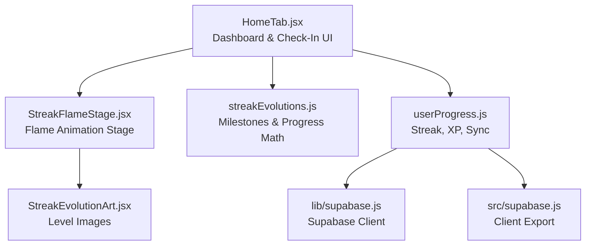
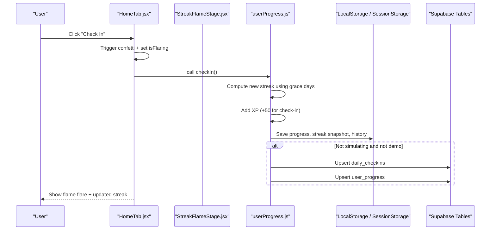
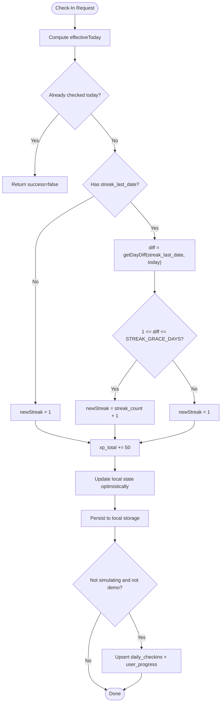
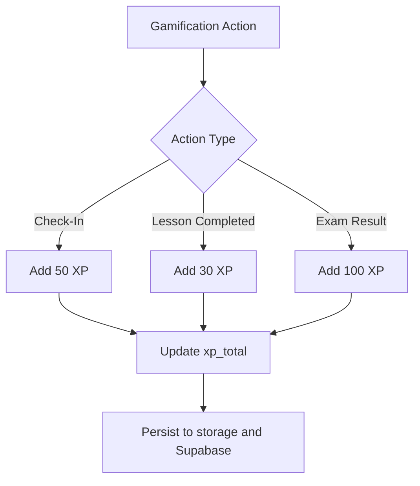
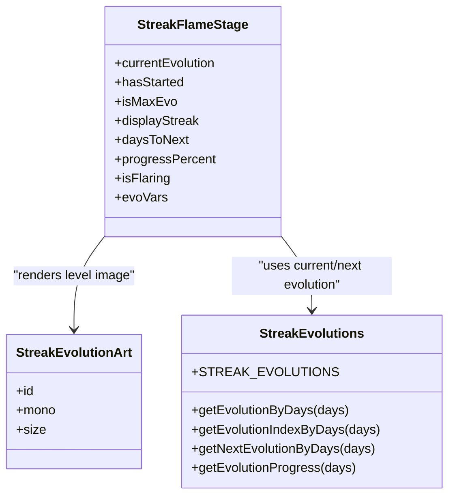
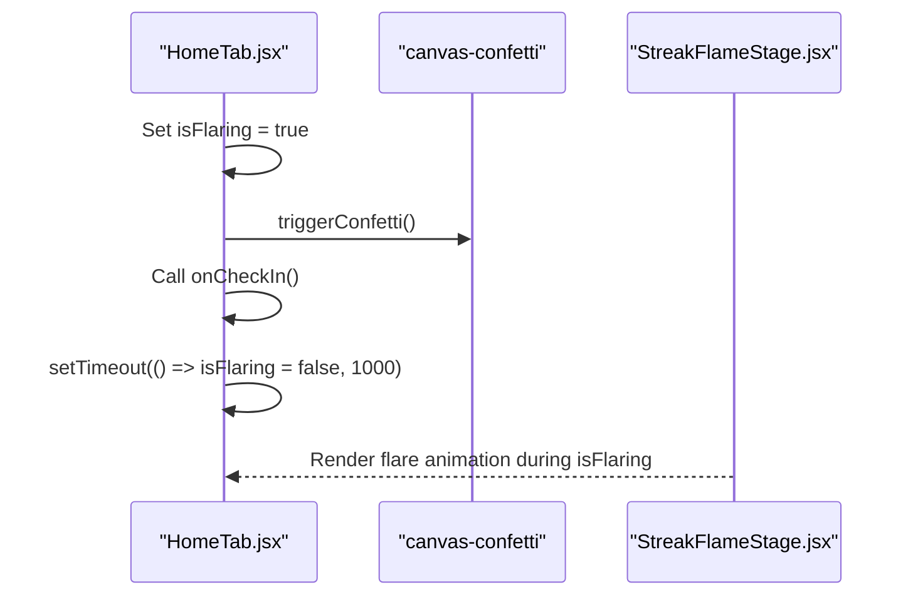
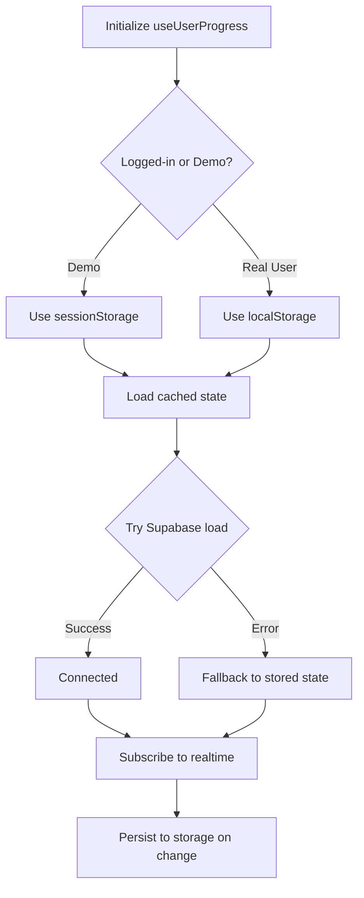
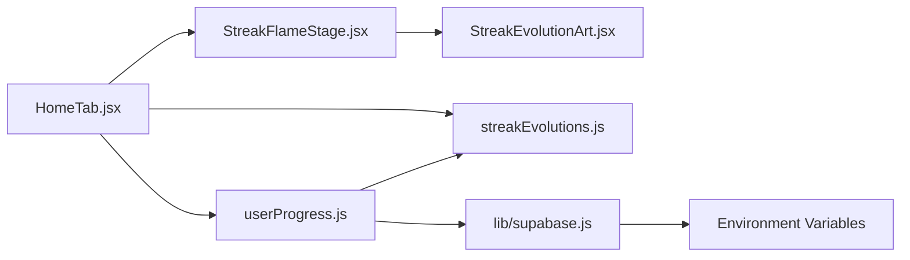

# Gamification System

<cite>
**Referenced Files in This Document**
- [HomeTab.jsx](file://src/components/HomeTab.jsx)
- [StreakFlameStage.jsx](file://src/components/motion/StreakFlameStage.jsx)
- [StreakEvolutionArt.jsx](file://src/components/StreakEvolutionArt.jsx)
- [streakEvolutions.js](file://src/lib/streakEvolutions.js)
- [userProgress.js](file://src/lib/userProgress.js)
- [supabase.js (client wrapper)](file://src/supabase.js)
- [supabase.js (Supabase client)](file://lib/supabase.js)
</cite>

## Table of Contents
1. [Introduction](#introduction)
2. [Project Structure](#project-structure)
3. [Core Components](#core-components)
4. [Architecture Overview](#architecture-overview)
5. [Detailed Component Analysis](#detailed-component-analysis)
6. [Dependency Analysis](#dependency-analysis)
7. [Performance Considerations](#performance-considerations)
8. [Troubleshooting Guide](#troubleshooting-guide)
9. [Conclusion](#conclusion)

## Introduction
This document explains the gamification system implemented in the project, focusing on:
- Streak tracking with grace period handling and automatic expiration
- XP point calculation for check-ins, lesson completion, and exam results
- Visual evolution animations for streak milestones
- Achievement-like notifications through UI feedback such as confetti and flame flares
- Local storage fallback mechanisms and Supabase synchronization

The goal is to make the streak and XP mechanics clear for both developers and non-technical readers, while providing code-level diagrams and formulas derived from the actual implementation.

## Project Structure
The gamification logic is primarily split between:
- A React hook that manages user progress, streak state, local storage, and Supabase sync
- A streak evolution configuration module that defines milestone thresholds and visual metadata
- UI components that render the flame stage, evolution artwork, and dashboard interactions

**Diagram sources**
- [HomeTab.jsx:66-107](file://src/components/HomeTab.jsx#L66-L107)
- [StreakFlameStage.jsx:13-22](file://src/components/motion/StreakFlameStage.jsx#L13-L22)
- [StreakEvolutionArt.jsx:15-31](file://src/components/StreakEvolutionArt.jsx#L15-L31)
- [streakEvolutions.js:20-167](file://src/lib/streakEvolutions.js#L20-L167)
- [userProgress.js:88-716](file://src/lib/userProgress.js#L88-L716)
- [supabase.js (client wrapper):1-2](file://src/supabase.js#L1-L2)
- [supabase.js (Supabase client):1-14](file://lib/supabase.js#L1-L14)

**Section sources**
- [HomeTab.jsx:66-107](file://src/components/HomeTab.jsx#L66-L107)
- [userProgress.js:88-716](file://src/lib/userProgress.js#L88-L716)
- [streakEvolutions.js:20-167](file://src/lib/streakEvolutions.js#L20-L167)

## Core Components
- **Streak and XP Hook**: `useUserProgress` manages streak count, last check-in date, XP total, mastery blocks, completed lessons, daily check-ins, Supabase loading, realtime subscriptions, local storage persistence, and simulation helpers.
- **Streak Evolution Config**: `streakEvolutions.js` defines six evolution tiers, their minimum day thresholds, colors, and helper functions for current tier, next tier, and progress percentage.
- **Flame Stage UI**: `StreakFlameStage.jsx` renders animated sparkles, a main flame glyph, streak name, next-tier hint, and a progress bar. It reacts to a flare trigger when the user checks in.
- **Evolution Art UI**: `StreakEvolutionArt.jsx` displays level images and applies a black filter for locked tiers.
- **Dashboard UI**: `HomeTab.jsx` orchestrates check-in interaction, confetti, admin preview mode, weekly calendar visualization, and the streak evolution collection.

**Section sources**
- [userProgress.js:88-716](file://src/lib/userProgress.js#L88-L716)
- [streakEvolutions.js:20-167](file://src/lib/streakEvolutions.js#L20-L167)
- [StreakFlameStage.jsx:13-191](file://src/components/motion/StreakFlameStage.jsx#L13-L191)
- [StreakEvolutionArt.jsx:15-75](file://src/components/StreakEvolutionArt.jsx#L15-L75)
- [HomeTab.jsx:66-107](file://src/components/HomeTab.jsx#L66-L107)

## Architecture Overview
The gamification system follows an optimistic UI pattern:
1. User clicks “Check In”.
2. The dashboard triggers a flare animation and confetti.
3. The hook updates streak count, last check-in date, and XP immediately.
4. If not simulating or demo mode, it writes to Supabase tables.
5. Realtime subscriptions keep other tabs or devices in sync.
6. Local storage acts as a fallback and cache.

**Diagram sources**
- [HomeTab.jsx:98-107](file://src/components/HomeTab.jsx#L98-L107)
- [userProgress.js:477-536](file://src/lib/userProgress.js#L477-L536)
- [userProgress.js:243-270](file://src/lib/userProgress.js#L243-L270)
- [userProgress.js:384-475](file://src/lib/userProgress.js#L384-L475)

## Detailed Component Analysis

### Streak Calculation Logic and Grace Period Handling
The streak rule is explicitly defined:
- Maximum gap between two check-ins is three days.
- Gaps of one to three days keep the streak alive and increment it.
- Four-day gaps (three consecutive missed days) reset the streak to zero.

Key behaviors:
- `STREAK_GRACE_DAYS = 3`
- `getDayDiff` computes signed day differences between `'YYYY-MM-DD'` strings.
- `checkIn` increments streak if within grace window; otherwise resets to one.
- An automatic expiration effect runs only with real dates: if the last check-in is beyond the grace period, streak is reset locally and synced to Supabase once per `(lastDate, streakCount)` signature.

Formulas:
- Let `last` be `streak_last_date`, `today` be effective today.
- Let `diff = getDayDiff(last, today)`.
- If `diff > STREAK_GRACE_DAYS`, then `streak_count = 0`.
- On check-in:
  - If `diff >= 1` and `diff <= STREAK_GRACE_DAYS`, then `newStreak = streak_count + 1`.
  - Otherwise, `newStreak = 1`.
  - If no previous date exists, `newStreak = streak_count + 1`.

**Diagram sources**
- [userProgress.js:36-42](file://src/lib/userProgress.js#L36-L42)
- [userProgress.js:63-83](file://src/lib/userProgress.js#L63-L83)
- [userProgress.js:210-240](file://src/lib/userProgress.js#L210-L240)
- [userProgress.js:477-536](file://src/lib/userProgress.js#L477-L536)

**Section sources**
- [userProgress.js:36-42](file://src/lib/userProgress.js#L36-L42)
- [userProgress.js:63-83](file://src/lib/userProgress.js#L63-L83)
- [userProgress.js:210-240](file://src/lib/userProgress.js#L210-L240)
- [userProgress.js:477-536](file://src/lib/userProgress.js#L477-L536)

### XP Points Calculation
XP is awarded for:
- Daily check-in: `+50 XP`
- Completing a roadmap lesson: `+30 XP`
- Recording an exam result: `+100 XP`

The hook updates `xp_total` optimistically and persists changes to Supabase when applicable.

**Diagram sources**
- [userProgress.js:498-506](file://src/lib/userProgress.js#L498-L506)
- [userProgress.js:575-581](file://src/lib/userProgress.js#L575-L581)
- [userProgress.js:609-644](file://src/lib/userProgress.js#L609-L644)

**Section sources**
- [userProgress.js:498-506](file://src/lib/userProgress.js#L498-L506)
- [userProgress.js:575-581](file://src/lib/userProgress.js#L575-L581)
- [userProgress.js:609-644](file://src/lib/userProgress.js#L609-L644)

### Visual Evolution Animations and Streak Evolution Artwork
Streak evolution is driven by the number of streak days:
- Tier 1: 0 days
- Tier 2: 14 days
- Tier 3: 30 days
- Tier 4: 45 days
- Tier 5: 60 days
- Tier 6: 90 days (maximum)

The flame stage provides:
- Ambient sparkle particles around the flame
- Idle breathing animation with slight scale and rotation
- Flare animation on successful check-in
- Progress bar animating toward the next evolution
- CSS variables injected from the current evolution’s theme

**Diagram sources**
- [StreakFlameStage.jsx:13-191](file://src/components/motion/StreakFlameStage.jsx#L13-L191)
- [StreakEvolutionArt.jsx:15-75](file://src/components/StreakEvolutionArt.jsx#L15-L75)
- [streakEvolutions.js:20-167](file://src/lib/streakEvolutions.js#L20-L167)

#### Evolution Progress Formula
Let:
- `d` = current streak days
- `current` = evolution where `current.minDays <= d`
- `next` = next evolution after `current`, or null if at maximum

Then:
- If `next` is null: `percent = 100`, `daysToNext = 0`
- Else:
  - `span = next.minDays - current.minDays`
  - `gained = d - current.minDays`
  - `percent = clamp(round((gained / span) * 100), 0, 100)`
  - `daysToNext = max(0, next.minDays - d)`

**Section sources**
- [streakEvolutions.js:20-167](file://src/lib/streakEvolutions.js#L20-L167)
- [StreakFlameStage.jsx:118-188](file://src/components/motion/StreakFlameStage.jsx#L118-L188)
- [HomeTab.jsx:133-172](file://src/components/HomeTab.jsx#L133-L172)

### Achievement Notifications and Visual Feedback
Achievement-style feedback is implemented through:
- Confetti burst on check-in
- Flame flare animation triggered by `isFlaring`
- Weekly streak calendar highlighting checked days
- Evolution collection showing unlocked vs locked tiers
- Admin preview mode allowing inspection of all evolution states

**Diagram sources**
- [HomeTab.jsx:89-107](file://src/components/HomeTab.jsx#L89-L107)
- [StreakFlameStage.jsx:123-149](file://src/components/motion/StreakFlameStage.jsx#L123-L149)

**Section sources**
- [HomeTab.jsx:89-107](file://src/components/HomeTab.jsx#L89-L107)
- [HomeTab.jsx:480-508](file://src/components/HomeTab.jsx#L480-L508)
- [HomeTab.jsx:510-732](file://src/components/HomeTab.jsx#L510-L732)

### Local Storage Fallback Mechanisms
The hook uses:
- `localStorage` for logged-in users
- `sessionStorage` for demo users
- Keys for progress, mastery, completed lessons, and check-in history
- Automatic persistence whenever state changes, except during simulation
- Fallback initialization from storage when Supabase is unavailable or errors occur

**Diagram sources**
- [userProgress.js:88-148](file://src/lib/userProgress.js#L88-L148)
- [userProgress.js:243-270](file://src/lib/userProgress.js#L243-L270)
- [userProgress.js:273-382](file://src/lib/userProgress.js#L273-L382)
- [userProgress.js:384-475](file://src/lib/userProgress.js#L384-L475)

**Section sources**
- [userProgress.js:88-148](file://src/lib/userProgress.js#L88-L148)
- [userProgress.js:243-270](file://src/lib/userProgress.js#L243-L270)
- [userProgress.js:273-382](file://src/lib/userProgress.js#L273-L382)
- [userProgress.js:384-475](file://src/lib/userProgress.js#L384-L475)

### Supabase Synchronization
Supabase integration includes:
- Loading initial data from `user_progress`, `mastery_progress`, `roadmap_lessons`, and `daily_checkins`
- Realtime subscriptions for each table filtered by user ID
- Upsert operations for check-ins, lesson completion, exam results, and mastery updates
- Graceful fallback to local storage when Supabase fails or tables are missing

Tables involved:
- `user_progress`: streak count, last date, exams, average score, accuracy, XP total
- `mastery_progress`: knowledge block progress
- `roadmap_lessons`: lesson completion status
- `daily_checkins`: historical check-in dates

**Section sources**
- [userProgress.js:273-382](file://src/lib/userProgress.js#L273-L382)
- [userProgress.js:384-475](file://src/lib/userProgress.js#L384-L475)
- [userProgress.js:512-529](file://src/lib/userProgress.js#L512-L529)
- [userProgress.js:583-603](file://src/lib/userProgress.js#L583-L603)
- [userProgress.js:625-640](file://src/lib/userProgress.js#L625-L640)
- [supabase.js (client wrapper):1-2](file://src/supabase.js#L1-L2)
- [supabase.js (Supabase client):1-14](file://lib/supabase.js#L1-L14)

## Dependency Analysis
The gamification system has clear separation of concerns:
- UI components depend on the hook for state and actions
- The hook depends on Supabase client and evolution config
- Evolution config is pure and reusable
- Supabase client is configured via environment variables with fallbacks

**Diagram sources**
- [HomeTab.jsx:66-107](file://src/components/HomeTab.jsx#L66-L107)
- [StreakFlameStage.jsx:13-22](file://src/components/motion/StreakFlameStage.jsx#L13-L22)
- [StreakEvolutionArt.jsx:15-31](file://src/components/StreakEvolutionArt.jsx#L15-L31)
- [streakEvolutions.js:20-167](file://src/lib/streakEvolutions.js#L20-L167)
- [userProgress.js:88-716](file://src/lib/userProgress.js#L88-L716)
- [supabase.js (Supabase client):1-14](file://lib/supabase.js#L1-L14)

**Section sources**
- [HomeTab.jsx:66-107](file://src/components/HomeTab.jsx#L66-L107)
- [userProgress.js:88-716](file://src/lib/userProgress.js#L88-L716)
- [streakEvolutions.js:20-167](file://src/lib/streakEvolutions.js#L20-L167)
- [supabase.js (Supabase client):1-14](file://lib/supabase.js#L1-L14)

## Performance Considerations
- Reduced motion support: Both the flame stage and dashboard respect `useReducedMotion`, disabling heavy animations for accessibility and performance.
- Optimistic UI: State updates happen instantly before network calls, improving perceived responsiveness.
- Local storage caching: Frequent reads/writes are minimized by batching state changes and persisting only when necessary.
- Realtime subscription cleanup: Channels are removed on unmount to prevent memory leaks.
- Image rendering: Evolution artwork uses static images with CSS filters rather than complex canvas effects, reducing GPU pressure.
- Confetti bursts: Limited particle count and short duration to avoid jank during check-in.

[No sources needed since this section provides general guidance]

## Troubleshooting Guide
Common issues and resolutions:
- Streak unexpectedly resets:
  - Verify whether more than three consecutive days have passed without check-in.
  - Check automatic expiration logic and ensure effective date calculations are correct.
- Supabase sync failures:
  - Confirm environment variables for Supabase URL and key.
  - Ensure required tables exist and RLS policies allow anonymous or authenticated access as configured.
  - Review console warnings for Supabase errors and fallback behavior.
- Local storage inconsistencies:
  - Clear browser storage if corrupted.
  - Remember demo mode uses session storage and does not persist across sessions.
- Animation glitches:
  - Disable reduced motion settings in the browser or OS if animations appear broken.
  - Test on devices with lower performance to validate smoothness.

**Section sources**
- [userProgress.js:210-240](file://src/lib/userProgress.js#L210-L240)
- [userProgress.js:273-382](file://src/lib/userProgress.js#L273-L382)
- [userProgress.js:384-475](file://src/lib/userProgress.js#L384-L475)
- [supabase.js (Supabase client):1-14](file://lib/supabase.js#L1-L14)

## Conclusion
The gamification system combines robust streak math, clear XP rewards, rich visual feedback, and resilient data synchronization. Grace period handling ensures fair streak maintenance, while local storage and Supabase provide reliable persistence. The evolution artwork and flame animations create engaging milestones that motivate consistent learning. For maintainability, the separation between UI, state management, and configuration makes it straightforward to extend streak rules, add new XP actions, or enhance visual feedback.

[No sources needed since this section summarizes without analyzing specific files]