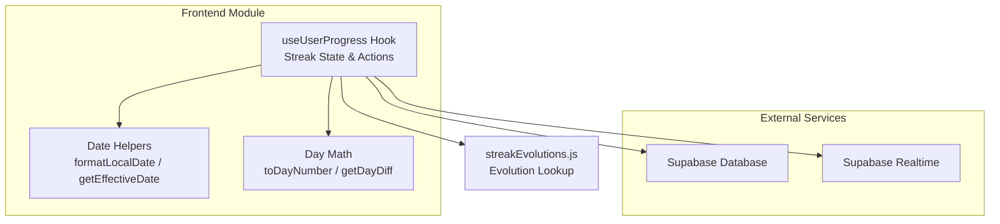
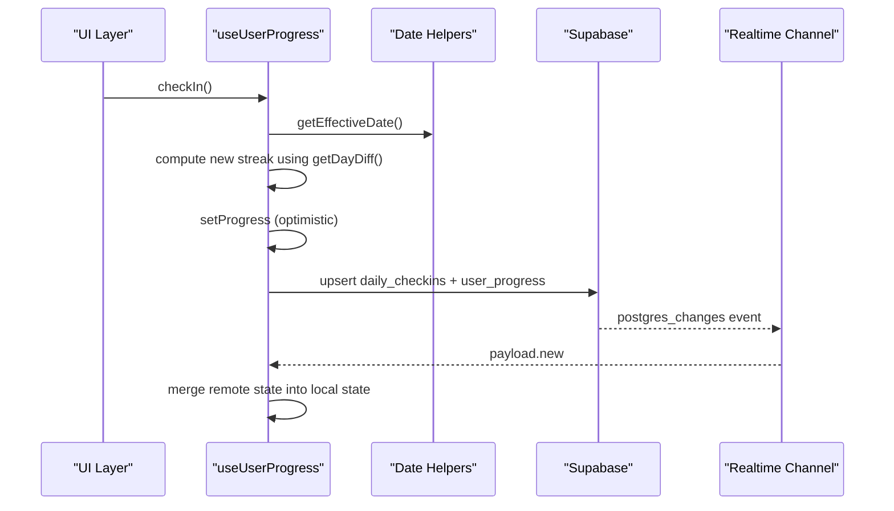
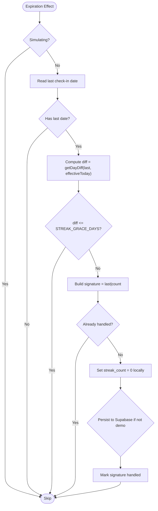
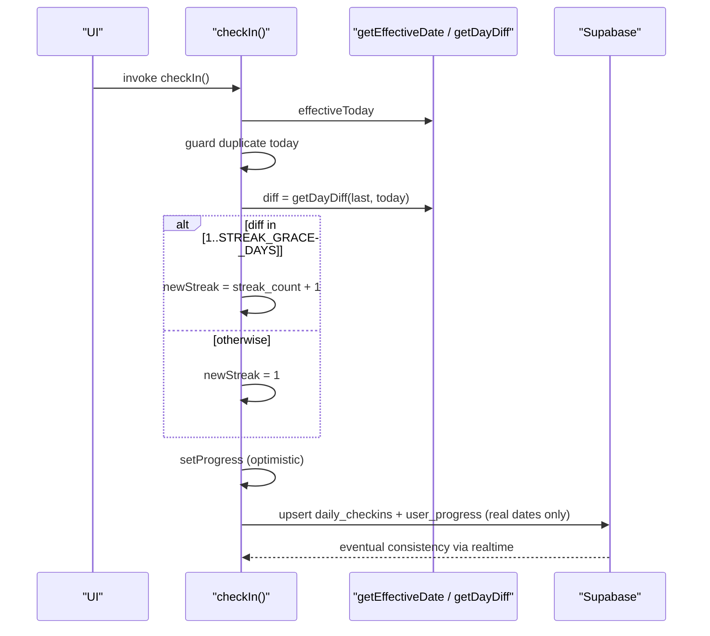
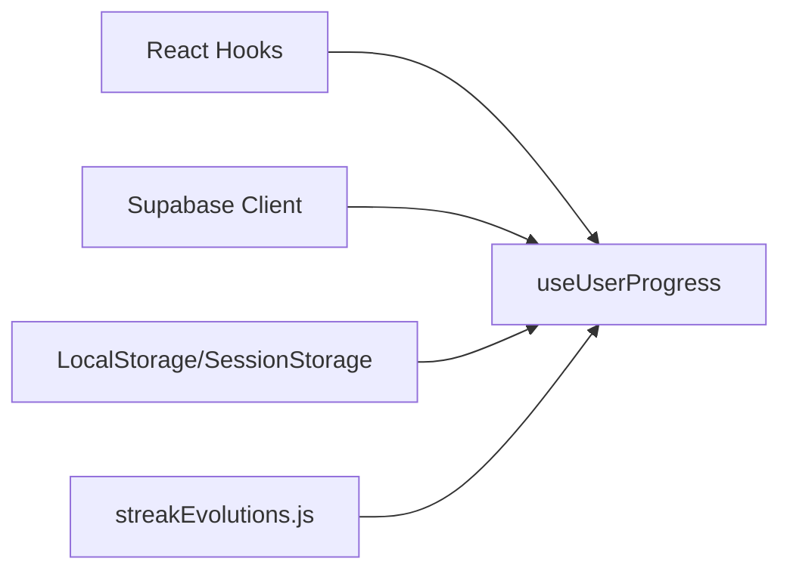

# Streak Algorithms & Logic

<cite>
**Referenced Files in This Document**
- [userProgress.js](file://src/lib/userProgress.js)
- [streakEvolutions.js](file://src/lib/streakEvolutions.js)
</cite>

## Table of Contents
1. [Introduction](#introduction)
2. [Project Structure](#project-structure)
3. [Core Components](#core-components)
4. [Architecture Overview](#architecture-overview)
5. [Detailed Component Analysis](#detailed-component-analysis)
6. [Dependency Analysis](#dependency-analysis)
7. [Performance Considerations](#performance-considerations)
8. [Troubleshooting Guide](#troubleshooting-guide)
9. [Conclusion](#conclusion)

## Introduction
This document explains the streak calculation system used by the application, focusing on:
- Grace period handling with a 3-day grace window
- Date difference calculations using timezone-safe day numbers
- Automatic streak expiration when users miss consecutive days beyond the grace period
- Edge cases such as invalid dates, timezone differences, and simulated date offsets
- Real-time update behavior through optimistic UI and database synchronization

The core logic is implemented in the user progress hook and related helpers.

## Project Structure
The streak algorithm lives inside the user progress module and integrates with Supabase for persistence and real-time updates. It also exposes utilities for formatting local dates and computing day differences.

**Diagram sources**
- [userProgress.js:1-10](file://src/lib/userProgress.js#L1-L10)
- [userProgress.js:44-83](file://src/lib/userProgress.js#L44-L83)
- [userProgress.js:88-240](file://src/lib/userProgress.js#L88-L240)
- [userProgress.js:477-536](file://src/lib/userProgress.js#L477-L536)
- [userProgress.js:683-693](file://src/lib/userProgress.js#L683-L693)

**Section sources**
- [userProgress.js:1-10](file://src/lib/userProgress.js#L1-L10)
- [userProgress.js:44-83](file://src/lib/userProgress.js#L44-L83)
- [userProgress.js:88-240](file://src/lib/userProgress.js#L88-L240)
- [userProgress.js:477-536](file://src/lib/userProgress.js#L477-L536)
- [userProgress.js:683-693](file://src/lib/userProgress.js#L683-L693)

## Core Components
- STREAK_GRACE_DAYS: The maximum allowed gap between two check-ins to keep the streak alive. A gap greater than this resets the streak.
- formatLocalDate: Formats a JavaScript Date into a local YYYY-MM-DD string without UTC conversion, avoiding off-by-one errors near midnight.
- getEffectiveDate: Returns today’s local date, optionally shifted by a simulation offset.
- toDayNumber: Converts a YYYY-MM-DD string into an absolute day number independent of timezones.
- getDayDiff: Computes signed day differences between two YYYY-MM-DD strings; returns a sentinel value for missing or invalid inputs.
- useUserProgress: Manages streak state, automatic expiration, check-in actions, and persistence via Supabase and LocalStorage.

Key responsibilities:
- Grace period enforcement during check-in
- Automatic streak reset when the effective date exceeds the last check-in by more than the grace period
- Timezone-safe date math
- Optimistic UI updates with eventual consistency from Supabase

**Section sources**
- [userProgress.js:36-42](file://src/lib/userProgress.js#L36-L42)
- [userProgress.js:44-83](file://src/lib/userProgress.js#L44-L83)
- [userProgress.js:88-240](file://src/lib/userProgress.js#L88-L240)
- [userProgress.js:477-536](file://src/lib/userProgress.js#L477-L536)

## Architecture Overview
The streak system combines client-side state management with server-backed persistence and real-time synchronization.

**Diagram sources**
- [userProgress.js:477-536](file://src/lib/userProgress.js#L477-L536)
- [userProgress.js:384-475](file://src/lib/userProgress.js#L384-L475)

## Detailed Component Analysis

### STREAK_GRACE_DAYS Constant
- Value: 3 days
- Meaning: If the gap between the last check-in and the current effective date is greater than 3 days, the streak resets.
- Usage:
  - Automatic expiration effect checks if the gap exceeds this threshold and resets the streak to zero.
  - Check-in logic allows continuing the streak if the gap is within 1..3 days.

Examples:
- Gap = 1..3 days: streak continues and increments.
- Gap > 3 days: streak resets to zero.

**Section sources**
- [userProgress.js:36-42](file://src/lib/userProgress.js#L36-L42)
- [userProgress.js:210-240](file://src/lib/userProgress.js#L210-L240)
- [userProgress.js:484-496](file://src/lib/userProgress.js#L484-L496)

### Date Helpers and Timezone Safety
- formatLocalDate: Builds a local YYYY-MM-DD string directly from local date components, avoiding UTC conversion pitfalls around midnight.
- getEffectiveDate: Returns the local “today” date, optionally shifted by a simulation offset for testing.
- toDayNumber: Parses YYYY-MM-DD into year/month/day and computes an absolute day number using UTC epoch milliseconds divided by the number of milliseconds per day. This yields a timezone-independent integer representing calendar days.
- getDayDiff: Calculates n2 - n1 where n1 and n2 are day numbers. Returns a sentinel value (999) if either input is missing or invalid.

Edge cases handled:
- Missing or malformed date strings return a sentinel instead of NaN propagation.
- Local date formatting prevents off-by-one errors due to timezone shifts.

Complexity:
- O(1) time and space for each helper call.

**Section sources**
- [userProgress.js:44-83](file://src/lib/userProgress.js#L44-L83)

### Automatic Streak Expiration Mechanism
Behavior:
- Runs only with real dates (not during simulation).
- Reads the last check-in date and compares it to the effective today.
- If the gap exceeds STREAK_GRACE_DAYS, the streak is reset to zero locally and persisted to Supabase.
- Uses a ref-based signature to avoid repeated writes for the same (last_date, count) pair.

Flow:

**Diagram sources**
- [userProgress.js:210-240](file://src/lib/userProgress.js#L210-L240)

**Section sources**
- [userProgress.js:210-240](file://src/lib/userProgress.js#L210-L240)

### Check-In Logic and Streak Computation
Behavior:
- Prevents duplicate check-ins on the same effective date.
- Computes the gap between the last check-in and today using getDayDiff.
- If the gap is within 1..STREAK_GRACE_DAYS, the streak increments.
- Otherwise, the streak restarts at 1.
- Updates local state optimistically and persists to Supabase only for real dates.

Sequence:

**Diagram sources**
- [userProgress.js:477-536](file://src/lib/userProgress.js#L477-L536)

**Section sources**
- [userProgress.js:477-536](file://src/lib/userProgress.js#L477-L536)

### Simulation Tools and Testing Aids
- simulateNextDay: Advances the effective date by one day in memory only.
- simulateMissedDays: Jumps ahead by STREAK_GRACE_DAYS + 1 days and resets the streak locally to demonstrate expiration.
- resetSimulation: Restores real date and reloads saved state from storage.

These tools help verify boundary conditions without altering persistent data.

**Section sources**
- [userProgress.js:646-681](file://src/lib/userProgress.js#L646-L681)

### Streak Evolution Integration
The hook composes a streak-compatible object that includes:
- Current streak count
- Whether the user checked in today
- Last check-in date
- Day offset and history
- Grace days constant
- Current evolution stage and progress computed by streakEvolutions.js

This enables UI components to render streak visuals based on the current streak length.

**Section sources**
- [userProgress.js:683-693](file://src/lib/userProgress.js#L683-L693)
- [streakEvolutions.js:1-200](file://src/lib/streakEvolutions.js#L1-L200)

## Dependency Analysis
The streak logic depends on:
- React hooks for state and effects
- Supabase client for persistence and real-time updates
- LocalStorage/sessionStorage for offline fallback and simulation isolation
- streakEvolutions.js for mapping streak lengths to visual stages

**Diagram sources**
- [userProgress.js:1-4](file://src/lib/userProgress.js#L1-L4)
- [userProgress.js:88-240](file://src/lib/userProgress.js#L88-L240)
- [userProgress.js:384-475](file://src/lib/userProgress.js#L384-L475)
- [userProgress.js:683-693](file://src/lib/userProgress.js#L683-L693)

**Section sources**
- [userProgress.js:1-4](file://src/lib/userProgress.js#L1-L4)
- [userProgress.js:88-240](file://src/lib/userProgress.js#L88-L240)
- [userProgress.js:384-475](file://src/lib/userProgress.js#L384-L475)
- [userProgress.js:683-693](file://src/lib/userProgress.js#L683-L693)

## Performance Considerations
- O(1) date math: toDayNumber and getDayDiff operate in constant time and space.
- Minimal network writes:
  - Automatic expiration uses a signature-based guard to avoid redundant Supabase writes.
  - Check-in writes occur once per action and only for real dates.
- Optimistic UI:
  - Immediate local state updates improve responsiveness.
  - Realtime channel merges server changes back into local state.
- Simulation isolation:
  - Simulation state does not persist to localStorage, preventing accidental contamination of real data.

Recommendations:
- Keep getDayDiff pure and free of side effects.
- Avoid unnecessary re-renders by memoizing derived values where appropriate.
- Ensure realtime subscriptions are properly cleaned up on unmount.

[No sources needed since this section provides general guidance]

## Troubleshooting Guide
Common issues and resolutions:
- Streak unexpectedly resets:
  - Verify effectiveToday vs last check-in date; gaps exceeding STREAK_GRACE_DAYS trigger reset.
  - Confirm timezone handling uses local date formatting rather than UTC conversion.
- Duplicate check-ins:
  - The hook guards against checking in twice on the same effective date.
- Data inconsistency after refresh:
  - Realtime events should reconcile state; ensure subscription is active and not closed.
- Simulation artifacts:
  - Use resetSimulation to restore real dates and reload persisted state.

Operational tips:
- Use simulateNextDay and simulateMissedDays to test boundary conditions safely.
- Monitor console warnings for Supabase write failures; local state remains consistent even if persistence fails.

**Section sources**
- [userProgress.js:210-240](file://src/lib/userProgress.js#L210-L240)
- [userProgress.js:477-536](file://src/lib/userProgress.js#L477-L536)
- [userProgress.js:646-681](file://src/lib/userProgress.js#L646-L681)

## Conclusion
The streak system enforces a 3-day grace period using timezone-safe date arithmetic and automatically resets streaks when users miss consecutive days beyond the grace window. It provides robust edge-case handling, optimistic UI updates, and reliable persistence via Supabase with real-time synchronization. The design balances correctness, performance, and developer ergonomics through clear helpers, simulation tools, and well-scoped state management.

[No sources needed since this section summarizes without analyzing specific files]