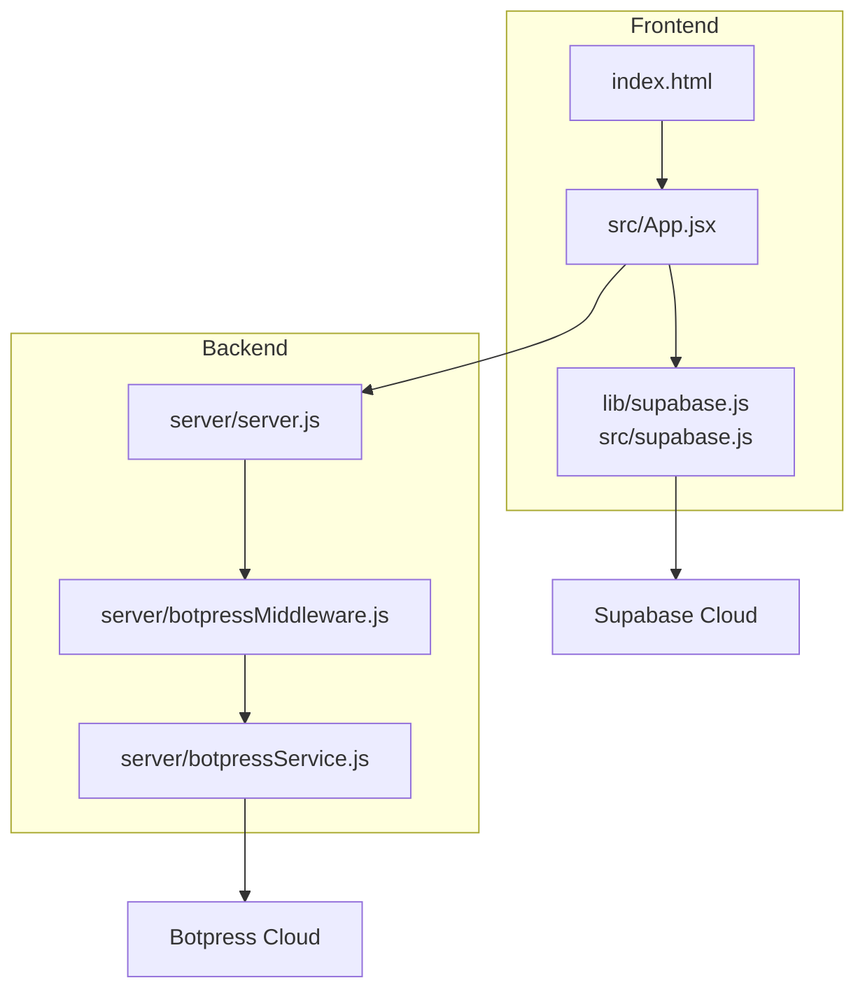
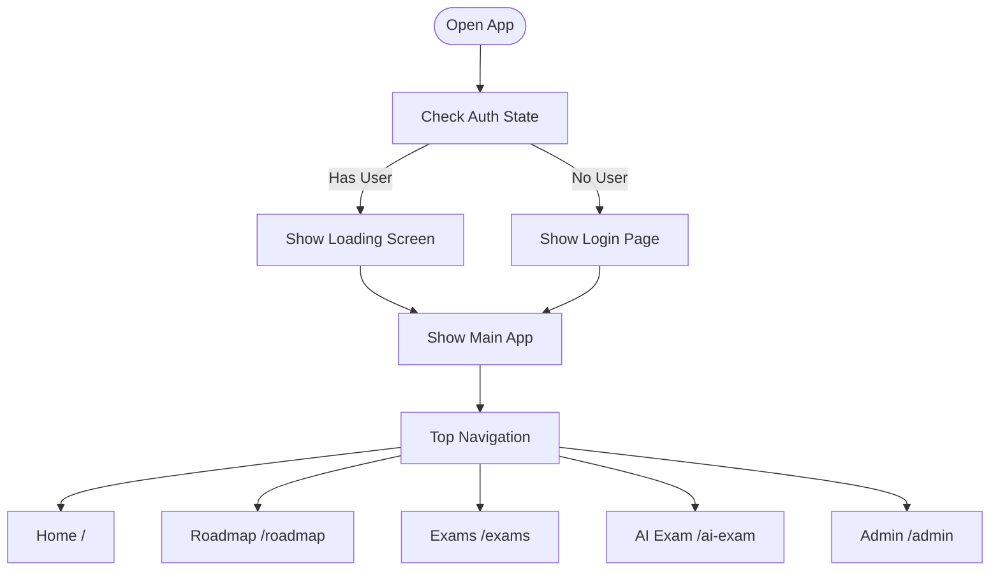
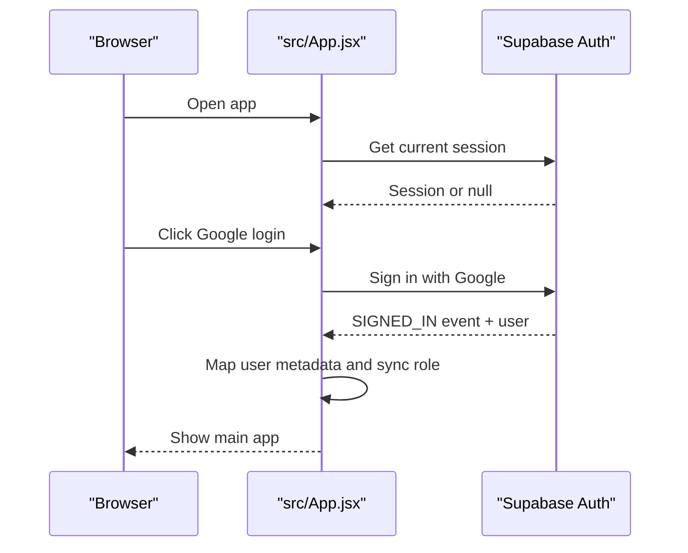
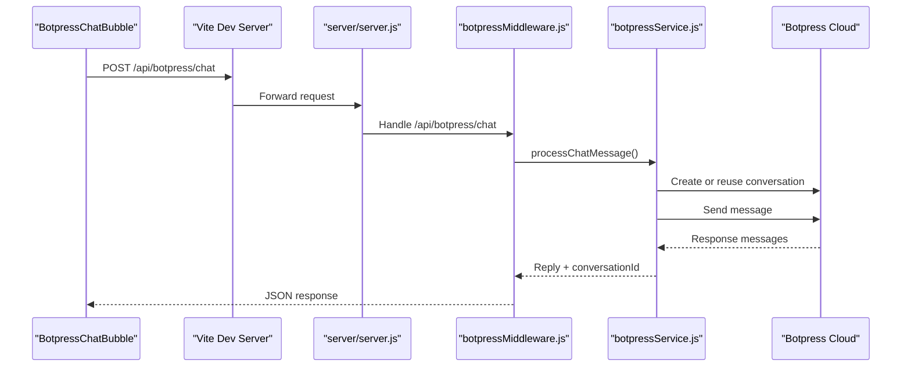

# Getting Started

<cite>
**Referenced Files in This Document**
- [README.md](file://README.md)
- [package.json](file://package.json)
- [vite.config.js](file://vite.config.js)
- [index.html](file://index.html)
- [src/App.jsx](file://src/App.jsx)
- [src/supabase.js](file://src/supabase.js)
- [lib/supabase.js](file://lib/supabase.js)
- [server/server.js](file://server/server.js)
- [server/botpressMiddleware.js](file://server/botpressMiddleware.js)
- [server/botpressService.js](file://server/botpressService.js)
</cite>

## Table of Contents
1. [Introduction](#introduction)
2. [Project Structure](#project-structure)
3. [Installation and Environment Setup](#installation-and-environment-setup)
4. [Development Server Startup](#development-server-startup)
5. [Initial Configuration](#initial-configuration)
6. [Basic Navigation and First-Time Experience](#basic-navigation-and-first-time-experience)
7. [Supabase Credentials Setup](#supabase-credentials-setup)
8. [Google OAuth Configuration](#google-oauth-configuration)
9. [Botpress Integration Setup](#botpress-integration-setup)
10. [Verification Steps](#verification-steps)
11. [Troubleshooting Guide](#troubleshooting-guide)
12. [Conclusion](#conclusion)

## Introduction
MewTinHoc is a React-based learning platform focused on Vietnamese high school computer science exam preparation. It provides roadmaps, an exam repository, AI-assisted practice, streak tracking, admin tools, and an integrated Botpress chat assistant. The project uses Vite for development, Supabase for authentication and data, and a small Node.js backend to proxy Botpress Cloud API calls securely.

The GitHub Pages deployment link is provided in the repository README.

**Section sources**
- [README.md:1-4](file://README.md#L1-L4)

## Project Structure
At a high level, MewTinHoc consists of:
- A React frontend built with Vite.
- A small Node.js server that serves static files and proxies Botpress endpoints.
- Supabase client configuration for authentication and data access.
- Botpress middleware and service logic for secure chat integration.



**Diagram sources**
- [index.html:41-44](file://index.html#L41-L44)
- [src/App.jsx:1-20](file://src/App.jsx#L1-L20)
- [lib/supabase.js:1-14](file://lib/supabase.js#L1-L14)
- [server/server.js:1-12](file://server/server.js#L1-L12)
- [server/botpressMiddleware.js:1-10](file://server/botpressMiddleware.js#L1-L10)
- [server/botpressService.js:1-10](file://server/botpressService.js#L1-L10)

**Section sources**
- [package.json:1-34](file://package.json#L1-L34)
- [vite.config.js:1-22](file://vite.config.js#L1-L22)
- [index.html:1-46](file://index.html#L1-L46)

## Installation and Environment Setup
### Requirements
- **Node.js**: Use a modern LTS version compatible with Vite 8 and ESM modules. The project uses `"type": "module"` in `package.json`, so Node.js must support ES modules.
- **npm**: Comes bundled with Node.js.

### Install Dependencies
Run the following command in the repository root:
```bash
npm install
```

This installs dependencies defined in `package.json`, including React, Vite, Supabase client, Botpress client, PDF rendering libraries, and routing utilities.

**Section sources**
- [package.json:1-34](file://package.json#L1-L34)

## Development Server Startup
There are two main ways to run the project locally:

### Frontend Development Server
Start the Vite development server:
```bash
npm run dev
```
This runs the React application with hot module replacement.

### Backend Server for Botpress Proxy
Start the Node.js backend server:
```bash
npm run server
```
By default, this server listens on port `3001`. You can override it using the `PORT` environment variable.

### Preview Built Output
After building the app:
```bash
npm run build
npm run preview
```

**Section sources**
- [package.json:6-12](file://package.json#L6-L12)
- [server/server.js:12-12](file://server/server.js#L12-L12)

## Initial Configuration
Before running the app with full features, configure environment variables:

### Required Variables
Create `.env.local` at the repository root for backend secrets:
- `BOTPRESS_TOKEN`: Your Botpress Cloud token.
- `BOTPRESS_BOT_ID`: Your Botpress bot ID.
- `BOTPRESS_WEBHOOK_ID`: Your Botpress webhook ID for chat.
- `BOTPRESS_ENCRYPTION_KEY`: Encryption key used by Botpress user keys.
- `BOTPRESS_ALLOWED_ORIGIN`: Optional allowed origin for CORS when calling `/api/botpress`.

For the frontend Supabase client, use Vite environment variables:
- `VITE_SUPABASE_URL`: Your Supabase project URL.
- `VITE_SUPABASE_PUBLISHABLE_KEY`: Your Supabase anon/publishable key.

### How Variables Are Loaded
- The backend reads `.env.local`, `.evn.local`, and `.env` from the repository root.
- The frontend reads `VITE_*` variables through Vite’s `import.meta.env`.

**Section sources**
- [server/botpressService.js:11-40](file://server/botpressService.js#L11-L40)
- [server/botpressService.js:43-69](file://server/botpressService.js#L43-L69)
- [lib/supabase.js:3-12](file://lib/supabase.js#L3-L12)

## Basic Navigation and First-Time Experience
When you open the app:
1. If no authenticated user is detected, the login page is shown.
2. After logging in via Google OAuth or demo mode, the main interface appears.
3. The top navigation allows switching between Home, Roadmap, Exams, and AI Exam.
4. Routes include:
   - `/` or `/home`: Home dashboard.
   - `/roadmap`: Learning roadmap view.
   - `/roadmap/:track`: Track-specific roadmap.
   - `/exams`: Exam repository.
   - `/ai-exam`: AI-assisted exam practice.
   - `/admin`: Admin panel (accessible via route or hash).



**Diagram sources**
- [src/App.jsx:22-55](file://src/App.jsx#L22-L55)
- [src/App.jsx:223-236](file://src/App.jsx#L223-L236)
- [src/App.jsx:242-340](file://src/App.jsx#L242-L340)

**Section sources**
- [src/App.jsx:22-55](file://src/App.jsx#L22-L55)
- [src/App.jsx:223-340](file://src/App.jsx#L223-L340)

## Supabase Credentials Setup
MewTinHoc uses Supabase for authentication and data. The frontend client is exported from `src/supabase.js`, which re-exports the configured client from `lib/supabase.js`.

### Steps
1. Create or select a Supabase project.
2. Copy your project URL and anon/publishable key.
3. Add these values to `.env.local`:
   - `VITE_SUPABASE_URL`
   - `VITE_SUPABASE_PUBLISHABLE_KEY`
4. Restart the development server if needed so Vite picks up the new variables.

If the variables are missing or contain placeholder values, the code falls back to a default project URL and key. For production, always replace defaults with your own credentials.

**Section sources**
- [src/supabase.js:1-2](file://src/supabase.js#L1-L2)
- [lib/supabase.js:1-14](file://lib/supabase.js#L1-L14)

## Google OAuth Configuration
Google OAuth is handled through Supabase Auth. The app listens for Supabase auth state changes and maps Google identity data into the local user object.

### What Happens in the App
- On load, the app checks for an existing Supabase session.
- When a user signs in via Google, the app extracts name, email, avatar, and provider metadata.
- The app syncs role information from Supabase profiles.
- On sign out, the app clears local user state.

### Steps
1. Enable Google provider in your Supabase project settings.
2. Configure redirect URLs in Supabase to match your deployment domain.
3. Ensure your Supabase project has the required tables and policies for user profiles and roles.
4. Test login by clicking the Google login button in the app.



**Diagram sources**
- [src/App.jsx:93-150](file://src/App.jsx#L93-L150)
- [src/App.jsx:152-180](file://src/App.jsx#L152-L180)

**Section sources**
- [src/App.jsx:93-150](file://src/App.jsx#L93-L150)
- [src/App.jsx:152-180](file://src/App.jsx#L152-L180)

## Botpress Integration Setup
Botpress integration is split into:
- A Vite plugin that proxies `/api/botpress` during development.
- A Node.js server that serves static files and handles Botpress endpoints.
- Middleware that validates requests, manages sessions, and forwards chat operations to Botpress Cloud.

### Step 1: Set Up Botpress Credentials
Add these variables to `.env.local`:
- `BOTPRESS_TOKEN`
- `BOTPRESS_BOT_ID`
- `BOTPRESS_WEBHOOK_ID`
- `BOTPRESS_ENCRYPTION_KEY`
- `BOTPRESS_ALLOWED_ORIGIN` (optional)

### Step 2: Run the Backend Server
Start the backend server:
```bash
npm run server
```
It listens on port `3001` by default.

### Step 3: Connect Frontend to Backend
During development, Vite automatically mounts the Botpress middleware at `/api/botpress` and `/MewTinHoc/api/botpress`. In production builds, the Node.js server routes `/api/botpress*` to the same middleware.

### Chat Flow Overview


**Diagram sources**
- [vite.config.js:10-16](file://vite.config.js#L10-L16)
- [server/server.js:40-50](file://server/server.js#L40-L50)
- [server/botpressMiddleware.js:106-114](file://server/botpressMiddleware.js#L106-L114)
- [server/botpressService.js:219-332](file://server/botpressService.js#L219-L332)

**Section sources**
- [vite.config.js:1-22](file://vite.config.js#L1-L22)
- [server/server.js:40-50](file://server/server.js#L40-L50)
- [server/botpressMiddleware.js:65-132](file://server/botpressMiddleware.js#L65-L132)
- [server/botpressService.js:43-78](file://server/botpressService.js#L43-L78)
- [server/botpressService.js:219-332](file://server/botpressService.js#L219-L332)

## Verification Steps
Use these steps to verify a successful setup:

1. **Install dependencies**
   ```bash
   npm install
   ```

2. **Start the frontend**
   ```bash
   npm run dev
   ```
   Confirm the React app loads without console errors.

3. **Verify Supabase connection**
   - Check that `VITE_SUPABASE_URL` and `VITE_SUPABASE_PUBLISHABLE_KEY` are set.
   - Try signing in with Google if enabled.

4. **Start the backend**
   ```bash
   npm run server
   ```
   Confirm the server logs its listening port.

5. **Test Botpress status**
   Call the status endpoint:
   ```
   GET http://localhost:3001/api/botpress/status
   ```
   Expected response includes:
   - `success`
   - `configured`
   - masked token and bot identifiers

6. **Test Botpress chat**
   Send a test message:
   ```
   POST http://localhost:3001/api/botpress/chat
   Body: { "message": "Hello" }
   ```
   Expected response includes:
   - `reply`
   - `source`
   - `conversationId`

7. **Build and preview**
   ```bash
   npm run build
   npm run preview
   ```
   Verify the built app serves correctly.

**Section sources**
- [server/server.js:77-79](file://server/server.js#L77-L79)
- [server/botpressMiddleware.js:90-98](file://server/botpressMiddleware.js#L90-L98)
- [server/botpressMiddleware.js:106-114](file://server/botpressMiddleware.js#L106-L114)

## Troubleshooting Guide

### Common Issues and Fixes

#### Supabase Authentication Not Working
- **Symptoms**: Login does nothing, or user state remains null.
- **Checks**:
  - Ensure `VITE_SUPABASE_URL` and `VITE_SUPABASE_PUBLISHABLE_KEY` are set.
  - Verify Google provider is enabled in Supabase.
  - Confirm redirect URLs match your deployment domain.
  - Check browser console for Supabase auth errors.

**Section sources**
- [lib/supabase.js:3-12](file://lib/supabase.js#L3-L12)
- [src/App.jsx:93-150](file://src/App.jsx#L93-L150)

#### Botpress Status Returns Not Configured
- **Symptoms**: `/api/botpress/status` shows `configured: false`.
- **Checks**:
  - Add `BOTPRESS_WEBHOOK_ID` and `BOTPRESS_ENCRYPTION_KEY` to `.env.local`.
  - Ensure values are not placeholders like `your_default_webhook_url`.
  - Restart the backend server after editing `.env.local`.

**Section sources**
- [server/botpressService.js:43-69](file://server/botpressService.js#L43-L69)

#### Botpress Chat Fails or Returns Fallback Replies
- **Symptoms**: Chat returns generic fallback text instead of Botpress replies.
- **Checks**:
  - Verify `BOTPRESS_TOKEN`, `BOTPRESS_BOT_ID`, `BOTPRESS_WEBHOOK_ID`, and `BOTPRESS_ENCRYPTION_KEY`.
  - Confirm network access to `chat.botpress.cloud`.
  - Check backend logs for warnings about get-or-create user or conversation creation.

**Section sources**
- [server/botpressService.js:145-217](file://server/botpressService.js#L145-L217)
- [server/botpressService.js:219-332](file://server/botpressService.js#L219-L332)

#### Botpress CORS Errors in Development
- **Symptoms**: Browser blocks requests to `/api/botpress`.
- **Fix**:
  - Set `BOTPRESS_ALLOWED_ORIGIN` to your development origin.
  - Ensure the request origin matches exactly.

**Section sources**
- [server/botpressMiddleware.js:69-87](file://server/botpressMiddleware.js#L69-L87)

#### Static Build Not Ready
- **Symptoms**: Backend returns a 503 error indicating static build is not ready.
- **Fix**:
  - Run `npm run build` before starting the production server.
  - Ensure the `dist` directory exists.

**Section sources**
- [server/server.js:60-74](file://server/server.js#L60-L74)

#### Port Conflicts
- **Symptoms**: Backend fails to start because port `3001` is already in use.
- **Fix**:
  - Set the `PORT` environment variable to another available port.

**Section sources**
- [server/server.js:12-12](file://server/server.js#L12-L12)

## Conclusion
You now have the essential steps to install, configure, and run MewTinHoc. Start with dependency installation, set up Supabase and Botpress credentials, launch the development server, and verify functionality using the provided endpoints and navigation flow. When issues arise, consult the troubleshooting section and check the relevant source files for how environment variables, authentication, and Botpress integration are implemented.