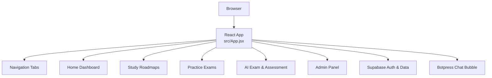
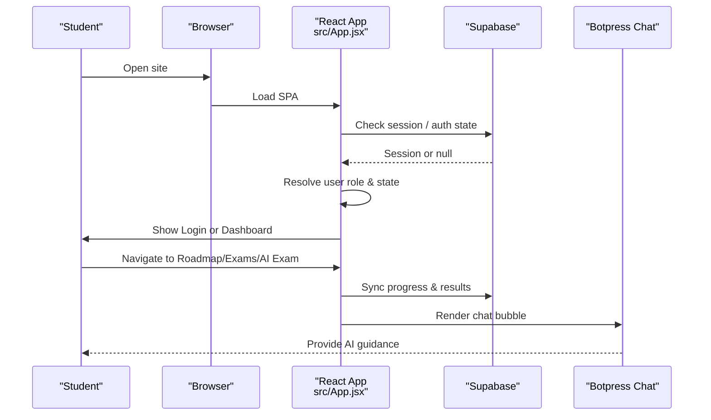
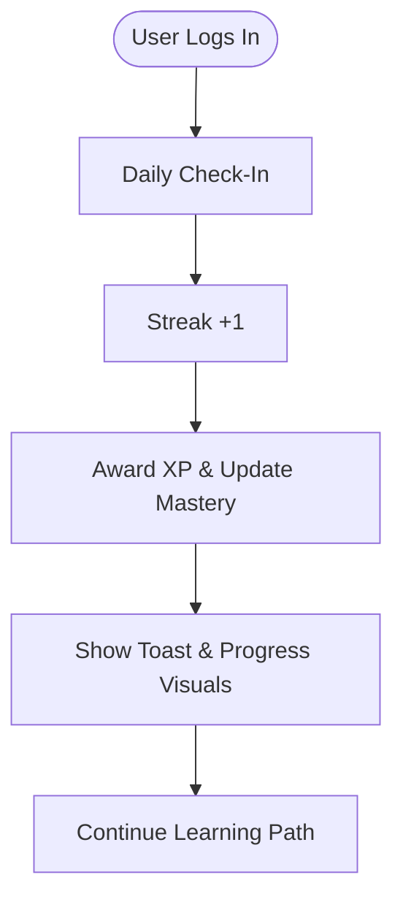
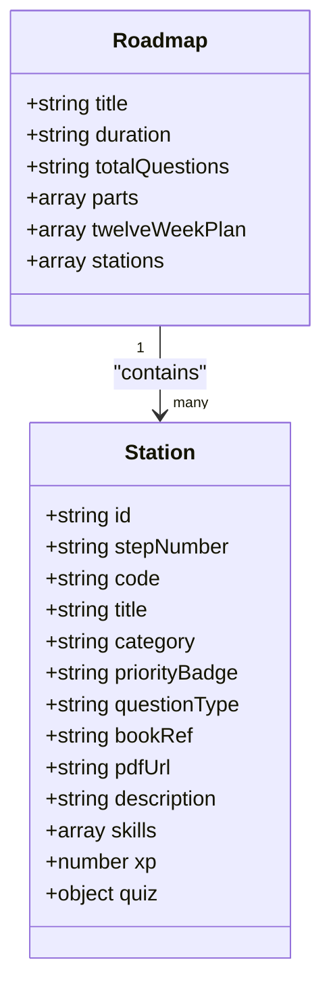
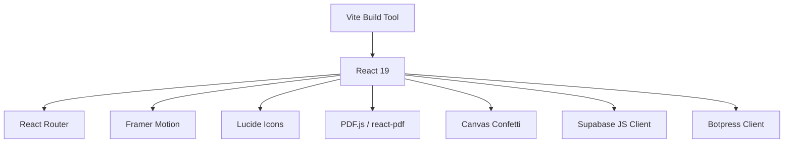
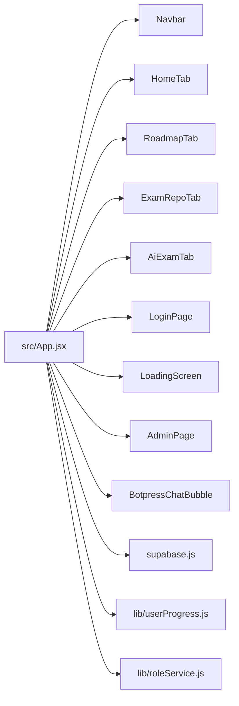

# Project Overview

<cite>
**Referenced Files in This Document**
- [README.md](file://README.md)
- [package.json](file://package.json)
- [src/App.jsx](file://src/App.jsx)
- [LoTrinhDayXich/csRoadmap.json](file://LoTrinhDayXich/csRoadmap.json)
- [LoTrinhDayXich/ictRoadmap.json](file://LoTrinhDayXich/ictRoadmap.json)
</cite>

## Table of Contents
1. [Introduction](#introduction)
2. [Project Structure](#project-structure)
3. [Core Components](#core-components)
4. [Architecture Overview](#architecture-overview)
5. [Detailed Component Analysis](#detailed-component-analysis)
6. [Dependency Analysis](#dependency-analysis)
7. [Performance Considerations](#performance-considerations)
8. [Troubleshooting Guide](#troubleshooting-guide)
9. [Conclusion](#conclusion)

## Introduction
MewTinHoc is a Vietnamese educational website designed to help high school students prepare for the national Computer Science and Information Technology exams under the new Ministry of Education and Training curriculum. The platform combines gamified learning, structured study roadmaps, a comprehensive practice exam system, and AI-powered assessment tools to make exam preparation engaging, personalized, and effective.

The target audience is Vietnamese high school students preparing for the national graduation exam in Computer Science and Information Technology. MewTinHoc supports both tracks:
- Computer Science track: deeper focus on Python programming, algorithms, databases, SQL, and machine learning/data science concepts.
- Information Technology Applications (ICT) track: deeper focus on Excel functions, database practice, web design with HTML/CSS, and multimedia editing.

Key features include:
- Gamification: streaks, mastery indicators, XP-based stations, and animated progress visuals to keep students motivated.
- Structured learning roadmaps: 12-week plans aligned with official exam structure, broken into shared foundational topics and specialized CS/ICT stations.
- Practice exam system: question banks organized by chapters and tracks, including multiple-choice and True/False formats matching the real exam.
- AI-powered assessment tools: an AI exam tab and Botpress chat integration that provide interactive guidance and feedback.
- Curriculum alignment: roadmap documents mirror the official exam matrix, including Part I multiple-choice questions and Part II True/False questions with progressive scoring.

Mission: Make exam preparation engaging and effective through visual roadmaps, focused practice, and intelligent feedback, while staying faithful to the official curriculum matrices for both CS and ICT tracks.

**Section sources**
- [README.md:1-4](file://README.md#L1-L4)
- [src/App.jsx:242-405](file://src/App.jsx#L242-L405)
- [LoTrinhDayXich/csRoadmap.json:2-43](file://LoTrinhDayXich/csRoadmap.json#L2-L43)
- [LoTrinhDayXich/ictRoadmap.json:2-43](file://LoTrinhDayXich/ictRoadmap.json#L2-L43)

## Project Structure
At a high level, MewTinHoc is a React + Vite frontend application with Supabase authentication and data persistence, plus optional server-side Botpress integration. The repository includes:
- Frontend app entry and routing in src/App.jsx.
- Roadmap definitions for CS and ICT tracks in LoTrinhDayXich/*.json.
- Dependencies and build scripts in package.json.
- A minimal README pointing to the GitHub Pages deployment.

**Diagram sources**
- [src/App.jsx:242-340](file://src/App.jsx#L242-L340)

**Section sources**
- [README.md:1-4](file://README.md#L1-L4)
- [package.json:1-34](file://package.json#L1-L34)
- [src/App.jsx:242-340](file://src/App.jsx#L242-L340)

## Core Components
MewTinHoc’s core user-facing components are organized as tabs within the main app shell:
- Home dashboard: displays streak, mastery, check-in actions, and quick navigation to other sections.
- Roadmap tab: presents the 12-week plan and station-by-station breakdown for each track.
- Exam repo tab: hosts chapter-based question sets for practice.
- AI exam tab: integrates AI-driven assessments and feedback.
- Admin panel: allows content and announcement management.

These components are orchestrated by the main app router and state manager, which also handles authentication, user role resolution, and progress synchronization.

**Section sources**
- [src/App.jsx:242-340](file://src/App.jsx#L242-L340)

## Architecture Overview
The platform follows a modern single-page application architecture:
- React + Vite provides fast development and optimized builds.
- Supabase handles authentication (Google OAuth), user profiles, and persistent progress data.
- Botpress offers an embedded AI chat assistant for student support.
- Roadmap JSON files define the curriculum structure and exam alignment.

**Diagram sources**
- [src/App.jsx:93-150](file://src/App.jsx#L93-L150)
- [src/App.jsx:242-340](file://src/App.jsx#L242-L340)

## Detailed Component Analysis

### Platform Purpose and Target Audience
MewTinHoc targets Vietnamese high school students preparing for the national Computer Science and Information Technology graduation exam. It aligns with the official curriculum matrices by mirroring the exam structure:
- Part I: Multiple-choice questions covering foundational topics.
- Part II: True/False questions with progressive scoring, tailored to CS or ICT specializations.

The platform’s mission is to transform exam preparation into a motivating, structured journey using gamification, clear roadmaps, and AI-assisted assessment.

**Section sources**
- [LoTrinhDayXich/csRoadmap.json:2-43](file://LoTrinhDayXich/csRoadmap.json#L2-L43)
- [LoTrinhDayXich/ictRoadmap.json:2-43](file://LoTrinhDayXich/ictRoadmap.json#L2-L43)

### Gamification Approach
Gamification elements include:
- Streak tracking with daily check-ins.
- Mastery bars and XP points per station.
- Animated progress visuals and toast notifications for achievements.
- Simulation controls to test streak behavior (next day, missed days, reset).

These mechanics encourage consistent study habits and reward incremental progress.

**Diagram sources**
- [src/App.jsx:181-204](file://src/App.jsx#L181-L204)
- [src/App.jsx:242-340](file://src/App.jsx#L242-L340)

**Section sources**
- [src/App.jsx:181-204](file://src/App.jsx#L181-L204)
- [src/App.jsx:242-340](file://src/App.jsx#L242-L340)

### Structured Learning Roadmaps
Each track has a dedicated roadmap document defining:
- Exam structure (duration, total questions, parts).
- Twelve-week plan divided into phases targeting specific score ranges.
- Stations mapping to curriculum topics, skills, and PDF references.
- Quiz structures with MCQ and True/False items.

CS track emphasizes Python programming, algorithms, databases, SQL, and machine learning/data science. ICT track emphasizes Excel functions, database practice, web design, and multimedia editing.

**Diagram sources**
- [LoTrinhDayXich/csRoadmap.json:2-582](file://LoTrinhDayXich/csRoadmap.json#L2-L582)
- [LoTrinhDayXich/ictRoadmap.json:2-582](file://LoTrinhDayXich/ictRoadmap.json#L2-L582)

**Section sources**
- [LoTrinhDayXich/csRoadmap.json:2-582](file://LoTrinhDayXich/csRoadmap.json#L2-L582)
- [LoTrinhDayXich/ictRoadmap.json:2-582](file://LoTrinhDayXich/ictRoadmap.json#L2-L582)

### Practice Exam System
The practice exam system organizes questions by chapters and tracks, supporting:
- Multiple-choice questions aligned with Part I.
- True/False scenarios aligned with Part II.
- Chapter-specific question modules for targeted practice.
- Recording exam results to track progress over time.

This system helps students simulate real exam conditions and identify areas needing improvement.

**Section sources**
- [src/App.jsx:302-329](file://src/App.jsx#L302-L329)

### AI-Powered Assessment Tools
AI features include:
- An AI exam tab for adaptive assessments and feedback.
- Botpress chat bubble providing conversational assistance.
- Integration with Supabase for user context and progress-aware responses.

These tools aim to personalize guidance, clarify difficult topics, and reinforce learning strategies.

**Section sources**
- [src/App.jsx:322-329](file://src/App.jsx#L322-L329)
- [src/App.jsx:390-391](file://src/App.jsx#L390-L391)

### Technology Stack Overview
MewTinHoc uses a modern, lightweight stack:
- React 19 and React Router for UI and routing.
- Vite for fast development and optimized builds.
- Supabase for authentication (Google OAuth) and data persistence.
- Botpress client for embedded AI chat.
- Framer Motion for animations and page transitions.
- PDF.js and react-pdf for viewing study materials.
- Canvas confetti and Lucide icons for gamification and UI polish.

**Diagram sources**
- [package.json:14-32](file://package.json#L14-L32)

**Section sources**
- [package.json:1-34](file://package.json#L1-L34)

## Dependency Analysis
The application depends on several external services and libraries:
- Supabase: Authentication and data layer.
- Botpress: AI chat assistant.
- Framer Motion: Animations and transitions.
- PDF.js/react-pdf: Study material viewer.
- Vite: Build tooling.

Internal dependencies include:
- App orchestrating routes and user state.
- Components for home, roadmap, exams, AI exam, login, loading screen, admin panel, and chat bubble.
- Utilities for announcements, role resolution, progress tracking, and viewport handling.

**Diagram sources**
- [src/App.jsx:1-20](file://src/App.jsx#L1-L20)
- [src/App.jsx:242-340](file://src/App.jsx#L242-L340)

**Section sources**
- [src/App.jsx:1-20](file://src/App.jsx#L1-L20)
- [src/App.jsx:242-340](file://src/App.jsx#L242-L340)

## Performance Considerations
- Use lazy loading for heavy components like PDF viewers and admin panels to reduce initial bundle size.
- Cache roadmap and question data locally where appropriate to minimize network requests.
- Optimize animations with Framer Motion to avoid layout thrashing on low-end devices.
- Leverage Supabase realtime efficiently; subscribe only when needed to reduce overhead.

[No sources needed since this section provides general guidance]

## Troubleshooting Guide
Common issues and resolutions:
- Authentication failures: Verify Google OAuth configuration in Supabase and ensure session handling is correct.
- Missing progress data: Confirm Supabase tables and RLS policies are set up; check user ID consistency.
- Botpress chat not appearing: Ensure Botpress client credentials are configured and the chat bubble component is mounted.
- Roadmap or question data not loading: Validate JSON structure and paths; confirm public access to static assets.

**Section sources**
- [src/App.jsx:93-150](file://src/App.jsx#L93-L150)
- [src/App.jsx:390-391](file://src/App.jsx#L390-L391)

## Conclusion
MewTinHoc delivers a comprehensive, gamified, and AI-enhanced preparation experience for Vietnamese high school students aiming to excel in the national Computer Science and Information Technology exams. By aligning with official curriculum matrices, offering structured roadmaps, and integrating practice exams with intelligent feedback, the platform makes exam preparation both engaging and effective. Its modern tech stack ensures a responsive, maintainable, and scalable foundation for continued growth.

[No sources needed since this section summarizes without analyzing specific files]