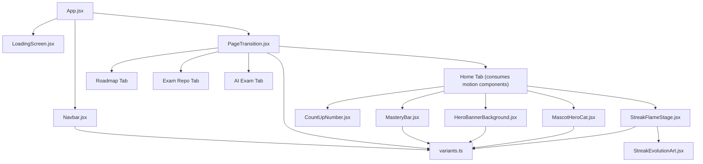
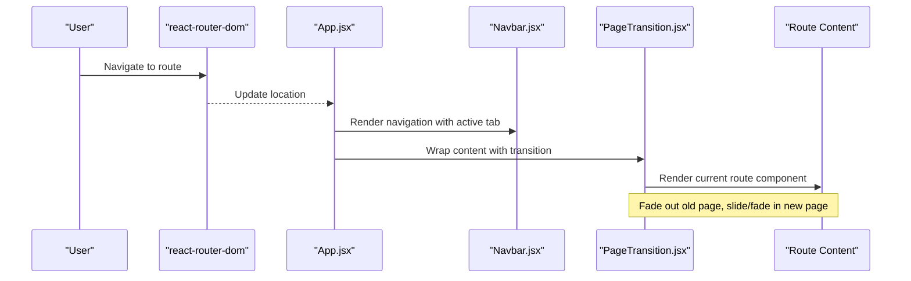
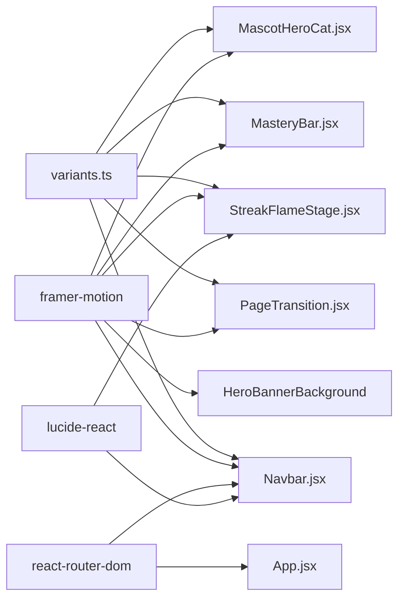

# UI Components Library

<cite>
**Referenced Files in This Document**
- [App.jsx](file://src/App.jsx)
- [Navbar.jsx](file://src/components/Navbar.jsx)
- [LoadingScreen.jsx](file://src/components/LoadingScreen.jsx)
- [PageTransition.jsx](file://src/components/motion/PageTransition.jsx)
- [MasteryBar.jsx](file://src/components/motion/MasteryBar.jsx)
- [CountUpNumber.jsx](file://src/components/motion/CountUpNumber.jsx)
- [HeroBannerBackground.jsx](file://src/components/motion/HeroBannerBackground.jsx)
- [MascotHeroCat.jsx](file://src/components/motion/MascotHeroCat.jsx)
- [StreakFlameStage.jsx](file://src/components/motion/StreakFlameStage.jsx)
- [StreakEvolutionArt.jsx](file://src/components/StreakEvolutionArt.jsx)
- [variants.ts](file://src/variants.ts)
- [package.json](file://package.json)
</cite>

## Table of Contents
1. [Introduction](#introduction)
2. [Project Structure](#project-structure)
3. [Core Components](#core-components)
4. [Architecture Overview](#architecture-overview)
5. [Detailed Component Analysis](#detailed-component-analysis)
6. [Dependency Analysis](#dependency-analysis)
7. [Performance Considerations](#performance-considerations)
8. [Accessibility and Responsive Design](#accessibility-and-responsive-design)
9. [Theme Customization and Motion Tokens](#theme-customization-and-motion-tokens)
10. [Troubleshooting Guide](#troubleshooting-guide)
11. [Conclusion](#conclusion)

## Introduction
This document describes the reusable UI components library used by the application. It focuses on navigation, motion-based animations powered by Framer Motion, loading screens, progress indicators, animated backgrounds, mascot interactions, streak visualization, and number animation. For each component, it explains props, events, styling approach, customization options, accessibility behavior, responsive patterns, performance considerations, and composition patterns with other components.

The library is built on React, uses Framer Motion for animations, Lucide icons, and integrates with routing through react-router-dom. A centralized motion design system lives in a shared variants file to keep easing curves, spring configurations, durations, and motion variants consistent across components.

## Project Structure
The UI components are organized under `src/components`, with motion-specific components grouped under `src/components/motion`. The root application composes these components, manages user state, routes, and orchestrates page transitions.

**Diagram sources**
- [App.jsx:1-406](file://src/App.jsx#L1-L406)
- [Navbar.jsx:1-289](file://src/components/Navbar.jsx#L1-L289)
- [LoadingScreen.jsx:1-201](file://src/components/LoadingScreen.jsx#L1-L201)
- [PageTransition.jsx:1-26](file://src/components/motion/PageTransition.jsx#L1-L26)
- [MasteryBar.jsx:1-42](file://src/components/motion/MasteryBar.jsx#L1-L42)
- [CountUpNumber.jsx:1-94](file://src/components/motion/CountUpNumber.jsx#L1-L94)
- [HeroBannerBackground.jsx:1-158](file://src/components/motion/HeroBannerBackground.jsx#L1-L158)
- [MascotHeroCat.jsx:1-205](file://src/components/motion/MascotHeroCat.jsx#L1-L205)
- [StreakFlameStage.jsx:1-192](file://src/components/motion/StreakFlameStage.jsx#L1-L192)
- [StreakEvolutionArt.jsx:1-76](file://src/components/StreakEvolutionArt.jsx#L1-L76)
- [variants.ts:1-280](file://src/variants.ts#L1-L280)

**Section sources**
- [App.jsx:1-406](file://src/App.jsx#L1-L406)
- [package.json:1-34](file://package.json#L1-L34)

## Core Components
This section summarizes the primary UI components and their responsibilities.

- Navigation: `Navbar` provides horizontal tab navigation, brand area, student info widget, login/logout controls, and active-tab highlighting with motion pill.
- Loading Screen: `LoadingScreen` renders a full-screen or inline loader with animated dots, progress bar, optional credit badge, and WebP/GIF fallback.
- Page Transition: `PageTransition` wraps route content with fade/slide transitions and reduced-motion support.
- Progress Indicator: `MasteryBar` animates a rounded progress fill using clip-path when entering the viewport.
- Number Animation: `CountUpNumber` animates numeric values with an ease-out quint curve and respects reduced-motion preferences.
- Animated Background: `HeroBannerBackground` creates parallax orbs, floating glyphs, and lens elements driven by pointer movement and springs.
- Mascot Interaction: `MascotHeroCat` shows hover/touch speech bubbles, idle breathing animation, and random head tilts.
- Streak Visualization: `StreakFlameStage` displays streak evolution art with sparkles, flaring reward animations, and a progress fill.
- Evolution Art: `StreakEvolutionArt` renders level images with optional monochrome filter for locked states.

**Section sources**
- [Navbar.jsx:1-289](file://src/components/Navbar.jsx#L1-L289)
- [LoadingScreen.jsx:1-201](file://src/components/LoadingScreen.jsx#L1-L201)
- [PageTransition.jsx:1-26](file://src/components/motion/PageTransition.jsx#L1-L26)
- [MasteryBar.jsx:1-42](file://src/components/motion/MasteryBar.jsx#L1-L42)
- [CountUpNumber.jsx:1-94](file://src/components/motion/CountUpNumber.jsx#L1-L94)
- [HeroBannerBackground.jsx:1-158](file://src/components/motion/HeroBannerBackground.jsx#L1-L158)
- [MascotHeroCat.jsx:1-205](file://src/components/motion/MascotHeroCat.jsx#L1-L205)
- [StreakFlameStage.jsx:1-192](file://src/components/motion/StreakFlameStage.jsx#L1-L192)
- [StreakEvolutionArt.jsx:1-76](file://src/components/StreakEvolutionArt.jsx#L1-L76)

## Architecture Overview
The application composes UI components around a central app shell that manages authentication, routing, and global state. Motion tokens from `variants.ts` standardize animations across components.

**Diagram sources**
- [App.jsx:242-340](file://src/App.jsx#L242-L340)
- [Navbar.jsx:17-46](file://src/components/Navbar.jsx#L17-L46)
- [PageTransition.jsx:9-24](file://src/components/motion/PageTransition.jsx#L9-L24)

## Detailed Component Analysis

### Navbar
A horizontal navigation header with:
- Brand logo and slogan
- Student info widget showing streak count and status
- Login button or profile chip with avatar and logout
- Admin-only button for company users
- Horizontal dock with category label “LEARNING” and tabs: Home, Roadmap, Exams, AI Exam
- Active tab highlight using Framer Motion layoutId pill
- URL-driven active state via react-router-dom hooks
- Reduced-motion support via `useReducedMotion`

Props:
- `activeTab`: string indicating the active tab key
- `setActiveTab`: function to update active tab
- `user`: user object (name, avatar, isAdmin)
- `streak`: streak object (count, checkedToday)
- `onOpenGoogleLogin`: callback to open Google login
- `onLogout`: callback to log out
- `onOpenStreakDetails`: callback to scroll to streak details

Events:
- Clicking tabs navigates via `navigate(path)` and updates `setActiveTab`
- Logout triggers `onLogout`
- Profile avatar error fallback sets default avatar
- Admin button navigates to `/admin` if user is admin

Styling:
- Uses CSS classes like `horizontal-sidebar`, `category-dock`, `nav-tab-btn`, `student-profile-chip`
- Inline styles for small interactive elements (e.g., admin button)
- Motion pill uses SPRINGS.pill for smooth sliding

Accessibility:
- Tabs use `role="tab"` and `aria-selected`
- Buttons have `title` attributes for tooltips
- Logo and streak pill have descriptive titles

Responsive:
- Compact labels shown on smaller screens via hidden/full label spans
- Avatar fallback ensures readable name even if image fails

Performance:
- Motion pill uses GPU-friendly transforms
- Avoids heavy reflows; relies on layoutId for smooth transitions

Customization:
- Add/remove tabs by extending `TABS` and adding buttons
- Change active pill radius via style prop
- Adjust motion variants via `headerMotionVariants` and `SPRINGS`

**Section sources**
- [Navbar.jsx:17-46](file://src/components/Navbar.jsx#L17-L46)
- [Navbar.jsx:50-179](file://src/components/Navbar.jsx#L50-L179)
- [Navbar.jsx:181-289](file://src/components/Navbar.jsx#L181-L289)

### LoadingScreen
A versatile loading screen supporting full-screen overlay or inline box mode:
- Size presets: sm, md, lg controlling box size, message font, bar thickness, hint font
- Animated cat image using WebP with GIF fallback on error
- Three bouncing dots and a sliding progress bar
- Optional credit badge (“@ThanhNhi”) with pulsing dot
- Accessible via `role="status"` and `aria-live="polite"`

Props:
- `text`: loading message displayed below progress
- `size`: preset size ("sm", "md", "lg")
- `showHint`: whether to show the text hint
- `showCredit`: whether to show the credit badge
- `fullScreen`: whether to render as fixed full-screen overlay

Behavior:
- On image load error, switches from WebP to GIF
- Full-screen mode applies radial gradients and light theme colors
- Inline mode inherits parent font and background

Accessibility:
- `role="status"` and `aria-live="polite"` announce loading state
- Credit dot is marked `aria-hidden`
- Image alt text indicates loading

Responsive:
- Max width constrained to viewport percentage
- Font sizes scale with preset

Performance:
- Uses async decoding for images
- Animations rely on CSS keyframes defined elsewhere

Customization:
- Extend SIZE_PRESETS for additional sizes
- Override wrapperStyle for custom themes

**Section sources**
- [LoadingScreen.jsx:5-40](file://src/components/LoadingScreen.jsx#L5-L40)
- [LoadingScreen.jsx:41-77](file://src/components/LoadingScreen.jsx#L41-L77)
- [LoadingScreen.jsx:78-132](file://src/components/LoadingScreen.jsx#L78-L132)
- [LoadingScreen.jsx:134-201](file://src/components/LoadingScreen.jsx#L134-L201)

### PageTransition
Wraps route content with entrance and exit animations:
- Old page fades out quickly
- New page fades in and slides up slightly
- Respects reduced-motion preference

Props:
- `children`: content to animate
- `className`: additional class names applied to the motion container

Integration:
- Used inside AnimatePresence in App.jsx to coordinate page transitions
- Uses `pageTransitionVariants` and `reducedMotionVariants` from variants.ts

Accessibility:
- No direct aria roles; relies on content semantics

Performance:
- Minimal DOM changes; uses Framer Motion for efficient transitions

Customization:
- Replace variants with custom motion definitions
- Adjust className for layout overrides

**Section sources**
- [PageTransition.jsx:1-26](file://src/components/motion/PageTransition.jsx#L1-L26)
- [variants.ts:238-279](file://src/variants.ts#L238-L279)

### MasteryBar
Animated progress bar that fills based on a percentage value:
- Uses clip-path to create rounded progress without layout shifts
- Triggers animation only once when entering viewport
- Supports custom color override

Props:
- `value`: number between 0 and 100 representing mastery percentage
- `color`: optional background color overriding default gradient

Behavior:
- Observes intersection with `useInView` and animates from current position
- Reduces motion duration significantly when reduced-motion is enabled

Accessibility:
- Container is `aria-hidden="true"` since it is decorative

Performance:
- Uses transform and clip-path for GPU-friendly animations
- Avoids reflow by not changing width/height during animation

Customization:
- Provide custom color via prop
- Adjust threshold via `amount` in `useInView`

**Section sources**
- [MasteryBar.jsx:1-42](file://src/components/motion/MasteryBar.jsx#L1-L42)
- [variants.ts:1-22](file://src/variants.ts#L1-L22)

### CountUpNumber
Smoothly animates numeric values from zero to a target:
- Accepts numbers or strings with embedded numbers
- Auto-detects decimal places unless specified
- Respects reduced-motion preference by instantly setting target
- Uses requestAnimationFrame for smooth 60fps updates

Props:
- `end`: target value (number or string)
- `duration`: animation duration in milliseconds
- `prefix`: text before the number
- `suffix`: text after the number
- `decimals`: explicit decimal places
- `className`: additional class names

Behavior:
- Parses numeric target from string inputs
- Applies easeOutQuint easing for natural deceleration
- Formats output with tabular-nums for stable digit widths

Accessibility:
- Semantic span element suitable for dynamic numbers

Performance:
- Cancels animation frame on cleanup
- Avoids unnecessary re-renders by updating state efficiently

Customization:
- Provide prefix/suffix for units like "%", " days", "/10"
- Override className for typography

**Section sources**
- [CountUpNumber.jsx:1-94](file://src/components/motion/CountUpNumber.jsx#L1-L94)

### HeroBannerBackground
Immersive animated background with parallax layers:
- Ambient orbs float slowly with staggered delays
- Floating code glyphs drift at mid depth
- Lens element near the foreground responds to mouse movement
- Pauses animations when browser tab is hidden to save CPU/battery

Props:
- None; fully self-contained

Behavior:
- Normalizes pointer position to -1..1 range
- Applies spring physics to smooth pointer-driven motion
- Uses motion values and transforms for x/y/rotate
- Disables parallax on touch devices or when reduced-motion is enabled

Accessibility:
- Decorative layer marked `aria-hidden="true"`

Performance:
- Uses passive event listeners for pointermove
- Stops animations when tab is hidden
- Relies on transform properties for GPU acceleration

Customization:
- Modify ORBS and GLYPHS arrays to adjust visuals
- Tune PARALLAX_SPRING stiffness/damping/mass

**Section sources**
- [HeroBannerBackground.jsx:1-158](file://src/components/motion/HeroBannerBackground.jsx#L1-L158)

### MascotHeroCat
Interactive mascot with speech bubble and idle animations:
- Shows encouraging messages on hover or click
- Randomly tilts head periodically
- Breathing animation while idle
- Hides speech bubble automatically after timeout

Props:
- None; fully self-contained

Behavior:
- Schedules next tilt with random delay
- Clears timers on visibility change and unmount
- Rotates speech messages cyclically
- Uses AnimatePresence for smooth bubble appearance/disappearance

Accessibility:
- Title attribute provides tooltip
- Image has descriptive alt text

Performance:
- Uses Framer Motion for lightweight animations
- Avoids heavy computations; relies on CSS transforms

Customization:
- Edit CAT_CHEERS array for different messages
- Adjust timing constants for tilt and auto-hide

**Section sources**
- [MascotHeroCat.jsx:1-205](file://src/components/motion/MascotHeroCat.jsx#L1-L205)
- [variants.ts:24-52](file://src/variants.ts#L24-L52)

### StreakFlameStage
Visualizes streak evolution with flame/sparkle effects:
- Sparkles pulse around the flame
- Flame gently scales and rotates in idle state
- Flares with pop spring on check-in reward
- Displays evolution name and next milestone text
- Progress fill animates from 0 to current percent

Props:
- `currentEvolution`: evolution object with id and name
- `hasStarted`: boolean indicating if streak started
- `isMaxEvo`: boolean indicating maximum evolution reached
- `displayStreak`: current streak count
- `daysToNext`: days remaining to next evolution
- `progressPercent`: percentage toward next evolution
- `isFlaring`: boolean to trigger reward flare
- `evoVars`: inline style variables for evolution theming

Behavior:
- Uses clip-path for smooth progress fill animation
- Applies different transitions for idle vs flaring states
- Integrates with StreakEvolutionArt for visual representation

Accessibility:
- Flame container has title describing state
- Text conveys progression and milestones

Performance:
- Uses willChange for transform optimization
- Leverages Framer Motion for efficient animations

Customization:
- Pass evoVars to control CSS variables like accent and secondary colors
- Adjust sparkle positions and timings

**Section sources**
- [StreakFlameStage.jsx:1-192](file://src/components/motion/StreakFlameStage.jsx#L1-L192)
- [StreakEvolutionArt.jsx:1-76](file://src/components/StreakEvolutionArt.jsx#L1-L76)

### StreakEvolutionArt
Renders evolution artwork with optional monochrome filter:
- Maps evolution ids to image paths
- Blocks context menu, drag, and selection for better UX
- Applies brightness(0) filter for locked states

Props:
- `id`: evolution identifier
- `mono`: boolean to show monochrome locked state
- `size`: height of container
- `style`: additional inline styles
- `className`: additional class names

Behavior:
- Defaults to first evolution if id is missing
- Prevents default image actions to avoid accidental downloads

Accessibility:
- Image is decorative (`alt=""` and `aria-hidden="true"`)
- Container handles user interaction prevention

Performance:
- Uses contain and object-fit for responsive scaling

Customization:
- Extend ART mapping for new evolution images
- Adjust filter for different locked-state visuals

**Section sources**
- [StreakEvolutionArt.jsx:1-76](file://src/components/StreakEvolutionArt.jsx#L1-L76)

## Dependency Analysis
Components depend on shared motion tokens and external libraries:

**Diagram sources**
- [variants.ts:1-280](file://src/variants.ts#L1-L280)
- [Navbar.jsx:1-15](file://src/components/Navbar.jsx#L1-L15)
- [PageTransition.jsx:1-4](file://src/components/motion/PageTransition.jsx#L1-L4)
- [MasteryBar.jsx:1-3](file://src/components/motion/MasteryBar.jsx#L1-L3)
- [HeroBannerBackground.jsx:1-8](file://src/components/motion/HeroBannerBackground.jsx#L1-L8)
- [MascotHeroCat.jsx:1-4](file://src/components/motion/MascotHeroCat.jsx#L1-L4)
- [StreakFlameStage.jsx:1-5](file://src/components/motion/StreakFlameStage.jsx#L1-L5)
- [App.jsx:1-18](file://src/App.jsx#L1-L18)

**Section sources**
- [package.json:14-24](file://package.json#L14-L24)
- [variants.ts:1-280](file://src/variants.ts#L1-L280)

## Performance Considerations
- Prefer transform and opacity animations to avoid layout thrashing.
- Use `willChange` sparingly for elements undergoing frequent transforms.
- Respect `prefers-reduced-motion` to minimize animations for sensitive users.
- Pause heavy background animations when the tab is hidden.
- Use passive event listeners for pointer/touch handlers.
- Debounce or throttle expensive calculations if added later.
- Keep animation durations short for micro-interactions (hover, tap).
- Use clip-path for progress bars instead of width changes to prevent reflow.
- Avoid inline style churn; compute styles outside render loops where possible.
- Leverage Framer Motion’s spring physics for natural motion with minimal cost.

[No sources needed since this section provides general guidance]

## Accessibility and Responsive Design
- Navigation tabs use semantic roles and aria-selected for keyboard/screen reader compatibility.
- Loading screen announces loading state via role and aria-live.
- Decorative elements are marked aria-hidden to avoid noise.
- Images include appropriate alt text or aria-hidden when decorative.
- Reduced-motion variants ensure animations do not overwhelm users who prefer less motion.
- Responsive layouts adapt via CSS classes and flexible sizing constraints.
- Touch interactions are supported with click handlers and auto-hide timeouts.
- Tooltips via title attributes improve discoverability for non-obvious actions.

**Section sources**
- [Navbar.jsx:191-283](file://src/components/Navbar.jsx#L191-L283)
- [LoadingScreen.jsx:77-113](file://src/components/LoadingScreen.jsx#L77-L113)
- [HeroBannerBackground.jsx:87-100](file://src/components/motion/HeroBannerBackground.jsx#L87-L100)
- [MascotHeroCat.jsx:87-103](file://src/components/motion/MascotHeroCat.jsx#L87-L103)

## Theme Customization and Motion Tokens
The motion design system centralizes:
- Easing curves: naturalOut, easeInOut, fastExit, emilOut
- Spring configurations: gentle, snappy, pill, rewardPop
- Durations: micro, pageExit, tabSwitch, pageEnter, countUp, ambientSlow
- Variants: header, banner, stats, matrix, streak, hover, icon, page transition
- Reduced-motion variants for accessibility

Usage patterns:
- Import SPRINGS and EASINGS into components for consistent motion.
- Apply variants to motion containers for coordinated animations.
- Override inline styles or CSS variables for theme adaptation.
- Compose components to build complex scenes (e.g., streak stage + evolution art).

**Section sources**
- [variants.ts:12-62](file://src/variants.ts#L12-L62)
- [variants.ts:64-280](file://src/variants.ts#L64-L280)

## Troubleshooting Guide
Common issues and resolutions:
- WebP not supported: LoadingScreen falls back to GIF on image error.
- Parallax not triggering: Ensure device supports hover and fine pointer; disabled on touch or reduced-motion.
- Tab highlight not moving: Verify layoutId matches and motion pill transition uses SPRINGS.pill.
- Number animation jumps: Check end value parsing and decimals configuration.
- Background animations consuming CPU: Confirm visibilitychange handler pauses animations when tab hidden.
- Mascot speech bubble not hiding: Ensure auto-hide timeout is cleared on leave/unmount.
- Streak flare not playing: Verify isFlaring prop toggles correctly on check-in.

**Section sources**
- [LoadingScreen.jsx:32-39](file://src/components/LoadingScreen.jsx#L32-L39)
- [HeroBannerBackground.jsx:57-85](file://src/components/motion/HeroBannerBackground.jsx#L57-L85)
- [Navbar.jsx:200-275](file://src/components/Navbar.jsx#L200-L275)
- [CountUpNumber.jsx:27-40](file://src/components/motion/CountUpNumber.jsx#L27-L40)
- [MascotHeroCat.jsx:62-85](file://src/components/motion/MascotHeroCat.jsx#L62-L85)
- [StreakFlameStage.jsx:119-149](file://src/components/motion/StreakFlameStage.jsx#L119-L149)

## Conclusion
The UI components library provides a cohesive set of reusable React components with consistent motion design, accessibility awareness, and responsive behavior. By centralizing motion tokens and leveraging Framer Motion, the components deliver smooth, performant animations while respecting user preferences. The architecture encourages composition, making it straightforward to extend and customize the interface for new features and themes.

[No sources needed since this section summarizes without analyzing specific files]