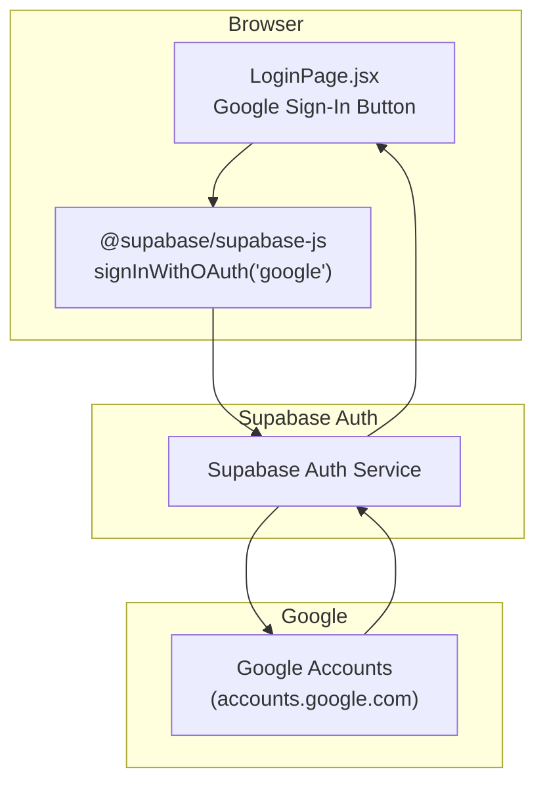
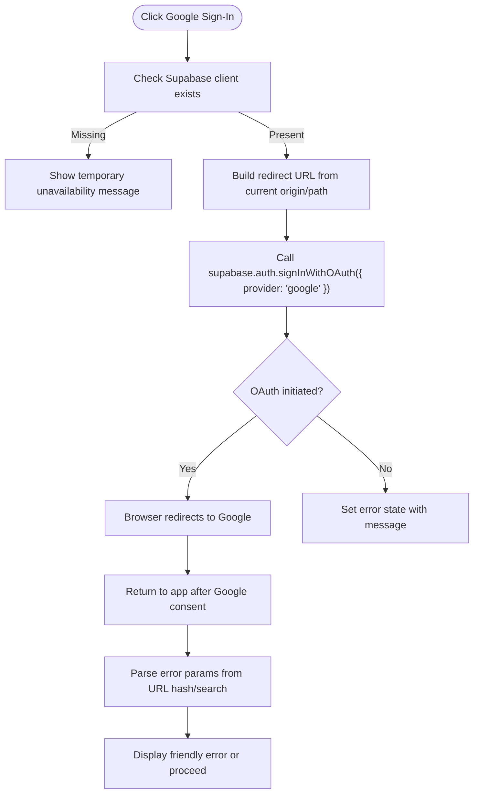
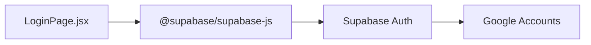

# Google OAuth Integration

<cite>
**Referenced Files in This Document**
- [lib/supabase.js](file://lib/supabase.js)
- [src/supabase.js](file://src/supabase.js)
- [src/components/LoginPage.jsx](file://src/components/LoginPage.jsx)
- [server/server.js](file://server/server.js)
- [server/securityHeaders.js](file://server/securityHeaders.js)
- [package.json](file://package.json)
</cite>

## Table of Contents
1. [Introduction](#introduction)
2. [Project Structure](#project-structure)
3. [Core Components](#core-components)
4. [Architecture Overview](#architecture-overview)
5. [Detailed Component Analysis](#detailed-component-analysis)
6. [Dependency Analysis](#dependency-analysis)
7. [Performance Considerations](#performance-considerations)
8. [Troubleshooting Guide](#troubleshooting-guide)
9. [Conclusion](#conclusion)

## Introduction
This document explains how Google OAuth is integrated into the application using Supabase Authentication on the client side. It covers:
- The end-to-end flow from clicking the Google sign-in button to returning to the app with a session.
- How Supabase is configured and where environment variables are used.
- How login errors are surfaced to users.
- Where logout and session management should be implemented.
- Common issues such as redirect loops, token expiration, and cross-origin or CSP-related errors.
- Steps to configure Google Cloud Console and server-side security headers for a smooth experience.

The implementation uses a browser-based OAuth flow through `@supabase/supabase-js`. There is no custom backend OAuth handler; the frontend redirects to Google via Supabase and returns to the same origin.

## Project Structure
The relevant parts of the project for Google OAuth are:
- Client-side Supabase client initialization and re-export.
- Login page that triggers Google OAuth and displays errors.
- Server that serves static files and applies security headers.
- Package dependencies including Supabase JS SDK.



**Diagram sources**
- [src/components/LoginPage.jsx:323-355](file://src/components/LoginPage.jsx#L323-L355)
- [lib/supabase.js:1-14](file://lib/supabase.js#L1-L14)

**Section sources**
- [src/components/LoginPage.jsx:1-590](file://src/components/LoginPage.jsx#L1-L590)
- [lib/supabase.js:1-14](file://lib/supabase.js#L1-L14)
- [src/supabase.js:1-2](file://src/supabase.js#L1-L2)
- [server/server.js:1-80](file://server/server.js#L1-L80)
- [server/securityHeaders.js:1-30](file://server/securityHeaders.js#L1-L30)
- [package.json:1-34](file://package.json#L1-L34)

## Core Components
- Supabase client configuration reads environment variables and falls back to defaults if not set.
- LoginPage handles Google OAuth initiation and error display.
- Server serves static assets and applies security headers.

Key responsibilities:
- lib/supabase.js: Creates and exports the Supabase client using environment variables when available.
- src/supabase.js: Re-exports the Supabase client for use in components.
- src/components/LoginPage.jsx: Triggers Google OAuth via Supabase and shows user feedback.
- server/server.js: Static file server used during development or preview.
- server/securityHeaders.js: Applies Content Security Policy and other security headers.

**Section sources**
- [lib/supabase.js:1-14](file://lib/supabase.js#L1-L14)
- [src/supabase.js:1-2](file://src/supabase.js#L1-L2)
- [src/components/LoginPage.jsx:310-355](file://src/components/LoginPage.jsx#L310-L355)
- [server/server.js:40-75](file://server/server.js#L40-L75)
- [server/securityHeaders.js:1-30](file://server/securityHeaders.js#L1-L30)

## Architecture Overview
The authentication flow is a standard browser-based OAuth/OIDC flow orchestrated by Supabase:

```mermaid
sequenceDiagram
participant User as "User"
participant App as "LoginPage.jsx"
participant SB as "Supabase Client"
participant SA as "Supabase Auth"
participant G as "Google Accounts"
User->>App : Click "Continue with Google"
App->>SB : signInWithOAuth({ provider : 'google', redirectTo })
SB->>SA : Forward OAuth request
SA->>G : Redirect to Google consent screen
G-->>SA : Authorization code + redirect back
SA-->>SB : Session established (cookies/local state)
SB-->>App : Redirect completes; UI can read session
```

Notes:
- The redirect URL is computed from the current origin and path so it works on localhost and GitHub Pages.
- Error parameters returned by Google are parsed from the URL hash/search and shown to the user.

**Diagram sources**
- [src/components/LoginPage.jsx:323-355](file://src/components/LoginPage.jsx#L323-L355)
- [lib/supabase.js:1-14](file://lib/supabase.js#L1-L14)

## Detailed Component Analysis

### Supabase Client Configuration
- The client is created with a URL and key.
- Environment variables are preferred:
  - VITE_SUPABASE_URL
  - VITE_SUPABASE_PUBLISHABLE_KEY
- If environment variables are missing or contain placeholder values, default values are used.

Implications:
- For production, always provide real environment variables.
- The public/anon key is intentionally exposed to the browser; do not treat it as a secret.

**Section sources**
- [lib/supabase.js:1-14](file://lib/supabase.js#L1-L14)
- [src/supabase.js:1-2](file://src/supabase.js#L1-L2)

### Google OAuth Login Flow
- The login component calls `signInWithOAuth` with provider `google`.
- A redirect URL is constructed from the current window location.
- Query parameters include offline access and account selection prompts.
- Errors from Google are extracted from the URL hash/search and displayed.



**Diagram sources**
- [src/components/LoginPage.jsx:310-355](file://src/components/LoginPage.jsx#L310-L355)

**Section sources**
- [src/components/LoginPage.jsx:310-355](file://src/components/LoginPage.jsx#L310-L355)

### Callback Handling and Error Display
- On return, the component checks the URL hash and search string for error parameters.
- If present, it decodes and displays an error message to the user.
- No explicit callback route is required because Supabase handles the redirect and restores the session automatically.

**Section sources**
- [src/components/LoginPage.jsx:310-321](file://src/components/LoginPage.jsx#L310-L321)

### Token Management and Session State
- The Supabase JS SDK manages tokens and sessions in the browser.
- After successful OAuth, the SDK stores session data and cookies as needed.
- Application code should check the current session to determine if the user is authenticated before rendering protected content.

Recommendations:
- Use Supabase’s auth state listeners to react to login/logout events.
- Guard routes and API calls based on the authenticated state.

[No sources needed since this section provides general guidance]

### Logout Functionality
- The current login page does not implement logout.
- To add logout, call the Supabase auth logout method and then navigate the user to the login page or home.
- Ensure any local state or cached user data is cleared after logout.

[No sources needed since this section provides general guidance]

### Server and Security Headers
- The server serves static files from the build output.
- Security headers are applied to all responses, including CSP, X-Frame-Options, Referrer-Policy, Permissions-Policy, and HSTS when HTTPS is detected.
- CSP allows scripts and connections to Google accounts and Botpress CDN, which is necessary for third-party integrations.

**Section sources**
- [server/server.js:40-75](file://server/server.js#L40-L75)
- [server/securityHeaders.js:1-30](file://server/securityHeaders.js#L1-L30)

## Dependency Analysis
The OAuth integration depends on:
- `@supabase/supabase-js` for client-side authentication.
- Supabase Auth service for managing providers and sessions.
- Google Accounts for identity verification and consent.



**Diagram sources**
- [package.json:14-25](file://package.json#L14-L25)
- [src/components/LoginPage.jsx:323-355](file://src/components/LoginPage.jsx#L323-L355)

**Section sources**
- [package.json:14-25](file://package.json#L14-L25)
- [src/components/LoginPage.jsx:323-355](file://src/components/LoginPage.jsx#L323-L355)

## Performance Considerations
- The OAuth flow is primarily handled by Supabase and Google; the app only initiates the flow and renders UI around it.
- Avoid unnecessary re-renders on the login page while waiting for redirect completion.
- Keep error messages concise and avoid heavy computations during OAuth callbacks.

[No sources needed since this section provides general guidance]

## Troubleshooting Guide

### Redirect Loops
Symptoms:
- The app repeatedly redirects to Google or back to itself.

Checks:
- Ensure the redirect URL matches what is configured in Google Cloud Console.
- Verify that the app’s origin and path are correct when constructing the redirect URL.
- Confirm that Supabase Auth is properly initialized and that the anon key is valid.

Actions:
- Set VITE_SUPABASE_URL and VITE_SUPABASE_PUBLISHABLE_KEY to your actual Supabase project values.
- In Google Cloud Console, add the exact redirect URI(s) used by your deployment (including trailing paths).

**Section sources**
- [lib/supabase.js:3-12](file://lib/supabase.js#L3-L12)
- [src/components/LoginPage.jsx:334-347](file://src/components/LoginPage.jsx#L334-L347)

### Token Expiration
Symptoms:
- Users are unexpectedly logged out or requests fail due to expired tokens.

Checks:
- Supabase JS SDK manages tokens; ensure the SDK version is up to date.
- Validate that the Supabase project settings allow the expected session lifetime.

Actions:
- Refresh the page or trigger a silent re-authentication if needed.
- Monitor network requests to confirm that Supabase is issuing new tokens.

[No sources needed since this section provides general guidance]

### Cross-Origin and CORS Issues
Symptoms:
- Network errors when calling Supabase endpoints.
- Mixed content warnings if HTTP is used.

Checks:
- Ensure the site is served over HTTPS in production.
- Confirm that Supabase project origins are allowed.
- Review server security headers and CSP policies.

Actions:
- Serve the app over HTTPS.
- Add your domain to Supabase Auth “Site URLs”.
- Update Google Cloud Console authorized origins to match your production domain.

**Section sources**
- [server/securityHeaders.js:24-29](file://server/securityHeaders.js#L24-L29)

### CSP and Third-Party Resources
Symptoms:
- Blocked scripts or frames from Google or other CDNs.

Checks:
- CSP must allow Google Accounts and any required CDNs.
- Current CSP includes allowances for Google accounts and Botpress CDN.

Actions:
- Keep script-src and connect-src directives aligned with your third-party services.
- Avoid overly permissive wildcards; prefer explicit domains.

**Section sources**
- [server/securityHeaders.js:1-11](file://server/securityHeaders.js#L1-L11)

### Google Cloud Console Configuration
Required steps:
- Create a Google OAuth 2.0 Client ID for a Web application.
- Add Authorized JavaScript origins matching your app’s domain(s), including http://localhost for development.
- Add Authorized redirect URIs matching the full URLs Supabase will redirect to (e.g., https://your-domain.com/login or your GitHub Pages URL).
- Configure scopes to request only basic profile information (name, email, avatar).

Validation:
- Test the flow locally and in staging before deploying to production.
- Inspect browser DevTools Network tab for OAuth redirects and errors.

[No sources needed since this section provides general guidance]

### Common Error Scenarios in the App
- Missing Supabase client: The login button shows a temporary unavailability message.
- OAuth initiation failure: A generic connection error is displayed.
- Google returns an error parameter: The app parses and shows a descriptive message.

Remediation:
- Verify environment variables and Supabase project settings.
- Check Google Cloud Console configuration and scopes.
- Clear browser cache and cookies if stale session state causes confusion.

**Section sources**
- [src/components/LoginPage.jsx:323-355](file://src/components/LoginPage.jsx#L323-L355)

## Conclusion
The application integrates Google OAuth through Supabase Authentication on the client side. The login page initiates the OAuth flow, and Supabase manages the redirect, token exchange, and session state. For a reliable setup:
- Provide real Supabase environment variables.
- Configure Google Cloud Console with correct origins and redirect URIs.
- Keep CSP and security headers aligned with third-party services.
- Implement logout and session guards in your application logic.

[No sources needed since this section summarizes without analyzing specific files]