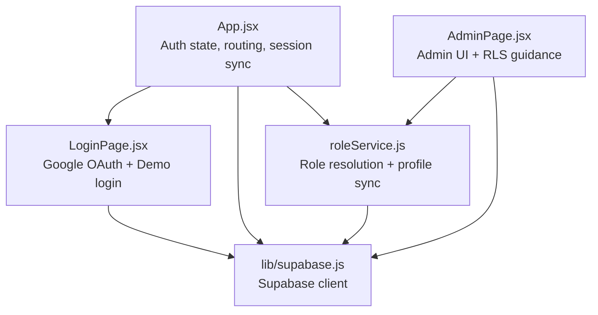
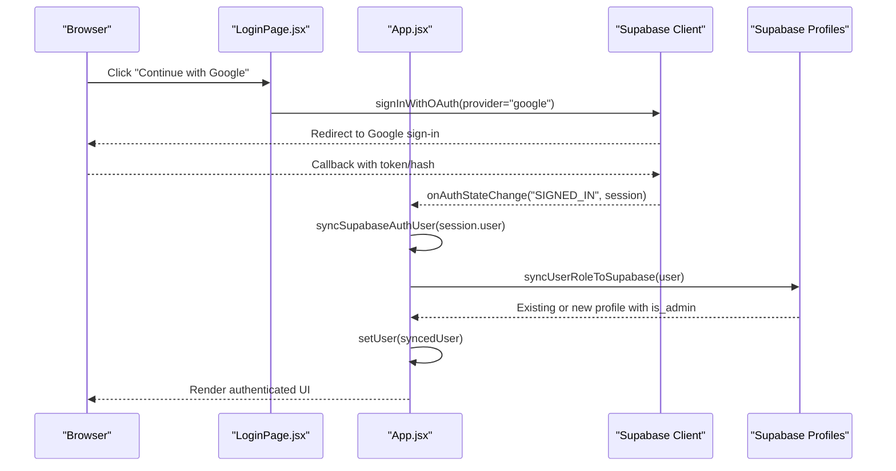
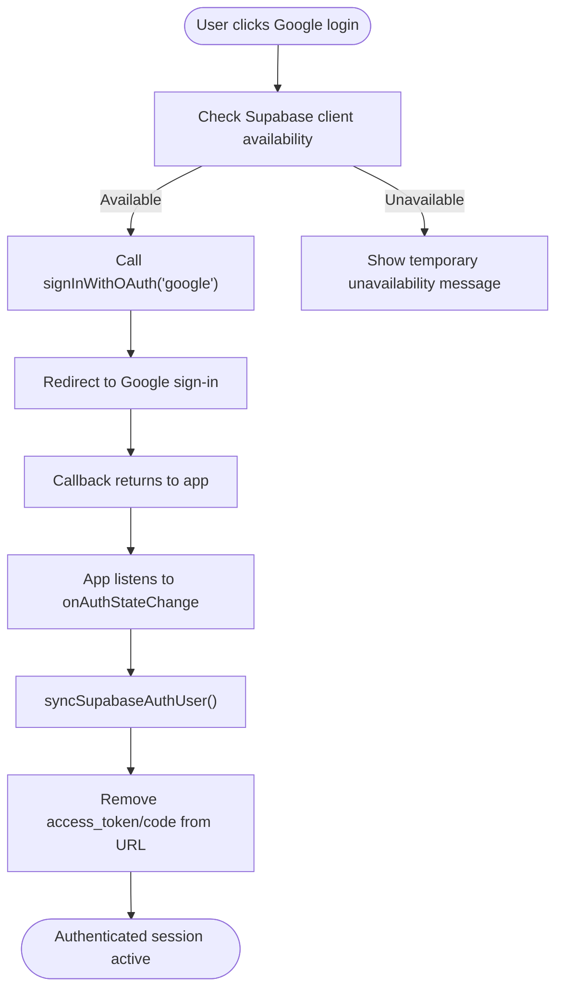
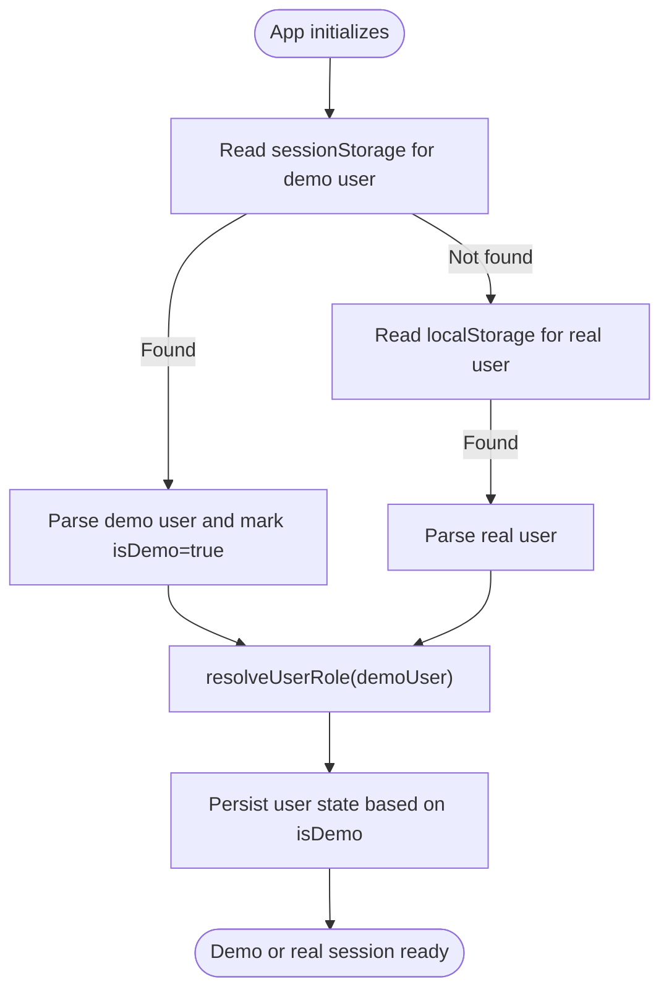
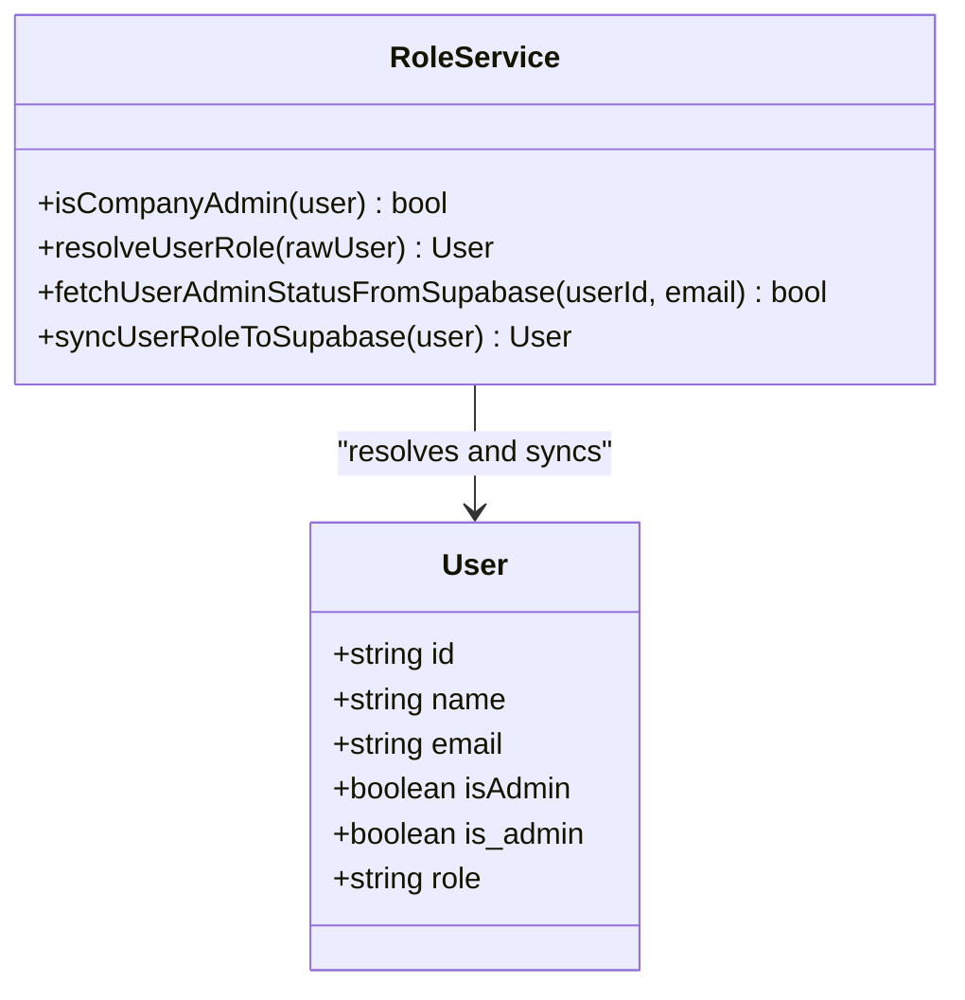
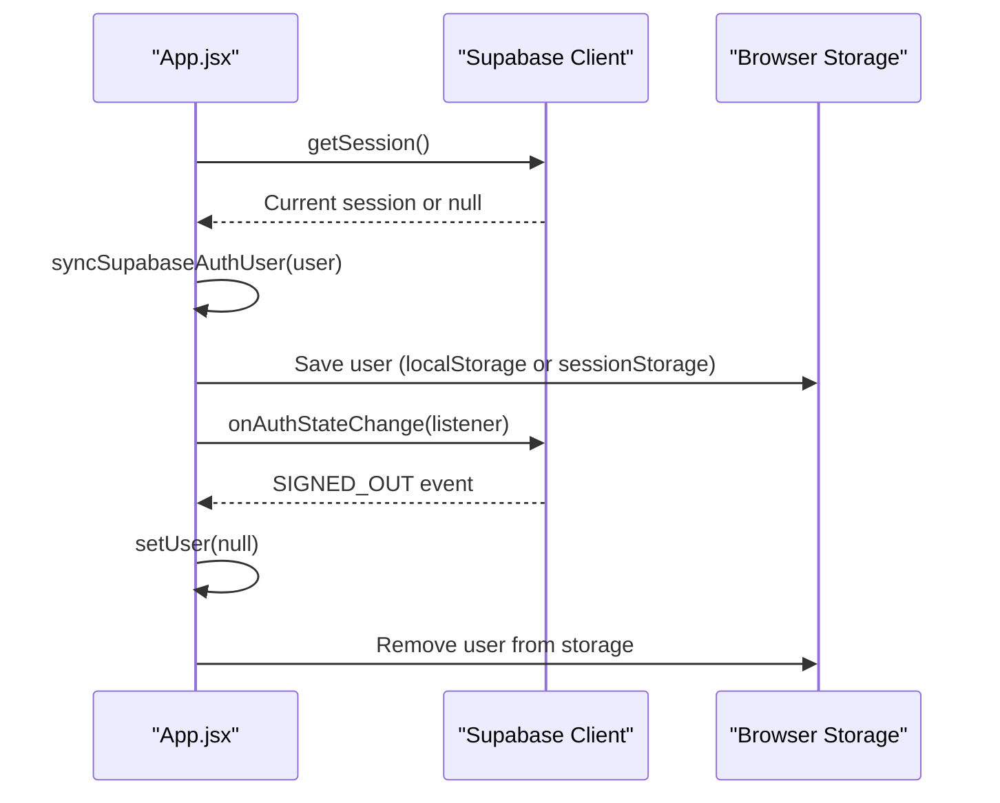
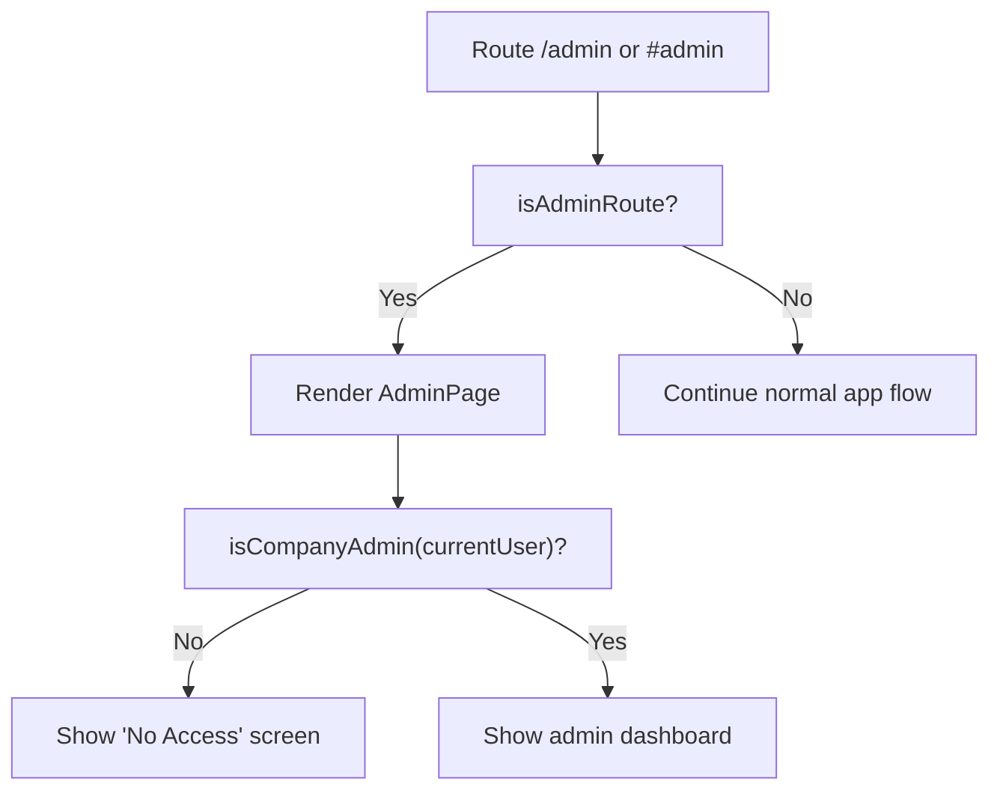
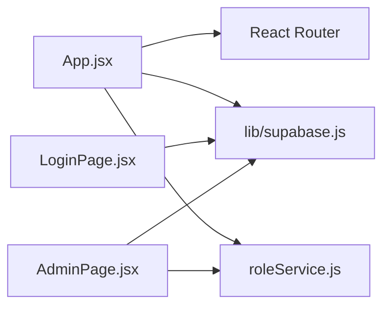

# User Authentication & Management

<cite>
**Referenced Files in This Document**
- [App.jsx](file://src/App.jsx)
- [LoginPage.jsx](file://src/components/LoginPage.jsx)
- [supabase.js](file://lib/supabase.js)
- [supabase.js](file://src/supabase.js)
- [roleService.js](file://src/lib/roleService.js)
- [AdminPage.jsx](file://src/components/AdminPage.jsx)
</cite>

## Table of Contents
1. [Introduction](#introduction)
2. [Project Structure](#project-structure)
3. [Core Components](#core-components)
4. [Architecture Overview](#architecture-overview)
5. [Detailed Component Analysis](#detailed-component-analysis)
6. [Dependency Analysis](#dependency-analysis)
7. [Performance Considerations](#performance-considerations)
8. [Troubleshooting Guide](#troubleshooting-guide)
9. [Conclusion](#conclusion)

## Introduction
This document explains the user authentication and management system for the application. It covers Google OAuth integration through Supabase, demo mode for testing without real authentication, role-based access control with admin privileges, and user session management. It also documents the end-to-end authentication flow from login to component rendering, role validation mechanisms, security considerations, and common debugging approaches.

The system supports two entry points:
- Real authentication via Google OAuth using Supabase Auth.
- Demo mode that simulates a logged-in student without connecting to Supabase Auth.

Administrative features are protected by role checks against a `profiles` table in Supabase, where `is_admin` determines whether a user has admin privileges.

## Project Structure
The authentication-related code is primarily located in the frontend React application:
- Application shell and session synchronization live in the main app component.
- The login page handles Google OAuth initiation and demo login.
- A shared Supabase client is configured in a library module.
- Role resolution and Supabase profile synchronization are centralized in a role service.
- Admin functionality is implemented in an admin page component.

**Diagram sources**
- [App.jsx:22-220](file://src/App.jsx#L22-L220)
- [LoginPage.jsx:298-355](file://src/components/LoginPage.jsx#L298-L355)
- [roleService.js:1-101](file://src/lib/roleService.js#L1-L101)
- [supabase.js:1-14](file://lib/supabase.js#L1-L14)
- [AdminPage.jsx:24-49](file://src/components/AdminPage.jsx#L24-L49)

**Section sources**
- [App.jsx:22-220](file://src/App.jsx#L22-L220)
- [LoginPage.jsx:298-355](file://src/components/LoginPage.jsx#L298-L355)
- [roleService.js:1-101](file://src/lib/roleService.js#L1-L101)
- [supabase.js:1-14](file://lib/supabase.js#L1-L14)
- [AdminPage.jsx:24-49](file://src/components/AdminPage.jsx#L24-L49)

## Core Components
- **Application shell**: Manages user state, integrates Supabase Auth listeners, synchronizes user data, handles login/logout, and routes to protected pages.
- **Login page**: Provides Google OAuth login and a demo login option for quick testing.
- **Supabase client**: Creates and exports a Supabase client using environment variables or fallback values.
- **Role service**: Resolves roles locally and synchronizes user profiles with Supabase, ensuring consistent admin status.
- **Admin page**: Renders administrative controls, lists profiles, toggles admin status, and provides SQL guidance for setting up Row-Level Security and storage policies.

Key responsibilities:
- Session initialization and persistence.
- OAuth redirect handling and cleanup.
- Role normalization (`isAdmin`, `is_admin`, `role`).
- Profile creation and admin flag synchronization.
- Admin-only route protection and UI gating.

**Section sources**
- [App.jsx:34-180](file://src/App.jsx#L34-L180)
- [LoginPage.jsx:310-355](file://src/components/LoginPage.jsx#L310-L355)
- [roleService.js:17-101](file://src/lib/roleService.js#L17-L101)
- [AdminPage.jsx:47-128](file://src/components/AdminPage.jsx#L47-L128)

## Architecture Overview
The authentication architecture combines client-side state management with Supabase Auth and database-driven authorization.

**Diagram sources**
- [LoginPage.jsx:323-355](file://src/components/LoginPage.jsx#L323-L355)
- [App.jsx:93-150](file://src/App.jsx#L93-L150)
- [roleService.js:59-101](file://src/lib/roleService.js#L59-L101)

## Detailed Component Analysis

### Google OAuth Integration
The login page initiates Google OAuth through Supabase. It sets a redirect URL, configures query parameters, and handles errors. On successful callback, Supabase emits an auth state change event, which the app listens to and processes.

Important behaviors:
- Redirect URL uses the current origin and path.
- Query parameters include offline access and account selection prompts.
- Error messages are extracted from hash or search parameters.
- After sign-in, the app normalizes user metadata and identity data.
- The app clears OAuth tokens from the URL for cleanliness.

**Diagram sources**
- [LoginPage.jsx:310-355](file://src/components/LoginPage.jsx#L310-L355)
- [App.jsx:125-150](file://src/App.jsx#L125-L150)

**Section sources**
- [LoginPage.jsx:310-355](file://src/components/LoginPage.jsx#L310-L355)
- [App.jsx:125-150](file://src/App.jsx#L125-L150)

### Demo Mode Functionality
Demo mode allows testing the application without real authentication. It creates a simulated user object marked as a demo user and stores it in session storage. The app distinguishes between demo users and real users when persisting state.

Key characteristics:
- Demo user is stored in `sessionStorage`.
- Real user is stored in `localStorage`.
- Demo mode bypasses Supabase Auth but still runs role resolution.
- Demo mode is intended for local development and quick testing.

**Diagram sources**
- [App.jsx:34-55](file://src/App.jsx#L34-L55)
- [App.jsx:78-90](file://src/App.jsx#L78-L90)
- [roleService.js:17-28](file://src/lib/roleService.js#L17-L28)

**Section sources**
- [App.jsx:34-90](file://src/App.jsx#L34-L90)
- [roleService.js:17-28](file://src/lib/roleService.js#L17-L28)

### Role-Based Access Control and Admin Privileges
Roles are normalized into a consistent shape containing `isAdmin`, `is_admin`, and `role`. Admin status is determined by Supabase profiles rather than hardcoded accounts. The role service ensures that new users default to non-admin and existing users retain their admin status.

Security notes:
- Admin checks use both `isAdmin` and `is_admin` fields for compatibility.
- Profile synchronization inserts a new profile with `is_admin = false` for new users.
- Admin-only features check `isCompanyAdmin(currentUser)` before rendering.

**Diagram sources**
- [roleService.js:1-101](file://src/lib/roleService.js#L1-L101)

**Section sources**
- [roleService.js:1-101](file://src/lib/roleService.js#L1-L101)
- [AdminPage.jsx:47-49](file://src/components/AdminPage.jsx#L47-L49)

### User Session Management
The app manages sessions by:
- Listening to Supabase Auth events.
- Synchronizing the authenticated user into local app state.
- Persisting user state to storage based on whether it is a demo or real session.
- Handling logout by signing out from Supabase and clearing local state.

**Diagram sources**
- [App.jsx:93-150](file://src/App.jsx#L93-L150)
- [App.jsx:170-180](file://src/App.jsx#L170-L180)
- [App.jsx:78-90](file://src/App.jsx#L78-L90)

**Section sources**
- [App.jsx:93-180](file://src/App.jsx#L93-L180)
- [App.jsx:78-90](file://src/App.jsx#L78-L90)

### Protected Routes and Admin-Only Features
The app renders the admin page only when the current route indicates admin access. The admin page itself enforces role checks before showing administrative controls. Non-admin users see an access-denied screen.

Behavior highlights:
- Admin route detection includes path and hash-based flags.
- Admin page reads the current user from props or local storage.
- Admin page rejects non-admin users early.
- Admin page provides SQL scripts to set up profiles, triggers, Row-Level Security, and storage policies.

**Diagram sources**
- [App.jsx:217-221](file://src/App.jsx#L217-L221)
- [AdminPage.jsx:47-49](file://src/components/AdminPage.jsx#L47-L49)
- [AdminPage.jsx:282-352](file://src/components/AdminPage.jsx#L282-L352)

**Section sources**
- [App.jsx:217-221](file://src/App.jsx#L217-L221)
- [AdminPage.jsx:47-49](file://src/components/AdminPage.jsx#L47-L49)
- [AdminPage.jsx:282-352](file://src/components/AdminPage.jsx#L282-L352)

## Dependency Analysis
The authentication system depends on:
- React Router for navigation and route-based rendering.
- Supabase JS client for authentication and database operations.
- Local browser storage for demo and real user state persistence.
- Role service for consistent role normalization and profile synchronization.

**Diagram sources**
- [App.jsx:1-18](file://src/App.jsx#L1-L18)
- [LoginPage.jsx:1-4](file://src/components/LoginPage.jsx#L1-L4)
- [AdminPage.jsx:1-22](file://src/components/AdminPage.jsx#L1-L22)
- [supabase.js:1-14](file://lib/supabase.js#L1-L14)

**Section sources**
- [App.jsx:1-18](file://src/App.jsx#L1-L18)
- [LoginPage.jsx:1-4](file://src/components/LoginPage.jsx#L1-L4)
- [AdminPage.jsx:1-22](file://src/components/AdminPage.jsx#L1-L22)
- [supabase.js:1-14](file://lib/supabase.js#L1-L14)

## Performance Considerations
- Avoid unnecessary re-renders by keeping user state minimal and derived fields normalized once during sync.
- Debounce frequent storage writes if needed; currently, storage updates occur on user changes.
- Prefer server-side authorization (Supabase RLS) over client-only checks for sensitive operations.
- Keep OAuth redirect logic simple to reduce navigation overhead.
- Use lazy loading for admin features if the admin UI becomes large.

[No sources needed since this section provides general guidance]

## Troubleshooting Guide

Common issues and debugging steps:

- **Google OAuth fails immediately**:
  - Verify Supabase client configuration and environment variables.
  - Check network requests to Google OAuth endpoints.
  - Inspect error parameters in URL hash or search string.

- **Redirect loop after Google sign-in**:
  - Ensure the redirect URL matches the application origin and path.
  - Confirm Supabase Auth redirect settings allow the domain.
  - Clear cached tokens and try again.

- **Admin page shows access denied**:
  - Confirm the user exists in the `profiles` table.
  - Verify `is_admin` is set to true for the intended account.
  - Run the provided SQL script to create profiles and enable RLS.

- **Storage write permissions blocked**:
  - Use the admin page’s storage test button to diagnose permission issues.
  - Apply the storage policy SQL snippet to allow admin writes.
  - Confirm the bucket name matches the policy.

- **Demo mode not persisting across tabs**:
  - Remember demo state is stored in session storage and does not survive tab closure.
  - Use real authentication for cross-tab persistence.

- **Logout does not clear local state**:
  - Ensure `handleLogout` signs out from Supabase and removes local storage entries.
  - Refresh the page to verify clean state.

**Section sources**
- [LoginPage.jsx:310-355](file://src/components/LoginPage.jsx#L310-L355)
- [App.jsx:170-180](file://src/App.jsx#L170-L180)
- [AdminPage.jsx:50-93](file://src/components/AdminPage.jsx#L50-L93)
- [AdminPage.jsx:269-276](file://src/components/AdminPage.jsx#L269-L276)

## Conclusion
The authentication and management system combines Google OAuth via Supabase with client-side session management and database-driven role enforcement. Demo mode enables rapid testing without real credentials. Role-based access control relies on Supabase profiles, with admin privileges explicitly managed through `is_admin`. The admin interface provides operational tools and SQL guidance to configure secure database policies. For production deployments, prioritize server-side authorization, validate all redirects, and keep sensitive configuration out of client code.

[No sources needed since this section summarizes without analyzing specific files]